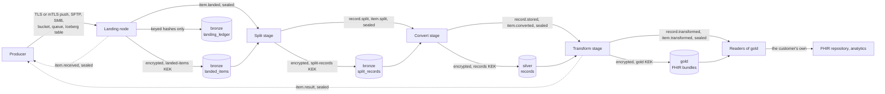

# Data flows: where PHI is, and in what form

Status: **Draft for review** · Date: 2026-11-24 · Document D5 of [HIPAA.md](HIPAA.md) §11.2 (§8.2 item 5).
Companion to [HIPAA-OPERATIONS.md](HIPAA-OPERATIONS.md). **It is not legal advice.**

This document is for the customer's security official. It lists every place a pipeline keeps or sends data, and
for each one says whether PHI is there and in what form. Use it for:
- **the risk analysis** (§ 164.308(a)(1)(ii)(A)): each row below is an asset, with the threat that matters for it;
- **the asset inventory, and accountability for media and backups** (§ 164.310(d)(2)(iii)–(iv));
- **breach assessment** (Subpart D): whether what was exposed was secured PHI (HIPAA.md §5).

It describes one pipeline as `deploy/reference/` sets it up: a database, buckets, keys and topics of its own
(HIPAA-OPERATIONS.md §2.8). Where a deployment differs, the security official adds the difference to the
inventory.

## 1. The forms data takes

| Form | What it means | Who can read it |
|---|---|---|
| **Plain PHI** | Readable content: a document, a record, a FHIR bundle | Whoever holds it |
| **Encrypted** | AES-256-GCM under a data key, with the data key wrapped by a KEK in the KMS (DESIGN.md §7.2). Each table has its own KEK | Someone with the table's ciphertext **and** the right to ask the KMS to unwrap with its KEK |
| **Sealed** | A JWE (`ECDH-ES+A256KW` or `RSA-OAEP-256`, then `A256GCM`) to one recipient's public key. Messages are also signed inside it (JWS, ES256) | Only the holder of that recipient's private key |
| **Keyed hash** | HMAC-SHA-256 under the pipeline's ID key (DESIGN.md §7.3): record IDs, the ledger's source references, message keys | No one can get content back from it. Guessing content to compare needs the ID key, which is held wrapped and only in the stages' memory |
| **Plain digest** | SHA-256 with no key | No content comes back from it, but someone who can guess the whole content can confirm the guess (§6) |
| **Identifiers and metadata** | UUIDs, sequence numbers, sizes, times, counts, intake and stage names, error codes, positions in a file | No PHI by design (DESIGN.md §1, §7.5). Some of it says something *about* an item (§5) |

Under HHS's breach guidance (74 FR 42742), PHI that is encrypted or sealed, with its keys not exposed alongside
it, is secured PHI. Keyed hashes and identifiers aren't PHI. A plain digest isn't either, except where the
content can be guessed (§6).

## 2. The flow

Beside every stage: one Postgres database for the pipeline (catalog, registries, fail stores, control state, audit
journal), the KMS, and an OpenTelemetry collector that sends audit events to the customer's SIEM. None of them
holds plain PHI (§3.2, §3.4, §3.5). The last stage that is configured sends `item.result` (STAGES.md §17.5).

## 3. Where PHI is

### 3.1 The stages, while they work

Each stage holds the PHI it is working on **in plain text in its process memory**. It also holds the keys it
works with: unwrapped data keys, its inbox private key, the ID key, its signing key, and short-lived cloud
credentials. Nothing in memory is written to disk: no swap the product controls, no heap or core dumps, a
read-only root filesystem, and `/tmp` holds only ciphertext. HIPAA-OPERATIONS.md §2.9 sets out the exposure, what
the product does about it, what the customer does, and the residual risk to record.

| Stage | Reads (and unwraps with) | Holds in memory, in plain | Writes | Sends |
|---|---|---|---|---|
| **Landing** (one active pod per intake, and a standby) | The producer's data, over the intake's transport | The item's bytes as they stream into 8 MiB chunks; never the whole item. A push body is never held whole or written to disk | `landed_items` (landed-items KEK); `landing_ledger`; its checkpoint | `item.landed` to split; `item.received` to the producer; the push receipt |
| **Split** (pods by item) | `landed_items` (landed-items KEK) | The item being split, a chunk at a time, and the records it cuts | `split_records` (split-records KEK); its inbox of `item.landed` messages | `record.split`, `item.split` to convert |
| **Convert** (pods by record) | `split_records` (split-records KEK) | Each record and its JSON conversion | `records` (records KEK) | `record.stored`, `item.converted` to transform |
| **Transform** (pods by record) | `records` (records KEK) | Each JSON record and its FHIR bundle | gold (gold KEK) | `record.transformed`, `item.transformed` to readers; `item.result` to the producer |
| **Admin and control pods** (each stage's control Deployment, and `kubectl exec` commands) | What the command needs, with the stage's rights | Only for the commands that write PHI out: `restore`, `patients`, `failures export`, and corrections | What the command changes (§3.4) | Results sealed to an operator's key (§4.3) |

The stage names hold for the C-CDA pipeline. Other pipelines have the same stages, with a different format and
WSTL set.

### 3.2 The object store: bronze, silver and gold

Every table is Iceberg on Parquet, in the pipeline's buckets. The data columns are encrypted at the application,
under the table's KEK. The store's own encryption (SSE-KMS, CMEK) is a second layer beneath, where the store has
one. **Object names and paths hold no PHI:** they are made of table names, UUIDs and hashes (DESIGN.md §1, §8.2).

| Table | Layer | PHI, and its form | Plain columns (no PHI) |
|---|---|---|---|
| `landed_items`, chunk rows | bronze | **The item exactly as received:** encrypted | item ID, chunk index, wrapped data key, KEK ref, batch ID, landing day |
| `landed_items`, summary row | bronze | **The original file name or path, the producer's reference, broker message IDs and what each replaces:** encrypted (`original_name_enc`, `message_refs_enc`, `message_replaces_enc`) | intake, kind, size, chunk count, keyed item digest, keyed source reference, source size and version, start time, the item it replaces, message offsets, keyed message keys; `item_sha256` is a plain digest (§6) |
| `landing_ledger` | bronze | None | keyed source references, sizes, modification times or versions, keyed digests, `item_size`, `item_sha256` (a plain digest, §6) |
| `split_records` | bronze | **Each record as cut, in its original form:** encrypted | record ID (keyed), item ID, seq, chunk index and count, offset and length in the item, format, lengths, line and column, error code |
| `records` | silver | **Each record converted to JSON**, or in its original form with the error that stopped conversion: encrypted | as `split_records`, with content type and mapping |
| gold (`<pipeline>_fhir`) | gold | **One FHIR bundle per record:** encrypted | as `records`, and `confidentiality`, the most restrictive v3 confidentiality code in the bundle (§5) |
| Table metadata and manifests | all | None | file paths, row counts, column statistics. A binary column's statistics keep its first 16 bytes; for `ciphertext` those are the nonce and the start of the ciphertext, so no PHI |

**What is left behind that a reader doesn't see:**
- **Chunks of an unfinished item** (a push that broke off, an item that changed while it was read) stay in
  `landed_items`, encrypted, with no summary row, until retention removes their day (DESIGN.md §5.3.2).
- **Older versions of every object.** Versioning is required (the `store-versioning` check), so a purged or
  rewritten file stays as a noncurrent version for the window the customer keeps (HIPAA-OPERATIONS.md §7). It
  stays encrypted under the same KEK, so destroying the KEK destroys it too (§8 there).
- **Replicas and backups** that the customer makes of the buckets, in other regions or accounts.

### 3.3 Messages on the broker

Every message body is **sealed** to its recipient, and signed by the pod that sent it. Only four things are in
plain on the broker: the message ID, the type, the item ID and the content type `application/jose`
(DESIGN.md §10.1). The partition key is the record ID (keyed) or the item ID. Message IDs are built from those
IDs, generations and counts. Topic names are `<pipeline>.<queue>`.

| Message | Sealed to | What is inside |
|---|---|---|
| `item.landed` | the split stage | IDs, intake, kind, size, keyed digest, where the item is stored. No content |
| `record.split`, `record.stored`, `record.transformed` | the next stage, or the readers of gold | IDs, places in the item, format, lengths, where the record is stored, lineage. **No content:** a reader fetches the record from the table and decrypts it with the KEK |
| `item.split`, `item.converted`, `item.transformed`, `item.progress` | the next stage, or the readers | counts, versions, completion. No content |
| `item.reprocess`, `record.reprocess` | the stage itself | the input message, with a run ID |
| `item.received`, `item.result` | the producer | IDs, counts, status, and each problem's code, stage, seq, offset, line and column, with the producer's references for the item and its messages. **The producer's references are the one thing here that may name a person**, if the producer puts one in a file name or a correlation ID; that is why they are encrypted in landing and sealed here |

A message can't be read without its recipient's private key, so a copy of the broker's disks or a topic exposes no
PHI. Kafka still needs TLS and ACLs (HIPAA-OPERATIONS.md §2.6): they authenticate clients and keep the
metadata above from being read off the network.

### 3.4 The pipeline's database

One Postgres database per pipeline (`sdh_<pipeline>`). **It holds no plain PHI.** The few columns that may hold
content, or text an operator wrote about content, are encrypted under the stage's KEK, each with its own data key.

| Tables | What they hold | PHI, and its form |
|---|---|---|
| Iceberg JDBC catalog | each table's current metadata file | None |
| Leases, checkpoints, the append queue, commit turns | owners, epochs, positions, Iceberg manifests waiting to commit | None |
| Stage registries: records, items, watermarks | each record's state, owner, keyed record ID, output digest (§6), version, message ID and key, and the message waiting to be sent, **sealed** | None in plain. The waiting message is sealed, as on the broker |
| Fail stores: `stage_failure`, `stage_failure_event` | each failure's code, place, state, who changed it and when | **The reason given for a decision** (decline, reopen, release): encrypted |
| Corrections: `stage_correction` | each correction's state, who sent it, the record it made | **The corrected content:** encrypted |
| Reprocess runs, releases, hold releases | selectors, versions, states, outcomes, counts | **The operator's reason:** encrypted |
| Control state, operations, idempotency answers, purge requests | pauses, KEKs in force, re-keys, retention, erasures; who asked, approvals, tickets, results as counts | None. Reasons and tickets are checked to 1–200 letters, digits, spaces and `. , : _ - # /` (§6) |
| Control results | a plaintext break-glass result, held for one fetch | **Plain PHI, encrypted** under the stage's KEK, deleted once fetched or expired (CONTROL-API-DESIGN.md) |
| Operator keys | each principal's sealing public key, its fingerprint, who registered it | None (public keys only) |
| Audit journal: chains, events, seals | every audit event, hash-chained | None: IDs, codes, counts, operator names and key fingerprints, never content or patient identifiers |

The database's backups (WAL archive, snapshots, base backups) hold the same, and need the same protection: they
hold the encrypted columns above, and the catalog that says where every table's files are.

### 3.5 Keys

Where the keys are is what makes the encrypted forms above secured. D3 (key management architecture) covers them
in full; for the inventory:

| Key | Where | Opens |
|---|---|---|
| KEKs: landed items, split records, records, gold (one each per pipeline) | The KMS. They never leave it | That table's data keys, and so its rows, versions and backups |
| ID key | Wrapped, in a table property; plain only in the stages' memory | Nothing. It makes keyed hashes |
| Each stage's signing key | The KMS, or an encrypted PEM in a Secret | Nothing. It signs messages |
| Each stage's inbox key pair | Private key in a Secret, mounted in the stage's pods | The messages sealed to that stage |
| Producers' and readers' key pairs | Their private keys stay with them; the stages hold public keys | The messages sealed to them |
| Operators' key pairs | Private keys on the operators' managed workstations, never on the cluster (HIPAA-OPERATIONS.md §2.3) | Exports, lookups and restores sealed to them |

### 3.6 Logs, metrics, traces and audit events

**No PHI by design:** no document values, file names, paths, object keys, producer references or exception messages
from parsers (DESIGN.md §7.5, §12). Errors are stable codes with offsets and sequence numbers. Telemetry
attributes go through an allow-list. Camel's body logging, tracing and message history are off. The SFTP and SMB
libraries' own logging is off, because their messages hold paths.

The exceptions to know about:
- **Sealed output on standard output.** `restore`, `patients` and `failures export` print their result as sealed
  JWE on lines starting `sdh-export: ` (HIPAA-OPERATIONS.md §2.3). Pod logs, and the log store that keeps them,
  then hold sealed PHI. It can be read only with the operator's private key, but it is in the inventory.
- **Readers' audit.** Each application that reads gold audits each record it opens (`reader.record_read`), in its
  own log or journal: record IDs, reader, purpose. No content.
- **The support bundle** (`support-bundle`, P5) holds settings with secrets removed, health, versions and recent
  operations. No PHI. The customer reads it before sending (HIPAA-OPERATIONS.md §9).

### 3.7 Outside the pipeline

These are in the inventory too, but they are the customer's, or the producer's:

| Where | What |
|---|---|
| **The producers' sources** | The originals, until the intake deletes, moves or renames them (`read-write`), or for good (`read-only`) |
| **Readers of gold, and what they load** | Plain PHI once decrypted: the FHIR repository, analytics, any copy a reader makes. Each reader has the gold KEK and its own key pair (HIPAA-OPERATIONS.md §2.5) |
| **Operators' workstations** | Their private keys, and anything they decrypt there: a restored item, a lookup result, an export (HIPAA-OPERATIONS.md §2.3) |
| **The SIEM and the audit store** | Audit events: no PHI (§3.6) |
| **Configuration management** | Settings and Secrets: keys and credentials, no PHI |
| **The cloud provider** | Every store above, under its BAA. With the KMS beside the stores, the provider could in principle use both, which is why its BAA is needed even though it holds only ciphertext (HIPAA.md §1) |

## 4. What leaves the pipeline, and how

### 4.1 To readers of gold

Through `connector-queue-reader`: a sealed message names each record, and the reader decrypts it from gold with the
gold KEK. Each read is audited with the reader's name and purpose (HIPAA-OPERATIONS.md §2.5). After that, the PHI
is the reader's to protect.

### 4.2 To producers

`item.received`, `item.result` and the push receipt: IDs, sizes, a SHA-256 of what was sent, counts, problem codes
and places, and the producer's own references. Sealed to the producer's key, or, for the push receipt, over the
push's TLS. No content.

### 4.3 To operators

| Command | What it gives | Form |
|---|---|---|
| `restore` | a landed item, or a stage's record | Sealed to the operator's key |
| `restore --plaintext` (break-glass, four eyes) | the same in plain | Through the control API, held encrypted for one fetch; the CLI refuses it under the `hipaa` profile unless waived |
| `patients` | the items and records that carry given identifiers, and those identifiers | Sealed to the reader's key; the identifiers go in on standard input, never in arguments (HIPAA-OPERATIONS.md §4.1) |
| `failures export` | a failed record's input | Sealed to the operator's key |
| `failures`, `status`, `stuck`, `health`, `settings`, the audit commands | states, counts, codes, places | No PHI |

Every one is audited with the operator and the key's fingerprint.

## 5. Plain metadata that says something about an item

None of this is PHI by itself. A security official may still want it in the risk analysis:
- **`confidentiality` on gold rows** says an item holds restricted (R) or very restricted (V) content, without
  saying what. It is in plain so a reader can leave such rows out without decrypting them (minimum necessary). It is
  copied from the source's confidentiality codes; the product adds none.
- **Sizes, counts and times** of items and records, and which intake an item came by. Someone who can link an
  intake and a time to a person from outside (one known submission, a small clinic) learns that something was
  sent, not what.
- **Error codes and their places** (line, column, offset) say what kind of fault a record has, not its content.
- **Operator names, tickets and reasons** in the control state and the audit journal. Their characters are limited
  so they can't hold free text about a document, but a name could still be typed in; the customer's policy forbids
  it (HIPAA-OPERATIONS.md §1).

## 6. Open points found while writing this

- **The stage registries' `output_digest` is a plain SHA-256** of each record's stored output (its JSON or FHIR
  bundle, with its error code and mapping; `RecordStageProcessor.digest`). It is used to tell a duplicate from a
  conflict (STAGES.md §6). For long documents it reveals nothing. For a short record whose every field could be
  guessed, such as one CSV row, someone who can read the registry could confirm a guess, which a keyed hash would
  prevent; record IDs are keyed for exactly this reason (DESIGN.md §7.3). HIPAA-OPERATIONS.md says the registry
  holds no PHI; that holds for C-CDA, and for short records only as long as no one can make that guess.
  **Proposed:** key the digest with the ID key, as record IDs are. Product work, not yet decided.
- **`item_sha256` in landing is a plain SHA-256** of each whole item, by design: the producer can check its
  receipt against what it sent (DESIGN.md §5.3.15). A whole item, or a batch of queue messages, can rarely be
  guessed whole; a push of one short message could. Customers with such intakes should know.
- **Unfinished chunks** stay until retention (§3.2). Removing them sooner isn't built.

## 7. For the risk analysis

List these assets for each pipeline, with the form each holds, from §3:
1. The stages' pods and nodes (plain PHI in memory: HIPAA-OPERATIONS.md §2.9).
2. The bronze, silver and gold buckets, their noncurrent versions, replicas and backups (encrypted).
3. The pipeline's Postgres database and its backups (encrypted columns; keyed hashes; digests).
4. The broker, its disks and any mirror (sealed).
5. The KMS keys, the ID key, and the Secrets holding inbox and signing keys.
6. The log store that keeps pod logs (sealed exports), the SIEM and the audit store (no PHI).
7. Readers of gold and the systems they load (plain PHI, the customer's).
8. Operators' workstations (private keys; decrypted exports).
9. The producers' sources, for as long as originals stay there.

---

**How this was checked (2026-11-24):** against DESIGN.md §1, §5.3, §7, §8, §10 and §18.1, STAGES.md §1, §3,
§17, HIPAA-OPERATIONS.md §2, and the code: the table definitions in `connector-core` and `connector-stage`
(`FailureStore`, `CorrectionStore`, `StageRegistry`, `ControlState`, `ControlStore`, `ControlResults`,
`OperatorKeys`, `ReprocessStore`, `StageReleases`, `HoldReleases`, `AuditTables`, `ItemCheckpoints`,
`QueuedCommits`), `OutboundMessage`, and `RecordStageProcessor.digest`. Not checked by a test: that no plain PHI
reaches the database or the logs at run time. A test that searches them for a synthetic document's values after a
harness run would prove it.
