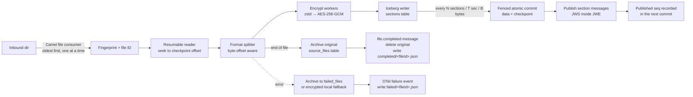

# Healthcare Source Connectors — Design

Status: **Draft for review, spike in progress** · Date: 2026-10-28 · Scope: parent project, `connector-contract`, `connector-core`, `connector-queue-reader`, `file-connector`

Revision 2026-10-28 (b): added the `connector-queue-reader` consumer library and `connector-contract` (§3, §10.2). Replaced the Iceberg-property lease with a Postgres lease plus fencing tokens (§9.3). Folded publish marks into batch commits (§9.2). Made host disk capacity an operator responsibility (§17). Recorded the §16 spike results.

Revision 2026-10-28 (c): built the splitters (§6). Resume uses a `ResumePoint` (offset plus PHI-free context offsets) instead of a bare offset, saved in the checkpoint as `resumeAt` (§6.1, §9.1). Sections are lists of literal parts and source ranges. The FHIR splitter uses a byte-level structural scanner instead of Jackson. Added X12 `GS`/`ISA` boundaries and TA1 handling.

Revision 2026-10-28 (d): built the split phase of the pipeline (§9.4). Multi-chunk sections are read twice (hash, then encrypt) so memory stays at one chunk (§7.2). Commit retries check the checkpoint first so a batch is never appended twice (§9.2). The checkpoint gained `format`, `fileSize` and the `ABANDONED` state (§9.1). Fingerprints and checkpoint MACs use labelled HMACs (§5.1, §9.1). Archiving, failure handling and broker adapters are not built yet.

Revision 2026-10-28 (e): built archiving and failure handling (§4.1, §11). Added the `FAILING` state, so the decision to fail a file is durable before anything else happens. Archive tables keep file-level values on a summary row (§8.2). The digest chain, the local fallback format and the completion order are now specified (§5.1, §11.1, §11.2). Broker adapters and the Camel wiring are not built yet.

Revision 2026-10-28 (f): wired the file connector (§5, §5.2, §10.3, §14). Startup order, the Camel route, the broker adapters and the `local` key provider are built. Found and fixed a Camel default that broke oldest-first pickup (§5, §16). The configuration shape changed in a few places (§14). Cloud KMS providers, admin commands and OpenTelemetry export are not built yet.

Revision 2026-10-28 (g): added the Docker integration suite, which runs on minikube (KVM2) (§15). Running it against real services found five problems, all fixed:
- the Camel Service Bus producer can't set per-message sessions or IDs;
- both Azure clients reorder sends that are in flight together;
- `S3FileIO` needs the AWS `kms` module;
- SeaweedFS 4.x needs S3 identities;
- committed sections could go unannounced when a file failed mid-publish.

See §10.3, §8.1, §11.2 and §16. MinIO images are no longer published, so S3 is tested on SeaweedFS only.

Revision 2026-10-28 (h): built table maintenance (§8.4): retention, compaction, snapshot expiry and orphan-file cleanup, scheduled between files under a writer lock. Retention now purges PHI files in the same run (a marker commit makes the delete expirable). Retention settings moved to `sdh.maintenance.retention` (§14).

Revision 2026-10-28 (i): built observability (§12): OpenTelemetry traces, metrics and audit events, exported over OTLP through PHI filters, and checked end to end against a real collector.

Revision 2026-10-28 (j): built the cloud key providers (§7.4) in a new `connector-kms` module: AWS KMS, Google Cloud KMS, Azure Key Vault and Vault Transit, for wrapping and for ES256 signing. Each is tested against an emulator or, for GCP, a fake KMS (§15.1).

Revision 2026-10-28 (k): built the container image (§14.1) and `ContainerImageIT` (now `ServiceImageIT`), which runs it locked down (read-only root filesystem, noexec `/tmp`, no capabilities, secrets as a Kubernetes-style volume). It found that the packaged app exited right after starting: Camel 4 ignores the old `camel.springboot.main-run-controller` setting, now `camel.main.run-controller`. Key files may now be group-readable (0440), as Kubernetes secret volumes with an `fsGroup` always are (§7.4).

Revision 2026-10-28 (l): built the operator commands `restore`, `decrypt-fallback` and `status` (§11.4). They are read-only, need `SDH_OPERATOR` and audit every run. Restores now always verify the digest, including partial ones. The image's JVM options moved to `/app/jvm.options`, shared with an `sdh-admin` wrapper (§14.1). Recording `replaces_file_id` on resubmission is not built yet.

Revision 2026-10-28 (m): the connector now runs against a real Iceberg REST catalog, Apache Polaris 1.8.0, in `PolarisIT` (§8.1, §15.1). Fencing, ingest, downstream read-back, archive restore, maintenance and the admin `status` command all pass unchanged. The REST catalog settings in §14 now include OAuth and an explicit `rest.auth.type`.

Revision 2026-10-29 (n): built the throughput tests (§13.1, `scripts/perf.sh`). Small sections are bound by per-message public-key crypto, about 0.55 ms of CPU each with a P-256 recipient. Fixed a queueing problem that stalled splitting while the previous batch was sealed: sealing now has its own pool (§13), which made small sections 25–40% faster.

Revision 2026-10-29 (o): sections are now converted to JSON before they are stored (§6.4). The JSON shapes are:
- CSV: an array of fields by position, with the header dropped;
- C-CDA: Google Data Harmonization's XmlToJson style, driven by the CDA schema and checked against Google's own published outputs;
- X12 and EDIFACT: segment and element arrays, with every position kept.

FHIR, generic XML and delimited sections are stored as split. A section that fails conversion is stored in its original form, marked with an error code, and announced with a new `section.failed` message; the file still completes. Also:
- added an EDIFACT splitter (§6.2);
- contract version 2.0 (§10.1);
- three new `sections` columns (§8.2).

Revision 2026-10-29 (v): recorded two support positions (§7.4, §8.1, §15.1, §16, §17). MinIO is not supported unless a customer pays for its support, development and testing. GCP Cloud KMS stays untested against the real service until customer demand requires it.

Revision 2026-10-29 (u): three builds (§14.1, §14.3):
- the **service image**, for our own hosted service only, is the existing Ubuntu/Temurin image;
- the **customer image** is built on a distroless Java 25 base: 25 Debian packages, no shell or package tools, so far less GPL code is redistributed;
- the **distribution tarball** has no Java runtime, so customers can receive nothing from us under the GPL and build their own image.

The JVM options are split into shared files (`src/dist/`). Operator commands work without a shell (`java @/app/admin.args`). `ContainerImageIT` became `ServiceImageIT` and `CustomerImageIT`.

Revision 2026-10-29 (t): license attribution for customer distribution (§14.2). Every jar carries our `LICENSE` and `NOTICE` (proprietary, Smile Digital Health Inc., with the HL7 attribution). The application jar, and so the image and any future distribution archive, also carries `THIRD-PARTY.txt` and the license texts for everything it bundles, generated with `license-maven-plugin` and a `gmavenplus` step adapted from `healthcare-data-harmonization`. The image adds `/app/legal/` and an OS package inventory. Legal review items before the first customer release are listed in §14.2.

Revision 2026-10-29 (s): Google Cloud Storage and Azure Data Lake Storage Gen2 now work: §8.1 listed them, but their Iceberg modules weren't in the build. Added `iceberg-gcp` and `iceberg-azure` with client versions that match the KMS and Camel libraries (§2), and `GcsIT` and `AdlsIT` (§15.1). Orphan cleanup on ADLS remains unverified, because Azurite can't list Data Lake paths (§8.1). Also fixed §8.1, which named a `sdh.storage.io` setting that doesn't exist; storage is chosen with the catalog's `io-impl`.

Revision 2026-10-29 (r): built the directory claim (§9.5): a hidden `.sdh-owner` file ties the inbound directory to one connector, checked at startup and before every file, which closes the gap left by the lease when two connectors use different lease names.

Revision 2026-10-29 (q): documented why only one instance may watch an inbound directory, how the lease prevents it, and the gap when two connectors use different lease names on the same directory (§9.5).

Revision 2026-10-29 (p): measured throughput with JSON conversion (§13.1): 4–15% slower, most for C-CDA. The throughput test runs as a plain Maven profile (`-Pperf`) and as NetBeans custom actions (`nbactions.xml`).

---

## 1. Purpose

Ingest health information files (C-CDA, X12, FHIR, CSV, and proprietary formats) dropped into a directory, split each file into self-contained sections at a run-time-defined boundary, store every section encrypted in Apache Iceberg tables (Parquet data files), and announce each stored section on a run-time-selected message queue with an encrypted, signed message.

The service must:

- Resume after any crash or restart from the exact section where it stopped, including part-way through a file of up to ~1 TB.
- Process every file already in the directory, then keep picking up new ones.
- Never expose PHI in file paths, object names, IDs, queue metadata, logs or telemetry.
- Run as exactly one instance.

`file-connector` is the first of several connectors. Everything that isn't specific to files lives in `connector-core` so later connectors reuse it.

## 2. Technology baseline

All versions were checked against Maven Central on 2026-10-28.

| Component | Version | Notes |
|---|---|---|
| Java | 25 (LTS) | Virtual threads for I/O-bound publishing and KMS calls. HKDF uses the Java 25 `javax.crypto.KDF` API |
| Spring Boot | 4.1.2 | Spring Framework 7.0.x. 4.1 OSS support runs to mid-2027. Only `file-connector` imports the Boot BOM |
| Apache Camel | 4.22.2 (LTS) | Camel pins Spring Boot 4.1.1; the spike confirmed 4.1.2 works (§16) |
| Apache Iceberg | 1.12.0 | No LTS concept; latest stable |
| Apache Parquet | 1.17.1 | The version Iceberg 1.12.0 is built against; pinned to match, not upgraded separately |
| Hadoop (classes only) | 3.4.3 | Six jars, transitive dependencies excluded: `hadoop-common`, `hadoop-mapreduce-client-core`, `hadoop-shaded-guava`, `woodstox-core`, `stax2-api`, `commons-collections4` (§16) |
| Jackson 2 | 2.22.2 | Used by Iceberg only (Spring uses Jackson 3). Pinned in `file-connector`, because Boot 4.1.2 would downgrade it to 2.21.x |
| Nimbus JOSE+JWT | 10.10 | JWS/JWE message encryption and signing |
| PostgreSQL | any supported | Lease store (§9.3). Can be the JDBC catalog's database. Driver 42.7.14, HikariCP (Boot-managed, pool of 2) |
| AWS SDK v2 | 2.50.2 | `s3`, `apache-client` and `kms` for Iceberg's `S3FileIO` (`iceberg-aws`). `kms` is needed even without SSE-KMS: `AwsProperties` loads KMS model classes on startup. Same line as Camel's SQS client, imported as a BOM in the parent POM |
| KMS clients | `google-cloud-kms` 2.98.0, `azure-security-keyvault-keys` 4.10.6, `azure-identity` 1.18.1 | `connector-kms` (§7.4). Chosen to match the versions Camel already brings (gax 2.83, gRPC 1.8x, azure-core 1.57), so nothing shared is upgraded underneath Camel. Vault Transit uses the JDK HTTP client |
| Object storage clients | `iceberg-gcp` + `google-cloud-storage` 2.71.0; `iceberg-azure` + `azure-storage-file-datalake` 12.25.0 + `azure-identity` | For `GCSFileIO` and `ADLSFileIO` (§8.1); Iceberg leaves these clients to the application. Chosen on the same cores as the KMS clients: `google-cloud-storage` 2.71.0 shares `google-cloud-jar-parent` 1.89.0 with KMS 2.98.0 (gax 2.83), and datalake 12.25.0 is built on the `azure-storage-blob` 12.32.0 that Camel's Event Hubs component already brings. `azure-core` is pinned at 1.57.1, because datalake alone would pull it back to 1.57.0 |
| Testcontainers | 2.0.5 | `-Pit` only, run by Failsafe 3.6.1 (§15) |
| OpenTelemetry | 1.62.0 (Boot-managed) | `connector-core` uses the API only; `file-connector` gets the SDK from `spring-boot-starter-opentelemetry` and exports over OTLP/HTTP with its own filtered exporters (§12) |
| Maven | 3.9.16 via Maven Wrapper | The local install is 3.8.7 |
| Spark | **Not used** | |

Where a component has no LTS line (Iceberg, Parquet, Nimbus), we use the latest stable release, with versions managed in the parent POM.

## 3. Project layout

```
healthcare-source-connectors/            groupId com.sdh.healthcare
├── pom.xml                              parent: dependency/plugin management, Java 25, enforcer
├── .gitignore                           excludes build output, IDE files, *.pem, *.key, *.p12, .env
├── mvnw, .mvn/wrapper/                  Maven 3.9.16
├── scripts/                             it-minikube.sh (Docker suite), build-image.sh (service or customer image), perf.sh (throughput), minikube-env.sh (shared),
│                                        cda-model/ (generates the C-CDA converter's schema model, §6.4)
├── docs/DESIGN.md                       this document
├── LICENSE, NOTICE                      our proprietary notice and attributions (HL7), copied into every jar (§14.2)
├── src/license/                         third-party attribution: THIRD-PARTY.txt template, license corrections,
│                                        copyright lines for components that ship none (§14.2)
├── nbactions.xml                        NetBeans custom actions (throughput test, §13.1)
├── connector-contract/                  library jar: the wire contract shared by writers and readers
│   └── com.sdh.healthcare.connector.contract
│       ├── message/      message records, payload codec, contract version
│       ├── jose/         MessageSealer (sign + encrypt), MessageOpener (decrypt + verify)
│       ├── crypto/       KeyProvider SPI, section key derivation, chunk encryption
│       └── table/        sections table schema, partition spec, sort order
├── connector-queue-reader/              library jar for consumers (§10.2); depends on contract only
├── connector-kms/                       library jar: KMS KeyProviders (§7.4); used by file-connector, optional for readers
│   └── com.sdh.healthcare.connector.reader
├── connector-core/                      library jar (no main class)
│   └── com.sdh.healthcare.connector.core
│       ├── split/        SectionSplitter SPI + built-in splitters
│       ├── convert/      SectionConverter SPI + JSON converters (csv, ccda, x12, edifact), CDA schema model
│       ├── crypto/       KMS/local KeyProvider implementations, ID HMAC
│       ├── storage/      Iceberg catalog/FileIO setup, writers, compaction, retention
│       ├── checkpoint/   checkpoint model, lease store, lease keeper, fenced committer
│       ├── publish/      MessagePublisher SPI, OutboundMessage (broker adapters live in the connector app, §10.3)
│       ├── telemetry/    Telemetry facade (spans, audit events, metrics), Attr allow-list, Fields, error codes
│       └── pipeline/     source-agnostic ingest pipeline (read → split → encrypt → write → commit → publish)
└── file-connector/                      Spring Boot application; service image (Dockerfile, §14.1); distribution kit
    │                                    (src/dist, src/assembly) and customer image (§14.3)
    └── com.sdh.healthcare.connector.file
        ├── FileConnectorApplication
        ├── config/       ConnectorProperties (sdh.*), KeyMaterial (local key provider), PEM reading
        ├── runtime/      ConnectorRuntime (startup order), ConnectorConfiguration (Spring wiring), FatalExit,
        │                 MaintenanceScheduler
        ├── route/        InboundRoute (directory discovery)
        ├── ingest/       InboundService (per-file handling, in-progress recovery, backoff)
        ├── publish/      QueueType (broker adapters), CamelMessagePublisher
        ├── telemetry/    OTLP exporters, AllowListSpanExporter, AuditOnlyLogRecordExporter, inbound age gauge
        ├── source/       LocalSourceFile, DirectoryOutcomeRecorder (completed/ and failed/ records, local fallback)
        └── admin/        operator commands: AdminCli (restore, decrypt-fallback, status), §11.4
```

Each module has its own `.gitignore` for module-specific output.

**Why `connector-contract` exists:** the message format, chunk encryption and table layout are written by `connector-core` and read by `connector-queue-reader`. Keeping them in one small module means both sides use the same code, and the reader doesn't pull in Camel, splitters or the pipeline. Consumers depend on `connector-queue-reader` only. They treat `connector-contract` as internal, apart from the message records it defines.

## 4. End-to-end flow



### 4.1 File lifecycle (state machine)

```
DISCOVERED → SPLITTING → ARCHIVING → COMPLETED
                │            │
                └────────────┴──→ FAILING → FAILED
   (source gone while SPLITTING, or ARCHIVING with the archive unfinished) → ABANDONED
```

The state lives in the `sections` checkpoint (§9.1). `FileProcessor` (`connector-core` `pipeline/`) runs the whole lifecycle.

| State | Durable record | Restart behaviour |
|---|---|---|
| DISCOVERED | none | The file is still in the inbound directory, so it is simply picked up again |
| SPLITTING | `sections` checkpoint | Resume at `resumeAt` and continue at `nextSeq`. Republish any committed-but-unpublished sections first |
| ARCHIVING | `sections` checkpoint + archive checkpoint on `source_files` | Continue archiving from the last archived block. If the archive is already done, finish without the source (§11.1) |
| COMPLETED | `completed/<fileId>.json`; original deleted | Nothing to do |
| FAILING | `sections` checkpoint with stage, error code and offset; archive checkpoint on `failed_files` | Finish failing the file; never retry splitting it |
| FAILED | `failed/<fileId>.json` (+ `failed/<fileId>.enc` if fallback was used) | Nothing to do; operators take over |
| ABANDONED | `sections` checkpoint | Nothing to do; `file.abandoned` was logged |

**Startup (for the file connector):** if `FileProcessor.inProgress()` returns a checkpoint, fingerprint the inbound files and `process()` the match first. If there is no match, call `recoverWithoutSource()`.

Files are processed **one at a time, oldest first**. This keeps ordering predictable and resume logic simple, and the work within a single file is already parallelised (§7).

## 5. Directory handling (Camel)

- **Consumer:** `camel-file` watches `sdh.file.inbound-dir`, non-recursive, with `sortBy=file:modified`, `maxMessagesPerPoll=1` and **`eagerMaxMessagesPerPoll=false`**. Without the last option Camel applies the one-file limit while scanning, before sorting, so "oldest first" depended on directory order. The spike route had this bug; the application test caught it.
- **Re-offering:** `noop=true` and `idempotent=false`, so a file that couldn't be handled (for example, storage was down) is offered again on the next poll. Successful files are deleted by the processor, so they aren't seen twice.
- **Partially written files:** a configurable read lock (`changed` by default) waits until the file size and modification time stay unchanged for `min-age`. With `read-lock: marker` the route waits for `<name>.done`, and the marker is deleted together with the original. `include` is an Ant-style pattern; hidden files are never picked up.
- **Subdirectories:** `completed/` and `failed/` sit inside the inbound directory and are excluded from pickup.
- **One connector per directory:** pickup takes no lock that another process would see, so the directory is claimed by one connector through a hidden `.sdh-owner` file, checked at startup and before every file (§9.5).
- **Startup:** if a checkpoint records an in-progress file, that file is processed before anything else. It is matched by fingerprint, not name (size first, so only same-size files are hashed). If the file has disappeared, `FileProcessor.recoverWithoutSource()` finishes it if its archive is complete, or else raises `file.abandoned` and closes the checkpoint. The route is defined with `autoStartup(false)` and is started only after this recovery. The same check runs before every file, so a file left in progress by an earlier error is always finished first.
- **Completion:** Camel's own move/delete options are switched off. The pipeline moves and deletes files itself, because a file is only finished once archiving has been committed.
- **Finished-file records:** `completed/<fileId>.json` and `failed/<fileId>.json` contain no PHI: file ID, timestamps, section count, byte count, keyed file digest, and for failures the stage, offset and error code. The original filename never appears in either directory.

### 5.1 File identity

| Identifier | Definition | Purpose |
|---|---|---|
| `fileId` | UUIDv7, assigned at pickup and saved in the checkpoint | Correlates queue messages, telemetry and tables |
| fingerprint | size + `HMAC(idKey, "sdh-fingerprint" ‖ 0 ‖ first 1 MiB ‖ last 1 MiB)` | Recognises the same file after a restart without reading all of it |
| `fileDigest` | `base32` of a chained HMAC-SHA-256 over fixed 64 MiB blocks, computed during archiving | Integrity value sent in `file.completed` |

The digest is chained, `H_i = HMAC(idKey, "sdh-file-digest" ‖ 0 ‖ H_{i-1} ‖ block_i)` with `H_{-1}` = 32 zero bytes, so a restart only needs the last `H` value and the block number, both of which are saved in the archive checkpoint. An empty file is one empty block. The digest depends only on content, not on `fileId` or how the archive was committed.

### 5.2 Process lifecycle

`ConnectorRuntime` starts in a fixed order:
1. **Validate configuration:** splitter options, queue type and URI, and key material, before touching storage.
2. **Acquire the lease:** if another instance holds it, startup fails with `LEASE_HELD` and a non-zero exit.
3. **Claim the inbound directory** (§9.5): if another connector owns it, startup fails with `INBOUND_DIR_CLAIMED`, the lease is released, and the process exits non-zero.
4. **Open storage:** open the catalog and create or load the three tables.
5. **Fence:** fence every table with this instance's epoch.
6. **Load keys:** unwrap or create the ID key.
7. **Build the pipeline:** pipeline, archivers and `FileProcessor`.
8. **Start pickup:** run in-progress recovery (§5), then start the route.

Shutdown runs in reverse. The route is stopped first, so no file is in flight when the lease is released.

**Errors per file** (`InboundService`):
- **Fatal errors** (lease loss, unknown commit outcome, tampered checkpoint, broken invariant, the directory claimed by another connector, any `Error`): `FatalExit` logs a PHI-free reason and the process exits with status 70.
- **Anything else:** the file is left in place and the route thread sleeps with exponential backoff (from `retry.initial-backoff`, capped at 5 min), which pauses the pipeline. The next poll tries again.

Nothing in this path logs a path or filename.

## 6. Splitting

### 6.1 SPI

Package `com.sdh.healthcare.connector.core.split`; built-ins in `split.builtin`.

```java
public interface SectionSplitter {
    String format();                                  // e.g. "ccda"
    default void validate(SplitConfig cfg) {}         // called at startup: bad config fails the service, not a file
    SplitSession open(SeekableByteSource src, ResumePoint from, SplitConfig cfg) throws IOException, SplitException;
}
public interface SplitSession extends AutoCloseable {
    Optional<Section> next() throws IOException, SplitException;
}
record Section(long sourceOffset, long sourceLength, List<Part> parts, ResumePoint resume)  // Part = Literal(bytes) | SourceRange(offset, length)
record ResumePoint(long offset, List<Long> context)
```

- **Byte ranges:** a section is a list of **parts**: source byte ranges plus small synthesised literals (a CSV header, an X12 envelope, an XML declaration or a rewritten root start tag) that make it self-contained. Splitters never hold section bytes in memory; `Section.open(src)` streams the plaintext. Sections are capped by `max-section-bytes`.
- **Resume:** every section carries the `ResumePoint` after it, and `open` must accept `ResumePoint.START` or any of these and produce exactly the sections that followed. `context` holds **source offsets only** of structures the splitter re-reads on resume: the enclosing ISA and GS segments for X12, and the open ancestor start tags for XML (for in-scope namespaces). Offsets carry no PHI, so the resume point can live in the checkpoint (§9.1). File-start context (CSV header, XML declaration, FHIR array-or-stream) is re-read from offset 0.
- **Limits:** `SplitterRegistry.open(format, src, from, nextSeq, cfg)` wraps the session and enforces §6.3, counting sections from `nextSeq` so the per-file count survives a resume. Splitters also stop scanning early once a section passes `max-section-bytes`.
- **Errors:** `SplitException` carries only an `ErrorCode` and a byte offset. Codes: `PARSE_UNTERMINATED_QUOTE`, `PARSE_UNBALANCED_ELEMENT`, `PARSE_XML_MALFORMED`, `PARSE_XML_UNSUPPORTED_ENCODING`, `PARSE_X12_INVALID_ENVELOPE`, `PARSE_X12_UNBALANCED`, `PARSE_X12_CONTROL_MISMATCH`, `PARSE_X12_UNEXPECTED_SEGMENT`, `PARSE_JSON_MALFORMED`, `PARSE_FHIR_UNEXPECTED_RESOURCE`, `RESUME_INVALID`, `LIMIT_*`.
- **Plug-ins:** new formats are discovered via `ServiceLoader` (proprietary formats can be dropped in as a jar).

### 6.2 Built-in splitters

The format and boundary are both set at run time.

| `format` | Default boundary | Behaviour |
|---|---|---|
| `ccda` / `xml` | `ccda`: element `ClinicalDocument`, ns `urn:hl7-org:v3`. `xml`: boundary required, `namespace` defaults to `*` (any) | Byte-level streaming XML tokenizer that ignores comments, CDATA, processing instructions and DOCTYPE. A section runs from the boundary start tag to its matching end tag; a nested boundary element stays inside the outer section. Namespace declarations in scope from ancestor elements are copied onto the section's root element, and the file's XML declaration is prepended, so every section is a valid standalone document. End tags are checked against start tags. Input must be ASCII-compatible (UTF-8, ISO-8859-x); UTF-16 fails with `PARSE_XML_UNSUPPORTED_ENCODING`. Entities from a DOCTYPE internal subset are not carried into sections. |
| `x12` | segment `ST` (also `GS` or `ISA`) | Delimiters are read from each ISA segment. `ST`: each section is `ISA + GS + ST…SE + GE + IEA`, with GE01 and IEA01 rewritten to 1. `GS`: `ISA + GS…GE + IEA`, IEA01 = 1. `ISA`: the interchange unchanged. A TA1 between ISA and GS becomes `ISA + TA1 + IEA` (IEA01 = 0), so nothing is dropped. Control numbers ST02/SE02, GS06/GE02 and ISA13/IEA02 are checked. BIN segments are not supported. |
| `fhir` | `Bundle` (`*` = any `resourceType`) | Byte-level structural JSON scanner (strings, escapes, bracket nesting) that checks each top-level object's `resourceType`. Jackson was dropped because it can't restart mid-array at a byte offset; full JSON validation is left downstream. Accepts a single resource, a JSON array, or NDJSON / whitespace-separated objects. Optional `fhir.ndjson-group-size` = N groups N resources per section (boundary then defaults to `*`); grouped array sections are wrapped in `[ ]`. |
| `edifact` | message `UNH` (also `UNG` or `UNB`) | Delimiters come from each interchange's `UNA` service string advice, or the ISO 9735 defaults; the release character is honoured. `UNH`: each section is `[UNA] UNB [UNG] UNH…UNT [UNE] UNZ`, with the UNE and UNZ counts rewritten to 1. `UNG`: one functional group per section; messages outside a group are one section each. `UNB`: the interchange unchanged. Control references UNH/UNT, UNG/UNE and UNB/UNZ are checked; segment counts aren't. |
| `csv` | record | RFC 4180 record boundary (newlines inside quotes are respected). `csv.header=true` prepends the first record to every section; `csv.delimiter` (default `,`). Empty lines are skipped. Content is otherwise not interpreted. |
| `delimited` | regex (`delimited.pattern`, or `delimited.literal=true`) | Generic fallback for proprietary formats. `mode = START \| END \| SEPARATOR` controls whether a matching line begins a section, ends one, or is dropped. Each line is decoded (`delimited.charset`, default UTF-8) and tested with `find()` on its first `delimited.match-window` bytes (default 4096). Blank lines never start a section. In START mode, lines before the first match form their own section. |

### 6.3 Limits

These are configurable per format. A violation fails the file with error code `LIMIT_*`.

| Limit | Default |
|---|---|
| `max-file-bytes` | csv 10 GiB; others 1 TiB |
| `max-section-bytes` | 512 MiB (well under Parquet's 2 GiB value limit) |
| `max-sections-per-file` | unlimited |

A file over `max-file-bytes` is rejected **before ingestion**. It is moved to the encrypted local `failed/` fallback and is not stored in Iceberg.

### 6.4 Conversion to JSON (built)

After splitting, each section is converted to JSON and the JSON is what is stored, encrypted and announced. Converters are found by format (`SectionConverter`, loaded with `ServiceLoader` like the splitters) and run on the encrypt worker pool. `sdh.split.convert: false` turns conversion off.

| Format | Mapping | JSON |
|---|---|---|
| `csv` | `csv-row/1` | The record's fields by position: `["1","Doe, Jane","","two\nlines"]`. RFC 4180 quoting; values kept exactly (no trimming, no type inference, empty is `""`). With `csv.header=true` the header is dropped |
| `ccda` | `ccda/1` | Google Healthcare Data Harmonization XmlToJson style (below) |
| `x12` | `x12/1` | `{"format":"X12","segments":[{"segment_id":"NM1","elements":["41","2","SAMPLE CLINIC","","",…]}]}`. Every segment, envelopes too; empty elements and spaces kept so positions are stable; composites stay one string (`"HC:99213:25"`) |
| `edifact` | `edifact/1` | `{"format":"EDIFACT","segments":[{"segment_id":"DTM","elements":[["137","20261028","102"]]}]}`. Each element is its list of components; release characters applied; empty elements and components kept. The character set comes from UNB S001 (UNOA/UNOB ASCII, UNOC–UNOK ISO 8859, UNOW/UNOY UTF-8) |
| `fhir`, `xml`, `delimited` | — | Stored as split: FHIR is already JSON; the others have no agreed mapping |

The X12 and EDIFACT shape follows common EDI-to-JSON converters (hub.actionedi.com). Those converters drop empty elements, delete spaces inside values and mishandle the EDIFACT release character, which would break mapping by position, so we don't follow them there.

**C-CDA, following Google's XmlToJson.** Google's tool binds the document to the CDA schema and writes it as nested JSON. Ours follows the same rules with a model generated from HL7's CDA R2 + SDTC schemas (`scripts/cda-model/generate_cda_model.py`, pinned to HL7/CDA-core-2.0 at `e922fc3`; output `cda-r2-sdtc.model`, with 234 types and 1,098 child elements):
- **Keys:** `{"ClinicalDocument": {…}}`; each element becomes a key with its local name, and each attribute a key with its name.
- **Arrays come from the schema:** an element the schema lets repeat (`id`, `name`, `given`, `entry`, `tr`, `td`…) is always an array, even with one occurrence; others are single values.
- **`xsi:type`** becomes `"type"` and selects the type used for the children.
- **Text:** an element with only text becomes a string, kept exactly. With attributes or child elements, the text goes under `"value"`: an array of text parts for mixed types (narrative, ED, names), otherwise a string. Whitespace-only text between child elements is dropped.
- **Typed attributes:** schema boolean attributes (`negationInd`, `inversionInd`, BL `value`) are JSON booleans, and integer ones (INT `value`, `qty`) JSON numbers. Everything else is a string; a value that isn't valid for its type stays a string.

**Where we deliberately differ from Google's tool**, so nothing is lost:
- **`nullFlavor` is kept.** Google deletes it.
- **Empty elements are kept.** An empty `<td/>` is `""`, so table cell positions stay stable; Google drops it.
- **Unknown elements and attributes are kept**, unknown elements as arrays. Google's schema binding drops them.
- **SDTC extensions keep their prefix** (`"sdtc:raceCode"`), as they sit beside CDA elements of the same name.
- **Keys come in document order**, so the output is deterministic.
- **Not data, so left out:** `xmlns` declarations and `xsi:schemaLocation`.

As in Google's output, mixed content loses the interleaving of text and child elements: text parts are listed under `"value"`, child elements under their own keys.

**Checks:**
- `CcdaConverterTest` converts Google's published Synthea inputs and compares the result with Google's expected JSON, after applying Google's two deletions. One pair always runs; all 13 run with `-Dccda.google.dir`, and all match.
- `CcdaSamplesTest` converts four real-world documents (USCDI v3 samples, a master CCD, and a de-identified Epic inpatient CCD) and checks that every attribute value and every piece of text in the XML appears in the JSON.
- DTDs and external entities are refused.

**Failures stay with the section, not the file.** A section that can't be converted is stored in its original form (as split), in the same `sections` table and commit, with `error_code` set. It is announced with `section.failed` (§10.1), and the file carries on and completes. Codes:
- `CONVERT_CSV_FIELD_COUNT`: the record's field count differs from the header's;
- `CONVERT_CSV_MALFORMED`: text after a closing quote;
- `CONVERT_INVALID_ENCODING`: bytes that aren't valid UTF-8, or not valid in the declared EDIFACT character set;
- `CONVERT_EDIFACT_CHARSET`: an unsupported syntax identifier;
- `CONVERT_X12_MALFORMED`, `CONVERT_EDIFACT_MALFORMED`, `CONVERT_XML_MALFORMED`;
- `CONVERT_TOO_LARGE`: over `split.convert-max-bytes`, 64 MiB by default; converting needs the whole section in memory.

Each failure gets a `sdh.audit.section.failed` event (file ID, seq, source offset, byte position within the section, code), emitted once its batch commits, and the `sdh.sections.failed` metric. Errors in splitting itself, such as an unterminated quote or broken XML, still fail the whole file (§11), because the file can't be divided into sections.

**Lineage:** `source_offset`/`source_length` (and the message's `sourceOffset`/`sourceLength`) always locate the section in the original, unsplit file, converted or not. Remediation (review, correction, resubmission) is a later piece of work with its own console; failed sections can already be found with `error_code IS NOT NULL` and read with `connector-queue-reader`.

**Memory and speed:**
- Single-chunk sections (up to 8 MiB) are converted on the worker pool.
- Larger ones are converted on the writer thread, one at a time, and JSON over one chunk is chunked as usual.
- Conversion costs 4–15% of throughput: least for CSV, where message sealing dominates, most for C-CDA (§13.1).

## 7. Encryption and identifiers

### 7.1 Keys

| Key | Type | Held by | Used for |
|---|---|---|---|
| Sections KEK | AES-256 or RSA/EC wrap key | KMS or local keystore | wrapping batch data keys for `sections` |
| Source-files KEK | separate key | KMS or local keystore | `source_files` table |
| Failed-files KEK | separate key | KMS or local keystore | `failed_files` table |
| ID key | 256-bit HMAC secret | generated at first start, stored **wrapped** in a table property, unwrapped into memory at startup | section IDs, fingerprints, digests |
| Signing key | EC P-256 | KMS (sign API) or passphrase-protected PEM | signing queue messages (ES256) |
| Recipient public key(s) | EC P-256 / RSA | PEM files, SHA-256 fingerprint pinned in config | encrypting queue messages |
| Recovery public key | EC P-256 | PEM file | encrypting the local `failed/` fallback when storage or KMS is unreachable |

Using a separate KEK per table lets the retrieving system be given decrypt rights on `sections` only.

### 7.2 Section encryption (envelope)

1. One random 256-bit **batch data key (BDK)** per commit batch, wrapped once by the KEK. This means one KMS call per batch, not per section, which matters for millions of CSV rows.
2. A per-section key is derived as `HKDF-SHA256(BDK, info = "sdh-section" ‖ fileId ‖ seq)`. Exposing one section's key exposes nothing else.
3. The section plaintext is cut into **8 MiB chunks**. The chunk count is known up front, because the splitter reports the section's byte length.
4. Each chunk is **zstd-compressed, then encrypted** with AES-256-GCM, using a random 96-bit nonce and AAD = `fileId ‖ seq ‖ chunkIndex ‖ chunkCount`. The AAD prevents chunks being reordered, swapped between sections, or truncated.
   - The section ID is not part of the AAD, because it isn't known until the whole section has been hashed, yet every chunk row carries it. A single-chunk section (the common case) is read once into memory, hashed and encrypted. A larger section is read **twice**: one pass computes the ID, the second encrypts and writes each chunk, and re-checks the hash so a source that changed in between fails the batch. Memory stays at one 8 MiB chunk per section in flight, whatever `max-section-bytes` is.
   - Compressing before encrypting is required, because ciphertext doesn't compress. It is safe here because no attacker-controlled input is mixed into the plaintext.

### 7.3 Section ID

`sectionId = base32(HMAC-SHA-256(idKey, storedBytes))`: the JSON for a converted section, or the section as split (including prefix/suffix bytes) for one stored in its original form (§6.4). Converters are deterministic, so the same section always gets the same ID. For CSV the header is no longer part of what is hashed, so identical records in files with different headers get the same ID.

- The ID is deterministic from content, so a repaired file resubmitted later produces the same IDs for unchanged sections. This is what downstream dedup relies on.
- It is keyed, so it cannot be used to guess low-entropy PHI such as a CSV row.
- Identical content in different files gets the same ID and is treated by downstream as a duplicate. This is accepted, and documented for CSV providers.
- The `idKey` is never rotated: rotating it would break dedup. Losing it breaks dedup only, not decryption.

### 7.4 KeyProvider SPI (built)

```java
public interface KeyProvider {
    WrappedKey wrap(String keyRef, byte[] dataKey);
    byte[] unwrap(WrappedKey wrapped);
    byte[] sign(String keyRef, byte[] digest);        // ES256, raw r‖s
    PublicKey publicKey(String keyRef);
}
```

Wrapping (the three KEKs) and signing are configured independently (`sdh.crypto.wrap-provider`, `sign-provider`), each one of the following. The KMS providers live in `connector-kms`, so downstream readers can use the same class to unwrap (§10.2).

| Provider | Wrap / unwrap | Sign (ES256) | Key ref | Recorded `kek_ref` |
|---|---|---|---|---|
| `local` | AES key wrap with AES-256 keys from a PKCS#12 keystore | encrypted PKCS#8 PEM (EC P-256) | keystore alias | alias |
| `aws-kms` | `Encrypt`/`Decrypt`, symmetric key, encryption context `sdh:purpose=sdh-batch-data-key` | `Sign`, `ECC_NIST_P256`, digest; DER → raw | key ID, ARN or alias | the key ARN KMS used (resolves aliases) |
| `gcp-kms` | `Encrypt`/`Decrypt`, symmetric key, AAD `sdh-batch-data-key`; CRC32C checked both ways | `AsymmetricSign`, `EC_SIGN_P256_SHA256` key version; DER → raw | `projects/…/cryptoKeys/<k>` (sign: `…/cryptoKeyVersions/<n>`) | the key version that encrypted |
| `azure-keyvault` | `wrapKey`/`unwrapKey`, `RSA-OAEP-256` on an RSA key (Key Vault wraps only with RSA; AES on Managed HSM) | `sign` ES256 on an EC P-256 key (already raw) | key identifier URL, versioned or not | versioned key ID |
| `vault-transit` | `encrypt`/`decrypt` on `aes256-gcm96`, associated data `sdh-batch-data-key` | `sign/<k>/sha2-256`, `prehashed`, `marshaling_algorithm=jws` on `ecdsa-p256` | transit key name | key name (`vault:v<n>:` in the value keeps the version) |

**Credentials:**
- **AWS:** the default provider chain; optional `sdh.crypto.aws.region` and `endpoint` (e.g. a VPC endpoint).
- **GCP:** Application Default Credentials; optional `sdh.crypto.gcp.endpoint` (a regional endpoint).
- **Azure:** `DefaultAzureCredential` (managed or workload identity, environment).
- **Vault:** `sdh.crypto.vault.address`, `mount` (default `transit`), optional `namespace`, plus a token, either `token` (from the environment) or `token-file`. The file is re-read on every request, so a Vault Agent sidecar can rotate it. Other Vault auth methods (Kubernetes, AppRole) are expected to run through Vault Agent.

**GCP Cloud KMS: untested against the real service.** There is no emulator. `GcpKmsKeyProviderTest` runs the provider against an in-process fake of the Cloud KMS API, which checks our side of the protocol but not Google's service (§15.1). It stays untested until customer demand requires it; then it needs a run against a real Cloud KMS project (wrap, unwrap and ES256 signing, with a regional endpoint) before that customer relies on it. The other providers are tested against emulators or local servers (§15.1).

**Startup checks** (`KeyMaterial`):
- **KEKs:** every KEK is probed with a wrap and unwrap of a throwaway key, so a missing key or permission stops startup with a message naming the KEK.
- **Signing key:** a KMS signing key must be EC P-256. A probe JWS is signed through the KMS and verified with the key's public half. Its SHA-256 fingerprint is logged (`crypto.signing_key`) for configuring readers.
- **Separate KEKs:** the sections KEK must differ from the archive KEKs.
- **Client lifecycle:** KMS clients are closed on shutdown.

**Signing through a KMS:** `KmsJwsSigner` (a Nimbus `JWSSigner`) sends the SHA-256 digest of the JWS signing input to `KeyProvider.sign`, so the private key never leaves the KMS. `MessageSealer` uses it like any other signer.

**Failures:** KMS errors carry the KMS's own message, which names keys and requests, never data. During ingest they count as storage failures (§11). If the failed-files KEK is unreachable, the file goes to the local fallback.

**Local mode:**
- **Keystore:** a PKCS#12 keystore whose entries are AES-256 secret keys, with entry aliases as the KEK refs. Plus PEM files for the signing key, the recipient key and the recovery key.
- **Encrypted PEMs:** encrypted PKCS#8 is read with the JDK alone, using PBES2 as written by `openssl pkcs8 -topk8 -v2 aes-256-cbc`; a test checks this against a real OpenSSL-generated key.
- **Protections:**
  - The service refuses to start if the keystore or signing key file is accessible by others, or writable or executable by group. Group read is allowed because Kubernetes secret volumes with an `fsGroup` are always at least 0440. Public key files are not checked.
  - Private PEMs must be encrypted PKCS#8, with the passphrase supplied from an environment variable or mounted secret.
  - Recipient PEM fingerprints must match the pinned values.

**Recipients:** messages are sealed to a single configured recipient. Rotation means switching `kid`; readers accept several keys meanwhile (§10.2). The recipient and recovery keys are always public PEMs: the connector only encrypts to them.

### 7.5 PHI hygiene

- **Logging:** no PHI, filenames or exception messages from parsers are ever logged. Exceptions are mapped to stable error codes (`PARSE_UNBALANCED_ELEMENT`, `LIMIT_SECTION_SIZE`, …), and only the code, exception class, offset and seq are emitted.
- **Camel:** body logging, tracing, message history and dead-letter body dumps are disabled.
- **Temp files:** no plaintext is ever written to temporary files.
- **Container:** runs as non-root with a read-only root filesystem; no heap dumps, core dumps, crash logs or JVM attach; and TLS everywhere (object store, catalog, KMS, brokers). See §14.1.

## 8. Storage

### 8.1 Catalog and object storage

These are selected at run time.

| Setting | Options |
|---|---|
| `sdh.storage.catalog.type` | `rest` (Apache Polaris, Nessie, Unity, AWS S3 Tables, …), `jdbc` (Postgres; simplest for self-hosting) |
| `sdh.storage.catalog.io-impl` | `org.apache.iceberg.aws.s3.S3FileIO` (AWS S3, **SeaweedFS**; MinIO is not supported, see below), `org.apache.iceberg.gcp.gcs.GCSFileIO` (Google Cloud Storage, `gs://`), `org.apache.iceberg.azure.adlsv2.ADLSFileIO` (Azure Data Lake Storage Gen2, `abfs://` / `abfss://`). All three ship in the image |

**Storage-side encryption:** server-side encryption (SSE-KMS / CMEK) is enabled where the store supports it, as a second layer beneath application encryption. For SeaweedFS, application encryption is the primary protection.

**SeaweedFS:** S3 identities must be configured (`-s3.config`). SeaweedFS 4.x rejects signed requests otherwise, and the AWS SDK always signs. Use `s3.path-style-access: true`.

**Apache Polaris (tested, 1.8.0):**
- **Storage:** an `S3` storage config with `endpoint` (the address clients use), `endpointInternal` (the address Polaris uses, if different), `pathStyleAccess: true` and, for stores without STS such as SeaweedFS, `stsUnavailable: true`.
- **Credentials:** Polaris writes table metadata itself, with its own S3 credentials (`AWS_ACCESS_KEY_ID`, …). The connector and readers use their own (`s3.access-key-id`, …, or the default AWS chain) and don't ask for vended credentials.
- **Auth:** OAuth2 client credentials: `rest.auth.type: oauth2`, `credential: <client-id>:<secret>`, `scope: PRINCIPAL_ROLE:ALL`, and `oauth2-server-uri` set explicitly. Polaris's built-in endpoint is `<uri>/v1/oauth/tokens`; with an external identity provider it's that provider's token URL.
- **Grants:** the principal needs `CATALOG_MANAGE_CONTENT` on the catalog: tables, properties and snapshots are all written through it.
- **Clean-up:** Polaris applies its own policy for old metadata files (§16 item 5). Data files are still deleted by the connector's maintenance through `S3FileIO`, so retention purges work the same as on JDBC.

**Google Cloud Storage (tested on fake-gcs-server):** `warehouse: gs://<bucket>/<path>`. In production `GCSFileIO` uses the default Google credentials (workload identity or a service account); set `gcs.project-id`. For an emulator, `gcs.service.host` and `gcs.no-auth: true`. `GcsIT` covers ingest, downstream read-back, archive restore, compaction, orphan cleanup and retention purge.

**Azure Data Lake Storage Gen2 (tested on Azurite):** `warehouse: abfss://<filesystem>@<account>.dfs.core.windows.net/<path>`, on a storage account with hierarchical namespace enabled. In production `ADLSFileIO` uses the default Azure credential chain (managed identity) unless a SAS token (`adls.sas-token.<account host>`) or shared key (`adls.auth.shared-key.account.name` / `.key`) is set. `adls.connection-string.<account host>` overrides the endpoint, which is how an emulator is reached. Azurite has no Data Lake directory operations, so `ADLSFileIO.listPrefix`, which orphan-file cleanup (§8.4) uses, is **not verified against an emulator**; Iceberg's own tests skip it on Azurite for the same reason. Everything else is covered by `AdlsIT`. Check orphan cleanup on a real storage account before relying on it.

**MinIO: not supported.** Its community images are no longer published on Docker Hub or Quay, so it isn't tested, and we don't offer support for it. It may work as an S3 endpoint (`s3.endpoint` plus `s3.path-style-access`), but that is unverified. Support will be added only if a customer pays for it, including any development and testing it needs.

### 8.2 Tables

The namespace is `sdh_ingest` (configurable). There are three tables, each with its own KEK and access policy.

**`sections`** has one row per chunk. A single table keeps commits atomic: Iceberg does not offer multi-table transactions on every catalog, so data and checkpoint must live in one table.

| Column | Type | Notes |
|---|---|---|
| section_id | string | keyed content hash |
| file_id | uuid | |
| seq | long | 0-based section sequence within file |
| chunk_index | int | |
| chunk_count | int | |
| source_offset | long | byte offset of section in source file |
| source_length | long | |
| format | string | |
| plaintext_length | long | before compression |
| ciphertext | binary | nonce ‖ AES-GCM ciphertext ‖ tag |
| bdk_wrapped | binary | wrapped batch data key (repeated per row; ~200 B per row, negligible) |
| kek_ref | string | key ID/version used to wrap |
| batch_id | uuid | |
| ingested_at | timestamptz | |
| content_type | string | what the stored bytes are: `application/json` when converted, else the original media type (`text/csv`, `application/xml`, `application/edi-x12`, `application/edifact`, `application/fhir+json`) |
| mapping | string, optional | the JSON mapping and version (`csv-row/1`, `ccda/1`, `x12/1`, `edifact/1`); null when stored as split |
| error_code | string, optional | set when conversion failed and the section is stored in its original form (§6.4) |

- **Partitioning:** `day(ingested_at)`. Sort order `file_id, seq, chunk_index`, so readers prune files using min/max statistics.
- **Parquet settings:** zstd level 1 for the whole table. Row group 128 MiB, target file size 512 MiB. The earlier plan to leave `ciphertext` uncompressed isn't possible: Iceberg sets the Parquet codec per table, not per column (spike finding). zstd passes incompressible ciphertext through at a small CPU cost and almost no size overhead.
- **`source_files`** holds the raw original in 8 MiB chunks, one row per chunk: `file_id`, `chunk_index`, `chunk_count`, `chunk_size`, `file_size`, `ciphertext`, `bdk_wrapped`, `kek_ref`, `batch_id`, `archived_at` (partition `day(archived_at)`, sort `file_id, chunk_index`). Chunk key = HKDF(BDK, fileId, seq 0); AAD = fileId ‖ 0 ‖ chunkIndex ‖ chunkCount.
- **Summary row:** values known only at the end go on one row with `chunk_index = -1`, written in the final archive commit: `original_name_enc` (the filename, encrypted with seq −1), `file_digest`, `digest_block_size`, `section_count`, `started_at` and `completed_at`. A file with a summary row is fully archived.
- **`failed_files`** has the same layout. Its summary row adds `failure_stage`, `failure_offset`, `failure_seq`, `error_code`, `failed_at` and `replaces_file_id`. `replaces_file_id` is not filled in yet; it waits for the admin resubmit flow.
- **Archive progress:** commits happen every `archive.commit-bytes` (default 512 MiB, whole blocks). Each one carries the archive checkpoint `sdh.archive.<connectorId>` = {fileId, nextBlock, chainHash, done, digest, finishedAt}, MAC'd like the main checkpoint. `ArchiveReader` restores a file (or its tail from an offset) a few chunks at a time and re-checks the digest.

### 8.3 Commit batching

A commit happens when the first of these thresholds is reached (all configurable):

- `commit.max-sections` (default 10,000)
- `commit.max-bytes` (default 512 MiB)
- `commit.max-interval` (default 30 s)
- end of file

Committing per section would create a snapshot per section and does not scale.

Each commit is **one fenced Iceberg commit** (§9.3) containing:
1. an `append` of the batch's data files;
2. an `updateProperties` that writes the checkpoint (§9), including the `publishedSeq` reached by the previous batch.

The fenced committer checks the lease epoch and commits with a strict compare-and-swap.

### 8.4 Maintenance (built)

Spark is not used. `TableMaintenance` (`connector-core` `maintenance/`) maintains one table without it, and `MaintenanceScheduler` (`file-connector`) runs it on all three tables every `maintenance.interval` (1 h).

**Scheduling:**
- **Between files only:** the scheduler runs only if it can take the writer lock without waiting. The inbound service holds that lock for each file, so maintenance never overlaps with ingest; a busy tick is skipped.
- **Bounded runs:** the compaction budget limits how long intake can be held up.
- **Errors:** a lease loss, unknown commit outcome or tampered checkpoint exits the process (status 70); anything else is logged and retried next interval.
- **Fencing:** every run starts with `FencedCommitter.verifyCurrent` (lease held, table epoch ours). Every maintenance commit goes through the fenced committer except snapshot expiry.

**Each run, per table:**
1. **Retention** (per table, off by default, at least 1 day). It deletes whole UTC days older than `now − retention`, using `deleteFromRowFilter` on the partition source column (`ingested_at`, or `archived_at` for the archive tables). That is metadata-only, because whole partitions match. Nothing to delete means no commit, so there are no empty snapshots. The PHI is then purged in the same run: Iceberg deletes a removed file only once the snapshot that removed it has expired, and the current snapshot never expires. So a fenced marker commit follows the delete, and every snapshot before the marker is expired, which deletes the files. Trade-off: no time travel to before a retention delete.
2. **Compaction (bin-pack):**
   - **What counts as small:** data files below `small-file-fraction` (0.75) of the table's target size (512 MiB), grouped by partition; a partition needs at least `min-input-files` (5) of them.
   - **Packing:** first-fit decreasing into bins of at most the target size.
   - **Rewriting:** each bin is rewritten by copying its rows unchanged (ciphertext included) into one new file, written unsorted because concatenating sorted files doesn't keep the sort order. Row counts are checked, and the swap commits through `RewriteFiles` with `validateFromSnapshot`.
   - **Budget:** it stops after `max-bytes-per-run` (8 GB).
3. **Snapshot expiry:** Iceberg core `expireSnapshots()`, keeping 7 days and at least `min-snapshots` (10).
   - It runs **standalone** through Iceberg's own commit, because only that path deletes the expired files (spike finding).
   - It runs right after `verifyCurrent`. The worst a stale instance could do is expire snapshots that are already past retention.
   - Files replaced by compaction are deleted when the compaction snapshot itself ages out, normally 7 days later.
4. **Orphan-file cleanup** (every `orphans.interval`, 24 h):
   - **Listing:** files under the table location are listed through the FileIO's prefix listing (`S3FileIO`, `GCSFileIO` and `ADLSFileIO` support it; the in-memory FileIO doesn't, so cleanup is skipped there).
   - **Not verified on ADLS:** `ADLSFileIO` lists through Data Lake directory operations, which the Azurite emulator doesn't have, so orphan cleanup on ADLS has never run in a test (§8.1). Check it once on a real storage account with hierarchical namespace before relying on it. Until then, deployments on ADLS can set `orphans.enabled: false`. The only cost is that strays left by a crash mid-batch stay in storage. They are encrypted, and a retention delete doesn't remove them.
   - **Reachability:** listed files are compared with everything reachable: metadata files and their log, manifest lists, manifests, data and delete files of every snapshot, and statistics files.
   - **Deletion:** unreferenced files older than `orphans.min-age` (3 days, at least 1 hour) are deleted.
   - **Safety stop:** if more than half of what's listed (and more than 20 files) looks orphaned, it refuses and logs `maintenance.orphans_refused`. A path-form mismatch (scheme, bucket alias) would otherwise look like every file is orphaned.

**Readers:** expiry doesn't break `connector-queue-reader` for older messages. When a message's snapshot has been expired, the reader refreshes and reads the current table, where compacted rows are unchanged; after a retention delete it reports the section as not found. One cost: a reader working through a backlog older than the snapshot window refreshes on every such message.

**Tests:** `TableMaintenanceTest` uses a JDBC catalog on embedded Postgres with a local-disk FileIO, so physical deletion is checked. It covers:
- compaction preserves every row byte-for-byte;
- only partitions with enough small files are compacted, within budget;
- replaced files are deleted once their snapshot ages out;
- retention drops only whole old days and removes their files at once, with no empty snapshot when there's nothing to delete;
- retention works on archive tables;
- orphan cleanup deletes old strays but not recent ones or anything referenced;
- a fenced-out instance changes nothing.

`FullStackIT` repeats compaction, orphan cleanup and retention purging against SeaweedFS, and `GcsIT` against a GCS emulator. `AdlsIT` repeats compaction and retention purging, but not orphan cleanup (§15.1).

## 9. Checkpointing, resume and single instance

### 9.1 Where progress lives

Progress is stored in **Iceberg table properties**, written in the same atomic commit as the data. Data and progress therefore cannot disagree, and they are protected by the same catalog access controls as the PHI. No local database is used. Only the lease's liveness lives outside Iceberg, in Postgres (§9.3).

```json
sdh.checkpoint.file-connector = {
  "fileId": "...", "fingerprint": "...", "state": "SPLITTING",
  "resumeAt": "123456789:1024,5120", "nextSeq": 40211,
  "committedSeq": 40210, "publishedSeq": 39000,
  "format": "ccda", "fileSize": 987654321,
  "startedAt": "...", "mac": "HMAC(idKey, \"sdh-checkpoint\" ‖ 0 ‖ canonical JSON without mac)"
}
```

- **`resumeAt`:** the encoded `ResumePoint` of the last committed section (§6.1): the next offset, then any context offsets. Offsets only, no content.
- **States:** see §4.1. A `FAILING` or `FAILED` checkpoint also carries `failureStage`, `errorCode`, `failureOffset` and `failedAt`. The pipeline refuses a new file while another is `SPLITTING`, `ARCHIVING` or `FAILING`.
- **Labelled MACs:** checkpoint MACs and fingerprints prefix a label, so neither can ever equal a section ID made with the same key.
- **Tamper detection:** the checkpoint is MAC'd with the ID key. If it fails verification, the service stops with `CHECKPOINT_TAMPERED` rather than guessing.
- **Archive phase:** uses an equivalent property on `source_files`, recording `nextBlock`, `chainHash` and `bytesArchived`.

### 9.2 Resume and publish protocol

```
loop per batch N:
  fencedCommit(data_N + checkpoint{resumeAt, nextSeq, committedSeq = last seq of N,
                                   publishedSeq = last seq of N-1 acknowledged by the broker})
  publish messages for seq (publishedSeq, committedSeq], waiting for broker ack
end of file:
  fencedCommit(checkpoint{state = ARCHIVING, publishedSeq = committedSeq})   # no data
```

Publish progress is recorded in the **next** batch commit, not in a separate commit, which halves the number of commits. The end-of-file commit carries no data, so the fenced committer adds an empty marker snapshot to it (§9.3).

On restart:
1. Read the checkpoint.
2. Rebuild messages for any committed-but-unpublished seq range from table metadata columns. Decryption isn't needed for this.
3. Republish those messages, then resume splitting at `resumeAt`.

**Duplicates:** at most one batch can be republished after a crash. That is the same worst case as before, since a crash part-way through publishing a batch already meant republishing it. Broker dedup (§10.3) removes the duplicates where the broker supports it, and downstream dedup handles the rest.

**Unknown commit outcome:** if a commit ends with Iceberg's `CommitStateUnknownException`, the process stops and restarts from the checkpoint. The checkpoint shows whether that commit happened.

**Retrying a commit:** other transient storage errors (I/O, `CommitFailedException`, 5xx, JDBC errors; an allow-list) are retried with backoff. Before each retry the pipeline re-reads the checkpoint, and if it already shows the batch the earlier attempt landed after all, so the batch is never appended twice.

### 9.4 Pipeline (`connector-core` `pipeline/`, built)

`IngestPipeline.split(source)` runs the split phase for one file and returns once every section is committed and published, with the checkpoint in `ARCHIVING`. The connector app supplies the source, the sections table, the `FencedCommitter`, keys, the sealer and a `MessagePublisher`.

1. **Identify:** fingerprint the source. If it matches a `SPLITTING` checkpoint, resume; if it matches an `ARCHIVING` one, return straight away; otherwise assign a UUIDv7 and commit a fresh checkpoint before anything else.
2. **Announce:** publish `file.started` (again on resume; message ID dedup handles the repeat), then republish any committed-but-unpublished range.
3. **Split and encrypt:** single-chunk sections are hashed and encrypted on the worker pool, with at most `4 × workers` in flight; larger sections are processed inline (§7.2). Rows are written in seq order.
4. **Commit:** at the first threshold (§8.3), data file + checkpoint in one fenced commit. The commit first waits for the previous batch's publishing and records its last seq as `publishedSeq`.
5. **Publish:** the batch's messages are sealed on the worker pool and sent in seq order on a background thread while the next batch is split. Failed sends are retried one by one.
6. **End of file:** wait for publishing, then a data-free commit to `ARCHIVING`.

The ID key is created or unwrapped by `IdKeys` (table property `sdh.id-key`). Each audit log line carries only IDs, seqs, offsets and counts.

### 9.3 Single-instance lease and fencing

The design follows the standard pattern for single-writer leases:
- a lease with a TTL in a store that supports compare-and-set and judges expiry by its own clock;
- renewal well before expiry;
- self-fencing on the holder's monotonic clock;
- a **fencing token** that the storage layer checks on every write.

Self-fencing alone isn't enough. A process can pause (GC, VM suspend, container freeze) between checking its lease and committing, so the storage commit must also reject a stale holder.

The earlier draft kept the lease in `sections` table properties, renewed every 30 s. That meant a metadata commit (a new `metadata.json`) every 30 s, around the clock, mixed in with the PHI data. It was replaced as follows.

**Two parts:**

| Part | Where | Job |
|---|---|---|
| Liveness | Postgres row in `sdh_lease` (`JdbcLeaseStore`) | Who holds the lease and until when. Renewals touch only this row and write nothing to Iceberg |
| Fencing token | `sdh.lease.epoch` property on each ingest table (`FencedCommitter`) | Lets a commit from a stale holder be rejected by the catalog itself |

**Lease store (`JdbcLeaseStore`):**
- One row per lease name: `owner`, `epoch`, `expires_at`.
- All expiry checks use the database clock (`clock_timestamp()`), so client clock skew can't create two holders.
- **Acquire** is one atomic upsert. It inserts a new row with epoch 1, or takes over an *expired* row with `epoch + 1`. A live row is left alone, and the caller gets `LEASE_HELD` and exits non-zero. Concurrent acquirers are serialised by the row lock, and the spike test confirms exactly one of 16 wins.
- **Renew** succeeds only while `owner` and `epoch` still match. **Release**, on clean shutdown, sets `expires_at` to now so a restart doesn't wait for the TTL. The row is never deleted, so the epoch only ever increases.
- **Placement:** a JDBC-catalog deployment can use the catalog's own Postgres. A REST-catalog deployment needs a small Postgres for this. The `LeaseStore` SPI leaves room for other stores with the same guarantees (for example a Kubernetes `Lease`); none is planned yet.

**Holder (`LeaseKeeper`):**
- **Timing:** TTL 60 s, renewal every 15 s, safety margin 10 s. These defaults are configurable; the code requires `2 × renew + margin < TTL`, so two renewals can fail in a row before anything happens.
- **Local validity:** `(time the last successful renewal request was sent) + TTL − margin`, measured on the monotonic clock. Counting from when the request was sent, not when the reply arrived, means a slow reply can only shorten the window.
- **Self-fencing:** before every commit, the pipeline calls `checkHeld()`. If the window has passed, or the store reports a new owner, the lease is lost (`lease.lost` audit event, `LEASE_LOST`). The pipeline stops, the process exits non-zero, and the orchestrator restarts it.
- **After a crash:** a successor waits at most the TTL (60 s) before it can take over.

**Fencing (`FencedCommitter`):**
1. **Establish:** after acquiring the lease, the instance commits its epoch to each ingest table. This commit fails if the table already shows a higher epoch. From that point, every older holder is fenced out.
2. **Every commit** (data batches, checkpoint updates, archive progress, compaction):
   - refresh the table and require `sdh.lease.epoch` = our epoch;
   - build the change as a transaction on that exact metadata;
   - commit it with `TableOperations.commit(start, new)`, a strict compare-and-swap;
   - if the commit fails, refresh and check the epoch again, which identifies a stale holder.
3. **Why not `Transaction.commitTransaction()`:** Iceberg's normal commit refreshes the table and quietly re-applies our changes on top of whatever metadata is newest. A stale instance's checkpoint would then land on top of its successor's. The spike includes a control test that shows this happening on both catalog types.
4. **Every commit adds a snapshot:** if a change doesn't add one, for example a properties-only update, the committer adds an empty marker append.
   - A REST catalog only checks a commit against concurrent changes through requirements such as `assert-ref-snapshot-id`, which is only sent when `main` moves. A properties-only commit carries no such requirement, so the server would accept it from a stale instance.
   - JDBC and Hive catalogs compare the whole metadata location, so they are safe either way. The marker keeps behaviour identical across catalogs.
5. **Tested:** a stale holder is rejected when it commits after its successor established, and in the race where the successor establishes between the stale holder's check and its commit. Both are tested on JDBC (embedded Postgres) and on REST (Iceberg's reference REST request handling, run in-process).
6. **Internals:** this relies on Iceberg's public `BaseTransaction.startMetadata()`, `currentMetadata()` and `underlyingOps()`. They are not formally part of the API, so the fencing tests run on every Iceberg upgrade.

### 9.5 One instance per inbound directory

Two connector instances must never watch the same inbound directory. Nothing in the directory itself stops them:
- **Pickup isn't exclusive.** The route uses `noop=true` and `idempotent=false` (§5), and the `changed` read lock only waits for the file to stop growing; it takes no lock another process would see. Two instances would both pick up the same file.
- **The pipeline moves and deletes files itself** (§5), so one instance could delete an original while the other is still splitting or archiving it.
- **One checkpoint per connector** (§9.1) records a single in-progress file, so two instances sharing tables would overwrite each other's progress.

The result would be duplicate sections and duplicate `section.stored` messages for the same file, under two different file IDs, and files abandoned part-way.

**How it is prevented:** the lease (§9.3). A second instance with the same `sdh.lease.name` fails at startup with `LEASE_HELD`. An old instance that paused and lost its lease is rejected by fencing on its next commit. The lease is held for the life of the process, not taken per file, so it costs one Postgres renewal every 15 s and nothing per file or section; it doesn't slow ingest. A per-file mutex shared between instances would be needed only for several instances working one directory, which is out of scope (§17).

**Why the lease alone isn't enough:** it is keyed on `sdh.lease.name`, not on the directory. Two connectors with different lease names but the same `inbound-dir` would both get a lease:
- with the same tables, fencing makes whichever has the higher epoch win, and the other exits with status 70 on its next commit and keeps restarting, but by then both may have picked up the same file;
- with different tables or namespaces, nothing in storage stops them.

**Directory claim (built, `InboundDirectoryClaim`):** the inbound directory records which connector owns it, in a hidden file `.sdh-owner` (hidden files are never picked up, §5).
- **Owner:** `connector-id`, `lease.name`, `storage.catalog-name` and `storage.namespace`. A difference in any of them is another connector. The file holds only these, a format version and the claim time; no path, filename or PHI.
- **At startup**, right after the lease is taken and before storage is opened (§5.2): if there is no claim, the connector creates one with `CREATE_NEW`, which is atomic, so of several connectors starting together exactly one wins (tested with 16). If the claim names another connector, startup fails with `INBOUND_DIR_CLAIMED`, the lease is released and the process exits non-zero. The error and the `connector.directory_claimed` audit event name the owner, so operators can see which deployment collides.
- **Before every file** the claim is read again. If another connector has replaced it, the running connector stops (status 70, reason `INBOUND_DIR_CLAIMED`). A deleted claim is recreated. The cost is reading one small file per input file.
- **Partly written claims:** an empty or incomplete file is re-read for up to 0.5 s, in case another connector is still writing it, then refused as unreadable.
- **The claim outlives the process.** A stopped connector still owns its directory, because it may have a file in progress there (§9.1). To hand a directory to another connector, or after renaming the lease, namespace or connector ID, stop the old connector and delete `.sdh-owner`.
- **Remaining limits:** two deployments with identical owner settings but separate lease databases look like one connector to the claim, and like two to the lease; keep lease names unique across environments that share storage. An OS file lock (`FileChannel.tryLock`) was considered and not used: it adds nothing the claim doesn't already catch on a local disk, and it is unreliable on NFS and some network shares.

**Deployment rule:** each inbound directory has exactly one connector, with its own `connector-id`, `lease.name` and tables. Kubernetes runs it with `replicas: 1` and `strategy: Recreate` (§14.1). To process more, run more connectors on separate directories, not more instances on one.

## 10. Messaging

### 10.1 Message types

Every message is **JWS (ES256, signed by this service, `typ: sdh-msg+jws`) nested inside JWE (`ECDH-ES+A256KW` for EC recipients or `RSA-OAEP-256` for RSA, always `A256GCM`)** addressed to the recipient's public key. Both headers carry a `kid`, so keys can be rotated. Every payload carries `"v": "<major>.<minor>"`, the contract version (§10.2).

| Type | When | Payload (inside encryption) |
|---|---|---|
| `file.started` | file picked up (or resumed with a new run) | fileId, format, fileSize, startedAt, connectorId |
| `section.stored` | after batch commit | messageId, fileId, sectionId, seq, sourceOffset, sourceLength, format, contentType, mapping (when converted), plaintextLength, chunkCount, storage ref (catalog, namespace, table, ingested date, snapshotId, kekRef) |
| `section.failed` | after batch commit, in seq order with the others | as `section.stored`, with errorCode instead of mapping; the section is stored in its original form (§6.4) |
| `file.completed` | after archive commit | fileId, sectionCount (failed included), failedSectionCount, fileSize, fileDigest, startedAt, completedAt |

- **No `file.failed` message:** failure is reported through OpenTelemetry only, as agreed. Downstream can detect an unfinished file as a `file.started` with no matching `file.completed`.
- **Change from earlier discussion:** the "duplicates skipped" count is **not** included in `file.completed`. Counting it would require checking every section against all previously stored IDs, which is too expensive at this scale. Duplicate handling stays downstream.
- **Unencrypted broker metadata** is limited to: `messageId`, `type`, `fileId` (used for ordering), and the content type `application/jose`.
- **Message IDs:**
  - `section.stored` and `section.failed`: `messageId = sectionId`.
- **Contract 2.0** (from 1.0): added `contentType`, `mapping`, `section.failed` and `failedSectionCount`. It's a major version because a 1.x reader can't handle the new message type.
  - `file.started`: `fs-<fileId>`.
  - `file.completed`: `fc-<fileId>`.

### 10.2 Consuming messages: `connector-queue-reader`

Consumers never implement the envelope, encryption or table layout themselves. They use the `connector-queue-reader` library, so those details can change inside the connector without breaking any consumer.

```java
QueueReader reader = QueueReader.builder()
    .recipientKey("downstream-2026", recipientPrivateKey)      // several allowed during rotation
    .trustedSigner("connector-2026", connectorSigningPublicKey)
    .catalog(icebergCatalog)                                     // consumer supplies catalog + FileIO
    .expectedCatalogName("prod")                                 // optional
    .keyProvider(kmsKeyProvider)                                 // unwrap rights on the sections KEK only
    .build();

ConnectorMessage m = reader.decode(brokerMessageBody);           // FileStarted | SectionStored | FileCompleted
if (m instanceof SectionStored s) {
    try (InputStream in = reader.openSection(s)) { ... }         // or reader.readSection(s, maxBytes)
}
```

**What the library does:**
- **Decoding:** decrypts and verifies messages. Only the algorithms listed in §10.1 are accepted, and keys are chosen by `kid` from fixed lists, so a message header can't pick a weaker algorithm or key. Rejections give a `MessageRejectedException.Reason`, never payload content.
- **Section lookup:** queries `sections` for the section's `file_id`, `seq` and `ingested_at` day, which allows partition pruning. It refreshes its cached table if the message names a snapshot it hasn't seen yet.
- **Keys:** unwraps each batch data key once and caches it by `batch_id`, then derives the section key.
- **Streaming:** decrypts chunk by chunk, holding one 8 MiB chunk in memory plus any chunks the scan returns early. Each row is checked against the message (section ID, chunk count, length). The stream fails if a chunk is missing, duplicated, out of range, from another batch, or the wrong length.
- **Broker-neutral:** the consumer passes in the message body from whatever broker client it uses.

**Versioning:** a reader accepts any message with the same contract major version and ignores unknown fields, so minor versions only add optional fields. A new major version is rejected with `UNSUPPORTED_VERSION`. Before the connector starts writing a new major version, consumers must upgrade to a reader that supports it.

**Dependencies:** `connector-contract`, Iceberg core/data/parquet and the six-jar Hadoop set. There is no Camel, no Spring and no pipeline code. Consumers add their catalog and FileIO modules, for example `iceberg-aws`.

### 10.3 Brokers

`sdh.queue.type` selects the adapter, and `sdh.queue.uri` is a full Camel endpoint URI, so any component option can be set at run time. All client libraries are included in the single build.

| `type` | Camel component | Ordering key | Broker-side dedup |
|---|---|---|---|
| `kafka` | camel-kafka | record key = fileId | idempotent + transactional producer |
| `sqs` | camel-aws2-sqs | MessageGroupId = fileId (FIFO) | MessageDeduplicationId (FIFO queues, 5 min) |
| `pubsub` | camel-google-pubsub | orderingKey = fileId | none; `messageId` attribute |
| `servicebus` | camel-azure-servicebus | SessionId = fileId | duplicate detection on MessageId |
| `eventhubs` | camel-azure-eventhubs | partitionKey = fileId | none; `messageId` property |
| `artemis` | camel-jms + Artemis JMS client | JMSXGroupID = fileId | `_AMQ_DUPL_ID` |
| `rabbitmq` | camel-spring-rabbitmq | single queue / consistent-hash exchange | `message_id`; optional `x-deduplication-header` for the dedup plugin |

**What each adapter sets** (`QueueType`):
- **Common metadata, every adapter:** `messageId`, `type`, `fileId` and `contentType` (`application/jose`). These are the only unencrypted values; the body is the JWE compact serialisation, sent as ASCII text.
- **`kafka`:** header `CamelKafkaKey` = fileId.
- **`sqs`:** exchange property `CamelAwsMessageGroupId` = fileId, and the exchange ID = messageId.
- **`pubsub`:** `CamelGooglePubsubOrderingKey` = fileId; the metadata travels as attributes.
- **`servicebus`:** `SessionId`, `MessageId`, `ContentType`, and the metadata as application properties.
- **`eventhubs`:** `PartitionKey` = fileId; the metadata isn't carried.
- **`artemis`:** `JMSXGroupID` = fileId and `_AMQ_DUPL_ID` = messageId.
- **`rabbitmq`:** `MessageId` and `ContentType`.
- **`camel`:** any endpoint with the common metadata only. Used for tests and for components without an adapter.

**Options added when the URI doesn't set them** (an explicit setting always wins):
- **`kafka`:** `requestRequiredAcks=all&enableIdempotence=true`.
- **`sqs`, for `*.fifo` queues:** `messageGroupIdStrategy=usePropertyValue&messageDeduplicationIdStrategy=useExchangeId`.
- **`pubsub`:** `messageOrderingEnabled=true`. Set a regional `pubsubEndpoint` as well.
- **`rabbitmq`:** `confirm=enabled`. Spring AMQP also needs `spring.rabbitmq.publisher-confirm-type=correlated`.

**Broker connections:**
- **Artemis:** a JMS connection factory is created from `sdh.queue.artemis.*`.
- **Other brokers:** connections come from the URI or the usual Camel and Spring component settings.

**How messages are sent:**
- **Order and acks:** `CamelMessagePublisher` calls the endpoint's async producer directly from the pipeline's single publish thread, so messages reach the client library in seq order and are acknowledged asynchronously. `ProducerTemplate.asyncSend` would hand them to a thread pool and lose the order.
- **Service Bus uses the Azure SDK:** Camel 4.22's Service Bus producer ignores per-message SessionId, MessageId and ContentType headers; it only takes a fixed session ID from the endpoint. `ServiceBusPublisher` therefore sends through the Azure SDK sender that Camel already ships. Connection settings are still read from the configured Camel URI, so configuration is unchanged.
- **One send at a time for the Azure brokers:** the Azure AMQP client, used for both Event Hubs and Service Bus, delivered sends that were in flight together out of order. The first message arrived, then the rest reversed. For these two `QueueType.keepsOrderWhenPipelined()` is false, and `Publishers.create` wraps them in `SequentialPublisher`: each send waits for the previous acknowledgement. Throughput on those brokers is bounded by round-trip time.
- **Verified against real brokers:** for every adapter the integration tests check all of the following (§15):
  - every message delivered;
  - each file's messages in order;
  - the ordering key;
  - the allowed metadata;
  - dedup, where the broker has it: Artemis `_AMQ_DUPL_ID`, SQS FIFO and Service Bus MessageId.
- **Done means durable:** a send counts as done only when the producer reports success.
- **Message size:** messages are small, around 2–4 KB after JOSE encoding, well under the smallest limit (SQS 256 KB).

## 11. Failure handling

| Situation | Action |
|---|---|
| Transient errors (KMS, object store, catalog, broker) | Retry with exponential backoff and jitter (`retry.max-attempts`, `retry.max-backoff`). The pipeline pauses; the file stays in its current state |
| Retries exhausted, or a non-retryable error (parse error, limit exceeded) | Fail the file (below) |
| Crash or kill at any point | Resume from the checkpoint (§9) |

**Classifying a failure:**

| Cause | Stage | Error code |
|---|---|---|
| File over `max-file-bytes` (checked before any checkpoint or `file.started`) | `intake` | `LIMIT_FILE_SIZE` |
| Splitter error | `split` | the splitter's `PARSE_*` / `LIMIT_*` code and offset |
| Broker didn't acknowledge after retries | `publish` | `PUBLISH_FAILED` |
| Reading the source failed | `split` or `archive` | `SOURCE_READ_FAILED` |
| Storage, catalog or KMS still failing after retries | `split` or `archive` | `STORAGE_FAILED` |

These never fail a file. They stop the process, which then restarts from the checkpoint: lease loss, `CommitStateUnknownException`, a tampered checkpoint, or a broken invariant (`IllegalStateException`).

### 11.1 Completing a file

After the split phase: archive the original to `source_files`, publish `file.completed`, write `completed/<fileId>.json`, delete the original, then commit `COMPLETED`. The original is deleted only after its archive is committed, and every step can be repeated (message ID dedup, records overwritten, deleting a missing file is fine). So a crash anywhere just repeats the remaining steps, and once the archive is done the source is no longer needed. A failure while archiving fails the file through §11.2, which archives it to `failed_files` instead.

### 11.2 Failing a file
1. Commit the decision: checkpoint `FAILING` with stage, code and offset. If storage is down this can't be recorded; the file still goes to the local fallback.
2. Already-committed and published sections stay where they are, each tied to its `file_id`.
3. The whole original is archived into `failed_files`. It goes to the local fallback `failed/<fileId>.enc` instead (§11.3) when the file is over `max-file-bytes`, when `FAILING` couldn't be recorded, or when the archive fails (storage or KMS unreachable). If even the fallback can't be written, the original is kept and the error propagates.
4. Announce every committed section: publish `section.stored` for any committed section not yet acknowledged. Once a file is `FAILED` no restart will republish it, so it must happen here. This is skipped when the broker itself is the failure, and a `publish.unannounced` range is logged instead. Also, when splitting stops, the in-flight publish of the last committed batch is now awaited rather than cancelled. A test that forces this race shows that, without the fix, the last batch was stored but never announced.
5. Write `failed/<fileId>.json`, delete the original, log `file.failed` (fileId, stage, offset, last committed seq, error code, where it was archived), and commit `FAILED`. No `file.failed` message is published (§10.1); the `sdh.audit.file.failed` event and `sdh.files.failed` metric report it (§12). Attempt count isn't recorded yet.

### 11.3 Local fallback format

`RecoveryEnvelope` (`connector-core` `crypto/`), streaming and any size:
- **Header:** `"SDHFB1"` ‖ fileId ‖ SHA-256(recovery public key) ‖ an ephemeral EC public key.
- **Key:** HKDF-SHA256 over the ECDH of the ephemeral and recovery keys, salted with the header hash.
- **Records:** each is `u32 length ‖ nonce ‖ AES-256-GCM(zstd(plaintext)) ‖ tag`, with AAD = header hash ‖ record index ‖ last-record flag.
- **Contents:** record 0 is JSON metadata (original name, size). The data follows in 8 MiB records.
- **Integrity:** truncation, reordering, splicing and the wrong key are all detected.

`DirectoryOutcomeRecorder` writes it to a hidden temp file and renames it into place only after a successful write and sync. Records are written the same way, with owner-only permissions.

### 11.4 Operator tools (built)

`java -jar file-connector.jar admin <command> …`; in the image, `sdh-admin <command>` (§14.1). The commands use the connector's own configuration (application.yml, environment, `SPRING_APPLICATION_JSON`; `--a.b=c` arguments override it) but start none of the connector: no Camel, no lease, and nothing is written to the tables or the lease store. Tables are loaded, never created, and the ID key is read, never created. So they are safe to run beside the running connector.

| Command | Does |
|---|---|
| `restore --file-id X --to <dir> [--from-offset N \| --unprocessed] [--table failed\|source] [--original-name]` | Decrypts an archived file from `failed_files` (looked up first) or `source_files`. `--unprocessed` starts after the last committed section of a failed file, found from the summary row's `failure_seq` and that section's source range: the part that never reached downstream. A tail repeats no headers or envelopes before that point (an X12 interchange header, a CSV header row), so it may need them added before resubmission. For a failed file, the stage, error code, offset and last committed seq are printed first |
| `decrypt-fallback --file failed/<id>.enc --key <recovery.pem> --to <dir> [--original-name]` | Decrypts a local fallback file (§11.3). The recovery private key must be an encrypted PKCS#8 PEM, with owner-only or group-read permissions as for the signing key (§7.4); its passphrase comes from `$SDH_RECOVERY_PASSPHRASE`, never an argument. Needs no catalog, lease or KMS |
| `status` | Shows the lease (holder, epoch, time left, read with the database clock), the checkpoint (file in progress, state, percentage split, sections committed and published, failure details), each archive table's progress, and the inbound backlog. Each part is shown on its own, so an unreachable KMS still leaves the lease and backlog visible; the exit status is 1 if any part couldn't be read |

**Output safety:**
- Decrypted output goes to a hidden temporary file with owner-only permissions. It is renamed into place only after the digest (restore) or envelope integrity (fallback) has been verified, and deleted otherwise, so no unverified plaintext is left behind.
- An existing file is never overwritten.
- Output is named `<fileId>` (or `<fileId>.from-<offset>`). `--original-name` uses the archived name instead, reduced to its last path element so it can't write outside the directory. The command then doesn't print that name, because command output may end up in logs.
- Every restore checks the digest, including partial ones: all chunks are decrypted either way.

**Audit:**
- `$SDH_OPERATOR` is required (letters, digits, `. _ @ + -`).
- Every run emits `sdh.audit.admin.<command>` with `sdh.operator`, plus the file ID, table, offset and bytes as they become known, and `result=ok|failed` with the exception class.
- Events go to the console and, when `sdh.telemetry.otlp.endpoint` is set, to the collector. Each event is exported straight away and flushed before exit.
- `sdh.operator` was added to the attribute allow-list (§12).

**Exit status:** 0 done, 1 failed, 2 usage error (an unknown option is an error, so a typo can't change what is restored).

**Not built yet:** recording `replaces_file_id` when a repaired file is resubmitted. The connector gives a resubmitted file a new fileId like any other, and nothing yet carries the link from the operator to the intake. One option is a marker file next to the resubmitted file, read at intake. Until then, the operator records the link in the ticket and in the restore's audit event.

## 12. Observability and audit (OpenTelemetry, built)

**Structure:**
- **`connector-core`** emits through `Telemetry` (`telemetry/`), on the OpenTelemetry **API** only. Until an SDK is installed everything is a no-op, so libraries and tests need nothing.
- **`file-connector`** installs the SDK that `spring-boot-starter-opentelemetry` builds and exports over OTLP/HTTP (§12.1).

**Traces:** `ingest.file` (root, one per file) contains:
- **`split.batch`** (file ID, format, last seq, count), which contains:
  - `storage.commit` (table, count);
  - `publish.batch` (count). This runs on the publishing thread, and its trace context is carried across, so it stays a child of its batch.
- **`archive`** (file ID, table).
- **`publish.batch`** for `file.started` and `file.completed`.

Other spans:
- `ingest.recover` is the root when finishing a file without its source.
- `maintenance` (table) runs per table and pass (§8.4).

Root spans carry `sdh.file_id` and `sdh.result`. A failed file's root span has status ERROR with `sdh.error_code` and `sdh.stage`. **Exceptions are never recorded on spans:** their messages could hold PHI, so only the exception class name (`sdh.reason`) is kept. Sampling is 100%: one trace per file is cheap.

**Audit events:** OTel log records with `event.name = sdh.audit.<event>`, also written to the console log (`sdh.audit` logger).
- **File events:**
  - `file.discovered` (bytes);
  - `file.started` (file ID, format, bytes);
  - `file.resumed` (next seq, offset);
  - `batch.committed` (last seq, offset, count);
  - `publish.republish`;
  - `file.split`;
  - `file.archived` (table, bytes);
  - `file.completed` (sections, bytes);
  - `file.failing` and `file.failed` (stage, error code, offset, last seq, where archived);
  - `archive.unavailable`, `publish.unannounced`, `file.failed_unarchived`, `file.abandoned`.
- **Lease and process events:**
  - `lease.acquired`, `lease.fenced_table` (epoch, table), `lease.lost` (reason `EXPIRED`, `TAKEN_OVER` or `FENCED`), `lease.released`;
  - `connector.started`, `connector.fatal` (reason).
- **PHI deletion:** `maintenance.retention` (table, files, first day kept) and `maintenance.orphans_deleted`.
- **Operator events** (`admin.*`) come with the admin commands.

**Metrics:**

| Metric | Type | Attributes |
|---|---|---|
| `sdh.files.in_progress` | gauge | |
| `sdh.file.progress_ratio` | gauge | bytes split / file size of the current file |
| `sdh.inbound.oldest_file_age` | gauge (s) | waiting files only (not hidden files or `.done` markers) |
| `sdh.bytes.read` | counter (By) | stage: `split`, `archive` |
| `sdh.sections.stored` | counter | format |
| `sdh.sections.published` | counter | |
| `sdh.files.completed` | counter | |
| `sdh.files.failed` | counter | error code, stage |
| `sdh.commit.duration` | histogram (s) | table |
| `sdh.publish.duration` | histogram (s) | |

**PHI defence, two layers:**
1. **At the source:** every attribute goes through `Fields`, which only accepts keys from the `Attr` enum (`sdh.file_id`, `sdh.format`, `sdh.state`, `sdh.stage`, `sdh.error_code`, `sdh.result`, `sdh.reason`, `sdh.seq`, `sdh.offset`, `sdh.count`, `sdh.bytes`, `sdh.epoch`, `sdh.table`, `sdh.archive`), with strings or numbers. There is no way to attach a filename or content.
2. **At export:**
   - `AllowListSpanExporter` keeps only those keys, whatever produced the span, and drops span events (exception events) and link attributes.
   - `AuditOnlyLogRecordExporter` exports only `sdh.audit.*` records, with allow-listed attributes, and replaces the body with the event name. Free-text log lines from any library never leave the host.
   - Metrics are created only through `Telemetry`, so their attributes are allow-listed by construction.

### 12.1 Export configuration

- **Endpoint:** `sdh.telemetry.otlp.endpoint` is the collector's OTLP/HTTP base URL; `/v1/traces`, `/v1/metrics` and `/v1/logs` are appended. `sdh.telemetry.otlp.headers` adds request headers (e.g. auth); `timeout` is 10 s; `metric-interval` is 60 s. Unset means no exporters: telemetry stays in-process and audit events still reach the console.
- **What's switched off:** Boot's own OTLP trace and log exporters (`management.tracing.export.otlp.enabled`, `management.logging.export.otlp.enabled`) and the Micrometer OTLP metrics registry (`management.otlp.metrics.export.enabled`). Every export goes through the filters above. JVM metrics via Micrometer aren't exported.
- **Meter provider:** Boot builds no OpenTelemetry meter provider (its metrics go through Micrometer), so `file-connector` defines an `SdkMeterProvider` with a periodic OTLP reader. Without it, metrics recorded through the OTel API would go nowhere.

**Tests:**
- **`FileProcessorTest`:** installs an SDK with in-memory exporters. It checks the span tree (including `publish.batch` parented across threads), the error code on a failed file, the audit events and the metric counts, and that no key outside the allow-list and no filename or record content appears anywhere.
- **`ExportFilterTest`:** covers both export filters.
- **`FullStackIT`:** exports to a real `otel/opentelemetry-collector-contrib:0.162.0`. It checks that traces, metrics and audit events arrive, and that none contains the PHI marker or a filename.

## 13. Performance

| Pipeline stage | Concurrency |
|---|---|
| Reader | 1 thread, sequential; `FileChannel` with 4 MiB direct buffers |
| Splitter | 1 thread |
| Hash, compress, encrypt | worker pool sized to CPU cores, at most 4 × workers sections in flight; sections over one chunk run inline on the writer thread |
| Iceberg writer | 1 thread (the splitter's), writes in seq order |
| Sealing messages | its own pool, also sized to CPU cores. It used to share the encrypt pool, so a batch's 10,000 sealing jobs queued ahead of the next batch's encryption and splitting stalled (§13.1) |
| Publishing | one background thread per pipeline sends in seq order; the adapter's futures carry concurrency |

- **Reads per file:** each file is read **twice**, once to split and once to archive. This trade keeps both phases simply resumable, and the second read is sequential I/O.
- **Throughput:** measured in §13.1. The original expectation (disk or object-store bound for large files, HMAC and encryption bound for small records) was wrong on both counts: large sections are bound by the single split-and-write thread, and small ones by per-message public-key crypto.

### 13.1 Measured throughput (built)

The throughput test is a Maven profile: `./mvnw -Pperf -pl connector-core -am verify` (unit tests are skipped). `scripts/perf.sh` wraps it, and NetBeans has it as the custom actions **Throughput test** and **Throughput test (quick, 64 MiB)** (`nbactions.xml`, root project > Run Maven). It generates synthetic files and runs each through the whole ingest path, assembled as the connector assembles it, with production defaults: commits every 10,000 sections or 512 MiB, one encrypt worker per core, 512 MiB archive commits and a 1.5 GiB heap (the Kubernetes sketch in §14.1).
- **Generated files** (seeded random words from a 4,096-word vocabulary, so they compress roughly like real text):
  - C-CDA: one `ClinicalDocument` per section, 50–350 KB each;
  - X12 837P: one claim per section, 1–6 KB, 1,000 per group;
  - CSV: one 150–400-byte record per section, with a header; 1 in 10 has a quoted note with a newline.
- **What it measures:** wall time for the split and archive phases (from the pipeline's own spans), average cores used, the busiest single thread's share of wall time, sampled peak heap, and stored bytes against source bytes.
- **What it checks:** each file completes with exactly the expected number of sections and messages, and every section converts to JSON (none falls back to raw).
- **The broker** is replaced by a counter that acknowledges at once, so broker latency isn't included; every message is still sealed and signed.
- **Options:** `-Dperf.size=4GiB`, `-Dperf.formats=csv`, `-Dperf.storage=s3` (SeaweedFS in the minikube VM), `-Dperf.recipient=rsa`.
- **Output:** `connector-core/target/perf/throughput-<storage>-<recipient>.md`.

**Results, 2026-10-29:** 1 GiB per format; AMD Ryzen 9 8945HX (16 cores, 32 threads), Java 25.0.4. Iceberg on local disk, JDBC catalog. After the sealing-pool fix, before JSON conversion (§6.4); the conversion run follows the table.

| Recipient key | Format | Sections | MiB/s | Sections/s | Split phase MiB/s | Archive MiB/s | Avg cores | Busiest thread | Stored ÷ source |
|---|---|---:|---:|---:|---:|---:|---:|---|---:|
| P-256 | C-CDA | 5,259 | 118 | 604 | 273 | 206 | 3.6 | main 93% | 0.50 |
| P-256 | X12 | 475,907 | 40 | 18,795 | 52 | 177 | 18.5 | main 59% | 0.93 |
| P-256 | CSV | 3,767,820 | 7 | 24,434 | 7 | 145 | 23.1 | sdh-seal 69% | 1.79 |
| RSA-3072 | C-CDA | 5,259 | 119 | 612 | 280 | 207 | 3.1 | main 94% | 0.50 |
| RSA-3072 | X12 | 475,907 | 61 | 28,357 | 91 | 185 | 9.8 | main 81% | 0.93 |
| RSA-3072 | CSV | 3,767,820 | 13 | 48,607 | 15 | 139 | 14.9 | main 58% | 1.79 |

**With JSON conversion (§6.4), P-256, same machine, single run:**

| Format | MiB/s | Sections/s | Split phase MiB/s | Avg cores | Busiest thread | Stored ÷ source | Change in sections/s |
|---|---:|---:|---:|---:|---|---:|---:|
| C-CDA | 100 | 514 | 204 | 5.8 | main 88% | 0.49 | −15% |
| X12 | 36 | 16,808 | 45 | 18.0 | main 55% | 1.01 | −11% |
| CSV | 6 | 23,490 | 7 | 22.8 | sdh-seal 68% | 1.58 | −4% |

C-CDA pays most: the schema-driven XML conversion cuts the split phase from about 275 to about 205 MiB/s and spreads work onto the encrypt workers (5.8 cores against 3.6). For X12 and CSV, message sealing still dominates, so conversion is a small share. CSV now stores 1.6× its size instead of 1.8×, because the header is no longer prepended to each section; X12 grows from 0.93 to 1.01 because JSON is wordier than segment text. Archive speed is unchanged. RSA and S3 runs have not been repeated with conversion.

On S3 (SeaweedFS inside the minikube VM, P-256) the results were close to local disk: C-CDA 103 MiB/s, X12 15,298 and CSV 19,490 sections/s. Uploads are not the limit, and SeaweedFS's own CPU use in the VM takes from the same host. Before the sealing-pool fix, P-256 gave X12 15,048 and CSV 19,859 sections/s.

**What bounds each case:**
- **Large sections (C-CDA): the single split-and-write thread**, busy 93% at about 270 MiB/s. Splitting, Parquet writing and multi-chunk section encryption all run on it; the workers are mostly idle. The archive pass runs at about 200 MiB/s. Neither is near disk speed. Input files were in the page cache, so disk reads weren't measured.
- **Small sections (X12, CSV): public-key crypto for every message.** A CPU profile of the CSV run put about 90% of CPU in P-256 arithmetic. Timed separately on one core:
  - ECDH key agreement: 390 µs;
  - ES256 signature: 95 µs;
  - ephemeral key generation: 70 µs.

  That's about 0.55 ms per message: the ECDH-ES encryption about 85%, the signature about 15%. Splitting, hashing, section encryption, zstd and Parquet are a few percent together.
- **RSA-3072 recipients** (already supported by the contract, §10) cost the connector about 55 µs per message to encrypt instead of about 460 µs: CSV is 2× faster, X12 1.5×. Readers pay the difference: RSA-3072 decryption is about 2.1 ms per message against about 0.4 ms for ECDH. With RSA, CSV is no longer CPU-bound (15 of 32 cores, no thread saturated), so the next limit is coordination between stages.
- **Stored ÷ source:** CSV stores 1.8× its size, because the header is prepended to every section and each row carries an ID, keys and GCM overhead. X12 is 0.93, with an envelope added to every transaction. C-CDA compresses to 0.5.
- **Peak heap:** G1 grew to the 1.5 GiB limit in every run, so this doesn't show how much the pipeline needs; in-flight data is bounded (§13). A smaller heap hasn't been tried.

**Ways to go faster on small sections** (not decided; §16 item 8):
1. RSA-3072 recipient keys: configuration only, about 2× for CSV, but readers pay about 5× more per message to decrypt.
2. A native crypto provider for P-256 (for example Amazon Corretto Crypto Provider, built on AWS-LC). Likely several times faster for ECDH and signing; not tried.
3. One message per committed batch instead of per section. This cuts sealing by up to 10,000× but changes the contract and how downstream consumers work.
4. Reusing the ephemeral ECDH key across messages would remove most of the cost. It breaks RFC 7518's rule that each key agreement uses a new ephemeral key, so it's not recommended.

## 14. Configuration

Bound to `ConnectorProperties`. Secrets come from environment variables, which Spring maps automatically (e.g. `SDH_CRYPTO_KEYSTORE_PASSWORD`, `SDH_CRYPTO_KEYS_SIGNING_PASSPHRASE`, `SDH_LEASE_JDBC_PASSWORD`), or from a `configtree:` mount. Values shown are defaults where they exist.

```yaml
sdh:
  connector-id: file-connector
  encrypt-workers: 0              # 0 = one per CPU core
  file:
    inbound-dir: /data/inbound
    read-lock: changed            # changed | marker (<name>.done)
    min-age: 30s
    poll-interval: 5s
    include: "*"                  # Ant-style
  split:
    format: ccda                  # ccda | xml | x12 | edifact | fhir | csv | delimited | <plugin>
    boundary: ClinicalDocument    # optional; format default
    options:                      # format options from §6.2, nested keys become dotted names
      namespace: urn:hl7-org:v3
      csv: { header: true }       # → csv.header
      fhir: { ndjson-group-size: 0 }
      delimited: { pattern: "^MSH\\|", mode: START }
    limits: { max-file-bytes: 1TB, max-section-bytes: 512MB }   # omitted = format defaults
    convert: true                 # JSON conversion where the format has a converter (§6.4)
    convert-max-bytes: 64MB       # larger sections are stored in their original form, as failed
  storage:
    catalog-name: sdh             # also sent in messages
    namespace: sdh_ingest
    catalog:                      # Iceberg catalog properties, passed through unchanged
      type: rest                  # rest | jdbc
      uri: https://polaris:8181/api/catalog
      warehouse: sdh              # the Polaris catalog name
      rest.auth.type: oauth2
      credential: "sdh-connector:${POLARIS_CLIENT_SECRET}"   # client id:secret, secret from the environment
      scope: PRINCIPAL_ROLE:ALL
      oauth2-server-uri: https://polaris:8181/api/catalog/v1/oauth/tokens
      io-impl: org.apache.iceberg.aws.s3.S3FileIO   # or ...gcp.gcs.GCSFileIO, ...azure.adlsv2.ADLSFileIO (§8.1)
      s3: { endpoint: "https://seaweedfs:8333", path-style-access: true }
      client: { region: us-east-1 }
    commit: { max-sections: 10000, max-bytes: 512MB, max-interval: 30s }
    archive: { commit-bytes: 512MB }
  lease:
    name: file-connector
    jdbc: { url: "jdbc:postgresql://postgres:5432/sdh?sslmode=verify-full", username: sdh, table: sdh_lease }
    ttl: 60s
    renew-interval: 15s
    safety-margin: 10s
  crypto:
    wrap-provider: local          # local | aws-kms | gcp-kms | azure-keyvault | vault-transit (§7.4)
    sign-provider: local          # same choices, independently
    keystore: { path: /run/secrets/keks.p12 }               # local only; password: SDH_CRYPTO_KEYSTORE_PASSWORD
    keys:
      sections-kek: sections-kek/1                          # keystore alias, or the KMS key ref
      source-files-kek: source-files-kek/1
      failed-files-kek: failed-files-kek/1
      signing: { kid: connector-2026, pem: /run/secrets/signing.pem }   # local; passphrase: env
      # signing: { kid: connector-2026, key-ref: "arn:aws:kms:eu-west-1:123456789012:key/…" }   # KMS
    aws: { region: eu-west-1 }                              # aws-kms; credentials: default chain
    gcp: { endpoint: "europe-west1-kms.googleapis.com:443" }  # gcp-kms; credentials: ADC
    vault: { address: "https://vault:8200", token-file: /vault/secrets/token, mount: transit }   # vault-transit
      recipient: { kid: downstream-2026, pem: /run/secrets/recipient.pem, sha256: "ab12..." }
      recovery-public: /run/secrets/recovery-public.pem
  queue:
    type: kafka                   # kafka | sqs | pubsub | servicebus | eventhubs | artemis | rabbitmq | camel
    uri: "kafka:sdh.sections?brokers=kafka:9093&securityProtocol=SSL"
    artemis: { broker-url: "tcp://artemis:61617?sslEnabled=true", username: sdh }
  retry: { max-attempts: 8, initial-backoff: 200ms, max-backoff: 30s }
  telemetry:                      # §12.1; unset endpoint = no export
    otlp: { endpoint: "https://otel-collector:4318", timeout: 10s }   # headers: { Authorization: ... } from env
    metric-interval: 60s
  maintenance:                    # §8.4; runs between files
    enabled: true
    interval: 1h
    snapshot-retention: 7d
    min-snapshots: 10
    compaction: { enabled: true, small-file-fraction: 0.75, min-input-files: 5, max-bytes-per-run: 8GB }
    orphans: { enabled: true, interval: 24h, min-age: 3d }
    retention: { sections: 30d, source-files: 365d, failed-files: 365d }   # unset = keep forever (default)
```

Compared with the earlier sketch:
- split options moved under `split.options`;
- object storage settings are plain Iceberg catalog properties, replacing `storage.io`;
- the signing key and recipient are single objects, not a list;
- retention moved to `maintenance.retention`; `lease.store` isn't read yet.

### 14.1 Container images (built)

There are two images, built from the same jar and the same JVM options:

| Image | For | Built from | Base | Shell | Size |
|---|---|---|---|---|---|
| **Service** (`sdh/file-connector-service`) | our own hosted service only; never given to customers | `file-connector/Dockerfile` | `eclipse-temurin:25-jre-noble` (Ubuntu) | yes, with `sdh-admin` | about 513 MB |
| **Customer** (`sdh/file-connector`) | distribution to customers | the distribution kit's `container/Dockerfile` plus the OS inventory step (§14.3) | `gcr.io/distroless/java25-debian13`, pinned by digest | no | about 437 MB |

`scripts/build-image.sh [service|customer]` runs Maven and then `docker build` against the minikube VM's Docker daemon (override the tag with `SDH_IMAGE`, the customer base with `SDH_JAVA_IMAGE`; extra arguments go to `docker build`). Both images run as uid/gid 10001 with a read-only root filesystem and the same mounts, so the Kubernetes settings below apply to both. What follows describes the service image; §14.3 describes the customer image's differences.

- **Base:** `eclipse-temurin:25-jre-noble`, with `25-jdk-noble` for the build stage. Production builds should pin both by digest (`--build-arg JRE_IMAGE=eclipse-temurin@sha256:…`).
- **Layers:** Spring Boot's `-Djarmode=tools extract --layers`, copied as four layers with dependencies first, so a code change rebuilds a few hundred KB rather than 200 MB. The image is about 513 MB.
- **User:** uid/gid 10001 (`sdh`), with no home directory or login shell. Everything under `/app` is root-owned and read-only to it; only `/data/inbound` belongs to it.
- **Operator commands:** `/usr/local/bin/sdh-admin` runs `admin` (§11.4) with the same JVM options and `-Xmx512m` (`@/app/admin.args`), so it fits beside the connector's JVM: `kubectl exec -it <pod> -- env SDH_OPERATOR=alice sdh-admin status`. With a read-only root filesystem, restore into `/tmp` (then `kubectl cp`) or the inbound volume. As a one-off container, arguments after the image name go to the app: `docker run … <image> admin status`.
- **Legal:** `/app/legal/` holds `LICENSE`, `NOTICE`, `THIRD-PARTY.txt` and `licenses/`, extracted from the jar at build time, and `os-packages.txt`, the OS package inventory generated in the final stage (§14.2). The OCI labels give the vendor (Smile Digital Health Inc.), `org.opencontainers.image.licenses=LicenseRef-Proprietary` and a pointer to these files. The JRE's notices stay in `/opt/java/openjdk/legal` and the OS packages' in `/usr/share/doc`.
- **Health:** there is no HTTP endpoint. The process is the health signal: fatal conditions exit with status 70 (`FatalExit`) and the orchestrator restarts it.

**JVM flags.** These are in two argument files, shared by both images and the distribution (`file-connector/src/dist/`): `/app/jvm.options` holds the PHI hygiene flags, which also apply on a host, and `/app/container.options` the container-only settings (heap from the memory limit, `/tmp`, native library paths). `ENTRYPOINT` is `java @/app/jvm.options @/app/container.options -jar /app/app.jar`, and operator commands add `@/app/admin.args`. `JDK_JAVA_OPTIONS` and `JAVA_TOOL_OPTIONS` are read before the command line, so they can add tuning (e.g. `-Xmx`) but can't undo these:

| Flag | Why |
|---|---|
| `-XX:-HeapDumpOnOutOfMemoryError`, `-XX:+ExitOnOutOfMemoryError` | No heap dump; an out-of-memory process exits and is restarted clean |
| `-XX:-CreateCoredumpOnCrash`, `-XX:ErrorFile=/dev/null` | No core dump, and no `hs_err` file (it holds raw memory near the crash) |
| `-XX:+DisableAttachMechanism` | No `jcmd`, so no heap dump on demand |
| `-XX:-UsePerfData` | No `hsperfdata` file in `/tmp` |
| `-XX:MaxRAMPercentage=75` | Heap sized from the container memory limit |
| `--enable-native-access=ALL-UNNAMED` | Java 25 otherwise warns when libraries load native code |
| `-DZstdNativePath=…`, `-Dorg.xerial.snappy.lib.path/name=…` | zstd-jni (section and Parquet compression) and snappy-java (an optional Kafka codec) load from `/app/native`, unpacked at build time, instead of unpacking themselves into `/tmp`. So `/tmp` can be `noexec`. Other native code (Netty, lz4) falls back to Java when it can't load |

**What the container needs at runtime:**

| Path | Mount | Contents |
|---|---|---|
| `/data/inbound` | writable volume, shared with whatever delivers files | Inbound files; the app writes `completed/` and `failed/` (§5) |
| `/tmp` | writable `emptyDir`/tmpfs; `noexec` is fine | `S3FileIO` stages multipart uploads here before sending them: the same bytes as the object store gets, with section payloads already encrypted. Allow about 1 GiB |
| `/run/secrets` | read-only secret volume | Local mode: `keks.p12`, `signing.pem`, `recipient.pem`, `recovery.pem` (paths are configuration, §14). Mode 0400 or 0440 |
| configuration | ConfigMap via `SPRING_CONFIG_ADDITIONAL_LOCATION`, or `SPRING_APPLICATION_JSON` | `sdh.*` (§14). Passwords and passphrases come from environment variables or a `configtree:` mount |

**Kubernetes.** A sketch of the pod settings. It's untested on a cluster (the `sdh-it` profile runs no Kubernetes), but `ServiceImageIT` and `CustomerImageIT` apply the same constraints in Docker:

```yaml
spec:
  replicas: 1                          # the lease (§9.3) also stops a second instance
  strategy: { type: Recreate }
  template:
    spec:
      securityContext:
        runAsNonRoot: true
        runAsUser: 10001
        runAsGroup: 10001
        fsGroup: 10001                 # secret files become root:10001 0440
        seccompProfile: { type: RuntimeDefault }
      containers:
        - name: file-connector
          image: sdh/file-connector:0.1.0         # or sdh/file-connector-service for our own service
          securityContext:
            readOnlyRootFilesystem: true
            allowPrivilegeEscalation: false
            capabilities: { drop: [ALL] }
          resources: { limits: { memory: 2Gi } }
          volumeMounts:
            - { name: inbound, mountPath: /data/inbound }
            - { name: tmp, mountPath: /tmp }
            - { name: keys, mountPath: /run/secrets, readOnly: true }
      volumes:
        - { name: inbound, persistentVolumeClaim: { claimName: sdh-inbound } }
        - { name: tmp, emptyDir: { sizeLimit: 1Gi } }
        - { name: keys, secret: { secretName: sdh-connector-keys, defaultMode: 0440 } }
```

### 14.2 Licensing and third-party attribution (built)

The project is proprietary: `Copyright (c) 2026 Smile Digital Health Inc. All rights reserved.` (`LICENSE`, and `<licenses>`/`<organization>` in the parent POM). The customer image and the distribution tarball are given to customers (§14.3); the service image runs only our own hosted service, which isn't distribution. Third-party licenses (Apache-2.0, MIT, BSD, EPL, GPL) attach their conditions to redistribution, so attribution goes into each artifact for exactly what that artifact bundles. The approach is taken from `healthcare-data-harmonization` (`license-maven-plugin` 2.7.1 plus a `gmavenplus-plugin` 5.1.0 Groovy step), configured in the parent POM's `pluginManagement`.

| Artifact | Bundles | Carries |
|---|---|---|
| Library jars (`connector-contract`, `connector-core`, `connector-kms`, `connector-queue-reader`) | only our classes; dependencies are declared in the POM and fetched by the user's build | `META-INF/LICENSE`, `META-INF/NOTICE` (ours, with the HL7 attribution). A list of dependencies here would describe things the jar doesn't contain, and could be wrong for the versions a consumer resolves; their own bundling step attributes what they ship |
| `file-connector` jar | every runtime dependency (368 components, 13 licenses at present) | the above, plus `META-INF/THIRD-PARTY.txt` and `META-INF/licenses/` |
| Distribution tarball (§14.3) | the jar, the zstd and snappy native libraries; no JRE | `legal/`: `LICENSE`, `NOTICE`, `THIRD-PARTY.txt`, `licenses/`, copied from the jar's build |
| Customer image (§14.3) | the tarball's contents, plus the distroless base: the Temurin JRE as a Debian package, glibc, the GCC runtime libraries and a few data and font libraries (25 packages) | `/app/legal/`: the tarball's `legal/` files, and `os-packages.txt`, generated by the inventory step: each package's version, source package and source version, and its copyright file in `/usr/share/doc/` |
| Service image (§14.1; not distributed) | the jar's contents, native libraries, the Temurin JRE, Ubuntu packages | the same `/app/legal/` files, with `os-packages.txt` generated by `dpkg-query`; the JRE's notices are in `/opt/java/openjdk/legal/` |

Our `LICENSE` and `NOTICE` are added to every jar as Maven resources from the repository root. `NOTICE` credits Health Level Seven for the C-CDA model in `connector-core`, which is derived from the HL7 CDA R2 and SDTC schemas (§6.4), and says where the image's other notices are.

**`THIRD-PARTY.txt`** has one entry per runtime dependency (test and provided scopes and our own modules excluded), generated from `src/license/third-party.ftl`:
- name, coordinates and project URL;
- its licenses, by canonical SPDX-style name; several names mean a choice;
- its own `NOTICE`, copied from its jar;
- for components not offered under Apache-2.0, its copyright line: the license file it ships in its jar, or else a line from `src/license/copyrights.properties`, taken from the project's published LICENSE. MIT and BSD require the copyright line, and the canonical texts only have placeholders.

`licenses/<name>.txt` holds one canonical text per license referenced. GPL-2.0 with the Classpath Exception is the GPL text followed by the exception.

**How it is built:**
1. `download-licenses` fetches the texts named in dependency POMs. These are only a fallback, for a license outside the canonical list. `gnu.org` URLs are redirected to the same texts in SPDX's repository, because `gnu.org` was unreachable from the development network and each attempt retried, which added two minutes per module.
2. `add-third-party` writes `THIRD-PARTY.txt`. License names are normalised by `<licenseMerges>`; for example, the Go license (re2j) and the Eclipse Distribution License are BSD-3-Clause texts. `src/license/override-THIRD-PARTY.properties` corrects POMs that are wrong: `javax.annotation-api` declares "CDDL + GPLv2 with classpath exception" as one license. The plugin runs with `force`, because the next step rewrites its output.
3. The Groovy step:
   - replaces each referenced license with its canonical text, fetched from SPDX or apache.org;
   - fills in each component's NOTICE and copyright.
   Texts are matched by exact canonical name, unlike the reference project's substring matching, so MIT-0 never gets the MIT text and BSD-2 never gets BSD-3.

**Changes from the reference setup:**
- third-party attribution only where dependencies are bundled (the reference adds it to every module);
- test and provided scopes are excluded;
- our own modules are excluded;
- canonical names match exactly;
- the Classpath Exception text is fetched;
- the copyright fallback was added;
- download timeouts are shorter.

**Failing the build:** a dependency with no license in its POM fails `add-third-party` (`failOnMissing`); add it to the override file. A component that isn't offered under Apache-2.0 and has neither a license file in its jar nor a line in `copyrights.properties` fails the Groovy step. So a new MIT, BSD or EPL dependency gets a human look.

**Network:** packaging `file-connector` fetches license texts, as in the reference project; the library modules don't. Offline, a placeholder is written and a warning logged, so check the warnings in a release build. `mvn test` doesn't run these steps (they're bound to `prepare-package`).

**Licenses in use:** almost all Apache-2.0, MIT or BSD. The rest:
- **offered under a choice:** Logback (EPL-2.0 or LGPL-2.1), JNA (Apache-2.0 or LGPL-2.1), the RabbitMQ client (Apache-2.0, GPL-2.0 or MPL-2.0), the Jakarta APIs (EPL-2.0 or GPL-2.0 with the Classpath Exception; EDL), `javax.annotation-api` (CDDL-1.1 or GPL-2.0 with the Classpath Exception), HdrHistogram (BSD-2-Clause or CC0);
- **single license:** `pem-keystore` (EPL-1.0), `reactive-streams` (MIT-0).

None forces GPL terms on the connector, because every GPL or LGPL option has a permissive or weak-copyleft alternative. For EPL-1.0 and EPL-2.0 components distributed in binary form, the project URL in `THIRD-PARTY.txt` points to the source.

**For legal review before the first customer release** (not engineering decisions):
- **HL7:** HL7's CDA-core-2.0 repository declares no license. The attribution follows HL7's IP policy; confirm it covers redistributing the derived model in a commercial product.
- **GPL source availability:** the distribution tarball contains nothing we use under the GPL: where a dependency offers the GPL as one choice, we use its other license. The customer image redistributes a few GPL and LGPL binaries: the Temurin JRE (GPL-2.0 with the Classpath Exception), glibc (LGPL-2.1) and the GCC runtime libraries (GPL-3.0 with the GCC Runtime Library Exception). No shell, core utilities or package tools are included; the earlier Ubuntu-based image carried bash, coreutils and many more. Commercial distribution of GPL-2.0 binaries needs either the corresponding source alongside or a written offer to provide it; pointing to upstream alone isn't enough. `os-packages.txt` records each package's source package and version, which is what a source offer or a source archive needs. Customers who must receive no GPL code from us can use the tarball and build their own image (§14.3).
- **Dependencies under a choice** (Logback, JNA, RabbitMQ client, Jakarta APIs): we rely on the permissive or weak-copyleft option. Recording that election in the release notes may be wanted.

### 14.3 Distribution tarball and customer image (built)

Customers get the connector in two forms, both built from one distribution kit:
- **The tarball**, `file-connector/target/file-connector-<version>-dist.tar.gz` (`-Pdist`, or the NetBeans action **Build distribution tarball**). It has no Java runtime: customers run it on a host with Java 25, or build their own image from it. Either way they receive nothing from us under the GPL.
- **The customer image**, which we build from the same kit on the distroless Java 25 base.

The kit is also built as a directory on every `package` (`target/file-connector-<version>-dist-dir/`), which is what the customer image and `CustomerImageIT` build from. The assembly is `src/assembly/` (one component descriptor, a directory format and a tarball format); the sources are `src/dist/`.

| Kit path | Contents |
|---|---|
| `app.jar` | the application jar |
| `bin/file-connector`, `bin/sdh-admin` | host start scripts: `java @config/jvm.options $JAVA_OPTS -jar app.jar`, with `SPRING_CONFIG_ADDITIONAL_LOCATION` pointing at `config/` |
| `config/jvm.options` | the PHI hygiene flags, shared with both images |
| `config/application.yml.example` | the §14 reference configuration, without references to this document |
| `container/Dockerfile`, `container.options`, `admin.args`, `inbound/` | the customer image build |
| `native/linux-amd64/`, `native/linux-arm64/` | `libzstd-jni.so` and `libsnappyjava.so`, unpacked from their jars at build time (`maven-dependency-plugin`) |
| `legal/` | `LICENSE`, `NOTICE`, `THIRD-PARTY.txt`, `licenses/` (§14.2) |
| `README.md` | for customers: requirements, configuration, host and container use, a Kubernetes manifest, operator commands, troubleshooting |

**`container/Dockerfile`** works on any Linux Java 25 image with glibc and `java` on the `PATH`:
- **Base:** `ARG JAVA_IMAGE` defaults to `gcr.io/distroless/java25-debian13:nonroot`; customers pin their own.
- **No `RUN` steps**, so shell-less bases work:
  - the native libraries come prebuilt from the kit, chosen by BuildKit's `TARGETARCH` (amd64 on the classic builder);
  - the inbound mount point is copied in with `--chown=10001:10001`.
- **User:** a numeric uid/gid 10001 with no account entry, so `-Duser.home=/tmp` is set in `container.options`.
- **Labels:** the vendor and license, as on the service image.

**Customer image** (`scripts/build-image.sh customer`, tag `sdh/file-connector:<version>`):
1. `container/Dockerfile`, built from the kit directory on `gcr.io/distroless/java25-debian13`, pinned by digest in the script and in `CustomerImageIT` (keep them in step, and update both when the base gets security fixes).
2. `file-connector/docker/customer-inventory.Dockerfile` adds `/app/legal/os-packages.txt`. The image has no shell, so a `busybox` build stage reads the base's package records (`/var/lib/dpkg/status.d/`) and resolves each package's copyright file. `busybox` isn't in the result. This step is our build tooling and isn't in the kit.

The base holds 25 Debian packages: the Temurin 25 JRE (as `temurin-25-jre`), glibc, the GCC runtime libraries, zlib, fonts, certificates and timezone data. It has no shell, core utilities or package tools.

**Differences from the service image:**

| | Service image | Customer image |
|---|---|---|
| Base | Ubuntu 24.04 with Temurin (`eclipse-temurin:25-jre-noble`) | distroless Debian 13 with Temurin as a package |
| Layers | Spring Boot layers, so a code change rebuilds a few hundred KB | the jar as one layer; the kit build has no extraction step |
| Account | `sdh` (10001) in `/etc/passwd` | numeric 10001 |
| Operator commands | `sdh-admin <command>` | `kubectl exec <pod> -- java @/app/jvm.options @/app/container.options @/app/admin.args <command>`, with `SDH_OPERATOR` in the exec's environment |
| Troubleshooting | `kubectl exec -- sh` | `kubectl debug -it <pod> --image=busybox --target=file-connector` (an ephemeral container; Kubernetes 1.25 or later) |

Both images use the same JVM options files and the same Kubernetes settings (§14.1).

**Tests:** `ServiceImageIT` and `CustomerImageIT` share one test body (`ContainerImageItBase`): ingest, downstream read-back, operator commands, no PHI in the log, and the legal files. File checks read files out of the container, so they work without a shell. Shell-only checks run on the service image only: the uid as seen inside, no writes outside the volumes, nothing unpacked into `/tmp`. `CustomerImageIT` also checks that:
- the image has no shell;
- `os-packages.txt` lists the JRE and glibc;
- every package's copyright file exists;
- none of the shell, core-utility or package-tool packages is present.

## 15. Testing

| Level | Coverage |
|---|---|
| Conversion | `FlatConvertersTest` (CSV, X12, EDIFACT edge cases and failure codes), `CcdaConverterTest` (parity with Google's XmlToJson outputs, DTDs refused), `CcdaSamplesTest` (four real-world C-CDA documents, nothing lost), `IngestPipelineTest` (JSON stored, failed sections kept raw with lineage, rebuilt after a restart, size limit, chunked JSON) |
| Unit | Each splitter, including boundaries spanning buffer edges, resume from every reported offset, malformed input and limits; crypto round-trips and AAD tamper detection; checkpoint MAC; message JOSE round-trip; lease keeper timing with a fake clock |
| Integration without Docker (default build) | Embedded PostgreSQL binaries (`io.zonky.test:embedded-postgres`) for the lease store and JDBC catalog. Iceberg's `RESTCatalogAdapter` for REST catalog commit rules, in-process. `InMemoryFileIO`. Fencing tests run against both catalog types. End-to-end write → message → `connector-queue-reader`. The whole Spring Boot app with a SEDA queue (`FileConnectorApplicationTest`). The admin commands against data the running app wrote, while it holds the lease (`AdminCommandsTest`) |
| Integration with Docker (`-Pit`) | See §15.1 |
| Crash and resume | Fault-injection points at every stage (after write, after commit, mid-publish, before end of file, mid-archive, after delete, while failing), then a restart. The test checks that there are no gaps, no lost or duplicated rows, and duplicate messages only within one batch |
| Throughput | `-Pperf` / `scripts/perf.sh` (§13.1): synthetic multi-GB C-CDA, X12 and CSV through the whole ingest path, on local disk or SeaweedFS; MiB/s, sections/s, phase times, cores used, busiest thread, stored ÷ source |

### 15.1 Docker integration suite (`-Pit`)

`*IT` classes in `file-connector`, run by Failsafe only under `-Pit`; the default build never needs Docker. Images are pinned to releases at least two weeks old.

| Test | Containers | Verifies |
|---|---|---|
| `FullStackIT` | `postgres:18.4`, `chrislusf/seaweedfs:4.48`, `apache/kafka:4.2.2` | The Spring Boot app as deployed: Postgres for the lease and JDBC catalog, SeaweedFS through `S3FileIO`, Kafka. It drops a good and a bad file. The good file has one record with a missing field: that section arrives as `section.failed` and reads back in its original form, and the file still completes with `failedSectionCount` 1; the others read back as JSON rows. Downstream, `connector-queue-reader` decodes the Kafka messages and reads every section back out of S3. The archive restores byte-for-byte. No object in the bucket (data, manifests or metadata) contains plaintext or a filename. A second connector with a different lease name on the same directory is refused by the directory claim (§9.5) and the running one carries on. Then maintenance on S3: compacts the 5 batch files into 1 and downstream still reads every section; a planted stray object is found by `S3FileIO` listing and deleted; retention three days on removes every sections data object from the bucket. Telemetry is exported over OTLP to `otel/opentelemetry-collector-contrib:0.162.0` (distroless: its output file is copied in) and must contain the traces, metrics and audit events, with no PHI marker or filename |
| `KafkaIT` | `apache/kafka:4.2.2` (3 partitions) | Record key = fileId, metadata headers, per-file order, `acks=all` + idempotence |
| `RabbitMqIT` | `rabbitmq:4.2.9-management-alpine` | `message_id`, content type, headers, publisher confirms (`CORRELATED`) |
| `ArtemisIT` | `apache/activemq-artemis:2.44.0-alpine` | `JMSXGroupID`, and duplicates dropped by `_AMQ_DUPL_ID` |
| `SqsIT` | `softwaremill/elasticmq-native:1.7.1` | FIFO MessageGroupId, and duplicates dropped by MessageDeduplicationId. ElasticMQ replaces LocalStack: it is SQS-compatible, light, and needs no account token |
| `PubSubIT` | `gcr.io/google.com/cloudsdktool/google-cloud-cli:590.0.0-emulators` | Ordering key with message ordering enabled, attributes |
| `ServiceBusIT` | `mcr.microsoft.com/azure-messaging/servicebus-emulator:2.0.0` + `mssql/server:2022-CU26-ubuntu-22.04` | Sessions per file in order, and duplicates dropped by MessageId. The emulator caps the dedup window at 5 min |
| `EventHubsIT` | `mcr.microsoft.com/azure-messaging/eventhubs-emulator:2.2.0` + `azurite:3.35.0` | Each file in one partition, in order |
| `AwsKmsIT` | `nsmithuk/local-kms:3.11.7` | `aws-kms` through `KeyMaterial.load`: KEK probes; an alias-referenced KEK records the real key ARN; tag tampering refused; a message signed through KMS opens with the KMS public key. local-kms replaces LocalStack (no account token) |
| `AzureKeyVaultIT` | `nagyesta/lowkey-vault:7.3.112` | `azure-keyvault`: RSA-OAEP-256 wrapping records the versioned key ID; ES256 through Key Vault. Emulator workarounds, test-only: (1) versioned key IDs, because Lowkey rejects `wrapKey` on an unversioned ID, which real Key Vault accepts; (2) the KEK also gets `encrypt`/`decrypt`; (3) under minikube the client goes to the VM's IP, which isn't in Lowkey's certificate, so the test client trusts only self-signed certificates and skips hostname verification |
| `GcsIT` | `fsouza/fake-gcs-server:1.56.1`, `postgres:18.4` | Google Cloud Storage through `GCSFileIO` and a JDBC catalog (§8.1): ingest, downstream read-back with its own catalog client, archive restore, compaction, orphan cleanup (a planted stray object is found by listing and deleted), retention purge, and no plaintext or filename in any object. The emulator's external URL is set after start, because resumable uploads return URLs built from it. Shares its test body with `AdlsIT` (`ObjectStoreItBase`) |
| `AdlsIT` | `mcr.microsoft.com/azure-storage/azurite:3.35.0`, `postgres:18.4` | Azure Data Lake Storage Gen2 through `ADLSFileIO`: the same checks as `GcsIT`, except orphan cleanup, which Azurite can't support (no Data Lake directory listing). The test lists objects through the Blob API instead |
| `PolarisIT` | `apache/polaris:1.8.0`, `chrislusf/seaweedfs:4.48`, `postgres:18.4` | The connector on a real Iceberg REST catalog (§8.1). The test creates the Polaris catalog through the management API (S3 storage with `stsUnavailable`, since SeaweedFS has no STS). It runs the `FullStackIT` flow on Polaris: ingest a good and a bad file, read every section back with a separate REST client, restore the archive, compact, delete a stray object, purge by retention, and check that no object holds plaintext or a filename. It also runs admin `status` against the same catalog. Fencing (§9.3) with two separate REST clients: a properties-only checkpoint commits as a marker snapshot; a stale holder is fenced after its successor establishes; the race between building and committing is rejected by the server (`assert-ref-snapshot-id`); and the control case shows a plain Iceberg transaction is not fenced. The SEDA queue stands in for the broker, which is covered elsewhere |
| `ServiceImageIT`, `CustomerImageIT` | the service image (`Dockerfile`) or the customer image (the kit's `container/Dockerfile` on distroless, plus the inventory step) + `postgres:18.4`, `chrislusf/seaweedfs:4.48`, `apache/kafka:4.2.2`, `busybox:1.37.0` | Each image as deployed (§14.1, §14.3), sharing one test body (`ContainerImageItBase`): read-only root filesystem, `noexec` tmpfs `/tmp`, all capabilities dropped, `no-new-privileges`, a 1.5 GB memory limit. Secrets are a volume shaped like a Kubernetes secret with an `fsGroup` (root:10001, 0440); the inbound directory is a volume that a second container (standing in for the file delivery) drops files into, because Docker won't copy into a container with a read-only root filesystem. Services are reached by network alias, configured through `SPRING_APPLICATION_JSON`. It checks that the process runs as 10001 and can't write outside its volumes; that a good and a bad file end in `completed/` and `failed/`; that downstream reads every section back from the host; that the console log has no PHI marker or filename; that `sdh-admin status` and `sdh-admin restore` work inside the running container without taking the lease; that `/app/legal/` holds our notice (with the HL7 attribution), a complete `THIRD-PARTY.txt` (including zstd-jni and snappy-java, whose native libraries are unpacked) and the license texts; that `os-packages.txt` lists every OS package and each has its copyright file; and that the JRE's notices are present; and that nothing native or `hs_err` was written to `/tmp`. The container log is saved to `target/container-image-it.log` |
| `VaultTransitIT` | `hashicorp/vault:2.1.1` (dev mode) | `vault-transit` built purely from connector settings (address, token file): wrap with associated data, ES256 signing, message round trip; a wrong token fails startup naming the KEK and HTTP 403 |

**Running it on minikube with KVM2:** use `scripts/it-minikube.sh`, which needs no local Docker daemon. The script:
- creates or starts a dedicated single-node profile `sdh-it` (`--driver=kvm2 --container-runtime=docker --no-kubernetes`, 6 CPUs, 12 GB, 60 GB disk; override with `SDH_IT_*`);
- exports `minikube docker-env`;
- runs `./mvnw -Pit verify`, passing any extra arguments through (e.g. `-Dit.test=KafkaIT`).

`SDH_IT_STOP=1` stops the VM afterwards; `minikube delete -p sdh-it` removes it. `scripts/build-image.sh` uses the same VM (§14.1); both share `scripts/minikube-env.sh`.

**What makes minikube work:**
- **Dedicated profile:** `docker-env` doesn't work on multi-node clusters, and the tests shouldn't share a cluster used for other work.
- **Reachability:** containers run inside the VM, and Testcontainers reaches them at the VM's IP through DOCKER_HOST.
- **No host mounts:** host paths don't exist in the VM, so config files (Service Bus, Event Hubs, SeaweedFS identities) are copied in with `Transferable`.
- **Ryuk:** Testcontainers' cleanup container mounts the VM's own Docker socket.
- **Clock skew:** object timestamps come from the VM's clock, which ran about 0.1 s ahead of the host after repeated stops and starts. The orphan-cleanup checks plant a stray object and clean up straight away, so they run maintenance with its clock a minute ahead. In production, orphans must be at least `orphans.min-age` (3 days) old, so skew between the connector and the store doesn't matter.
- **Status check:** `minikube status` exits non-zero without Kubernetes, so the script checks the host state instead.

**Failsafe:** it tests `target/classes`, because Spring Boot's repackaged jar keeps classes under `BOOT-INF/`.

**Time:** with images cached in the VM, the whole build (135 unit tests + 18 ITs, including building the image) takes about 3 min 10 s. The first run pulls several GB of images.

**GCP Cloud KMS** has no emulator. `GcpKmsKeyProviderTest` (a unit test in `connector-kms`) runs the provider against an in-process fake of the Cloud KMS gRPC service: real AES-GCM with the AAD enforced, real ECDSA, and the CRC32C integrity fields. It checks our side of the protocol, not Google's service. Testing against the real service waits for customer demand (§7.4).

**Not covered yet:** other REST catalogs (Nessie, Unity, AWS S3 Tables); the image on a real Kubernetes cluster.

**Not tested, by decision:** MinIO (not supported unless a customer pays for it, §8.1) and GCP Cloud KMS against the real service (untested until customer demand requires it, §7.4).

## 16. Risks and verification items

These are checked first, in a build spike before the full implementation. Spike status as of 2026-10-28. All results come from `./mvnw install` on Java 25.0.4 (32 tests, all passing).

| # | Item | Status | Result |
|---|---|---|---|
| 1 | Java 25 with Iceberg/Parquet and Hadoop classes | **Passed** | Parquet write and read through Iceberg work on Java 25. A fully trimmed `hadoop-common` is not enough: `Configuration` needs Woodstox/StAX2, hadoop-shaded-guava and commons-collections4, and Parquet's read path needs `hadoop-mapreduce-client-core`. That is six jars in total, all with transitive dependencies excluded (§2). We don't use `HadoopFileIO`, so Hadoop's security code (`UserGroupInformation`/`Subject`, a known Java 23+ problem area) is never reached. `S3FileIO` against SeaweedFS **passed** in `FullStackIT`, once the AWS `kms` module was added (§2) |
| 2 | Camel 4.22 with Spring Boot 4.1.x | **Passed** | Spring Boot 4.1.2 with Camel 4.22.2: the context starts with all 7 broker components resolved, the file consumer picks up files oldest first, skips `completed/`/`failed/` and never moves or deletes files, and the Iceberg stack works on the same classpath. One fix needed: pin Jackson 2 to 2.22.2 (§2). Fat jar is about 184 MB with every broker client (190 MB once wired, with `iceberg-aws` and the S3 client; 208 MB with the GCS and ADLS clients as well). **Later finding:** the spike's oldest-first check passed only by directory order; `eagerMaxMessagesPerPoll=false` is needed (§5). **Later finding:** the packaged app exited right after starting, because Camel 4 reads `camel.main.run-controller`, not `camel.springboot.main-run-controller`; tests start the app in-process, so only `ContainerImageIT` (now `ServiceImageIT`) saw it (§14.1) |
| 3 | Azure emulators | **Passed** | Service Bus and Event Hubs emulators run under `-Pit` on minikube. They found two adapter bugs (§10.3): Camel's Service Bus producer can't set per-message sessions or IDs, and the Azure client reorders sends in flight together |
| 4 | Custom compaction | **Built** | Bin-pack via `RewriteFiles` + `validateFromSnapshot` through the fenced committer (§8.4). Findings: snapshot expiry must run standalone to delete files physically; and Iceberg deletes a removed file only once the snapshot that removed it has expired, so retention adds a marker commit to purge at once |
| 5 | Metadata growth | **Resolved** | Lease renewals no longer touch Iceberg (§9.3), and publish marks ride along with batch commits (§9.2). Commits are now roughly one per batch. Test: after 130 commits, at most 100 previous metadata files are kept, and the oldest is deleted (JDBC catalog; a REST server applies its own policy) |
| 6 | New: fencing on REST and JDBC catalogs | **Passed** | Plain Iceberg transactions are not fenced, which the control test demonstrates. The compare-and-swap committer with snapshot markers is (§9.3). Confirmed on a real REST server, Apache Polaris 1.8.0, in `PolarisIT` |
| 7 | New: Testcontainers suite | **Passed (partly)** | §15.1: SeaweedFS + `S3FileIO`, Postgres, and all seven brokers pass on minikube. KMS providers: AWS (local-kms), Azure (Lowkey Vault) and Vault pass; GCP runs against a fake only, and stays untested against the real service until customer demand requires it (§7.4). Apache Polaris (REST catalog) passes, including fencing. Google Cloud Storage (fake-gcs-server) and ADLS Gen2 (Azurite) pass; orphan cleanup on ADLS isn't covered, because Azurite can't list Data Lake paths. MinIO is not supported unless a customer pays for it (§8.1) |
| 8 | New: throughput on small sections | **Open** | §13.1: about 24,000 sections/s (CSV ≈ 7 MiB/s) with a P-256 recipient on 16 cores, bound by public-key crypto for every message. A 1 GiB CSV takes about 2.5 minutes. Whether that's enough depends on expected volumes; the options are in §13.1 |

**Spike follow-ups:** check the Iceberg internals used by the fenced committer (§9.3) on every Iceberg upgrade.

## 17. Out of scope (for now)

- Multi-instance or high-availability operation. The lease enforces a single writer, and the directory claim keeps each inbound directory to one connector (§9.5).
- **Host disk capacity:** space for the inbound directory, `completed/` and `failed/` records, and the encrypted local `failed/<fileId>.enc` fallback is the operators' responsibility, through normal system monitoring. The service doesn't reserve, measure or predict disk space.
- **MinIO:** not supported or tested. Support only if a customer pays for it, including the development and testing it needs (§8.1).
- **GCP Cloud KMS against the real service:** untested until customer demand requires it (§7.4).
- Re-keying existing data after a KEK compromise. KEK rotation for new data is supported through `kek_ref`.
