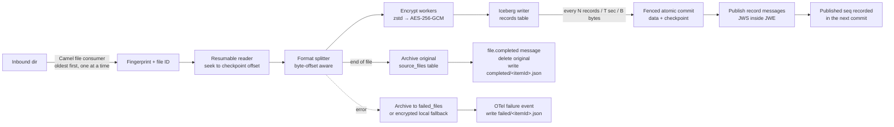
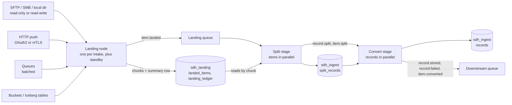
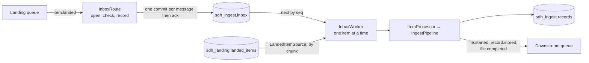

# Healthcare Source Connectors — Design

Status: **Draft for review; one spike item open (§16)** · Date: 2026-11-05 · Scope: parent project, `connector-contract`, `connector-core`, `connector-kms`, `connector-queue-reader`, `connector-runtime`, `file-connector`, `landing-connector`

Revision 2026-10-28 (b): added the `connector-queue-reader` consumer library and `connector-contract` (§3, §10.2). Replaced the Iceberg-property lease with a Postgres lease plus fencing tokens (§9.3). Folded publish marks into batch commits (§9.2). Made host disk capacity an operator responsibility (§17). Recorded the §16 spike results.

Revision 2026-10-28 (c): built the splitters (§6). Resume uses a `ResumePoint` (offset plus PHI-free context offsets) instead of a bare offset, saved in the checkpoint as `resumeAt` (§6.1, §9.1). Records are lists of literal parts and source ranges. The FHIR splitter uses a byte-level structural scanner instead of Jackson. Added X12 `GS`/`ISA` boundaries and TA1 handling.

Revision 2026-10-28 (d): built the split phase of the pipeline (§9.4). Multi-chunk records are read twice (hash, then encrypt) so memory stays at one chunk (§7.2). Commit retries check the checkpoint first so a batch is never appended twice (§9.2). The checkpoint gained `format`, `itemSize` and the `ABANDONED` state (§9.1). Fingerprints and checkpoint MACs use labelled HMACs (§5.1, §9.1). Archiving, failure handling and broker adapters are not built yet.

Revision 2026-10-28 (e): built archiving and failure handling (§4.1, §11). Added the `FAILING` state, so the decision to fail a file is durable before anything else happens. Archive tables keep file-level values on a summary row (§8.2). The digest chain, the local fallback format and the completion order are now specified (§5.1, §11.1, §11.2). Broker adapters and the Camel wiring are not built yet.

Revision 2026-10-28 (f): wired the file connector (§5, §5.2, §10.3, §14). Startup order, the Camel route, the broker adapters and the `local` key provider are built. Found and fixed a Camel default that broke oldest-first pickup (§5, §16). The configuration shape changed in a few places (§14). Cloud KMS providers, admin commands and OpenTelemetry export are not built yet.

Revision 2026-10-28 (g): added the Docker integration suite, which runs on minikube (KVM2) (§15). Running it against real services found five problems, all fixed:
- the Camel Service Bus producer can't set per-message sessions or IDs;
- both Azure clients reorder sends that are in flight together;
- `S3FileIO` needs the AWS `kms` module;
- SeaweedFS 4.x needs S3 identities;
- committed records could go unannounced when a file failed mid-publish.

See §10.3, §8.1, §11.2 and §16. MinIO images are no longer published, so S3 is tested on SeaweedFS only.

Revision 2026-10-28 (h): built table maintenance (§8.4): retention, compaction, snapshot expiry and orphan-file cleanup, scheduled between files under a writer lock. Retention now purges PHI files in the same run (a marker commit makes the delete expirable). Retention settings moved to `sdh.maintenance.retention` (§14).

Revision 2026-10-28 (i): built observability (§12): OpenTelemetry traces, metrics and audit events, exported over OTLP through PHI filters, and checked end to end against a real collector.

Revision 2026-10-28 (j): built the cloud key providers (§7.4) in a new `connector-kms` module: AWS KMS, Google Cloud KMS, Azure Key Vault and Vault Transit, for wrapping and for ES256 signing. Each is tested against an emulator or, for GCP, a fake KMS (§15.1).

Revision 2026-10-28 (k): built the container image (§14.1) and `ContainerImageIT` (now `ServiceImageIT`), which runs it locked down (read-only root filesystem, noexec `/tmp`, no capabilities, secrets as a Kubernetes-style volume). It found that the packaged app exited right after starting: Camel 4 ignores the old `camel.springboot.main-run-controller` setting, now `camel.main.run-controller`. Key files may now be group-readable (0440), as Kubernetes secret volumes with an `fsGroup` always are (§7.4).

Revision 2026-10-28 (l): built the operator commands `restore`, `decrypt-fallback` and `status` (§11.4). They are read-only, need `SDH_OPERATOR` and audit every run. Restores now always verify the digest, including partial ones. The image's JVM options moved to `/app/jvm.options`, shared with an `sdh-admin` wrapper (§14.1). Recording `replaces_file_id` on resubmission is not built yet.

Revision 2026-10-28 (m): the connector now runs against a real Iceberg REST catalog, Apache Polaris 1.8.0, in `PolarisIT` (§8.1, §15.1). Fencing, ingest, downstream read-back, archive restore, maintenance and the admin `status` command all pass unchanged. The REST catalog settings in §14 now include OAuth and an explicit `rest.auth.type`.

Revision 2026-10-29 (n): built the throughput tests (§13.1, `scripts/perf.sh`). Small records are bound by per-message public-key crypto, about 0.55 ms of CPU each with a P-256 recipient. Fixed a queueing problem that stalled splitting while the previous batch was sealed: sealing now has its own pool (§13), which made small records 25–40% faster.

Revision 2026-10-29 (o): records are now converted to JSON before they are stored (§6.4). The JSON shapes are:
- CSV: an array of fields by position, with the header dropped;
- C-CDA: Google Data Harmonization's XmlToJson style, driven by the CDA schema and checked against Google's own published outputs;
- X12 and EDIFACT: segment and element arrays, with every position kept.

FHIR, generic XML and delimited records are stored as split. A record that fails conversion is stored in its original form, marked with an error code, and announced with a new `record.failed` message; the file still completes. Also:
- added an EDIFACT splitter (§6.2);
- contract version 2.0 (§10.1);
- three new `records` columns (§8.2).

Revision 2026-11-03 (av): built step 4 of landing, SFTP and SMB intakes (§5.3.14). They use JSch and smbj directly, polled by a Camel timer, with explicit settings in place of a Camel URI (§5.3.9). SMB is SMB 3 with encryption required and NTLMv2; a share that doesn't encrypt, and a guest or anonymous login, are refused. A problem reaching the source is reported once by reason as `intake.unreachable` (`NETWORK`, `AUTH`, `PERMISSION`, `HOST_KEY`, `NOT_FOUND`, `ENCRYPTION`) and `intake.reachable` when it ends; all but `NETWORK` are retried only every `auth-retry-interval`. An item cut off part way resumes from its checkpoint, which also fixes a crash after a read failed mid-item (§5.3.4). Tested against embedded SSHD, and against OpenSSH and Samba containers behind Toxiproxy. New dependencies: JSch, smbj and Bouncy Castle (§14.2).

Revision 2026-11-04 (aw): built step 5 of landing, HTTP push (§5.3.15). `sdh.landing.source.type: http` starts a web server, and only then; the other intakes still run without one. Decided 2026-11-04: the endpoint is a Spring MVC controller on Spring Boot's Tomcat with Spring Security, not Camel's `platform-http`, because `platform-http` reads the whole request body before the route runs, into memory or a plaintext temporary file. A push is authenticated by OAuth2 (a JWT checked against the issuer's keys, audience and scope) or mTLS (a client certificate from a trusted CA, with a listed subject), streamed straight into landing, and answered `202` with a receipt that carries the SHA-256 of the body. An `Idempotency-Key` is scoped to its sender. A push waits up to `max-wait` for the one before it, then gets `503` with `Retry-After`. The ledger gained `item_size` and `item_sha256`, and `landed_items` gained `item_sha256` (§5.3.2). New dependencies: Spring Web MVC, Spring Security with the OAuth2 resource server, Tomcat and Nimbus JOSE + JWT (§14.2).

Revision 2026-11-04 (ax): built step 6a of landing, queue intakes for Kafka, SQS, RabbitMQ and Artemis (§5.3.16), and the splitter's handling of message batches. `sdh.landing.source.type: queue` consumes `sdh.landing.broker`, and lands messages in batches, one item per batch, with a message index (each message's offset and the keyed hash of its broker ID) on the summary row (§5.3.2). A message is acknowledged only once its batch is committed. Decided 2026-11-04: Camel consumers, as for the other intakes, except Artemis, which uses the JMS client directly because both of Camel's JMS components acknowledge a message as soon as their listener returns. A message delivered again is recognised by its ID within `dedup-window` (1 hour) of the last landed batch, not 7 days as first said. The splitter splits a batch message by message; a message that can't be split, or holds a record over the limit, is stored raw as one `record.failed`, and the rest of the batch carries on. Pub/Sub, Service Bus and Event Hubs are step 6b. No new dependencies.

Revision 2026-11-04 (ay): built step 6b of landing, queue intakes for Pub/Sub, Service Bus and Event Hubs (§5.3.16), all by Camel consumers. Pub/Sub uses `ackMode=NONE`: each exchange completes at once and carries an acknowledgement that is used once the batch is landed. Service Bus holds each exchange open in peek-lock mode, with Camel renewing the lock. Event Hubs holds each exchange open, with a blob checkpoint store and start positions the node supplies (`sdh.landing.broker.eventhubs`). Changed for every broker (decided 2026-11-04): a batch that can't be landed is now tried again in place, keeping its messages, instead of being handed back. Handing it back raised each message's delivery count, so on a broker with a delivery limit (Service Bus and Artemis, 10 by default; RabbitMQ 4 quorum queues, 20) a long storage outage would have dead-lettered messages. Messages are handed back only when the route stops, as soon as Camel prepares it for shutdown. After a fatal error the consumer is held back, rather than its messages handed back repeatedly until the node exits. Service Bus messages are identified by sequence number, Event Hubs events by partition and sequence number, and Pub/Sub messages by message ID.

Revision 2026-11-04 (az): built step 7a of landing, bucket intakes for S3 (and S3-compatible stores), Azure Blob Storage and Google Cloud Storage (§5.3.17). Decided 2026-11-04: each store's SDK directly, polled by a Camel timer, as for SFTP and SMB, not Camel's `aws2-s3`, `azure-storage-blob` and `google-storage` consumers, so that a broken read resumes with a ranged read, every timeout is set, and no key is logged. Decided the same day: a bucket is found by listing its prefix every `poll-interval`; event notifications may be added later as an option. `path` and `move-to` are key prefixes. An object's version is its time and its ETag (S3, Azure) or generation (GCS), recorded as `<millis>:<tag>`, so an object written again with the same bytes is a new version, as a file would be. Reads, copies and deletes are conditional on the tag where the store allows. Bucket items are landed as kind `object`. Iceberg tables are step 7b. No new dependencies: the SDKs were already on the class path for Iceberg's file IO and the key providers.

Revision 2026-11-04 (ba): built step 7b of landing, Iceberg table intakes (§5.3.18), and a `parquet` splitter (§6.2). `sdh.landing.source.type: iceberg` follows a table through its own catalog, read-only: each Parquet data file an `append` snapshot adds is landed as one item of kind `table-file`, its bytes as they are; a `replace` (compaction) is passed over; an `overwrite` or `delete` raises `intake.table_rewrite` and nothing is landed for it. Decided 2026-11-04: the splitter's `parquet` format makes one JSON record per row (mapping `parquet-row/1`), resuming by row group and row; the landed copy stays the original file. Decided the same day: on the first start the intake lands every data file of the current snapshot, then each later append (`start: earliest`, the default), or only later appends (`start: latest`). Progress is a snapshot ID kept, MAC'd, in a property of the ledger table and committed under the lease's fence, so a restart carries on and a compaction after snapshot expiry can't land rows again. Changed in `connector-core`: a resume point is now ordered by its offset, then its context (`ResumePoint.isAfter`), so several records can share an offset; and a splitter may set a record's origin itself, which `RecordOrigins` then keeps. New error codes `PARSE_PARQUET_MALFORMED` and `PARSE_PARQUET_UNSUPPORTED_TYPE`. No new dependencies: `parquet-hadoop`, already there through Iceberg, is now declared by `connector-core`.

Revision 2026-11-04 (bb): built step 8 of landing, producer feedback (§5.3.8). Decided 2026-11-04 with the user: producers are outside organisations, each seeing only its own items; results go to a results queue per intake, sealed to the producer's own key; a resubmission is recorded as a link only, and both items are kept in full, because landed data is PHI and nothing may be lost or replaced automatically. The landing node sends `item.received` when an item lands; the splitter sends `item.result` when it finishes one, completed or failed, with each problem's error code, record, byte offset, line, column and, for a message batch, the message and its broker ID, in parts. Both are sent before the step that follows is committed, so a crash means a resend with the same message ID, never a loss. Contract 2.3 (§10.1). An HTTP intake with results must admit one sender (`oauth2.subject`, or one `mtls.subjects` entry). Push takes `X-Correlation-Id` and `Replaces` headers; directory, SFTP, SMB and bucket intakes take a `<name>.sdh-replaces` marker. Queue and table intakes can't name an item they replace yet.

Revision 2026-11-04 (bc): built the landing metrics (§5.3.7). Decided 2026-11-04 with the user: the first metrics are renamed to the planned names (`sdh.items.landed` is now `sdh.landing.items`; `sdh.landing.source_reachable` is now `sdh.intake.up`; `sdh.landing.items_waiting` is now `sdh.landing.backlog`), and the rest are added: bytes, duplicates, ledger size, batch size, listing time and size, oldest wait, push requests and lock wait, and the intake health gauges of §5.3.4 for listing intakes and Artemis. `IntakeHealth` now holds an intake's reachability for both; the Artemis route reports again when the reason changes, as §5.3.4 says. Directory polls are timed by a Camel poll strategy, which also replaces Camel's log of a failed poll. Left for a spike: how each Camel broker's consumer reports giving up, or losing and regaining its broker, so the health gauges can cover them.

Revision 2026-11-04 (bd): built broker health for the Camel queue intakes (§5.3.16). A spike cut each broker off through Toxiproxy: all six consumers came back on their own, but only SQS told Camel, and Pub/Sub's consumer gave up for good on a deleted subscription while its route still said it had started. Decided 2026-11-04 with the user, broker by broker: SQS by a poll strategy; RabbitMQ by a connection listener and a passive queue check; Kafka, Pub/Sub, Service Bus and Event Hubs by a check through the broker's own client every `sdh.landing.broker.check-interval` (30 s), a fallback for want of a Camel hook. A Pub/Sub consumer that gave up is restarted once its subscription is found again. The intake health gauges now cover every queue intake. `IntakeHealth.problem()` gives the current reason. Pub/Sub's check needs `pubsub.subscriptions.get`.

Revision 2026-11-04 (be): queue and table intakes can name what they replace (§5.3.8). Decided 2026-11-04 with the user: a queue message names the earlier message it replaces, item and message, in an `sdh_replaces` header (`<itemId>/<messageId>`), kept per message, encrypted, in `landed_items.message_replaces_enc` (§5.3.2), and reported per message in `item.received` and in each problem of `item.result`; a table append names the item its files replace in its snapshot property `sdh.replaces`. As for markers, a link that is malformed or names an item the intake never landed is ignored with `item.replaces_ignored`, and the data is landed without it. SQS consumers now ask for the `sdh_replaces` attribute. Contract 2.4 (§10.1). A status endpoint for producers stays unbuilt, until a producer needs one.

Revision 2026-11-04 (bf): items given up are cleaned up, and remote sources are claimed. Decided 2026-11-04 with the user: the chunks of an item given up part way are kept for a grace period, `sdh.maintenance.retention.given-up` (7 days, at least 1), then removed by maintenance and audited as `item.purged` (§5.3.13). Each give-up is recorded, MAC'd, in the commit that clears its checkpoint, so none is missed, and a landed item is never removed. `TableMaintenance` takes a purge step of the caller's, run before expiry so the removed files leave storage in the same run, and shares its row copying with compaction. Decided the same day: every read-write source is now claimed (§9.5), SFTP and SMB through their connections (§5.3.14) and buckets by a conditional write (§5.3.17), checked once per listing. `InboundDirectoryClaim` keeps its claim through a `ClaimFile`.

Revision 2026-11-04 (bg): documentation only. The order of work (§5.3.10) marks step 3b built and drops the claims and replaces links now built from what is left for later. `item.resumed` is marked built (§5.3.4), and the audit events of §5.3.7 are split into built and planned: `item.discovered` and `item.skipped` are not built either. The status line names every module and the one open spike item.

Revision 2026-11-04 (bh): the ledger's memory, measured, and kept within a share of the heap (§5.3.2). Measured with 1 to 50 million random entries: the index took 48 to 96 bytes an item, not the 36 planned, because the digest set used 16-byte slots too and a set doubles when two-thirds full; 10 million items took 528 MiB and needed a 768 MiB heap to load, more than the README's 512 MiB. Decided 2026-11-04 with the user: the digest prefixes move to a set of plain longs (`LongSet`), so an item takes 36 to 72 bytes (10 million: 384 MiB); the sets are sized from the table's metadata before loading, so loading never grows them; the index may take half the heap, and startup fails with `LEDGER_TOO_LARGE` if it would take more; and `ledger.memory_low` warns when the next doubling would pass that half. The keys stay 128 bits. Still to check: the splitter's inbox (§5.3.10).

Revision 2026-11-05 (bi): documentation only. Decided 2026-11-05 with the user: a pipeline (an intake, its landing node and its splitter) carries one type of content, and types are never mixed in the same landing storage or the same split storage (§5.3). This settles the question of several formats in one intake, which is no longer listed as still to check (§5.3.10); mixing them is out of scope (§17).

Revision 2026-11-05 (bj): performance measured for each part of the consolidated pipeline, in shared columns (§13.1). Decided 2026-11-05 with the user: the real landing node and the real splitter, each in process; per stage plus end to end; bulk files plus many small documents; a shared summary; end to end by replaying the landing run's timeline in the splitter; and the existing benchmark kept as the split micro-benchmark (`core`). New `LandingPerf` and `SplitterPerf`, shared support in `connector-core`'s test JAR, one output directory (`target/perf/`) with `pipeline-summary.md`, and six NetBeans actions. First results: bulk files split as fast in the app as in the micro-benchmark; small documents split at about 1 a second, against 10 landed, which is the next thing to look at.

Revision 2026-11-05 (bk): the demonstration shows the whole current pipeline, landing and splitting (§15.3). Decided 2026-11-05 with the user: the landing node and the splitter as two processes, run from their JARs; the telemetry kept as files plus a report; two pipelines, a watched directory and HTTP push with mTLS; and, for landing, duplicate content, refused pushes and a resubmission link. The apps export OTLP to a receiver in the demo, which follows each item by its audit events and writes `telemetry/report.md`. Locally, Artemis replaces the SEDA stand-in. The NetBeans actions now build both apps.

Revision 2026-11-05 (bl): the deployment shape and its rationale are written up in [DEPLOYMENT.md](DEPLOYMENT.md): separate images and deployments for the landing node and the splitter, with the queue between them on the customer's broker; the other shapes considered, and why not. Decided 2026-11-05 with the user, after testing what could strand an item: the splitter now reconciles its inbox with `landed_items` (§5.3.12), at startup and every 15 minutes, adding an item landed more than 10 minutes ago whose `item.landed` never arrived (`inbox.recovered`), because the landing node's resend at startup covers only its own crash, not a broker that lost a message. An `item.landed` of a contract major version the splitter can't read is no longer dropped but left unacknowledged until the splitter is upgraded (`inbox.unreadable_version`, §10.2), so the splitter is upgraded first. New `sdh.landing.reconcile` settings; new tests `ContractVersionTest`, two in `FileConnectorApplicationTest` and one in `IntakeServiceTest`; `MessageSealer.seal(Map)` for tests of other versions.

Revision 2026-11-05 (bn): demo sandbox (§15.4, docs/SANDBOX.md). `scripts/sandbox.sh` runs a three-node minikube cluster laid out as a customer would run the pipeline: a 3-broker Kafka, SeaweedFS with a bucket per medallion layer (bronze landed, silver records, gold reserved for the FHIR stage) and an S3 key per stage, Postgres, Vault Transit for every KEK and signing key, network policies (Calico), and OpenTelemetry to Grafana. Both stages are deployed from their READMEs' Deployments, by image digest from the cluster's registry, with the landing node's active and standby on different nodes. The FHIR stage's namespace, quota, topics, bucket, keys and credentials are made ready. The project's minikube profiles now live under `SDH_SANDBOX` (`scripts/minikube-home.sh`); `sdh-it` is 8 CPUs and 8 GB. The landing README now says a push intake's Deployment needs `Recreate`: a standby is never ready, so a rolling update stalls (found in the sandbox).

Revision 2026-11-05 (bm): third-party attribution made complete, and the images built from Maven (§14.1–§14.3). Every license, notice and copyright file a bundled jar ships is now in `THIRD-PARTY.txt`, Apache-2.0 components included, so the licenses and copyright lines of code that components bundle (jBCrypt in JSch, the SCRAM libraries in the PostgreSQL driver, BoringSSL in `grpc-netty-shaded`) are no longer left out. JSch's licenses are marked as all applying, not as a choice. Spring Boot's jar mode tools, which repackaging adds, are attributed. Distribution builds fail on a license text that couldn't be fetched. New `ThirdPartyAttributionIT` checks both jars against what they bundle, in `-Pit`, `-Pdist` and `-Pimages`. New `images` profile and NetBeans action build all four images into the VM; the tarball action builds both applications' tarballs.

Revision 2026-11-05 (bo): steps 1–3 of the parallel-stages refactor ([STAGES.md](STAGES.md) §11). Step 1: "section" became "record", and "file" became "item" where it means an item, throughout; contract 3.0. Step 2: receiving from and sending to every broker moved into a new library, `connector-broker` (§3), which the landing node's queue intake now uses (§5.3.16); the broker watch's log events are now `broker.*`. Step 3: a new library, `connector-stage`, the worker every pipeline stage will run on: a stage's processor does its own work, and the worker claims each record in a Postgres registry, commits each batch once, keeps each stored record's sealed message until it is sent, counts records per item and sends the item-complete message, recognises duplicates and reports conflicts to the stage's dead-letter queue as the new `record.conflict` message (§10.1). New error codes `RECORD_CONFLICT` and `STAGE_BATCH_FAILED`. Fixed in `connector-broker`: a Kafka or Artemis batch being retried now gives up as soon as Camel prepares its route to stop, as the other brokers' did, instead of holding the route until its shutdown timed out (§5.3.16); found by the stage's integration test. Tested by `StageRegistryTest`, `StageWorkerTest`, `StagePropertiesTest` and `StageWorkerIT` (every broker).

Revision 2026-11-06 (bp): producer results are not guaranteed (§5.3.8). Decided 2026-11-06 with the user: problems in a producer's data are found by our operators, from what the pipeline records, and resolved with the producer by steps both organisations agree; `item.received` and `item.result` help, but a producer must not rely on them being complete. A result can name no message for a failed record that reached its stage by reconciling (audited `convert.placement_unknown`), isn't sent again on a replay unless an operator asks, and an item lost between stages has none until it is recovered ([STAGES.md](STAGES.md) §13). An operator's problem report, which works out placement from landing, is planned.

Revision 2026-11-06 (bq): step 4d of the parallel-stages refactor ([STAGES.md](STAGES.md) §11). `file.started` and `file.completed` are removed from the contract (still 3.0); the stages' `item.split` and `item.converted` replace them (§10.1). The operator commands moved to `connector-stage`, so every stage has them (§11.4): the split stage's `restore --item-id` and `status`, the convert stage's `status`; `decrypt-fallback` and the local fallback format are removed (§11.3). The convert stage ships like the others, as a distribution kit and tarball (`convert-stage-<v>`) and images `sdh/convert-stage` and `sdh/convert-stage-service`; the split stage's images are renamed `sdh/split-stage` and `sdh/split-stage-service` (§14.1, §14.3). The integration tests run the stages: the storage tests on the split stage alone, `FullStackIT` and the image tests on both. Running them found that retention on a stage's tables didn't purge at once: the marker commit added no snapshot under the stages' committer, so the deleted files stayed until the delete expired. The marker is now an empty append of its own (§8.4). The demo and the sandbox run both stages, the convert stage as a third app per pipeline (§15.3, §15.4); the demo found that the convert stage didn't start with no format options set. Sections that describe the single splitter before the stages are marked as such.

Revision 2026-11-07 (br): recovering from lost or purged queue messages, after the sandbox run of step 4d ([STAGES.md](STAGES.md) §8, §13.2). Decided 2026-11-07 with the user. The split stage's reconciler also takes on an item left part way whose message was then lost: one in progress whose checkpoint hasn't been written for longer than the grace, whenever it was landed (`ItemCheckpoints.stalled`; `split.recovered`, reason `CHECKPOINT_STALLED`). Before, such an item had a checkpoint, so the reconciler passed it by, and nothing ever finished it. A message of an earlier contract major version is now rejected (`MessageRejectedException.Reason.EARLIER_VERSION`; `split.rejected` or `stage.message_rejected`) rather than held: no upgrade will read it, so holding it blocked its partition for good. The sandbox found this, when the previous build's landing node re-announced an item before its upgrade. A later major version is still held. The landing node has operator commands (§11.4), on the stages' CLI, with `replay --item-id`, the first replay of §13.2: it sends a landed item's `item.landed` again under a broker ID of its own. For it, the landing node keeps each batch's time to the microsecond, as the table does, so a message rebuilt from the summary row is the one first sent. Tested by `ItemCheckpointsTest`, `FileConnectorApplicationTest`, `ContractVersionTest`, `StageWorkerTest` and `ReplayCommandTest`.

Revision 2026-11-07 (bs): the convert stage's reconciler keeps a watermark ([STAGES.md](STAGES.md) §9, §13.4). Decided 2026-11-07 with the user. Each run looked back only `sdh.reconcile.lookback` (2 days), so a `record.split` lost during an outage longer than that (an SQS queue keeps messages 4 days by default, or a queue purged meanwhile) was never found. The registry now keeps how far the reconciler has checked, `stage_reconcile.checked_to` (created with the registry's tables, only ever moved forward). A run looks from the earlier of it and the lookback, a day at a time, holding one day's record IDs, and saves its progress after each day; a catch-up is audited `convert.reconcile_catching_up` and `convert.reconcile_caught_up`. With no row yet, a stage starts at the lookback, as before. A full scan of `split_records` at startup was rejected: it holds every record ID kept. `status` shows the watermark. Known, documented for operators and left open (resolved by revision (bt)): after an outage longer than the grace, the reconciler can't tell a queued `record.split` from a lost one, so it converts the backlog's records too, serially on the duties pod; nothing is converted twice, but the backlog drains more slowly, and a failed record it reaches first loses its placement (`convert.placement_unknown`) (STAGES.md §12, §13.4). Tested by `StageRegistryTest`, `StageAdminTest` and `ConvertStageTest`.

Revision 2026-11-07 (bt): the convert stage's reconciler waits for a backlog to drain ([STAGES.md](STAGES.md) §9, §13.4). Decided 2026-11-07 with the user; resolves what revision (bs) left open. A record that looked lost might only be queued behind a backlog, after an outage or whenever the queue fell more than the grace behind under load, and the reconciler converted those itself, serially on the duties pod, slowing the backlog and losing a failed record's placement. Now every pod notes when a record older than the grace comes off its queue (`BacklogWatch`, from the commit time of the `split_records` snapshot the message names), in the registry's `stage_backlog`, at most once a minute, by the database's clock. While that is within `sdh.reconcile.backlog-quiet` (15 minutes), a run rebuilds nothing and leaves the watermark (`convert.reconcile_deferred`, reason `BACKLOG`). A pod newly holding the duties also waits one quiet time at startup, before the pods have received anything (reason `STARTING`). After `sdh.reconcile.max-deferral` (6 hours) of waiting it goes ahead anyway (`convert.reconcile_deferral_capped`), so a queue always behind can't hide a real loss. A drained-queue signal from the brokers was rejected: none is common to the seven. Tested by `StageRegistryTest`, `ConvertStageTest` and `ConvertPropertiesTest`.

Revision 2026-11-07 (bu): step 5 of the parallel-stages refactor, KEDA in the sandbox ([STAGES.md](STAGES.md) §10, [SANDBOX.md](SANDBOX.md)). Decided 2026-11-07 with the user: the split and convert stages always keep at least one pod (`minReplicaCount: 1`), since the duties pod reconciles and a lost message adds no backlog to wake a stage scaled to zero; and the landing node is never scaled, with only its lease holder in service, since landing in parallel could land one file twice. `scripts/sandbox.sh up` installs KEDA 2.21.0 from its release manifest, checked against a pinned SHA-256; each pipeline has a `ScaledObject` per stage on its Kafka consumer lag (1 to 2 split pods, 1 to 3 convert pods), the stages' input topics six partitions, and the Deployments no `replicas`, so a deploy doesn't undo KEDA. `scripts/sandbox.sh scale-demo` pushes copies of the samples and reports the pods each stage ran and the items each finished. The stages' READMEs gain "Autoscaling", the landing node's README the reason not to, DEPLOYMENT.md "Scaling". The sandbox found a bug in revision (bt): on a stage where no backlog had ever been seen, the convert reconciler's wait at startup never ended, so it never reconciled. The wait was recorded by updating the stage's `stage_backlog` row, which only noting a backlog made. It is now an upsert, and `seen_at` may be null (a table made by (bt) has its `NOT NULL` dropped). Tested by `StageRegistryTest.keepsAWaitWithNoBacklogEverSeen` and `ConvertStageTest.endsTheWaitAtStartupWithNoBacklogEverSeen`. Running the demo also found that the sandbox's control-plane node runs out of memory under load, and that an outage then can fail a valid item as `RESUME_NO_PROGRESS` (SANDBOX.md "Checked", STAGES.md §12); both open.

Revision 2026-11-07 (bv): an outage no longer fails a valid item as `RESUME_NO_PROGRESS` (§9.2, [STAGES.md](STAGES.md) §12). Decided 2026-11-07 with the user, for what revision (bu) found: an attempt whose error says a service was down takes its restart back, while crashes and other errors count as before. The errors are recognised by `Outage`, an allow-list. `KeyServiceUnavailableException` is new in `connector-contract`: Vault reports itself unreachable or not serving (429, 502 to 504; sealed is 503) with it, and the cloud KMS providers do the same for their clients' equivalents, where before Vault sealed was a plain `IllegalStateException`. `ItemCheckpoints.replace` writes a splitting item's checkpoint and leaves a pending batch for resume. Tested by `IngestPipelineTest` (`anOutageDoesntCountTowardsFailingAnItem`, `anOutageMidCommitLeavesTheBatchForResume`, `otherErrorsStillCount`), `OutageTest`, `KafkaOutageTest`, `KmsSupportTest` and `VaultTransitKeyProviderTest`. An item already failed this way still needs an operator (STAGES.md §12).

Revision 2026-11-07 (bw): the sandbox's memory is sized so that neither the workstation nor a node can be starved ([SANDBOX.md](SANDBOX.md) "Memory"), after its control-plane node ran out of memory in revision (bu)'s demo. Decided 2026-11-07 with the user: the sandbox's landing node runs as one pod with no standby (Kubernetes starts another if it dies), and KEDA gives each stage at most two pods. Measured: minikube offered pods each node's whole memory, though a node's own use is about 1.5 GiB, and turned eviction off; every shared service's volume is on the control-plane node, where pods had asked for 95% of it and their limits came to 158%. Built: `scripts/sandbox.sh up` gives the VMs their memory while stopped (7.5 GiB for the control-plane node, 6.75 GiB for each other), sets each kubelet's `systemReserved` (2,304 and 1,664 MiB) and an eviction threshold (256 MiB), taints the control-plane node for the shared services (which tolerate it) and KEDA, and pushes the registry's images again after a restart. Every pod's request equals its limit; Vault has 384 MiB (it exceeded 256), the split stage 1.5 GiB in the sandbox, KEDA's pods 128 MiB. Each stage's two pods run on different nodes, so a node always has room for one of each. Every script that starts a VM checks first that the VMs together leave the host 9 GiB (`SDH_HOST_RESERVE`, `minikube-home.sh`); the cluster and `sdh-it` therefore no longer run at once, and `images` stops the cluster while it builds. The landing node's README keeps its active node and standby.

Revision 2026-11-07 (bx): a stage worker that stops releases the claims it holds on records it didn't store, once its threads have stopped, rather than leaving them to expire after `sdh.stage.claim.ttl` (60 s); another pod takes them over at once, still counted as one more attempt ([STAGES.md](STAGES.md) §10, "Scaling down, as found"). A worker whose threads don't stop within the claim's time to live, or that can't reach Postgres, leaves them to expire, as before.

Revision 2026-11-07 (by): a Kafka batch the receiver gives up (as it stops, or FATAL) is no longer passed by. Found on the sandbox: Camel's Kafka consumer only logs a poll that fails and polls on from past it, so the next poll's commit moved its partition past records never handled, and two items of 300 were never converted; Camel also commits only the partition of a poll's last record. The receiver now commits each partition of a handled poll, and seeks each partition of a poll not handled back to its start before giving up ([STAGES.md](STAGES.md) §10). The convert reconciler, which hadn't repaired them, now rebuilds a record whose claim expired with nothing stored, and completes an item stored in full with its total (`convert.item_completion_recovered`).

Revision 2026-11-07 (bz): a Kafka consumer no longer leaves its group while a batch is retried or a long item split ([STAGES.md](STAGES.md) §10). Decided 2026-11-07 with the user. Camel handles a poll on its polling thread, so a batch retried in place stopped the consumer polling; past `max.poll.interval.ms` (5 minutes) it left its group, its partitions moved, and its commit failed, so records were handled again. Kafka keeps no delivery count, the reason for retrying in place on the other brokers, so on Kafka a batch to be tried again now waits its pause (at most 1 minute), its poll's handled records are committed and the rest sought back, and the route returns for the next poll to bring them again. The stages' longest pause is 1 minute, not 5. The split stage, which holds a message while its item is split, sets `maxPollIntervalMs` to 30 minutes unless its URI does; an item taking longer is moved to another pod, which waits for its lease, and is announced again. The sandbox's stages use Kafka 4's group protocol (`groupProtocol=consumer`, KIP-848), under which a rebalance doesn't wait for a busy pod; it isn't the default, since a broker before 4.0 refuses it. New `ReceiveSettings.withKafkaDefault`. Tested by `KafkaRewindIT` (both protocols) and `ReceiveSettingsTest`, and on the sandbox with Vault sealed for 8 minutes.

Revision 2026-11-03 (au): built retention and maintenance of the landing tables (§5.3.13). The landing node runs the same maintenance as the splitter on `landed_items` and `landing_ledger`, between items under the intake's writer lock. Retention of `landed_items` (`sdh.maintenance.retention.landed-items`, off by default, at least 7 days) purges whole days but never part of an item: the cutoff moves back to the start of any item that spans it. The ledger is never purged. `MaintenanceScheduler` moved from `file-connector` to `connector-runtime`, with the compaction and orphan settings (§8.4). Not built: removing the chunks of an item that was given up; retention removes them with their day.

Revision 2026-11-03 (at): built step 3b of landing: the landing node ships like the splitter, as a distribution kit and tarball (`landing-connector-<v>`), a customer image (`sdh/landing-connector`) and a service image (`sdh/landing-connector-service`), each with its SBOM, signature and scan (§14.1, §14.3–§14.5). The shared Docker files moved to the top-level `docker/`; `build-image.sh` takes the application; `sign-release.sh` signs both tarballs and all four images into `target/release/`. The splitter's images and kit lose the inbound directory, and `restore` in a container goes to `/tmp`, read out through `kubectl debug`. The splitter's Kafka consumer keeps automatic commits, one message per poll (§5.3.12). `ContainerImageItBase`, the Kubernetes run and the demo now run both stages: landing as an active node and a standby, with failover of each stage (§15).

Revision 2026-11-03 (as): built step 3a of landing (§5.3.10, §5.3.12): the splitter now reads only from landing. It takes `item.landed` messages into a durable inbox table, acknowledges each once it is committed, and splits the inbox's items in order, reading each from `landed_items` by chunk. Directory pickup, fingerprints, `InProgressLocator`, archiving to `source_files` and `failed_files`, the local fallback and the `completed/` and `failed/` records are gone from the splitter (§5, §8.2, §11). `restore` reads the landed item. The splitter has its own key pair for `item.landed`, and trusts the landing node's signing key (§7.4). New error code `MESSAGE_REJECTED`. The `-Pit` suite, the Kubernetes run, the images and the demo are rewritten for two stages in step 3b.

Revision 2026-11-03 (ar): built step 2 of landing (§5.3.10): `landing-connector`, a Spring Boot application with a local directory intake. It lists the directory with Camel's `file` component, lands each item once it has settled (or its `.done` marker is there), writes the ledger entry, sends `item.landed`, and on a read-write source deletes, moves or renames the item. It recovers from a crash at any step, and can run as a standby. What the two applications share moved from `file-connector` into a new library, `connector-runtime` (§3): the common settings, key loading, publishers, telemetry export, the directory claim, the lease database and the exit hook. New error codes `INTAKE_NOT_WRITABLE` and `INTAKE_UNREACHABLE`. Retention and maintenance of the landing tables, and an image for the node, are still to do.

Revision 2026-11-03 (aq): built step 1 of landing (§5.3.10), in `connector-core` `landing/`. `ItemLander` stores an item as a stream in encrypted chunks, resumably, with a summary row and the same keyed digest as archived files; `LandedItems` reads it back and checks it. `LandingLedger` and `LedgerIndex` record what has been landed, without PHI, and repair the last entry after a crash. `LandingCheckpoint` holds progress. `item.landed` is contract 2.2 (§10.1), and the item ID becomes the splitter's file ID (§5.3.6). `LeaseKeeper.acquireAsStandby` waits for the lease for as long as it takes (§5.3.5). Nothing runs these yet; the landing node is step 2.

Revision 2026-11-03 (ap): documentation only. Ingestion becomes two stages (§5.3, not built), replacing the source-endpoint plan of revision an. A landing node per intake, with a standby, takes data from directories, SFTP, SMB, HTTP push, the seven queues, buckets and Iceberg tables through a fixed list of Camel components, and stores it as received in its own namespace, `sdh_landing`. It then signals the splitter with an `item.landed` message. Read-only sources are tracked with a ledger, so nothing is landed twice. The landed copy replaces `source_files`, and the splitter reads only from landing. How producers find the source of a problem in their data is still open (§5.3.8).

Revision 2026-11-02 (ao): problems can be found by line and column, for remediation.
- **C-CDA JSON is `ccda/2` (§6.4):** every element written as an object starts with `"#line"` and `"#col"`, where its start tag begins in the record. A mapping reports its issues there (the Whistle runtime's `check::at`), so an operator can go straight to the element, or to its nearest present parent when it is missing. The JSON is about 39% larger; the C-CDA memory factor goes from 5 to 6.
- **The converter always uses Woodstox (§6.4),** chosen by name, so the connector and the command-line tools (`ccda-quickrun`) read a document the same way and report the same positions. Malformed XML is now reported at a byte position; it was a character count.
- **Records carry an origin (§6.1, §8.2, §10.1):** where their text starts in the record and in the file, as lines and columns, so a position in a record becomes one in the file (`RecordOrigin.toFile`, in `connector-contract`). A failed record also gives where in the file conversion failed.
- **Contract 2.1 (§10.1):** `record.stored` and `record.failed` gain `origin`, and `record.failed` gains `errorLine` and `errorColumn`. Six optional `records` columns, added to existing tables at startup (§8.2).

Revision 2026-11-01 (an): documentation only. A plan for source endpoints chosen by configuration (§5.3, not built): local, S3-compatible, SFTP and Iceberg/Parquet sources as plugins behind a `SourceEndpoint` SPI, with splitting and conversion unaware of where files come from. One pipeline per pod, defined in a configuration file shipped with the pod; operator-defined pipelines are deferred to pipeline monitoring and management (§17).

Revision 2026-11-01 (am): documentation only. The performance test was run against the C-CDA tree of revision al (§13.1): throughput is unchanged, allocation is 8% lower and GC pauses about 40% shorter. A comparison is only fair from the same filesystem; the project folder's encrypted home directory made the same code look 10% slower.

Revision 2026-10-31 (al): C-CDA documents of structured entries need about 60% less memory to convert.
- **C-CDA tree (§6.4):** each element is held in plain arrays instead of lists and maps, and with nothing at all for what it doesn't have. Grouping children by name moved to when the JSON is written. The text run being read is kept once by the reader, not in every element. Whitespace runs, and attribute values of up to 64 characters, are kept once per distinct value and shared (at most 1,024 and 16,384 per document, so a hostile document can't grow the tables without end). A 64 MB document of structured entries needs 231 MiB instead of 566; the memory factor goes from 10 to 5, which still covers a document whose values don't repeat at all (5.0 times its size). Conversion is about 5% faster. The JSON is byte-for-byte the same (680 documents: the test, mapping and Google Synthea samples, 650 mutated ones among them, and the 16 and 64 MB documents).

Revision 2026-10-31 (ak): the conversion budget reserves enough for C-CDA documents of structured entries.
- **C-CDA memory factor (§6.4):** 3.5 → 10. The 3.5 was measured on a document that was mostly a base64 PDF. A 64 MB document of structured entries needs 566 MiB, 8.8 times its size (9.6 at 16 MB), so the budget reserved 224 MiB for it and let other conversions use the rest. Several large structured records at once could then run the heap out of memory, which the budget is there to prevent.

Revision 2026-10-31 (aj): the other converters need far less memory, conversions share a memory budget, and two gaps that a hostile or broken file could use are closed.
- **Converter memory (§6.4):** X12, EDIFACT and CSV no longer decode a record into a string or build a tree; they write the JSON from the record's bytes. Large records are written twice, counting first, so the JSON is held once at exactly its size. For a 64 MB record: EDIFACT about 2 GiB → 256 MiB, X12 512 → 224 MiB, CSV 384 → 160 MiB, C-CDA 224 → 208 MiB. Before, an EDIFACT record of about 30 MB ran a 1 GiB heap out of memory. The JSON is byte-for-byte unchanged (1,257 test inputs, 400 mutated ones per format among them).
- **Conversion budget (§6.4):** conversions running at once share `split.convert-memory`, 40% of the heap by default. Each converter states its peak as a multiple of the record's size, and a record that doesn't fit waits.
- **Converter bugs (§6.4):** an unexpected exception from a converter fails that record with `CONVERT_FAILED`. Before, it failed the whole file as `STORAGE_FAILED`.
- **XML nesting (§6.3):** a boundary element may be nested at most 128 elements deep, and its ancestors' start tags may be at most 1 MiB (the most a resume re-reads). Before, there was no limit: 200,000 nested wrappers in a 600 KB file gave a 1.36 MB checkpoint, rewritten on every commit.
- **Error positions:** CSV and X12 now report exact byte offsets; they were character offsets, which differ after non-ASCII text. An X12 separator that isn't ASCII is now `CONVERT_X12_MALFORMED` at the ISA.

Revision 2026-10-31 (ai): a file that keeps stopping the connector no longer stops it forever, and C-CDA conversion needs less than half the memory.
- **Restarts without progress (§9.2):** the checkpoint counts how often splitting resumed without a batch committing since (`restarts`, §9.1). At 2, the uncommitted batch is stored unconverted (`CONVERT_SKIPPED`), in case a conversion is what stops the connector; at 3, the file fails with `RESUME_NO_PROGRESS` (§11). Before, a record that ran the connector out of memory was retried on every restart, and nothing else was ever processed. `sdh-admin status` shows the count.
- **C-CDA memory (§6.4):** the parser no longer joins text into one string (it took about five times the text's size), the JSON is written straight to UTF-8 bytes, and the tree is released before the output is trimmed. A 64 MB document needed 512 MiB of heap with Woodstox and 640 MiB with the JDK's parser; it now needs 224 MiB with either. The JSON is byte-for-byte the same.

Revision 2026-10-30 (ah): documentation only. The US Core 6.1 C-CDA mapping (the `mapping` repository) now reads `ccda/1` as stored, so no reshaping step sits between the connector and the mapping (§6.4). Its sample documents are the connector's conversions of the C-CDA test documents.

Revision 2026-10-30 (ag): a demonstration of the connector (§15.3).
- **Running it:** `-Pdemo`, or two NetBeans actions, in-process or against Postgres, SeaweedFS and Kafka in the minikube VM. Since revision (bk), the landing node and the splitter run as two processes.
- **What it shows:** C-CDA files delivered one at a time, with the connector's log, audit events, and OpenTelemetry traces and metrics on the console, through the production PHI filters. The files fail in three ways (unsupported encoding, a file cut off part-way, a document that can't be converted), and the converted documents are read back as a consumer would.
- **Bug found and fixed:** a C-CDA document with an undeclared entity such as `&nbsp;` failed its whole file with `STORAGE_FAILED`, instead of being stored unconverted. Woodstox reports that error as an unchecked exception, which the converter didn't catch (§6.4).

Revision 2026-10-30 (af): the container heap is half the memory limit instead of 75% (`MaxRAMPercentage=50`, §14.1). In the README's 2 GiB container, the heap is now 1 GiB instead of 1.5 GiB.
- **Why:** at a 1.5 GiB heap, process memory reached 2.0 GiB in the performance test alone, before Spring, Camel and an operator command's JVM, so a large file could get the pod killed (§13.1).
- **Cost:** under 10% throughput.
- **Perf test:** its default heap follows, at 1 GiB.
- **Tested:** both image tests pass. The Kubernetes run (§15.2) now checks the heap the JVM picks inside the pod from the README's 2Gi limit (1024 MiB), and all its checks pass, including an operator restore beside the running connector.

Revision 2026-10-30 (ae): performance tests for throughput and memory use as a Maven profile (§13.1).
- **Running them:** `-Pperf`, never in a normal build or with `-Pit`. Three NetBeans actions: the full run, a quick check, and a 512 MiB heap. C-CDA and X12 by default.
- **New memory measures:** heap still in use after each collection, direct buffers, process RSS and allocation.
- **Results:** printed at the end, and in a per-run report plus a `history.csv` that collects every run.
- **Finding:** the README's Kubernetes sizing (2 GiB container, 1.5 GiB heap) leaves too little room. This test's JVM alone reaches 2.0 GiB, before Spring, Camel and `sdh-admin`. A 1 GiB heap costs under 10%; changed in revision af.

Revision 2026-10-29 (ad): the remaining performance runs (§13.1).
- **Runs:** P-256 on the current dependencies (no change), RSA and S3 with JSON conversion, and a heap-sizing trial from 1536 down to 384 MiB.
- **Two fixes found by the heap trial:**
  - The Parquet writers buffered up to 100 rows before checking the row-group size, and archive rows are 8 MiB. That meant about 800 MiB in memory, which caused out-of-memory errors at 768 MiB and full collections even at 1.5 GiB. They now check after every row. Every heap down to 384 MiB completes, and 512 MiB costs about 8–14%.
  - The cleanup after a failed Parquet write replaced the real error (the out-of-memory) with "Cannot return unfinished footer". It no longer throws.
- **Perf test:** reports GC pause time and full collections, and takes `-Dperf.heap`.

Revision 2026-10-29 (ac): two upgrade guards.
- **Iceberg:** `IcebergUpgradeGuardTest` fails when Iceberg or Parquet changes version, and prints the review the fencing and other Iceberg-dependent code need (§9.3). It also checks that transactions are still `BaseTransaction`s on both catalog types.
- **Azure HTTP client:** the Azure SDK now uses the JDK HTTP client instead of its Netty one, which was built for Netty 4.1 while the app runs 4.2 (§8.1). This removes the version-mismatch warning, reactor-netty, and the BoringSSL and QUIC native libraries. The enforcer bans the Netty client, and `AzureHttpClientTest` checks which client the SDK picks.
- **Tested:** all tests pass, including ADLS on a real account, Service Bus, Event Hubs and Key Vault, and a sign through the real Key Vault.

Revision 2026-10-29 (ab): fixed what the first vulnerability scan found (§14.5). Security overrides in the parent POM: Jackson 2.22.3, `amqp-client` 5.37.0, Guava 33.7.2, `lz4-java` 1.11.4 and `snappy-java` 1.1.10.12. The two bundled copies that can't be upgraded (Jackson inside `parquet-jackson`, Guava inside `hadoop-shaded-guava`) are accepted with reasons in `vuln-accepted.yaml`: our code reaches neither. The scan now passes, and a full release run signs and verifies. All unit tests and integration tests pass.

Revision 2026-10-29 (aa): vulnerability scanning and base image updates (§14.5). The three base images are pinned by digest in one file, `docker/base-images.env`, which the build script and both image tests read; the service image's Temurin bases were unpinned before. `scripts/base-images.sh` checks or updates the pins, Renovate opens a pull request when a pinned tag gets a new build, and `sign-release.sh` refuses to sign with a stale base. `scripts/vuln-scan.sh` scans the three SBOMs with grype, and `sign-release.sh` signs nothing unless it passes: no High or Critical vulnerability with a fix available, other than ones accepted with a reason. The first scan fails: 12 fixable High vulnerabilities in Java dependencies, two of them in copies bundled inside other jars. Fixing them is not done yet. The distroless pin was already behind; it now follows `nonroot`, and the image tests pass on the new bases.

Revision 2026-10-29 (z): SBOMs and signing (§14.4, `scripts/sign-release.sh`). A CycloneDX SBOM of the application jar is built at `package` and ships in the kit as `legal/sbom.cdx.json`. Each image gets its own SBOM, made by syft and attached as a signed attestation. The tarball gets a detached signature (verifiable with openssl alone), and both images are signed by digest. The release key is in Azure Key Vault. Tested end to end with a throwaway key and with the Key Vault key, both into a throwaway registry. The run also fixed `.dockerignore`, which had broken `build-image.sh service` since revision (u).

Revision 2026-10-29 (y): license election for dual-licensed components (§14.2): permissive licenses (MIT, Apache-2.0, BSD, ISC, Creative Commons) are elected over any GPL or similar license. `THIRD-PARTY.txt` names the elected license for each of the ten components offered under a choice, and the image tests fail if one is missing or a GNU license is elected. Five components have no permissive option and are distributed under EPL-2.0 or CDDL-1.1.

Revision 2026-10-29 (x): ran ADLS Gen2 orphan cleanup on a real Azure storage account (`AdlsAzureIT`, opt-in, §15.1). `ADLSFileIO.listPrefix` returns paths relative to the container, so every file of the `records` table looked orphaned; the size-based safety stop refused the run, but a table of 20 files or fewer wasn't protected by it. Listed paths are now resolved against the table location, and any listed path outside the table location refuses the whole run (§8.4). Everything, orphan cleanup included, now passes on real ADLS.

Revision 2026-10-29 (w): ran the customer image on Kubernetes (§15.2, `scripts/k8s-minikube.sh`), deployed from the README's manifest in a namespace that enforces the restricted Pod Security Standard. Everything passes. The run found and fixed:
- the README's Deployment, which passed only the lease password; all secrets now come through `envFrom`;
- operator commands, which now take `--operator` because `kubectl exec` can't set `SDH_OPERATOR` (§11.4);
- the README's `kubectl debug` command, refused in restricted namespaces; it now uses `--profile=restricted`;
- `kubectl cp` advice, which doesn't work without `tar` in the image;
- `application.yml.example`, which wasn't valid YAML.
The run also showed that after a crash the restarted connector exited with `LEASE_HELD` until the old lease lapsed, and Kubernetes' growing restart delays made takeover take 54–94 s, with the pod in `CrashLoopBackOff`. Startup now waits for a held lease, up to TTL + safety margin (70 s by default), before refusing (§9.3). Takeover after a crash is now 57 s with no restarts; a second live instance is refused after the wait instead of at once.

Revision 2026-10-29 (v): recorded two support positions (§7.4, §8.1, §15.1, §16, §17). MinIO is not supported unless a customer pays for its support, development and testing. GCP Cloud KMS stays untested against the real service until customer demand requires it.

Revision 2026-10-29 (u): three builds (§14.1, §14.3):
- the **service image**, for our own hosted service only, is the existing Ubuntu/Temurin image;
- the **customer image** is built on a distroless Java 25 base: 25 Debian packages, no shell or package tools, so far less GPL code is redistributed;
- the **distribution tarball** has no Java runtime, so customers can receive nothing from us under the GPL and build their own image.

The JVM options are split into shared files (`src/dist/`). Operator commands work without a shell (`java @/app/admin.args`). `ContainerImageIT` became `ServiceImageIT` and `CustomerImageIT`.

Revision 2026-10-29 (t): license attribution for customer distribution (§14.2). Every jar carries our `LICENSE` and `NOTICE` (proprietary, Smile Digital Health Inc., with the HL7 attribution). The application jar, and so the image and any future distribution archive, also carries `THIRD-PARTY.txt` and the license texts for everything it bundles, generated with `license-maven-plugin` and a `gmavenplus` step adapted from `healthcare-data-harmonization`. The image adds `/app/legal/` and an OS package inventory. Legal review items before the first customer release are listed in §14.2.

Revision 2026-10-29 (s): Google Cloud Storage and Azure Data Lake Storage Gen2 now work: §8.1 listed them, but their Iceberg modules weren't in the build. Added `iceberg-gcp` and `iceberg-azure` with client versions that match the KMS and Camel libraries (§2), and `GcsIT` and `AdlsIT` (§15.1). Orphan cleanup on ADLS remains unverified, because Azurite can't list Data Lake paths (§8.1). Also fixed §8.1, which named a `sdh.storage.io` setting that doesn't exist; storage is chosen with the catalog's `io-impl`.

Revision 2026-10-29 (r): built the directory claim (§9.5): a hidden `.sdh-owner` file ties the inbound directory to one connector, checked at startup and before every file, which closes the gap left by the lease when two connectors use different lease names.

Revision 2026-10-29 (q): documented why only one instance may watch an inbound directory, how the lease prevents it, and the gap when two connectors use different lease names on the same directory (§9.5).

Revision 2026-10-29 (p): measured throughput with JSON conversion (§13.1): 4–15% slower, most for C-CDA. The throughput test runs as a plain Maven profile (`-Pperf`) and as NetBeans custom actions (`nbactions.xml`).

---

## 1. Purpose

Ingest health information files (C-CDA, X12, FHIR, CSV, and proprietary formats) dropped into a directory, split each file into self-contained records at a run-time-defined boundary, store every record encrypted in Apache Iceberg tables (Parquet data files), and announce each stored record on a run-time-selected message queue with an encrypted, signed message.

The service must:

- Resume after any crash or restart from the exact record where it stopped, including part-way through a file of up to ~1 TB.
- Process every file already in the directory, then keep picking up new ones.
- Never expose PHI in file paths, object names, IDs, queue metadata, logs or telemetry.
- Run as exactly one instance.

`file-connector` is the first of several connectors. Everything that isn't specific to files lives in `connector-core` so later connectors reuse it.

## 2. Technology baseline

All versions were checked against Maven Central on 2026-10-28.

| Component | Version | Notes |
|---|---|---|
| Java | 25 (LTS) | Virtual threads for I/O-bound publishing and KMS calls. HKDF uses the Java 25 `javax.crypto.KDF` API |
| Spring Boot | 4.1.2 | Spring Framework 7.0.x. 4.1 OSS support runs to mid-2027. Only `file-connector` imports the Boot BOM |
| Apache Camel | 4.22.2 (LTS) | Camel pins Spring Boot 4.1.1; the spike confirmed 4.1.2 works (§16) |
| Apache Iceberg | 1.12.0 | No LTS concept; latest stable |
| Apache Parquet | 1.17.1 | The version Iceberg 1.12.0 is built against; pinned to match, not upgraded separately |
| Hadoop (classes only) | 3.4.3 | Six jars, transitive dependencies excluded: `hadoop-common`, `hadoop-mapreduce-client-core`, `hadoop-shaded-guava`, `woodstox-core`, `stax2-api`, `commons-collections4` (§16) |
| Jackson 2 | 2.22.3 | Used by Iceberg and the cloud clients (Spring uses Jackson 3). A security override in the parent POM (§14.5), imported again in `file-connector` ahead of Spring Boot, because Boot 4.1.2 would downgrade it to 2.21.x |
| Nimbus JOSE+JWT | 10.10 | JWS/JWE message encryption and signing |
| PostgreSQL | any supported | Lease store (§9.3). Can be the JDBC catalog's database. Driver 42.7.14, HikariCP (Boot-managed, pool of 2) |
| AWS SDK v2 | 2.50.2 | `s3`, `apache-client` and `kms` for Iceberg's `S3FileIO` (`iceberg-aws`). `kms` is needed even without SSE-KMS: `AwsProperties` loads KMS model classes on startup. Same line as Camel's SQS client, imported as a BOM in the parent POM |
| KMS clients | `google-cloud-kms` 2.98.0, `azure-security-keyvault-keys` 4.10.6, `azure-identity` 1.18.1 | `connector-kms` (§7.4). Chosen to match the versions Camel already brings (gax 2.83, gRPC 1.8x, azure-core 1.57), so nothing shared is upgraded underneath Camel. Vault Transit uses the JDK HTTP client |
| Object storage clients | `iceberg-gcp` + `google-cloud-storage` 2.71.0; `iceberg-azure` + `azure-storage-file-datalake` 12.25.0 + `azure-identity` | For `GCSFileIO` and `ADLSFileIO` (§8.1); Iceberg leaves these clients to the application. Azure's HTTP client is the JDK one (`azure-core-http-jdk-httpclient` 1.1.3, built on `azure-core` 1.57.1; §8.1). Chosen on the same cores as the KMS clients: `google-cloud-storage` 2.71.0 shares `google-cloud-jar-parent` 1.89.0 with KMS 2.98.0 (gax 2.83), and datalake 12.25.0 is built on the `azure-storage-blob` 12.32.0 that Camel's Event Hubs component already brings. `azure-core` is pinned at 1.57.1, because datalake alone would pull it back to 1.57.0 |
| Testcontainers | 2.0.5 | `-Pit` only, run by Failsafe 3.6.1 (§15) |
| OpenTelemetry | 1.62.0 (Boot-managed) | `connector-core` uses the API only; `file-connector` gets the SDK from `spring-boot-starter-opentelemetry` and exports over OTLP/HTTP with its own filtered exporters (§12) |
| Maven | 3.9.16 via Maven Wrapper | The local install is 3.8.7 |
| Spark | **Not used** | |

Where a component has no LTS line (Iceberg, Parquet, Nimbus), we use the latest stable release, with versions managed in the parent POM.

## 3. Project layout

```
healthcare-source-connectors/            groupId com.sdh.healthcare
├── pom.xml                              parent: dependency/plugin management, Java 25, enforcer
├── .gitignore                           excludes build output, IDE files, *.pem, *.key, *.p12, .env
├── mvnw, .mvn/wrapper/                  Maven 3.9.16
├── .mvn/jvm.config                      lets Maven's JVM use sun.misc.Unsafe without Java 25's warning (the local Maven 3.8.7 calls it)
├── scripts/                             it-minikube.sh (Docker suite), k8s-minikube.sh (Kubernetes run, §15.2), sign-release.sh (SBOMs and signing, §14.4), vuln-scan.sh and base-images.sh (§14.5), build-image.sh (service or customer image), perf.sh (performance, §13.1), minikube-env.sh (shared),
│                                        cda-model/ (generates the C-CDA converter's schema model, §6.4)
├── docs/DESIGN.md                       this document
├── LICENSE, NOTICE                      our proprietary notice and attributions (HL7), copied into every jar (§14.2)
├── src/license/                         third-party attribution: THIRD-PARTY.txt template, license corrections,
│                                        copyright lines for components that ship none (§14.2)
├── nbactions.xml                        NetBeans custom actions (throughput test, §13.1)
├── connector-contract/                  library jar: the wire contract shared by writers and readers
│   └── com.sdh.healthcare.connector.contract
│       ├── message/      message records, payload codec, contract version
│       ├── jose/         MessageSealer (sign + encrypt), MessageOpener (decrypt + verify)
│       ├── crypto/       KeyProvider SPI, record key derivation, chunk encryption
│       └── table/        records table schema, partition spec, sort order
├── connector-queue-reader/              library jar for consumers (§10.2); depends on contract only
├── connector-kms/                       library jar: KMS KeyProviders (§7.4); used by the applications, optional for readers
│   └── com.sdh.healthcare.connector.reader
├── connector-core/                      library jar (no main class)
│   └── com.sdh.healthcare.connector.core
│       ├── split/        RecordSplitter SPI + built-in splitters
│       ├── convert/      RecordConverter SPI + JSON converters (csv, ccda, x12, edifact), CDA schema model
│       ├── crypto/       KMS/local KeyProvider implementations, ID HMAC
│       ├── storage/      Iceberg catalog/FileIO setup, writers, compaction, retention
│       ├── checkpoint/   checkpoint model, lease store, lease keeper, fenced committer
│       ├── publish/      MessagePublisher SPI, OutboundMessage (broker adapters live in connector-broker, §10.3)
│       ├── telemetry/    Telemetry facade (spans, audit events, metrics), Attr allow-list, Fields, error codes
│       └── pipeline/     source-agnostic ingest pipeline (read → split → encrypt → write → commit → publish)
├── connector-broker/                    library jar: every broker both ways, chosen at run time (§10.3, §5.3.16);
│   │                                    shared with the stages and healthcare-data-transformer
│   └── com.sdh.healthcare.connector.broker
│       ├── receive/      ReceiveProperties, ReceiveSettings (checked), CamelReceiveRoute, ArtemisReceiveRoute,
│       │                 HeldBatches, BatchHandler, BrokerMessage, BrokerWatch, BrokerHealth, per-broker checks
│       └── send/         QueueType (broker adapters), Publishers, CamelMessagePublisher, ServiceBusPublisher
├── connector-stage/                     library jar: a pipeline stage's worker (STAGES.md §7); shared with
│   │                                    healthcare-data-transformer
│   └── com.sdh.healthcare.connector.stage
│                         StageProcessor (a stage's own work), StageWorker (claims, commit, send, item complete,
│                         dead-letter queue), StageRegistry (Postgres claims and item rows), StageProperties
├── connector-runtime/                   library jar: what the two applications share
│   └── com.sdh.healthcare.connector.runtime
│       ├── config/       CommonSettings (shared sdh.* records), ConnectorSettings, KeyMaterial, PEM reading
│       ├── publish/      ResultsChannel (item.result to producers)
│       ├── maintenance/  MaintenanceScheduler (§8.4, §5.3.13)
│       ├── telemetry/    OTLP exporters, AllowListSpanExporter, AuditOnlyLogRecordExporter
│       └── FatalExit, InboundDirectoryClaim (§9.5), LeaseDatabase
├── landing-connector/                   Spring Boot application: the landing node (§5.3)
│   └── com.sdh.healthcare.connector.landing
│       ├── LandingConnectorApplication
│       ├── config/       LandingProperties (sdh.*), SourceSettings (checked source settings)
│       ├── runtime/      LandingRuntime (startup order), LandingConfiguration (Spring wiring, gauges)
│       ├── route/        IntakeRoute (directory listing)
│       ├── intake/       IntakeService (land, record, announce, finish; recovery), Readiness, Announcer,
│       │                 IntakeSource, LocalDirectorySource
│       └── admin/        operator commands: LandingAdmin (replay) on connector-stage's AdminCli, §11.4
└── file-connector/                      Spring Boot application; service image (Dockerfile, §14.1); distribution kit
    │                                    (src/dist, src/assembly) and customer image (§14.3)
    └── com.sdh.healthcare.connector.file
        ├── FileConnectorApplication
        ├── config/       ConnectorProperties (sdh.*; the shared records are in connector-runtime)
        ├── runtime/      ConnectorRuntime (startup order), ConnectorConfiguration (Spring wiring)
        ├── route/        InboundRoute (directory discovery)
        ├── ingest/       InboundService (per-file handling, in-progress recovery, backoff)
        ├── telemetry/    InboundGauge (inbound age gauge)
        ├── source/       LocalSourceFile, DirectoryOutcomeRecorder (completed/ and failed/ records, local fallback)
        └── admin/        operator commands: SplitAdmin (restore, status) on connector-stage's AdminCli, §11.4
```

Each module has its own `.gitignore` for module-specific output.

**Why `connector-contract` exists:** the message format, chunk encryption and table layout are written by `connector-core` and read by `connector-queue-reader`. Keeping them in one small module means both sides use the same code, and the reader doesn't pull in Camel, splitters or the pipeline. Consumers depend on `connector-queue-reader` only. They treat `connector-contract` as internal, apart from the message records it defines.

## 4. End-to-end flow

*Before the stages.* Since step 4 ([STAGES.md](STAGES.md) §3), the split stage (`file-connector`) splits landed items into `split_records`, and the convert stage (`convert-stage`) converts and stores each record in `records`, with records worked on in parallel across pods. This section and §4.1 describe the single splitter before landing, and are kept as background.



### 4.1 File lifecycle (state machine)

```
DISCOVERED → SPLITTING → ARCHIVING → COMPLETED
                │            │
                └────────────┴──→ FAILING → FAILED
   (source gone while SPLITTING, or ARCHIVING with the archive unfinished) → ABANDONED
```

The state lives in the `records` checkpoint (§9.1). `FileProcessor` (`connector-core` `pipeline/`) runs the whole lifecycle.

| State | Durable record | Restart behaviour |
|---|---|---|
| DISCOVERED | none | The file is still in the inbound directory, so it is simply picked up again |
| SPLITTING | `records` checkpoint | Resume at `resumeAt` and continue at `nextSeq`. Republish any committed-but-unpublished records first |
| ARCHIVING | `records` checkpoint + archive checkpoint on `source_files` | Continue archiving from the last archived block. If the archive is already done, finish without the source (§11.1) |
| COMPLETED | `completed/<itemId>.json`; original deleted | Nothing to do |
| FAILING | `records` checkpoint with stage, error code and offset; archive checkpoint on `failed_files` | Finish failing the file; never retry splitting it |
| FAILED | `failed/<itemId>.json` (+ `failed/<itemId>.enc` if fallback was used) | Nothing to do; operators take over |
| ABANDONED | `records` checkpoint | Nothing to do; `file.abandoned` was logged |

**Startup (for the file connector):** if `FileProcessor.inProgress()` returns a checkpoint, fingerprint the inbound files and `process()` the match first. If there is no match, call `recoverWithoutSource()`.

Files are processed **one at a time, oldest first**. This keeps ordering predictable and resume logic simple, and the work within a single file is already parallelised (§7).

## 5. Directory handling (Camel)

**Since step 3a (§5.3.12) the splitter no longer picks up files.** This section describes how it did, which is now the landing node's job (§5.3.11). The checkpoint, digest and lifecycle parts still apply to the splitter, with the item ID as the file ID.

- **Consumer:** `camel-file` watches `sdh.file.inbound-dir`, non-recursive, with `sortBy=file:modified`, `maxMessagesPerPoll=1` and **`eagerMaxMessagesPerPoll=false`**. Without the last option Camel applies the one-file limit while scanning, before sorting, so "oldest first" depended on directory order. The spike route had this bug; the application test caught it.
- **Re-offering:** `noop=true` and `idempotent=false`, so a file that couldn't be handled (for example, storage was down) is offered again on the next poll. Successful files are deleted by the processor, so they aren't seen twice.
- **Partially written files:** a configurable read lock (`changed` by default) waits until the file size and modification time stay unchanged for `min-age`. With `read-lock: marker` the route waits for `<name>.done`, and the marker is deleted together with the original. `include` is an Ant-style pattern; hidden files are never picked up.
- **Subdirectories:** `completed/` and `failed/` sit inside the inbound directory and are excluded from pickup.
- **One connector per directory:** pickup takes no lock that another process would see, so the directory is claimed by one connector through a hidden `.sdh-owner` file, checked at startup and before every file (§9.5).
- **Startup:** if a checkpoint records an in-progress file, that file is processed before anything else. It is matched by fingerprint, not name (size first, so only same-size files are hashed). If the file has disappeared, `FileProcessor.recoverWithoutSource()` finishes it if its archive is complete, or else raises `file.abandoned` and closes the checkpoint. The route is defined with `autoStartup(false)` and is started only after this recovery. The same check runs before every file, so a file left in progress by an earlier error is always finished first.
- **Completion:** Camel's own move/delete options are switched off. The pipeline moves and deletes files itself, because a file is only finished once archiving has been committed.
- **Finished-file records:** `completed/<itemId>.json` and `failed/<itemId>.json` contain no PHI: file ID, timestamps, record count, byte count, keyed file digest, and for failures the stage, offset and error code. The original filename never appears in either directory.

### 5.1 File identity

| Identifier | Definition | Purpose |
|---|---|---|
| `itemId` | UUIDv7, assigned at pickup and saved in the checkpoint | Correlates queue messages, telemetry and tables |
| fingerprint | size + `HMAC(idKey, "sdh-fingerprint" ‖ 0 ‖ first 1 MiB ‖ last 1 MiB)` | Recognises the same file after a restart without reading all of it |
| `itemDigest` | `base32` of a chained HMAC-SHA-256 over fixed 64 MiB blocks, computed during archiving | Integrity value sent in `item.landed` and `item.split` |

The digest is chained, `H_i = HMAC(idKey, "sdh-file-digest" ‖ 0 ‖ H_{i-1} ‖ block_i)` with `H_{-1}` = 32 zero bytes, so a restart only needs the last `H` value and the block number, both of which are saved in the archive checkpoint. An empty file is one empty block. The digest depends only on content, not on `itemId` or how the archive was committed.

### 5.2 Process lifecycle

`ConnectorRuntime` starts in a fixed order:
1. **Validate configuration:** splitter options, queue type and URI, and key material, before touching storage.
2. **Acquire the lease:** if another instance holds it, startup waits for it to lapse, up to TTL + safety margin (70 s by default). If it is still held after that, the other instance is alive, and startup fails with `LEASE_HELD` and a non-zero exit (§9.3).
3. **Claim the inbound directory** (§9.5): if another connector owns it, startup fails with `INBOUND_DIR_CLAIMED`, the lease is released, and the process exits non-zero.
4. **Open storage:** open the catalog and create or load the three tables.
5. **Fence:** fence every table with this instance's epoch.
6. **Load keys:** unwrap or create the ID key.
7. **Build the pipeline:** pipeline, archivers and `FileProcessor`.
8. **Start pickup:** run in-progress recovery (§5), then start the route.

Shutdown runs in reverse. The route is stopped first, so no file is in flight when the lease is released.

**Errors per file** (`InboundService`):
- **Fatal errors** (lease loss, unknown commit outcome, tampered checkpoint, broken invariant, the directory claimed by another connector, any `Error`): `FatalExit` logs a PHI-free reason and the process exits with status 70.
- **Anything else:** the file is left in place and the route thread sleeps with exponential backoff (from `retry.initial-backoff`, capped at 5 min), which pauses the pipeline. The next poll tries again.

Nothing in this path logs a path or filename.

### 5.3 Landing: two-stage ingestion (steps 1 to 8 built)

Decided 2026-11-03. Steps 1 to 8 of §5.3.10 are built. Step 1: the landing tables, the item writer and reader, the ledger, the landing checkpoint, `item.landed` and the lease's standby mode, in `connector-core` `landing/`. Step 2: the landing node, `landing-connector`, with a local directory intake (§5.3.11). Step 3a: the splitter reads only from landing (§5.3.12); step 3b: the deployment and integration tests for two stages. Step 4: SFTP and SMB intakes (§5.3.14). Step 5: HTTP push (§5.3.15). Step 6: queue intakes for the seven brokers (§5.3.16). Step 7a: bucket intakes for S3, Azure Blob and GCS (§5.3.17). Step 7b: Iceberg tables (§5.3.18). Step 8: producer feedback (§5.3.8). Decided this replaces the 2026-11-01 plan of a `SourceEndpoint` plugin for each kind of endpoint. We can't predict how customers will send data, so intake is built on Apache Camel's components instead of adapters of our own, except where a library gives us more control (SFTP and SMB, §5.3.14; buckets, §5.3.17) or Camel has no component (Iceberg tables, §5.3.18).

Ingestion becomes two stages:
1. **Landing.** A landing node picks data up wherever it is, stores it exactly as received, encrypted, in landing tables, and sends an `item.landed` message saying where to find it. It lands anything; it never parses or judges content.
2. **Splitting.** The connector as it is today (§4 onwards), but reading only from landing. It consumes `item.landed` messages, splits, converts and stores records as now, and flags problems in the data. It no longer picks up files itself, and no longer archives originals: the landed copy is the archive.



As built since step 4 ([STAGES.md](STAGES.md)): the second stage below is two, the split stage and the convert stage, each a set of pods that work in parallel. The decisions below are as they were taken.

**Decisions (2026-11-03):**
- **Two stages,** signalled by queue, as above. Push and queue senders need an answer in seconds, which they couldn't get while a large file was being split.
- **One landing node per intake,** with a standby that takes over cleanly (below). An *intake* is one configured source: a directory, a share, a bucket prefix, an HTTP endpoint, a queue or a table.
- **One type of content per pipeline** (decided 2026-11-05 with the user). A pipeline is an intake, its landing node and its splitter, and it carries one type of content in one format, such as C-CDA documents or X12 837 claims. Types of content are never mixed in the same landing storage or in the same split storage: each pipeline has its own landing namespace and its own splitter namespace. A producer that sends two types of content gets two pipelines, each with its own intake, namespaces and queues. Landing never parses content (above), so nothing checks this: an item of another type is split as the pipeline's format, and normally fails with that format's errors.
- **Landing storage is its own namespace,** `sdh_landing` by default, with its own catalog settings, KEK and access policy. Customers can keep it in the same catalog and bucket as the other stages, or in separate ones, depending on budget. Iceberg for every stage keeps one storage architecture across the medallion layers: landing is bronze.
- **The landed copy replaces `source_files`.** Each original is stored once.
- **Landed items never change.** If a producer's data has a problem, the producer fixes it at their end and sends it again; we never edit landed data.
- **Retention of landed data is set by the customer,** possibly up to the legal limit for keeping records, which can be many years.
- **No guarantees about producers:** sizes, rates, naming, clean-up and timing are all unknown. Files may stay on a source indefinitely. Producers never append to a file they have dropped.
- **Camel components from a fixed list.** SFTP, SMB, buckets, HTTP push and Artemis are the exceptions. SFTP and SMB (decided 2026-11-03, §5.3.14) use JSch and smbj directly, polled by a Camel timer, so that timeouts, encryption, host keys and logging are under our control and the settings are explicit rather than a URI. HTTP push (decided 2026-11-04, §5.3.15) is a Spring MVC controller, because Camel's `platform-http` can't stream a request body. Artemis (decided 2026-11-04, §5.3.16) uses the JMS client, polled by a Camel timer, because Camel's JMS components acknowledge a message before it can be landed. Buckets (decided 2026-11-04, §5.3.17) use each store's SDK, polled by a Camel timer, for the same reasons as SFTP and SMB. Iceberg tables (§5.3.18) use the Iceberg API, polled by a Camel timer, since Camel has no component for them. More are added at a customer's request, after a security review: TLS and authentication options, what the component logs (paths, filenames and URIs can hold PHI), and how it behaves when the network fails.
- **Dropped:** FHIR push (the end of the pipeline is a FHIR repository, so pushing FHIR through this ingestion adds little beyond MDM) and NFS (Camel has no NFS component, and a mount moves failure handling outside the application).

#### 5.3.1 Intakes

| Intake | Camel component | Ready to land | Already landed? | Resume a large item |
|---|---|---|---|---|
| Local or mounted directory | `file` | unchanged for `settle` | ledger: path, size, mtime | yes |
| SFTP | JSch, polled by a Camel timer (built) | unchanged for `settle` | ledger: path, size, mtime | yes, by offset |
| SMB share | smbj, SMB 3 with encryption required, polled by a Camel timer (built) | unchanged for `settle` | ledger: path, size, mtime | yes, by offset |
| Object bucket | the S3, Azure Blob and GCS SDKs, polled by a Camel timer (built, §5.3.17) | present (objects appear whole); `settle` optional | ledger: key, size, time and ETag (GCS: generation) | yes, by ranged reads |
| HTTP push | Spring MVC and Spring Security, not `platform-http` (built, §5.3.15) | the whole request body received | `Idempotency-Key` header, if sent | no: the sender retries |
| Queue | `kafka`, `aws2-sqs`, `spring-rabbitmq`, `google-pubsub`, `azure-servicebus`, `azure-eventhubs`; the JMS client for Artemis (built, §5.3.16) | a batch is full or its time is up | broker message ID, within `dedup-window` | no: unacknowledged messages are redelivered |
| Iceberg table | the Iceberg API, polled by a Camel timer (built, §5.3.18) | a committed `append` snapshot | ledger: data file path, size and `0:<table UUID>` | yes, by offset |

**Readiness (`settle`).** A file or object is ready once its size and modification time have stayed the same for `settle` (configurable per intake; default 2 minutes). The time is measured by the landing node's own observations across polls, not by comparing the file's timestamp with our clock, because a share's or server's clock may be wrong. An intake whose producer writes a `<name>.done` marker can wait for the marker instead (`ready: marker`).

**Permissions (`access`).**
- `read-only`: the source is never changed. Items are recognised as already landed by the ledger (§5.3.3).
- `read-write`: after an item is landed, `after` says what happens to it: `delete`, `move` to a directory, or `rename` with a suffix. The ledger is still written, so an item is not landed twice if the action fails or is interrupted.
- **Startup check:** a `read-write` intake creates and removes a hidden probe file. If that fails, startup fails with `INTAKE_NOT_WRITABLE` instead of landing items it can't then clear. Every intake checks it can list and read.

**HTTP push.**
- Each intake chooses OAuth2 (a bearer JWT checked against the issuer's keys, audience and a required scope) or mTLS (the client certificate checked against the intake's trusted CAs and an allow-list of subjects). For mTLS, TLS ends at the pod (the ingress passes TLS through), so the certificate the node checks is the sender's own.
- `POST /intakes/<intake>/items`. The body is streamed straight into landing chunks, never held whole in memory or written to disk in plaintext. There is no size limit unless the intake sets `max-item-bytes`.
- The answer is `202 Accepted` with a receipt (§5.3.8), sent only after the item's commit. A sender that loses the connection before then doesn't know the outcome and sends again; an `Idempotency-Key` header makes that safe (the same key returns the first receipt).
- While no node holds the intake's lease (a failover), there is no ready pod behind the Service and senders get a connection error. A push that waits too long for the one before it gets `503` with `Retry-After`.

**Queues.**
- Messages are landed in batches, so a stream of small messages doesn't become a stream of commits and `item.landed` messages. A batch closes at `batch.max-messages`, `batch.max-bytes` or `batch.max-wait`, whichever comes first (defaults 1,000, 64 MiB, 5 s).
- A batch is one item. It keeps each message's offset, and the keyed hash of its broker message ID, in a message index, so the splitter can treat every message as its own unit, whatever the format.
- Messages are acknowledged (or, for Kafka and Event Hubs, their offsets committed) only after the batch's commit. A crash before then means redelivery; redelivered messages already landed are recognised by message ID, if they come within `dedup-window` (1 hour) of the last landed batch, and acknowledged without landing them again.

**Iceberg tables.** For each new snapshot that only adds data, each added data file becomes one item: its Parquet bytes, landed as they are. Data files never change, so the table UUID and file path identify them for good. A snapshot that deletes or overwrites rows can't be expressed as new items: it raises `intake.table_rewrite` and nothing is landed for it. A compaction (`replace`) only rewrites rows already landed and is passed over. Plain Parquet files in a bucket are bucket items. The splitter's `parquet` format splits either into one JSON record per row (§6.2).

#### 5.3.2 Landing storage

Namespace `sdh_landing` (configurable), with its own catalog properties, so it can be on another catalog, bucket or storage account.

**`landed_items`** (`LandingTables`, written by `ItemLander`, read by `LandedItems`) is encrypted like `source_files` (§8.2): the item in 8 MiB chunks, one row per chunk, then a summary row (`chunk_index = -1`) written in the item's final commit. A summary row means the item is fully landed.
- **Read as a stream,** because a push's size isn't known in advance. A chunk is known to be the last by reading one chunk ahead.
- **Chunk rows** carry only `item_id`, `chunk_index`, `ciphertext`, `bdk_wrapped`, `kek_ref`, `batch_id` and `landed_at` (the partition). The chunk key is HKDF(BDK, itemId, seq 0) as for records. The chunk count in the AAD is 0, because it isn't known when a chunk is written; the summary row's count and the digest catch a missing, extra or moved chunk instead.
- **The summary row** holds `intake`, `kind` (`file`, `object`, `push`, `message-batch`, `table-file`), `item_size`, `chunk_count`, `chunk_size`, `item_digest` with `digest_block_size`, `started_at`, the source reference (`source_ref_hash`, `source_size`, `source_version`), the encrypted original name or path (`original_name_enc`, seq −1 as for archives), `replaces_item_id`, and `item_sha256`, the SHA-256 of the content (built in step 5; none for an item resumed after a restart, §5.3.15).
- **`item_digest`** is the keyed chained digest of §5.1, with the same label and blocks, so a file's item digest equals the file digest the splitter reports for it. Tested.
- **Size check:** when the source gave a size, the bytes read must match it exactly, or the landing stops with `ItemChangedException` and nothing is finished.
- **Record index** (step 6a): a message batch's summary row also has `message_offsets` (where each message starts) and `message_keys` (the keyed hash of each message's broker ID, null for a message without one). `LandedItems.messageIndex` reads them, and `LandedItems.messageKeys` the keys landed since a time.
- **The producer's references** (step 8, §5.3.8): the producer's own reference is `original_name_enc` (a file's path, a push's `X-Correlation-Id`); a message batch's broker message IDs are `message_refs_enc`, a JSON array in message order (null for a message without one), encrypted like the original name but at seq −2, read by `LandedItems.messageRefs`; the earlier message each replaces is `message_replaces_enc`, a JSON array the same way at seq −3, set only if one does, read by `LandedItems.messageReplaces`. `replaces_item_id` is set from a push's `Replaces` header, a `.sdh-replaces` marker or a table append's `sdh.replaces`. `IngestTables.create` adds optional columns to existing tables, so adding them later is safe.

Chunks committed without a summary row belong to an item that wasn't finished (a push that broke off, an item that changed while being read). Nothing reads them. For now they are removed only by retention, with the rest of their day (§5.3.13); removing them sooner needs their files rewritten, and isn't built.

**`landing_ledger`** records what has been landed, with no PHI: hashes, sizes and times only.
- **Key:** `HMAC(idKey, "sdh-source-ref" ‖ 0 ‖ intake ‖ path or key)`, plus size and modification time (or version ID or ETag; for a queue, one entry per batch, keyed by its item ID, with the message IDs' hashes in the message index), and the item's content digest.
- **Size and SHA-256:** each entry also has `item_size` and `item_sha256` (step 5), so a push's receipt can be given again from the ledger alone.
- **Kept longer than the data.** Retention purges `landed_items`, but a file that stays on a read-only source would then be landed again. The ledger has its own retention, by default forever.
- **Written straight after the item's commit.** Iceberg has no multi-table commit (§8.2), so a crash in between leaves the last item without a ledger row. Items are landed one at a time, so only the last can be missing: at startup `LandingLedger.repair` adds it from the done checkpoint. An item is never landed twice for that reason. Tested.
- **In memory (`LedgerIndex`):** the node keeps each sighting's 128-bit key in a compact set (`PairSet`, 16 bytes a slot), and 60 bits of each item's digest in another (`LongSet`, 8 bytes a slot). A set is at most two-thirds full and doubles when it would be fuller, so an item takes 36 to 72 bytes: 10 million items take 384 MiB, and the index doubles at 2.8, 5.6, 11.2, 22.4 and 44.7 million items. The digest set only says an earlier item *may* have the same content; `LandingLedger.itemsWithDigest` gives the exact items. The keys stay 128 bits: with 64, two files' keys could match, and the second would never be landed. `sdh.landing.ledger_items` reports the index's size.
- **Its share of the heap** (decided 2026-11-04 with the user, after measuring it): the index may take half the heap, leaving the rest for landing. At startup, the ledger's entries are counted from the table's metadata (`LandingLedger.count`), and the sets are made at the size they need, so loading never grows them. If that size is more than half the heap, startup fails with `LEDGER_TOO_LARGE` (`ledger.too_large`, with the entries and the heap needed) before anything is loaded, rather than running out of memory part way. When the index's next doubling would take it past its half, `ledger.memory_low` is logged once, with the entries and the bytes it would then take, so an operator can raise the memory before a restart fails. Loading takes about 8 seconds per 10 million entries from a table in memory, more from a bucket, and a standby pays it before it takes over.
- **Why not a modification-time watermark:** copies made with `cp -p` or `rsync -t` keep old times, so a watermark would miss them.

**Checkpoint.** `sdh.landing.<intake>` on `landed_items` (`LandingCheckpoint`), MAC'd like §9.1: the item in progress, its kind, its source reference (the keyed hash, size and version: no PHI, and the intake finds the item again by hashing what it lists), the next block and the chain hash; once done, the size, digest and landing time. Resuming checks that the source reference is unchanged, or fails with `ItemChangedException`. An unfinished item must be finished or cleared (`ItemLander.clear`) before another starts. Large items are committed every `commit-bytes`, as archives are today, so a 1 TB file isn't read again from the start after a restart.

**Retention:** `maintenance.retention.landed-items`, set by the customer (unset keeps items forever), at least 7 days. Purging uses the existing retention run (§8.4), and never takes part of an item (§5.3.13). The landing node can't see the splitter's progress, so the retention must be longer than the splitter can fall behind; an item purged before it is read fails in the splitter with `SOURCE_READ_FAILED`.

#### 5.3.3 Already landed, and duplicates

- **The key** is the source reference plus size and modification time (§5.3.2). An item seen with the same key is skipped.
- **Changed in place:** the same path with a new size or time is landed as a new item. Producers don't append, so this means a file was rewritten. An item that changes *while* it is being landed is given up (`item.changed`, with its item ID) and landed afresh once it settles again. *Planned:* logging the earlier item's ID with a rewrite.
- **Same content, new name:** the item is landed again, as agreed, and `item.duplicate_content` is logged with the new item's ID, the number of earlier items with the same content, and the first of them, because their content digests match. The splitter processes it like any other.
- **Lots of old files:** every poll lists the whole source, and on a read-only source that list only grows. Listing time and size are reported (`sdh.intake.list_duration`, `sdh.intake.listed_items`) so an operator sees it before it hurts. Producers can help by writing into dated subdirectories, which the intake can be told to scan (`recursive`, `max-depth`).

#### 5.3.4 Network shares and remote sources

SFTP, SMB, buckets and queues fail in ways a local disk doesn't. The landing node handles each case, and reports it without names or paths:

| Problem | Handling | Reported as |
|---|---|---|
| Server unreachable, or a connection that drops | connect and read timeouts (`connect-timeout`, `read-timeout`; SFTP keep-alives are derived from the read timeout), so nothing hangs; retried at the next poll | `intake.unreachable` (reason `NETWORK`); `intake.reachable` when it is back |
| Drops in the middle of an item | committed chunks are kept; on reconnect the item resumes at the next block, if its size and modification time haven't changed. If they have, the partial item is dropped and landed again once it settles | `item.resumed` (built) when it resumes; `item.changed` if it changed; *planned:* `item.restarted` |
| Item deleted or renamed while being read | the partial item is given up when a full listing doesn't find it; if it reappears it is landed then | `item.abandoned` (*planned:* `item.vanished`) |
| Credentials rejected, or permission removed | no fast retries, which could lock the account; retry at `auth-retry-interval` (default 5 min) | `intake.unreachable` (reason `AUTH` or `PERMISSION`) |
| SFTP host key changed or not pinned | never accepted automatically; retried at `auth-retry-interval` until an operator updates the pinned key | `intake.unreachable` (reason `HOST_KEY`) |
| SMB share that doesn't encrypt, or a guest login | refused, as for credentials | `intake.unreachable` (reason `ENCRYPTION`, or `AUTH` for a guest) |
| Share, directory or bucket no longer exists | as for credentials | `intake.unreachable` (reason `NOT_FOUND`) |
| `after` action fails on a read-write intake | the item is already landed and in the ledger, so it isn't landed again; the action is retried each poll | `intake.retry`; *planned:* `item.after_failed` |

Each reason is reported once, until the source is reachable again or the reason changes; the event carries `ERROR_CODE INTAKE_UNREACHABLE` and no names or paths. The gauges `sdh.intake.up` (1 or 0), `sdh.intake.last_poll_age` (seconds since the source last answered) and `sdh.intake.outage_seconds` (0 when up) are built for every intake but HTTP (`IntakeHealth`; for queues, §5.3.16), alongside the landing metrics (§5.3.7). JSch's and smbj's own logging is switched off, because their messages hold paths; their exceptions are classified and dropped, never kept as a cause (§5.3.14).

#### 5.3.5 One node per intake, and a standby

- **The lease** is the one in §9.3, named `landing/<intake>` (`sdh.lease.name` isn't used), so two nodes for one intake always share it. Fencing on the landing tables rejects any commit from an old holder.
- **Standby:** a second pod for the same intake waits for the lease for as long as it takes, instead of failing after TTL + margin as a connector does now (`sdh.landing.standby: true`, `LeaseKeeper.acquireAsStandby`, built). Its readiness probe stays false, so a Service sends HTTP pushes only to the holder. When the holder stops renewing, the standby takes over within one TTL (60 s by default); after a clean shutdown, at once.
- **Recovering cleanly:** the new holder fences the tables, then:
  - finishes the item in progress, from its checkpoint, if the source still has it unchanged. Built for directories: until the first full listing ends, only that item can land; if the listing doesn't find it, it is given up (`item.abandoned`) and its checkpoint cleared;
  - adds ledger rows for any summary row without one (§5.3.2);
  - sends `item.landed` again for items whose message may not have been acknowledged (message IDs make this safe, §10.1);
  - starts the intake.
  Queue messages that weren't acknowledged are redelivered by the broker, and push senders retry, so nothing is lost and, thanks to the ledger, nothing is landed twice.
- **Claims** (§9.5) are made on every read-write source, local or remote, so two intakes with different names can't land the same source. A read-only source can't hold a claim; there, unique intake names are the only guard, and it is a deployment rule.

#### 5.3.6 Signalling the splitter, and what changes in it

**`item.landed`** (`ConnectorMessage.ItemLanded`, built) goes on the intake's landing queue, read only by its splitter, never by downstream consumers. It is sealed like every other message (§10.1). Payload: the item ID (in `itemId`), intake, kind, size, item digest, `landedAt`, and the storage reference (catalog, namespace, table, the day of the summary row, a snapshot that holds the item, KEK ref). Message ID `il-<itemId>`. `replaces_item_id` will be added as an optional field when its step needs it. The message index isn't in the message: the splitter reads it from the summary row (§5.3.16).

**The item ID is the file ID.** The splitter processes an item under its item ID, so every record, and every message about it (`record.split`, `record.stored`, the item-complete messages), carries the item ID as its `itemId`, and downstream can go from any record back to the landed original with no extra field.

**The splitter:**
- records each `item.landed` in a durable inbox table and acknowledges the message once that commit is done, then splits the inbox's items one at a time, in order (decided 2026-11-03 over holding the message until the item is finished, which would tie a long split to the broker's redelivery timeout);
- reads the item from `landed_items` by chunk, with random access, so splitting works as today;
- records the item ID in its checkpoint, so after a restart it finds its item directly. Fingerprints, `InProgressLocator`, the directory claim and deleting originals all go from the splitter;
- has no archive step: `source_files` and `failed_files` are retired. A failed item stays in landing, and `restore` reads it from there;
- doesn't need the local encrypted fallback (§11.3) any more, because a landed item is already in storage. The landing node doesn't need one either: until an item is committed, the source still has it, the push sender retries, or the broker redelivers. `decrypt-fallback` stays for fallback files that already exist.

**Contract 2.2** adds `item.landed`. Downstream readers never receive it, so it is a minor version (§10.2).

#### 5.3.7 Telemetry

Everything goes through `Telemetry` and the allow-list (§12). No path, filename, object key or producer reference appears in telemetry; `Attr` gains `sdh.intake`, `sdh.item_id` and `sdh.kind`.
- **Traces:** `land.item` (root, one per item) contains `read` blocks, `storage.commit` and `publish.batch`.
- **Audit events:** built: `item.landed` (bytes), `item.changed`, `item.duplicate_content`, `item.resumed`, `item.abandoned`, `intake.unreachable` (with a reason) and `intake.reachable`, `intake.table_rewrite`, `intake.table_history_lost`, `intake.table_file_skipped` and `intake.table_file_missing` (§5.3.18), plus the lease events of §12. *Planned:* `item.discovered`, `item.skipped` (already landed; to be counted, not logged one by one), `item.restarted`, `item.vanished` and `item.after_failed`.
- **Metrics:** `sdh.landing.items` and `sdh.landing.bytes` (by intake and kind), `sdh.landing.duplicates`, `sdh.landing.backlog` (items seen but not yet landed) and `sdh.landing.oldest_waiting_age`, `sdh.landing.ledger_items`, `sdh.landing.batch_size` for queues, `sdh.intake.list_duration` and `sdh.intake.listed_items` for listings (§5.3.3), `sdh.push.requests` (by result) and `sdh.push.wait_duration` for push, and the intake health metrics of §5.3.4. All built (revision (bc)), each by `sdh.intake`. `sdh.landing.duplicates` counts queue messages and pushes already landed; a listing's ledger hits aren't counted, since every poll would count them again. A push intake's backlog is the requests waiting for the writer lock; a queue intake has no backlog or oldest-wait gauge, since the broker reports its own depth.

#### 5.3.8 Producer feedback as built (step 8)

When the splitter flags a problem, the producer has to find it in their own data and send a fix. Telemetry can't tell them: it carries no names, and it goes to our operators, not to them. So each intake can send its producer messages of its own, on a results queue.

**Decided 2026-11-04:**
- **Producers are outside organisations,** and each sees only its own items. Results are sealed (§10.1) to the producer's own public key, `sdh.results.recipient`, pinned by SHA-256 like the downstream recipient, and signed with the node's key. They go to a queue of their own, `sdh.results.queue`, never the downstream queue.
- **Not guaranteed** (decided 2026-11-06). Problems in a producer's data are found by our operators, from what the pipeline records, and resolved with the producer by steps both organisations agree. Results help a producer find its own data, but may have gaps:
  - a failed record that reached the convert stage by reconciling (STAGES.md §9), not by its message, names no queue message (audited `convert.placement_unknown`, item and record number);
  - a replay (STAGES.md §13.2) sends a result again only when the operator asks;
  - an item lost between stages has no result until it is recovered.
  The operator's problem report (`sdh-admin problems`, planned) works out a record's message from landing on request.
- **One channel: the results queue.** A status endpoint, result files and a report are left for later (see **Not built**, below).
- **Two messages per item:** `item.received` when it lands, and one `item.result` when the splitter has finished it, completed or failed. An abandoned item (§9.1) has no result: it wasn't finished.
- **Resubmission is a link only.** A producer can say an item replaces an earlier one; we record the link (`replaces_item_id`) and keep both items in full. Nothing is suppressed, merged or overwritten: landed data is PHI, and nothing may be lost or replaced automatically. What to do with the link is for downstream. This is the `replaces_file_id` of §11.4.
- **One sender per HTTP intake** when results are on, so a producer only gets results for its own pushes: `oauth2.subject` (tokens for any other subject are refused) or exactly one `mtls.subjects` entry. The node won't start otherwise.

**`item.received`** (`Announcer`, landing node) carries the item ID, intake, kind, size, SHA-256 of the content as received, `landedAt`, the producer's reference, the item it replaces, and for a message batch the broker message IDs, in order, and the earlier message each replaces, if any does. With the SHA-256 the producer can find the exact file or message on their side. It is sent after `item.landed`, in the same retry and recovery path: if the results broker is down, landing waits, and the receipt is sent again after a restart (the last landed item is announced again, §5.3.11). Message ID `rc-<itemId>`.

**`item.result`** (`ResultReporter`, the convert stage, STAGES.md §9) carries the item ID, intake, `status` (`completed` or `failed`), the record and failed-record counts, the failure for a failed item (code, stage, byte offset), the problem count, and the problems: one per failed record, with its error code, stage (`convert`, or `split` for a piece the splitter couldn't parse), record number, byte offset, line and column (§6.1, §6.4), and for a message batch the message's index, broker ID and the earlier message it replaces. It also repeats the producer's reference and the item it replaces, and `finishedAt`. It is sent after `item.converted` and before the convert stage marks the item complete, so a crash means it is sent again. Message IDs `rs-<itemId>-<part>`.
- **Parts:** problems are sent in parts of at most 1,000, and at most 96 KiB of them, so a sealed part stays under 256 KB (SQS and Service Bus) even with long broker IDs. Every part carries the totals and `part` and `partCount`, so any one of them says how the item ended.
- **Which message:** the last message of the batch that starts at or before the problem's byte offset, from the message index (§5.3.16).

**The producer's reference:**
- **Files and objects:** the path or key, as listed.
- **Push:** the `X-Correlation-Id` header, 1 to 255 visible ASCII characters (`400` otherwise).
- **Queues:** the broker message IDs, in `message_refs_enc`.
- **Tables:** none.

It is stored encrypted (§5.3.2), because a path can hold PHI, and only ever leaves the node sealed to the producer.

**Naming the item replaced:**
- **Push:** a `Replaces: <itemId>` header. A malformed ID is `400`; an item this intake never landed is `400` with `{"error":"unknown-replaces"}` and `push.unknown_replaces`, and nothing is landed, so the producer can correct it and resend.
- **Directory, SFTP, SMB and buckets:** a marker file `<name>.sdh-replaces` beside the item, holding the earlier item's ID. It is never landed itself, and must be in place before the item is ready. A marker that is malformed, too long (over 256 bytes) or names an item this intake never landed is ignored with `item.replaces_ignored` (`reason` `MALFORMED` or `UNKNOWN`), and the item is landed without the link: a file can't be refused back to its producer. A marker written after its item landed is ignored. On a read-write intake the marker is deleted after the item is landed, whatever `after` does to the item.
- **Queues:** a message names the earlier message it replaces in an `sdh_replaces` header, attribute or property, as `<itemId>/<messageId>`: the item the earlier message landed in, as `item.received` gave it, and that message's broker ID (§5.3.16). Where it goes: a Kafka record header (UTF-8), an SQS message attribute (the node asks for it, §5.3.16), a RabbitMQ header, a Pub/Sub attribute, a Service Bus application property, an Event Hubs event property, or an Artemis JMS string property. The name has an underscore, not a hyphen, because a JMS property name can't hold one. The link is kept per message, encrypted in `message_replaces_enc` on the summary row (§5.3.2), since a broker ID can hold PHI. One whose item this intake never landed (`UNKNOWN`), or that isn't an item ID, a `/` and 1 to 255 visible ASCII characters (`MALFORMED`), is ignored with `item.replaces_ignored`, and the message is landed without it. The message ID isn't checked against the earlier item: it is the producer's word, passed on. Decided 2026-11-04 with the user: per message, item and message, since a batch is the node's grouping, not the producer's.
- **Tables:** an `append` snapshot's summary property `sdh.replaces`, holding the earlier item's ID, names it for every data file the append added (§5.3.18). It is checked as a marker is. A backfill names none: the files of the snapshot it lands were added by many snapshots. Decided 2026-11-04 with the user.

**Configuration** (`sdh.results`, both nodes): `enabled` (false), `queue` (`type`, `uri`, and `artemis` for an Artemis queue, which shares the node's JMS connection when `sdh.queue` is also Artemis on the same broker; a different broker is refused), and `recipient` (`kid`, `pem`, `sha256`). The landing node and the splitter of an intake use the same results queue and producer key.

**No PHI in logs:** `results.sent` has the item ID and message type only.

**Not built:** result files and a report. A status endpoint is left until a producer needs one (decided 2026-11-04 with the user): it would need a durable store of results, and a web service for producers, with its own authentication, on every kind of node, while the results queue already carries everything it would show.

**Tests:**
- `ContractRoundTripTest`: both messages, with optional fields left out.
- `ItemLanderTest`: broker IDs kept encrypted, and the item replaced.
- `PushServiceTest`: a receipt with the producer's references; an unknown `Replaces`.
- `IntakeServiceTest`: a marker's link; `BucketSourceTest`: markers not listed, and deleted after landing.
- `PushMtlsApplicationTest`: receipts through the whole node; `PushWebConfigurationTest`: one sender.
- `ResultReporterTest`: parts by count and bytes, each sealed part under 256 KB, problems placed in their messages, a failed item.
- `FileConnectorApplicationTest`: results for two completed items and a failed one through the whole splitter, with the producer's references.
- `IngestPipelineTest`: the failed records, with their places.

#### 5.3.9 Configuration

One intake per landing node:

```yaml
sdh:
  connector-id: landing-claims-sftp
  landing:
    intake: claims-sftp                    # names the lease, checkpoint, ledger keys and metrics
    source:
      type: sftp                           # directory | sftp | smb | s3 | azure-blob | gcs | iceberg | http | queue
      path: /outbound/claims
      sftp: { host: dropzone.example.org, user: sdh, private-key: /run/secrets/sftp_key, known-hosts: /run/secrets/known_hosts }
      # bucket: { name: claims-drop, region: eu-west-1 }   # s3 | azure-blob | gcs (§5.3.17); path is then a key prefix
      # table: { catalog: { type: rest, uri: "https://producer-catalog:8181/api/catalog" }, identifier: ehr.claims, start: earliest }   # iceberg (§5.3.18)
      access: read-only                    # read-only | read-write
      after: { mode: move, to: processed/ }   # read-write only: delete | move | rename
      ready: { mode: stable, settle: 2m }     # stable | marker
      recursive: false
      max-item-bytes: 0                    # 0 = no limit
      auth-retry-interval: 5m
    broker:                                # queue intakes (§5.3.16)
      type: kafka                          # kafka | sqs | rabbitmq | artemis | pubsub | servicebus | eventhubs
      uri: "kafka:hl7.adt?brokers=kafka:9093&groupId=sdh-landing-adt&securityProtocol=SSL"
      batch: { max-messages: 1000, max-bytes: 64MB, max-wait: 5s }
      dedup-window: 1h
    http:                                  # http intakes (§5.3.15)
      port: 8443
      tls: { certificate: /run/secrets/tls.crt, private-key: /run/secrets/tls.key }
      auth: oauth2                         # oauth2 | mtls
      oauth2: { issuer: "https://idp.example.org", audience: sdh-landing, scope: sdh.push, subject: claims-producer }   # subject: the one sender, needed with results
      # mtls: { trusted-cas: /run/secrets/producer-ca.pem, subjects: ["CN=claims-producer"] }
    queue: { type: kafka, uri: "kafka:sdh.landing.claims?brokers=kafka:9093&securityProtocol=SSL" }   # where item.landed goes
  results:                                 # receipts and results for the producer (§5.3.8); the splitter has the same
    enabled: true
    queue: { type: kafka, uri: "kafka:sdh.results.claims?brokers=kafka:9093&securityProtocol=SSL" }
    recipient: { kid: claims-producer-2026, pem: /run/secrets/producer.pub.pem, sha256: "<hex>" }
  storage:                                 # as §14, for the landing namespace
    namespace: sdh_landing
  crypto:
    keys: { landed-items-kek: landed-items-kek/1 }
  lease: { name: landing-claims-sftp, standby: true }
  maintenance:
    retention: { landed-items: 3650d, given-up: 7d }   # the ledger is always kept
```

- **SFTP, SMB, buckets and tables have explicit settings,** not a URI (§5.3.14, §5.3.17, §5.3.18). Their passwords, key passphrase, secret keys and connection strings come from the environment.
- **A URI is checked** against the fixed list of components and against options that must be set or must not be. For a queue intake (built, §5.3.16), the options that hold a message until it is landed are added, a different value for one is refused, and so is a password, key or secret written in the URI rather than as a `{{...}}` placeholder. Credentials come from mounted secrets or the environment, never from the URI itself.
- **The splitter's configuration** loses `sdh.file.*` and gains the landing queue it reads from and the landing catalog it reads items from (read access only, with unwrap rights on `landed-items-kek`).

#### 5.3.10 Order of work

1. **Landing storage (built):** `landed_items` and `landing_ledger`, the landing checkpoint, `item.landed` in `connector-contract`, and the lease's standby mode.
2. **The landing node (built)** (`landing-connector`, a new Spring Boot module) with a local directory intake: readiness, both access modes, the ledger, recovery and telemetry (§5.3.11). The listing metrics of §5.3.3 came later (revision (bc)). The image and kit came in step 3b, retention and maintenance after it (§5.3.13).
3. **The splitter reads from landing.** 3a (built, §5.3.12): an `item.landed` consumer and inbox, a chunk-backed source, archiving and the fallback removed, `restore` reading landing. 3b (built, revision (at)): an image for the landing node, the build and Kubernetes scripts, and the `-Pit` suite, the Kubernetes run (§15.2) and the demo rewritten for two stages, with failover of both stages.
4. **SFTP and SMB (built),** with the failure cases of §5.3.4 tested against containers that are cut off, stalled, restarted and given wrong keys (§5.3.14). Left for later: Kerberos for SMB, and the planned events of §5.3.4. The intake metrics of §5.3.4 came later (revision (bc)), and claims on remote sources later still (revision (bf)).
5. **HTTP push (built),** with OAuth2 and mTLS (§5.3.15). Correlation IDs came in step 8. Left for later: the status endpoint of §5.3.8, and an HTTP readiness probe.
6. **Queue intakes (built, §5.3.16),** batched. 6a: Kafka, SQS, RabbitMQ and Artemis, the message index, and the splitter splitting a batch message by message. 6b: Pub/Sub, Service Bus and Event Hubs. Queue metrics and broker health came later (revisions (bc) and (bd)).
7. **Buckets and Iceberg tables.** 7a, buckets (built, §5.3.17): S3 and S3-compatible stores, Azure Blob and GCS, tested against SeaweedFS, Azurite and fake-gcs-server. Left for later: event notifications in place of listing, and conditional deletes on S3. 7b, Iceberg tables (built, §5.3.18), with the splitter's `parquet` format. Left for later: landing files that have row-level deletes, and rows from an overwrite.
8. **Producer feedback (built, §5.3.8):** receipts and results on a results queue per intake, the producer's references, and links to the item replaced. Left for later: a status endpoint. Naming the item replaced for queues and tables came later (revision (be)).

**Still to check before building:**
- **The splitter's inbox** holds every item ID it has received in a `PairSet`, 24 to 48 bytes an item, and isn't sized or checked against the heap the way the ledger is (§5.3.2). It is under half the ledger's size, and the splitter's heap is larger, but the same check may be wanted there.

#### 5.3.11 The landing node as built (step 2)

`landing-connector` is a Spring Boot application, one per intake. It shares `connector-runtime` with `file-connector`.

**Startup** (`LandingRuntime`), in order:
1. Check the settings and load the keys: only `landed-items-kek`, the signing key and the recipient's key. There is no recovery key: the node has no local fallback (§5.3.6).
2. Take the lease `landing/<intake>`: as a standby, waiting for as long as it takes; otherwise as §9.3, failing with `LEASE_HELD`.
3. On a read-write source, claim the directory (§9.5) and run the write probe: a hidden file is created and deleted in the source, and in the `move-to` directory for `move`. A failure is `INTAKE_NOT_WRITABLE` (`intake.not_writable`), and startup fails.
4. Open the landing catalog and both tables, fence them with the lease's epoch, and load the ID key from `landed_items`, creating it if it's new. The landing storage has its own ID key, because it may be in another catalog from the splitter's.
5. Count the ledger's entries for the intake, fail with `LEDGER_TOO_LARGE` if their index would take more than half the heap (§5.3.2), then load them into the `LedgerIndex`, and start the publisher.
6. Recover (`IntakeService.recoverAtStartup`): repair the ledger, note an unfinished item to resume, and send `item.landed` again for the last landed item. Then the route starts.

**Listing** (`IntakeRoute`): Camel's `file` component with `noop` and `idempotent=false`, so Camel never changes the source and every listing offers every file, oldest first. Hidden files, markers, renamed items and a `move-to` directory inside the source are left out. An empty listing still sends one empty message, so the node knows when each listing ends.

**Each item** (`IntakeService`), one at a time:
1. Hash its path with the ID key and look it up in the index with its size and modification time. If it's already landed, only its after-action is done (in case it was cut short), and nothing else.
2. Otherwise wait until it's ready (`Readiness`): the same size and time across listings for `settle`, by the node's own clock; or, with `ready: marker`, as soon as Camel sees its `.done` marker.
3. Land it under a new UUIDv7 item ID. If its size or time differs from the listing when it's opened, or the bytes read don't match, it is given up (`item.changed`) and forgotten until it settles again.
4. Write its ledger entry, and add it to the index. If the index says an earlier item may have the same content, the ledger confirms it and `item.duplicate_content` is logged.
5. Send `item.landed` and wait for the broker's acknowledgement (30 s, with the retry settings). Until it's acknowledged, nothing else is landed: the next listing sends it again first.
6. On a read-write source: delete it, move it to `move-to` keeping its relative path, or rename it with `rename-suffix`; and delete its marker. A target that is taken gets `.1`, `.2` and so on: nothing is overwritten. A file that has changed since it was listed is left for its turn.

A crash between any two steps is safe: between 3 and 4 the ledger is repaired; between 4 and 5 the message is sent again at startup; between 5 and 6 step 1 finishes the job. Message IDs (`il-<itemId>`) make a repeated message harmless.

**Errors.** Lease loss, an unknown commit outcome, a tampered checkpoint, a broken invariant and a lost claim stop the process (status 70). Anything else (storage or broker down, an unreadable file, a failed after-action) is retried at the next listing, after a backoff that doubles up to 5 minutes. A source that can't be listed (missing, unmounted, no permission) is reported once with `intake.unreachable` (`INTAKE_UNREACHABLE`), and again with `intake.reachable` when it's back.

**Telemetry.** Audit events: `connector.started`, `item.landed`, `item.announced`, `item.resumed`, `item.changed`, `item.abandoned`, `item.cleared`, `item.duplicate_content`, `ledger.repaired`, `ledger.memory_low`, `ledger.too_large`, `intake.unreachable`, `intake.reachable`, `intake.not_writable`, and the lease events. Metrics: those of §5.3.7. Camel's own message on a failed directory poll is replaced by `intake.list_failed` with the exception's class, since the message can name a path. No path or filename is logged; Camel logs the configured directory when the route starts, as the file connector does.

**Settings** for a directory intake:

```yaml
sdh:
  connector-id: landing-claims
  landing:
    intake: claims                 # names the lease, the checkpoint and the ledger entries
    standby: false                 # true: wait for the lease as a standby
    source:
      path: /data/claims
      access: read-write           # read-only (default) | read-write
      after: move                  # read-write: delete (default) | move | rename; read-only: none
      move-to: /data/claims-landed
      rename-suffix: .landed
      ready: settled               # settled (default) | marker
      settle: 2m
      include: "*"                 # Ant-style pattern
      recursive: false
      poll-interval: 10s
  storage:
    catalog: { type: jdbc, uri: ..., warehouse: ... }   # as §14
    catalog-name: sdh
    namespace: sdh_landing
    commit-bytes: 512MB
  crypto:
    keys: { landed-items-kek: landed-items-kek/1, signing: {...}, recipient: {...} }
  queue: { type: kafka, uri: "kafka:sdh.landing.claims?brokers=kafka:9093" }   # where item.landed goes
```

The broader shape in §5.3.9 (`type`, `uri`, `batch`, `http`) comes with the later steps.

**Tests:** `IntakeServiceTest` (settling, read-only and read-write sources, a rewritten file, duplicate content, a failed send, a failed after-action, resuming after a crash, giving up a vanished item, an unreachable source), `LocalDirectorySourceTest`, `ReadinessTest`, `SourceSettingsTest`, and `LandingConnectorApplicationTest`: the whole node on embedded Postgres, a JDBC catalog, key files and a SEDA queue.

#### 5.3.12 The splitter as built (step 3a)

*Superseded by step 4* ([STAGES.md](STAGES.md) §8, §11): the inbox, `InboxWorker` and `file.started`/`file.completed` are removed. The split stage takes each `item.landed` from its input route, splits the item under the item's lease with its checkpoint in `split_item`, and sends `record.split` and `item.split`; reading landed items and the keys are as below. Kept as the record of step 3a.

The splitter (`file-connector`) now reads only from landing.



**Inbox** (`connector-core` `inbox/`):
- The `inbox` table sits in the splitter's namespace, beside `records`, and is fenced with the same lease. It has one row per item: `seq` (from 1), `item_id`, `intake`, `kind`, `item_size`, `item_digest`, `landed_at`, `received_at`. There is no PHI.
- **Receiving:** each message is opened with the splitter's own private key and verified against the landing node's public key. It must be `item.landed`, for the configured intake, and point at the configured landing catalog, namespace and `landed_items`. A message that fails a check is audited as `inbox.rejected` (`MESSAGE_REJECTED`, with a PHI-free reason) and dropped: delivering it again won't change it. The exception is a contract major version the splitter can't read (§10.2): that message is audited as `inbox.unreadable_version` and not acknowledged, so it is delivered again, with the route's growing pause, until the splitter is upgraded (`UnreadableVersionException`). The messages behind it wait; nothing is dropped, and the splitter keeps splitting what is already in its inbox.
- **Recording:** one commit per message, then the message is acknowledged. A repeat (the same item ID, found in an in-memory set loaded at startup) is acknowledged without a new row. If the commit fails after its retries, the route tries again in place with a growing pause, and doesn't take the next message until it succeeds.
- **Position:** a MAC'd table property `sdh.inbox.<connectorId>` holds the last finished `seq`. It is moved after each item is `COMPLETED` or `FAILED`. A tampered value stops startup.
- **Consumer URI:** `sdh.landing.queue-uri` is a Camel endpoint URI, used as it is. It must acknowledge a message only once the route has handled it, never on receipt. For Kafka: `groupId=<splitter>&autoOffsetReset=earliest&maxPollRecords=1&breakOnFirstError=true`, with automatic commits (the default). The route handles each record before the next poll, and the client's automatic commit, made at a poll, covers only records returned by earlier polls, so it never covers one not yet handled. One record per poll keeps that true at shutdown too, when the client commits the position of everything it has returned. `breakOnFirstError` makes a failed record be fetched again rather than skipped, and `earliest` makes a new group start at the first message. Turning automatic commits off (`autoCommitEnable=false`) without committing in the route would commit nothing. A repeat after a crash is harmless: the inbox recognises it.

**Worker** (`InboxWorker`): a single thread takes the next item after the position, waiting up to `sdh.landing.idle-wait` for one to arrive.
- If the checkpoint holds a different item in progress (a file from before landing, or the last item of an inbox that was replaced), it is marked `ABANDONED` first. Records already stored stay.
- The item is processed under its item ID (`ItemProcessor`): a new one is split; one in progress resumes from its checkpoint; one already finished is skipped without being read.
- Only a problem with the item itself fails it: a split or limit error, too many restarts without progress (§9.2), or landed chunks that are missing or altered (`SOURCE_READ_FAILED`, stage `landing`). Anything else (storage, the broker or the KMS down) is retried from the checkpoint with a growing pause, up to 1 minute (5 before revision (bz): a longer pause than Kafka's poll interval took the consumer out of its group), because the item is safe in landing. Lease loss, `CommitStateUnknownException`, a tampered checkpoint and broken invariants stop the process, as before.
- The writer lock is held while an item is processed, so maintenance (now on `records` and `inbox`) runs only between items. The inbox has no retention: its rows are how repeats are recognised.

**Reading items** (`LandedItemSource`): it implements `SeekableByteSource`, so the splitters work unchanged. Chunks are read four at a time and the last two windows are kept decrypted. Each chunk's GCM tag binds it to the item and its index, so a chunk that is missing, moved or altered is refused. The digest isn't worked out again here, because splitting needn't read in order; `file.completed` carries the digest recorded at landing, and `restore` checks it. `landed_items` is loaded when the first item needs it, never created by the splitter, and refreshed as each item is opened.

**Checkpoint states:** `ARCHIVING` keeps its name but now means "split, finishing": `file.completed` is published, then `COMPLETED` committed. `FAILING` → `FAILED` announces any unannounced records, as before (§11.2).

**Keys** (`sdh.crypto.keys`): `records-kek` (wrap and unwrap, probed at startup), `landed-items-kek` (unwrap only, not probed; reading the landing ID key checks it), `inbox` (the splitter's own EC private key: an encrypted PEM for now, a KMS later) and `landing-signer` (the landing node's public key). The landing node's `recipient` is the splitter's inbox public key. `source-files-kek`, `failed-files-kek` and `recovery-public` are gone.

**Reconciling** (`InboxReconciler`, built in revision (bl)): the landing node sends the last item's message again after a restart, which covers a crash between landing and announcing. It doesn't cover a broker that accepted a message and then lost it (a purged queue, a lost broker node, a retention limit passed while the splitter was down). So the worker, at startup and then every `interval`, between items, looks in `landed_items` for the intake's fully landed items (those with a summary row) landed more than `grace` ago and not in the inbox, and adds them in the order they were landed, each with an `inbox.recovered` warning (reason `MESSAGE_MISSING`). The first run looks at every landed item; later runs at those landed since the previous cutoff, less the grace again, in case the two nodes' clocks differ. A recovered item is split after those already in the inbox; if its message turns up later, it is a repeat. If a run fails, splitting carries on and the next run tries again from the same point. A new splitter against existing landing data therefore splits everything already landed for its intake.

**Settings:** `sdh.landing.intake`, `sdh.landing.queue-uri`, `sdh.landing.idle-wait` (default 5 s), `sdh.landing.reconcile` (`enabled`, default true; `grace`, default 10 min; `interval`, default 15 min), and `sdh.landing.storage` (`catalog`, defaulting to `sdh.storage.catalog`; `catalog-name`; `namespace`, default `sdh_landing`). `sdh.file.*`, `sdh.storage.archive` and the source and failed retention settings are gone.

**Telemetry:** the `sdh.inbox.backlog` gauge, and the `inbox.added`, `inbox.repeat`, `inbox.rejected`, `inbox.unreadable_version` and `inbox.recovered` audit events; `inbox.reconciled` in the log for each run. The `ingest.item` span replaces `ingest.file`.

**Tests:** `ItemProcessorTest`, `LandedItemSourceTest`, `InboxTest`, and the Spring tests `FileConnectorApplicationTest` and `AdminCommandsTest`. In those, `TestLanding` plays the landing node: it lands items in the same catalog and sends sealed `item.landed` messages over SEDA. The splitter takes items in order, records a repeat once, refuses another intake, another catalog and an unknown signer, and fails a bad item. The integration tests that drive the splitter (`FullStackIT`, `PolarisIT`, the object-store tests) use `TestLanding` too. The image tests and the demo still assume directory pickup until step 3b. Since revision (bl), `FileConnectorApplicationTest` also recovers landed items whose messages were lost, and takes `item.landed` of other minor versions while waiting on another major.

#### 5.3.13 Landing maintenance and retention (built)

The landing node runs the maintenance of §8.4 on `landed_items` and `landing_ledger`, through the shared `MaintenanceScheduler` (`connector-runtime` `maintenance/`). The splitter uses the same scheduler on `records` and `inbox`.

- **Between items:** `IntakeService` holds its writer lock while it recovers, while it handles each listed item and at the end of each listing, so a tick runs only between items. A busy tick is skipped.
- **Errors,** fencing and the steps of each run are as §8.4: lease loss, an unknown commit outcome and a tampered checkpoint stop the process (status 70).
- **The ledger** has compaction, snapshot expiry and orphan cleanup, but no retention: a read-only source keeps its files, and without their entries they would be landed again.

**Retention of `landed_items`** (`sdh.maintenance.retention.landed-items`, off by default, at least 7 days so the splitter has time to read each item) deletes whole UTC days by `landed_at`. An item's batches each carry their own `landed_at`, so an item landed across midnight has rows on both sides of a day boundary, and a plain day cutoff would purge its first chunks and leave the rest. `LandedItems.keepFrom` moves the cutoff back to the earliest `started_at` of:
- any finished item whose summary row is at or after the cutoff but which started before it;
- the item still being landed, from the checkpoint.

The cutoff is then rounded down to a whole day, so the delete still matches whole partitions. The cost is keeping a little more: at most the day an item started, for items that span the cutoff. The scan reads only files from the cutoff on, and only their summary rows.

After a purge, recovery still works: the last landed item is rebuilt from the checkpoint alone, and the splitter sees its `item.landed` again as a repeat.

**Items given up** (`GivenUpItems`; decided 2026-11-04 with the user). An item given up part way (`item.abandoned`, `item.changed`, a broken push, a batch that failed) leaves committed chunks with no summary row, which nothing reads. Retention would only remove them with their day, and it is off by default. They are removed after a grace period instead, `sdh.maintenance.retention.given-up` (7 days by default, at least 1), so an operator has time to look into a give-up first: for a file the producer deleted while it was read, the chunks are the only copy left, incomplete as it is. In other cases the data still exists elsewhere: a changed file lands again as its new version, a broken push is answered with an error and sent again, a batch's messages come again, and a missing table file can't be landed anyway.
- **Recorded as it is given up,** in the commit that clears the checkpoint, so the record can't be lost: the `landed_items` property `sdh.given-up.<intake>`, holding each item ID and when it was given up, MAC'd with the ID key and bound to the intake like a checkpoint, so nobody without the key can name an item to remove. A tampered record stops the node.
- **Removed by maintenance,** before compaction and expiry, once the grace period has passed: files holding only the item's rows are dropped, and files it shares with other items, after compaction, are rewritten without its rows (the others' ciphertext copied unchanged). The item comes off the record in the same commit, validated against concurrent changes. A marker commit then lets the removed files be expired and deleted from storage in the same run, as retention's are. Each item is audited as `item.purged`, by ID.
- **A landed item is never removed:** one the record names that has a summary row is taken off the record and reported (`item.purge_refused`, reason `LANDED`), and a summary row met while rewriting stops the purge.
- Maintenance must be on (`sdh.maintenance.enabled`, the default) for items given up to be removed.
- Found while testing: Iceberg's filtered reads (1.12.0) can miss rows in a Parquet file holding UUIDs on both sides of the sign bit. Item IDs are UUIDv7, all starting `01` for millennia, so landing never meets it; tests use UUIDv7 IDs.

**Settings:** as §14's `sdh.maintenance`, with `retention.landed-items` in place of `retention.records`, and `retention.given-up` (above).

**Tests:** `LandingRetentionTest` lands an item a minute before midnight in 40-second batches. Retention keeps all of it and reads it back whole, and purges an older item completely. Without the guard, the same purge takes the item's first day. A checkpoint of an unfinished item keeps rows from its start. `MaintenanceSchedulerTest` checks the minimum. `LandingConnectorApplicationTest` runs a pass over both tables with retention set. `GivenUpItemsTest`: an item given up is recorded as its checkpoint is cleared, kept through the grace period, then removed with its files, which leave storage in the same run; a file shared with a landed item after compaction is rewritten without its rows; a landed item named in the record is never removed; a tampered record, or one copied from another intake, is refused.

#### 5.3.14 SFTP and SMB as built (step 4)

`sdh.landing.source.type` is `directory` (the default), `sftp` or `smb`. Both remote sources implement `RemoteSource` (`list`, `open` at an offset, `afterLanding`, `checkWritable`, `reachable`, `close`) and share `RemoteListing`, which applies the same rules as the directory intake: hidden names and the `move-to` directory are skipped, `recursive` is honoured, and markers, the rename suffix and `include` are applied. Items are listed oldest first. Paths are absolute: on the server for SFTP, within the share for SMB.

**Decided 2026-11-03: the libraries directly, not Camel's components.** Camel's `sftp` and `smb` endpoints are configured by URI, poll and download in their own way, and log paths. Calling JSch and smbj directly lets the node read at an offset to resume, set every timeout, check encryption after login, and classify errors without keeping their messages. `RemoteIntakeRoute` is a Camel timer (`poll-interval`) that lists the source and hands each item to `IntakeService`, as `IntakeRoute` does for a directory.

**Polling** (`RemoteIntakeRoute.poll`):
- A failed listing goes to `IntakeService.onListingFailed` with its reason. After a reason that retries slowly (all but `NETWORK`), polls are skipped for `auth-retry-interval`.
- If the connection breaks while items are offered, the listing stops without being reported done, so the unfinished item isn't given up because the rest of the listing went missing.
- After a read fails part way, `IntakeService` reloads the checkpoint, so the next listing resumes the item. Before, the next item would have stopped the node with "Another item is still being landed".

**SFTP** (`SftpSource`, JSch 2.28 from `com.github.mwiede`):
- **Host keys** come from a required `known-hosts` file, with `StrictHostKeyChecking=yes`; an unknown or changed key is `HOST_KEY`.
- **Login** with a private key (OpenSSH format, with an optional passphrase) or a password.
- **Timeouts:** `connect-timeout` and `read-timeout`. JSch's keep-alive also sets the socket timeout, and notices a stall only after interval × (count + 1), so the node sets the interval to `read-timeout` / 4, with a count of 3.
- **Versions** are the modification time, in whole seconds as SFTP gives it. A read checks it with `lstat` first, and a failed read drops the session and reports `NETWORK`.
- **`after`:** delete, move (creating directories, and adding `.1`, `.2` … to a name already taken) or rename; markers are removed with their item. The write probe puts and removes a hidden file.

**SMB** (`SmbSource`, smbj 0.15 with Bouncy Castle for NTLM's MD4):
- **SMB 3 only** (3.1.1, 3.0.2, 3.0), with encryption asked for. smbj treats that as a preference, so after login the node requires the session to encrypt, or reports `ENCRYPTION`. Guest and anonymous sessions are `AUTH`; DFS is off.
- **Login:** NTLMv2, with `domain`, `user` and a password. Kerberos is left for later.
- **Timeouts:** smbj has no connect timeout of its own, so the node gives it a socket factory with `connect-timeout`; `read-timeout` is smbj's request timeout.
- **Reads** are at an offset, in pieces of up to 1 MiB. Reparse points are skipped. A share that isn't a disk share is `NOT_FOUND`.
- **`after`** uses rename, as for SFTP. The probe creates a hidden file and removes it.
- **Errors:** NT status codes map to a reason; anything else is `NETWORK`.

**No PHI in logs:** both libraries' logging is off (`JSch.setLogger(null)`, `com.hierynomus: off` in `application.yml`), and `IntakeUnavailableException` keeps only the reason and the cause's class name, never the cause, whose message may hold a path.

**Settings** (`sdh.landing.source`, checked by `SftpSettings` and `SmbSettings`, whose `toString` hides secrets):
- `type`, `auth-retry-interval` (5m).
- `sftp`: `host`, `port` (22), `user`, `private-key`, `private-key-passphrase`, `password`, `known-hosts`, `connect-timeout` (15s), `read-timeout` (60s). Known hosts and a key or password are required.
- `smb`: `host`, `port` (445), `share` (a name, no slashes), `domain`, `user`, `password`, `connect-timeout` (15s), `read-timeout` (60s).
- Secrets from the environment: `SDH_LANDING_SOURCE_SFTP_PASSWORD`, `SDH_LANDING_SOURCE_SFTP_PRIVATE_KEY_PASSPHRASE`, `SDH_LANDING_SOURCE_SMB_PASSWORD`.

**Claims** (§9.5): a read-write SFTP or SMB source is claimed like a local directory, through the source's own connection. SMB creates the claim with `FILE_CREATE`, which fails if it exists. SFTP has no exclusive create, and JSch's rename overwrites on OpenSSH (`posix-rename`), so the claim is written to a hidden staging file and hard-linked into place (`hardlink@openssh.com`), which fails if the claim exists; on a server without that extension it is renamed into place once no claim is found, so two nodes starting at the same moment could both think they won, and the loser stops at its next check.

**Not built:** Kerberos, and the planned events of §5.3.4.

**Tests:**
- `SftpSourceTest` (embedded Apache SSHD): ordering and offset reads, password login, an unpinned host key, rejected credentials, a missing or unreadable directory, a server that drops part way, an item that changed, moves with markers, rename and delete, and the probe on a directory it can't write.
- `RemoteIntakeRouteTest`: offering items, a listing cut short, the wait after refused credentials, and an immediate retry after a network failure. `IntakeServiceTest` adds resuming an item whose read broke, and reporting a failed listing by reason.
- `SftpLandingApplicationTest`: the whole node on embedded SSHD, through an outage (reason `NETWORK`) and back, with no filenames in the logs.
- `SftpIntakeIT` (OpenSSH container behind Toxiproxy): list, read and move; a cut connection, then resume; a stalled connection dropped within 20 s; a server restart; a wrong key against a changed host key; the source claimed by a hard link, a second create refused, another node refused, and neither the claim nor its staging file listed.
- `SmbIntakeIT` (two Samba containers, one requiring encryption and one with it off, behind Toxiproxy): an encrypted share works end to end; the unencrypted one is `ENCRYPTION`; a wrong password is `AUTH` and a missing share `NOT_FOUND`; a cut, a stall and a restart; the share claimed, a second create refused, another node refused, and the claim not listed.

#### 5.3.15 HTTP push as built (step 5)

`sdh.landing.source.type: http` makes the node a push intake. `WebServerSwitch`, an `EnvironmentPostProcessor`, sets `spring.main.web-application-type` to `servlet` for it and to `none` for every other type, so the other intakes still start no web server and no Spring Security defaults. A push intake has no listing, no `path` and no Camel route of its own; the rest of the node (lease, storage, ledger, `item.landed`, maintenance) is as in §5.3.11.

**Decided 2026-11-04: Spring MVC, not Camel's `platform-http`.** The plan was `platform-http` on Spring Boot's server, so that HTTP sits among the other Camel intakes. It can't stream: its binding reads the whole body before the route runs, into a byte array, or with streaming on into a cache that spills to a plaintext temporary file, and the Spring Boot consumer has no setting to stop it. Either breaks the rule that a body is never held whole or written in plaintext. So `PushController` is a plain `@RestController`, on the same Tomcat, with Spring Security. The intake type is still chosen at run time, like the others.

**The request.** `POST /intakes/<intake>/items`, over TLS only:
- The body is read from the request's own stream, in landing's chunks, through `PushService`. Multipart is off (`spring.servlet.multipart.enabled: false`) and Tomcat's `maxPostSize` is 0, so neither spools a body to disk; a form or multipart content type gets `415`.
- `Content-Length` is checked if sent: a body shorter or longer than stated is `400`. Chunked bodies are fine.
- `max-item-bytes` (0 = no limit) is checked as the body arrives: `413`.
- `Idempotency-Key`, if sent, is 1 to 255 visible ASCII characters, or `400`.
- `X-Correlation-Id`, if sent, is the producer's own reference (§5.3.8), stored encrypted as the item's original name: 1 to 255 visible ASCII characters, or `400`.
- `Replaces`, if sent, is the ID of an item this intake landed (§5.3.8): `400` if it isn't a UUID, or names an item the ledger doesn't have.
- Every answer has `Cache-Control: no-store`. Any other path or method is refused.

**Authentication** (`PushWebConfiguration`), one of:
- **`oauth2`:** a bearer JWT. Its keys come from `jwk-set-uri`, or from the issuer's metadata if that isn't set, fetched on the first push. Signatures: RS, PS and ES at 256, 384 and 512; never HS or unsigned. The issuer, the audience, a non-blank `sub` and the scope are all required, and with `subject` set (step 8), `sub` must be it. No token is `401`; a valid token without the scope is `403`.
- **`mtls`:** TLS requires a client certificate from `trusted-cas`; a certificate from another CA, or none, fails the handshake. Its subject must be in `subjects`, compared in RFC 2253 canonical form, so case and spacing don't matter; an unlisted subject is `403`. TLS must end at the pod for this (the ingress passes TLS through).

**The sender** is the token's issuer and subject, or the certificate's canonical subject. It is used only to scope the idempotency key, and is hashed with it; it is never stored in plain or logged.

**`PushService`** lands one push at a time, under the writer lock that maintenance also takes:
- **Waiting:** a push waits up to `max-wait` (30s) for the one before it, then gets `503` with `Retry-After` (`retry-after`, 30s) and `push.busy`.
- **Replays:** with an `Idempotency-Key`, the source reference is the hash of the sender and key. A reference already in the ledger gets the first push's receipt again (`push.replayed`) and lands nothing; the same key from another sender is a new push. Without a key, every push is new.
- **Receipt** (`Receipt`): `itemId`, `intake`, `size`, `sha256` and `landedAt`, as JSON, sent only after the item's commit. `landedAt` is to the microsecond, as stored, so a replay gives exactly the same receipt.
- **A push can't resume.** If its body breaks off, is the wrong length or is too large, or storage fails, its checkpoint is cleared at once (`item.abandoned`); the committed chunks stay, without a summary row, until maintenance removes them after `retention.given-up` (§5.3.13). The answer is `400`, `413` or `503`, and `push.broken` or `push.too_large` says which.
- **After the commit,** the ledger entry and the `item.landed` message are written. If either fails, the receipt still holds (the item is committed), and they are finished before the next push lands (`push.finish_deferred`); until they are, pushes get `503`. So an item is never announced behind a newer one.
- **Startup** repairs the ledger, clears an unfinished push and announces the last landed item again, as for the other intakes. A push that arrives before that has run does it first.
- Fatal errors stop the node, as in §5.3.11.

**SHA-256** (decided 2026-11-04, for the receipt of §5.3.8): `ItemLander` hashes every item as it lands it, for every intake, and stores the hex in `landed_items.item_sha256` on the summary row and in `landing_ledger.item_sha256`, beside the new `item_size`. An item resumed after a restart has none, since its first chunks weren't read again; for a push, which never resumes, it is always there. `LandingLedger.find` gives the entry for a source reference.

**Readiness.** The port opens only once the node holds the lease, so a standby isn't sent pushes. There is no HTTP health endpoint yet: use a TCP probe on the push port.

**Settings** (`sdh.landing.http`, checked by `HttpSettings`, whose `toString` hides the key's password):
- `port` (8443), `auth` (`oauth2` or `mtls`), `max-item-bytes` (0), `max-wait` (30s), `retry-after` (30s), `read-timeout` (60s; also the connection timeout).
- `tls`: `certificate` (PEM, with its chain), `private-key` (PEM) and `private-key-password`. Required.
- `oauth2`: `issuer` and `jwk-set-uri` (both `https`), `audience` and `scope`, all but `jwk-set-uri` required; `subject`, the one sender, required with `sdh.results` (§5.3.8).
- `mtls`: `trusted-cas` (PEM) and `subjects` (at least one).
- Secret from the environment: `SDH_LANDING_HTTP_TLS_PRIVATE_KEY_PASSWORD`.

**No PHI in logs:** no body, sender, key or header is logged; events carry the item ID, the intake and byte counts only.

**Not built:** the status endpoint of §5.3.8, and a health endpoint (the TCP probe is enough, since the port opens only on the lease holder).

**Tests:**
- `PushServiceTest`: a landed push and its replays, scoped by sender and across a restart; a body that breaks off after chunks were committed; bodies too large, short or long; a broker outage, during which nothing more lands; an unfinished push cleared at startup; a fatal error.
- `PushOAuth2ApplicationTest` (the whole node, with a JWKS served by the test): a 1.5 MB body streamed in chunks, with its receipt, its `item.landed` and no PHI in the logs; replays scoped by sender; no token, and tokens signed by another key, from another issuer, for another audience, expired or without the scope; too large, cut off, form and bad-key requests; a busy intake.
- `PushMtlsApplicationTest`: a listed client whose subject is written differently, and its replay; an unlisted subject; a certificate from another CA; no certificate.
- `ItemLanderTest` and `LandingLedgerTest`: the SHA-256 (none after a resume) and `find`.

#### 5.3.16 Queue intakes as built (step 6)

`sdh.landing.source.type: queue` makes the node a queue intake, consuming one queue or topic, set in `sdh.landing.broker`. Like a push intake it has no listing and no `path`; the rest of the node is as in §5.3.11. Step 6a built Kafka, Amazon SQS, RabbitMQ and ActiveMQ Artemis; 6b, Google Pub/Sub, Azure Service Bus and Azure Event Hubs.

**Decided 2026-11-04: Camel consumers, with one exception.** Camel is how the other intakes are routed and how the intake type is chosen at run time, so queues use it too, as long as a message can be held until its batch is committed. A throwaway spike against each of the first four brokers settled how; for the other three, the components' source did, and the integration tests check it:

| Broker | Consumer | How a message is held until its batch is landed |
|---|---|---|
| Kafka | `kafka`, with `batching=true`, `allowManualCommit=true`, `autoCommitEnable=false` | each poll is one exchange; it is landed, in batches, and then its offsets are committed with `KafkaManualCommit` |
| SQS | `aws2-sqs`, with `deleteAfterRead=true`, `extendMessageVisibility=true` | each exchange is held open, and completes only when its batch is landed: the message is deleted then, or comes back after its visibility timeout if the exchange fails |
| RabbitMQ | `spring-rabbitmq`, with `acknowledgeMode=MANUAL`, `asyncConsumer=true` | each exchange is held open; once its batch is landed, `basicAck` on the message's channel, or `basicNack` with requeue if not |
| Artemis | the JMS client, `CLIENT_ACKNOWLEDGE`, polled by a Camel timer | once a batch is landed, acknowledging its last message acknowledges them all |
| Pub/Sub | `google-pubsub`, with `ackMode=NONE`, streaming pull | each exchange completes at once, carrying an acknowledgement (`GooglePubsubAcknowledge`) that is used once its batch is landed; the client extends the message's deadline meanwhile, up to `maxAckExtensionPeriod` (1 h) |
| Service Bus | `azure-servicebus`, with `serviceBusReceiveMode=PEEK_LOCK`, `enableDeadLettering=false`, `sessionEnabled=false` | each exchange is held open; Camel completes the message when it completes, and renews its lock every 10 s meanwhile, up to `maxAutoLockRenewDuration` (5 min). Camel turns off the client's own auto-complete |
| Event Hubs | `azure-eventhubs`, with the node's `checkpointStore` and `eventPosition` | each exchange is held open; the checkpoint moves only past completed events |

Artemis is the exception: both of Camel's JMS components acknowledge a message as soon as their listener returns, before it could be landed. `camel-jms` runs on Spring's listener container, which (in Spring 7) treats any acknowledge mode but auto, transacted and dups-ok as client acknowledge, and acknowledges when the listener returns; `camel-sjms` does the same, and has no other mode. Holding the exchange open doesn't help with either. The plain JMS client does what is needed.

**Batches** (in `connector-broker`: `HeldBatches` for the Camel consumers but Kafka, the Kafka processor in `CamelReceiveRoute`, `ArtemisReceiveRoute`; each hands a closed batch to a `BatchHandler`, here `BatchService`):
- A batch closes at `max-messages` (1,000), `max-bytes` (64 MB) or `max-wait` (5 s) after its first message, whichever comes first. A single message larger than `max-bytes` is a batch of its own. Artemis learns a message's size only once it has received it, so its batches can pass `max-bytes` by one message.
- Batches are landed one at a time. While one is landed, a consumer offering more than another batch's worth is held back.
- **A batch that can't be landed** (storage or the landing queue down) is tried again in place, with the backoff of `sdh.retry`, keeping its messages; the consumer is held back meanwhile. Decided 2026-11-04 (step 6b), replacing handing the batch back: each redelivery raises a message's delivery count, and Service Bus and Artemis (10 by default), RabbitMQ 4 quorum queues (20) and Pub/Sub and SQS with a dead-letter policy move a message aside at their limit, so a long outage would have dead-lettered messages. Event Hubs and Kafka need it anyway: a checkpoint or offset can't go back for one batch. On Kafka the batch isn't held: after its pause it is left for the next poll, which brings it again, so the consumer keeps polling and stays in its group (revision (bz); a consumer held longer than `max.poll.interval.ms` leaves its group and its commit fails). A held Service Bus message keeps its lock for `maxAutoLockRenewDuration`; after that it comes again, and is recognised too.
- **When the route stops,** held messages are handed back: as soon as Camel prepares the route for shutdown (`ShutdownPrepared`), so the shutdown doesn't wait out its timeout for exchanges that are only being held. A Kafka or Artemis batch being tried again gives up at the same point: the Kafka poll's offsets aren't committed, and the Artemis connection is dropped, so their messages come again. Service Bus is the exception: Camel closes its receiver first, so its messages can't be abandoned, and come back once their lock expires (`LockDuration`, 1 minute by default).
- **A fatal error** (§5.3.11) stops the node: nothing more is landed, settled or handed back, and the consumer is held back until the node stops, rather than taking and handing back messages until it exits.

**Landing a batch** (`BatchService`, under the writer lock that maintenance also takes):
- The batch is one item of kind `message-batch`: the message bodies one after another, with the message index (§5.3.2) on its summary row. A batch can't resume: a batch that fails part-way has its checkpoint cleared (`item.abandoned`), and its messages come again.
- **One ledger entry per batch,** keyed by `"batch" ‖ 0 ‖ itemId`. A message's ID isn't stored: only its keyed hash, `HMAC(idKey, "sdh-source-ref" ‖ 0 ‖ intake ‖ "message" ‖ 0 ‖ messageId)`, in the message index.
- **Duplicates.** A message whose ID is already in the batch, or was landed within `dedup-window` (1 hour) of the last landed batch, is skipped. The window is measured from the last batch, not from the clock, so a node that was down for a day still recognises what it landed just before. At startup the keys are read back from the summary rows landed in the window before the last batch (`LandedItems.messageKeys`), and are then held in memory, dropping those that fall out of the window. A batch of nothing but duplicates is acknowledged and lands nothing (`batch.skipped`). A redelivery later than the window is landed again.
- **Message IDs:** Kafka, `topic/partition/offset`; SQS and Pub/Sub, the message ID; Service Bus, the sequence number (a producer's `messageId` is optional); Event Hubs, `partition/sequenceNumber`; RabbitMQ, the producer's `message_id`, if set (without one, a message can't be recognised, and is landed again if it comes again); Artemis, `JMSMessageID`. All stay the same when a message is delivered again.
- **After the commit,** the ledger entry and `item.landed` are written. If either fails, the batch is still acknowledged (it is committed), and they are finished before the next batch lands (`batch.finish_deferred` in the log), so no item is announced behind a newer one. Startup repairs the ledger, clears an unfinished batch and announces the last landed item again, as for the other intakes.
- **Artemis message types:** text is landed as UTF-8, bytes as they are. Other types have no byte form: they are landed empty and reported (`message.unsupported_type`); object messages are never deserialised.
- **Broker outages:** Camel's consumers reconnect on their own, except Pub/Sub's on an error it can't retry; how each is watched is under **Broker health** below. The Artemis route reports a lost or refused connection once, as `intake.unreachable` (`NETWORK` or `AUTH`), drops it, which returns any unacknowledged messages, and reconnects with backoff, then reports `intake.reachable`.

**Splitting a batch** (in `connector-core`). `LandedItemSource` carries the message index, and `IngestPipeline` opens such an item with `SplitterRegistry.openMessages`: a `MessageSession` runs the format's splitter over each message on its own, with offsets, resume points and line numbers moved to the message's place in the item. Empty messages are skipped. A message the splitter can't parse, or that holds a record over the size limit, becomes one failed record from that point to the message's end (`SplitRecord.Failure`, with the error code and its offset), stored raw and announced with `record.failed`; the rest of the batch is split as usual and the item completes. So one bad message fails only itself.

**Broker health** (`BrokerWatch` in `connector-broker`, telling the intake's `IntakeHealth` through `BrokerHealth`; decided 2026-11-04 with the user, after a spike). Each queue intake reports `intake.unreachable` once per reason, `intake.reachable` when its broker is back, and the gauges of §5.3.4. The spike cut each Camel consumer's broker off, stalled it, and broke it each broker's own way, through Toxiproxy: every consumer came back on its own, but Camel's health checks said UP throughout, and only SQS told Camel's exception handler. So each broker is watched its own way, preferring a Camel or Spring hook, and otherwise checking through the broker's own client (a fallback, agreed with the user), made from the consumer endpoint's own settings and credentials. No check receives, locks or settles a message.

| Broker | Outage seen by | Back seen by | Reasons |
|---|---|---|---|
| SQS | a poll strategy (`pollStrategy=#sdhIntakePolls`): each failed poll | each completed poll, even an empty one | `AUTH`, `PERMISSION`, `NOT_FOUND`, `NETWORK`; a stalled poll reports nothing, so shows only as a growing `last_poll_age` |
| RabbitMQ | a Spring AMQP connection listener on the node's factory: each failed connection, or one the broker dropped; and a passive declare of each queue, every `check-interval` | each new connection, and the queues found | `AUTH` (a refused login), `NOT_FOUND` (a deleted queue, which the consumer takes up again once it is back), `NETWORK` |
| Kafka | `describeTopics` (or `listTopics` for a pattern) with Kafka's admin client, every `check-interval`; it needs only the Describe permission the consumer has | the topics described | `AUTH`, `PERMISSION`, `NOT_FOUND`, `NETWORK` |
| Pub/Sub | the subscription looked up with the component's own admin client, every `check-interval`; and each subscriber watched (`WatchedPubsubComponent`), since Camel's consumer gives up for good on an error it can't retry, while its route still says it has started | the subscription found; a consumer that gave up is restarted then (`broker.consumer_restarted`) | `AUTH`, `PERMISSION`, `NOT_FOUND`, `NETWORK`. The account needs `pubsub.subscriptions.get`, which `roles/pubsub.subscriber` lacks; without it every check reports `PERMISSION` |
| Service Bus | a peek from the last possible sequence number, by a receiver made as Camel makes the consumer's, every `check-interval`: it needs only Listen, and takes, locks and reads no message | the peek answered | `AUTH`, `NOT_FOUND`, `NETWORK` |
| Event Hubs | the hub's properties, by a consumer client made as Camel makes the consumer's, and the checkpoint container's existence, every `check-interval` | both answered | `AUTH`, `PERMISSION`, `NOT_FOUND` (the hub or the container), `NETWORK` |

A check waits up to 20 s; the next starts `check-interval` after it ends. The Pub/Sub component replaces Camel's, and takes the same `camel.component.google-pubsub.*` settings. Restarting the route hands back held messages, which come again and are recognised by their IDs (§5.3.16), so nothing is lost or landed twice.

**Settings** (`sdh.landing.broker`, checked by `ReceiveSettings` in `connector-broker`, which names them by this prefix in its errors; `BrokerSettings` adds `dedup-window` and the `sdh_replaces` attribute):
- `type`: `kafka`, `sqs`, `rabbitmq`, `artemis`, `pubsub`, `servicebus` or `eventhubs`.
- `uri`: the Camel consumer URI, for all but Artemis. It must use the broker's component. The options above are added, and one set to anything else is refused, since it could acknowledge a message before it is landed. Also added if absent: Kafka `maxPollRecords` and `batchingIntervalMs` from the batch limits, `valueDeserializer` for bytes, and `autoOffsetReset=earliest`; SQS `visibilityTimeout=60`, `maxMessagesPerPoll=10`, `waitTimeSeconds=20`, and `sdh_replaces` in `messageAttributeNames` (added to any names given, unless they are `All`; §5.3.8) (and `pollStrategy=#sdhIntakePolls` is required); RabbitMQ `autoDeclare=false`, `prefetchCount` from `max-messages`, and the node's own connection factory. Kafka needs a `groupId`, and RabbitMQ `queues`. An option holding a password, key, secret, token or JAAS configuration must be a `{{...}}` placeholder; a value is refused. The URI is rebuilt without encoding, so placeholders reach Camel intact.
- `batch.max-messages`, `batch.max-bytes`, `batch.max-wait`, `dedup-window` (1h), and `check-interval` (30s), how often a broker is checked (above).
- `rabbitmq`: `addresses`, `virtual-host` (`/`), `username`, `password`, `ssl` (false; when on, the JVM's trust store and host name checking).
- `artemis`: `broker-url`, `username`, `password`, `queue`.
- **Pub/Sub** options required: `ackMode=NONE`, `synchronousPull=false`, `maxDeliveryAttempts=0` (above 0 Camel nacks at the limit itself, and logs the message ID); added if absent: `maxAckExtensionPeriod=3600`. Credentials: `serviceAccountKey`, or the default Google credentials. The Pub/Sub endpoint, for an emulator or a private endpoint, is a component setting, `camel.component.google-pubsub.endpoint`: the subscriber ignores the URI's `pubsubEndpoint`.
- **Service Bus** options required: `serviceBusReceiveMode=PEEK_LOCK`, `enableDeadLettering=false` (a batch handed back must come again, not be dead-lettered), `sessionEnabled=false` (Camel renews no session locks); `processorClient` is refused, since a client of one's own bypasses the route; `maxAutoLockRenewDuration` is added (300000) and must be positive. Credentials: `connectionString` as a placeholder, or `credentialType=AZURE_IDENTITY` with `fullyQualifiedNamespace`.
- **Event Hubs** options required: `checkpointStore=#sdhIntakeCheckpoints` and `eventPosition=#sdhIntakeEventPositions`, which the node binds; Camel's own `blob*` options are refused. `eventhubs`: `checkpoint-container` (which must exist), and `checkpoint-connection-string` or `checkpoint-endpoint` (with the default Azure credential). The positions are the earliest event for every partition, used only for a partition with no checkpoint, so a new consumer group takes what the hub still holds. The checkpoint is written every 500 events or 5 s, as Camel does by default; after a crash, the events since it come again and are recognised.
- **Secret options** (a name holding `password`, `secret`, `accessKey`, `token`, `jaas` or `connectionString`, in any case) must be a `{{...}}` placeholder or a `#bean` reference.
- Secrets from the environment: `SDH_LANDING_BROKER_RABBITMQ_PASSWORD`, `SDH_LANDING_BROKER_ARTEMIS_PASSWORD`, `SDH_LANDING_BROKER_EVENTHUBS_CHECKPOINT_CONNECTION_STRING`, and the variables the URI's placeholders name. The `toString` of each connection hides its password.

**No PHI in logs:** no body, message ID or key is logged. Events carry the item ID, the intake and counts; Camel's own warning for an exchange that wasn't landed names only Camel's exchange ID.

**Not built:** detecting a stalled SQS poll other than by `last_poll_age`.

**Tests:**
- `BatchServiceTest`: a batch landed as one item with its message index and content; duplicates within a batch, across batches and after a restart; keys forgotten outside the window; a landing queue outage; an unfinished batch cleared at startup; a fatal error; links to replaced messages kept, and malformed or unknown ones ignored.
- `HeldBatchesTest` (`connector-broker`): batches closed by count, bytes and time; a failed batch tried again in place; everything held after a fatal error until the stop; held exchanges released on stop; a broker that settles later (Pub/Sub).
- `ReceiveSettingsTest` (`connector-broker`): the options added for each broker; settings named by their prefix in errors; options that would acknowledge early, secrets written in the URI, Event Hubs `blob*` options, and missing settings, refused; placeholders and bean references kept. `BrokerSettingsTest`: the `sdh_replaces` attribute added, the landing prefix in errors, and a negative `dedup-window` refused.
- `MessageSessionTest`, `ItemLanderTest` and `ItemProcessorTest` (`connector-core`): splitting by message, a resume inside a message, the message index stored and read, and a batch in which one message fails alone.
- `QueueIntakeIT` (`-Pit`; Kafka, ElasticMQ for SQS, RabbitMQ, Artemis, and the Pub/Sub, Service Bus (with SQL Server) and Event Hubs (with Azurite) emulators): a node lands a batch and crashes before acknowledging it; a new node lands all 30 messages exactly once, recognising the redelivered batch, each with the link its `sdh_replaces` header gave. For Event Hubs, two partitions and the node's blob checkpoint store on Azurite.
- `RabbitLandingApplicationIT` (`-Pit`): the whole node on RabbitMQ, from settings to `item.landed`, leaving the queue empty.
- `BrokerWatchTest` and `BrokerChecksTest` (`connector-broker`): each check's answer told to the broker's health; a consumer that gave up restarted once, when its broker answers, and again if the restart fails; what each broker needs bound; each broker's failures read as their reasons.
- `BrokerHealthIT` (`connector-broker`, `-Pit`; the same brokers but Artemis, each behind Toxiproxy): the broker cut off is reported as `NETWORK`, and its return, after which messages arrive; a refused RabbitMQ login (`AUTH`), deleted RabbitMQ and SQS queues and a deleted Pub/Sub subscription (`NOT_FOUND`), each reported and recovered from, the Pub/Sub consumer by a restart.

#### 5.3.17 Buckets as built (step 7a)

`sdh.landing.source.type` `s3`, `azure-blob` or `gcs` makes the node a bucket intake. `S3Source`, `AzureBlobSource` and `GcsSource` share `BucketSource`, which implements `RemoteSource` (§5.3.14), so the node polls a bucket as it does an SFTP server: `RemoteIntakeRoute` on a Camel timer, `RemoteListing`'s rules, the same reasons in `intake.unreachable`, and the same wait after a slow-retry reason.

**Decided 2026-11-04: the SDKs directly, not Camel's components.** Camel's `aws2-s3`, `azure-storage-blob` and `google-storage` consumers download each object whole, can't resume one at an offset, and move or delete it as soon as the exchange completes. Calling the SDKs lets the node resume with a ranged read, set every timeout, make reads and moves conditional on the version listed, and keep keys out of the log. **Decided the same day: listing, not notifications.** The prefix is listed every `poll-interval`. Event notifications (S3 events, Event Grid, Pub/Sub notifications) need more infrastructure on the customer's side and a listing anyway to catch up after an outage; they may be added later as an option.

**Keys and the listing rules.** `path` and `move-to` are absolute and are key prefixes, `/` being the bucket's root: `path: /inbound` reads keys under `inbound/`. `/` in a key separates the names the listing rules see. Without `recursive`, a delimiter listing returns only the keys directly under the prefix. With it, every key under the prefix is listed, and those under a hidden name or the `move-to` prefix are left out, as a walk would leave them. Keys ending in `/` (folder placeholders) are skipped. Markers, the rename suffix and `include` apply as for files (§5.3.14).

**Versions.** An item's version is its modification time in milliseconds and its tag, recorded in the ledger as `<millis>:<tag>` (`ListedItem.versionText`). The tag is the ETag for S3 and Azure, and the generation for GCS. S3 times are kept to the second, because some S3-compatible stores give milliseconds in a listing but seconds in a `HEAD`; Azure gives seconds. The GCS time is when the generation was written, so a change to an object's metadata alone isn't a new version. The tag makes an object written again with the same size in the same second a new version; the time makes one written again with the same bytes (the same ETag) a new version, as a file would be. `Readiness` compares the tag too.

**Ready.** Objects appear whole, so `settle: 0s` is enough unless the producer writes several objects that belong together; `ready: marker` works as for files.

**Reads** are ranged and conditional: S3 `GetObject` with `If-Match` and `Range`, Azure `openInputStream` with a range and `If-Match`, GCS a reader on the generation listed, seeked to the offset. GCS looks the object up first, since its reader fails only once read. A missing or changed object is `ItemChangedException`; a read that fails part way is `NETWORK`, and the item resumes from its checkpoint at the next poll. At an offset equal to the size, nothing is read; the object is only checked. An S3 read closed before its end is aborted, rather than read to the end to keep the connection.

**`after`** (read-write only; the object is checked against the version listed first, and left if it has gone or changed):
- `delete`: S3 deletes unconditionally, because not every S3-compatible store takes a conditional delete; Azure deletes with `If-Match` (and the blob's snapshots); GCS with the generation.
- `move` and `rename`: a copy, then the delete. The copy is conditional on the tag, and goes to the target key or the first of `.1`, `.2` … that is free. S3 copies objects over 5 GiB in 512 MiB parts, aborting the upload on failure. Azure copies within the account (`beginCopy`, `If-None-Match: *` on the target) and waits up to an hour. GCS copies the generation, with `doesNotExist` on the target.
- Markers are deleted with their item. The write probe puts and deletes an empty hidden object under `path`, and under `move-to` for `move`.

**Credentials:**
- **S3:** `access-key-id` with `secret-access-key`, or the SDK's default chain (environment, profile, web identity, container and instance roles), or none with `anonymous`. `region` defaults to the environment's, or `us-east-1` with an `endpoint`. `path-style-access` for most S3-compatible stores. With an `endpoint`, the SDK's request checksums are sent only when required, since some S3-compatible stores refuse them.
- **Azure:** `connection-string`, or `endpoint` (the account's blob endpoint) with the default Azure credential (environment, workload identity, managed identity, Azure CLI), or `endpoint` with `anonymous` for a public container.
- **GCS:** Google's application default credentials, or none with `anonymous`; `project-id` and `endpoint` (for an emulator) are optional.

**Timeouts:** `connect-timeout` (15s) and `read-timeout` (60s): the Apache client's connection and socket timeouts for S3, the JDK client's connect, response, read and write timeouts for Azure, and the HTTP transport's connect and read timeouts for GCS.

**Errors** map to reasons: HTTP 401, and S3 codes such as `InvalidAccessKeyId` and `SignatureDoesNotMatch`, and Azure `AuthenticationFailed` and credential failures, are `AUTH`; other 403s are `PERMISSION`; 404 (no bucket or container) is `NOT_FOUND`; anything else is `NETWORK`. Azurite answers a wrong key with `AuthorizationFailure`, which on Azure itself means a firewall or network rule, so it is `PERMISSION`.

**No PHI in logs:** keys are never logged or put in a message. Azure's HTTP logging is set to `NONE` in code, so `AZURE_HTTP_LOG_DETAIL_LEVEL` can't turn it on. `IntakeUnavailableException` keeps only the cause's class name.

**Settings** (`sdh.landing.source.bucket`, checked by `BucketSettings`, whose `toString` hides secrets): `name` (the bucket or container), `endpoint`, `region` (S3 only), `path-style-access` (false), `access-key-id` and `secret-access-key` (S3 only), `connection-string` (Azure only), `project-id` (GCS only), `anonymous` (false), `connect-timeout` (15s), `read-timeout` (60s). A setting for another store is refused. Secrets from the environment: `SDH_LANDING_SOURCE_BUCKET_SECRET_ACCESS_KEY`, `SDH_LANDING_SOURCE_BUCKET_CONNECTION_STRING`, or the SDKs' own variables.

**Claims** (§9.5): a read-write bucket is claimed by the object `.sdh-owner` under `path`, written only if there is none: S3 with `If-None-Match: *` (a 412 or 409 means another writer won), Azure with `overwrite=false` (409), GCS with `doesNotExist` (412). An S3-compatible store that ignores the condition overwrites instead, and the node that lost stops at its next check.

**Not built:** event notifications; conditional deletes on S3; S3 object versions (a versioned bucket is read at its latest versions, and a delete leaves a delete marker); Azure copies between accounts.

**Tests:**
- `BucketSourceTest` (a bucket in memory): the listing rules flat and deep; reads from an offset and at the end; a changed object refused; `move` to a free key with its marker, and left alone if changed; `rename` and `delete`; the probe, refused and unreachable; failures and broken reads; a claim made, refused to another node, made again once deleted, and none for a read-only bucket.
- `BucketSettingsTest`: each type, a relative path, a missing name, S3 key pairs, `anonymous` with a key, Azure's one-of rule, settings for another store refused, the endpoint checked, secrets hidden. `ReadinessTest`: a new tag starts the wait again.
- `BucketIntakeIT` (`-Pit`; SeaweedFS behind Toxiproxy, Azurite and fake-gcs-server): on each store, list, read from an offset and move, with the probe leaving nothing; rename to a free key; a changed object refused and left; a missing bucket `NOT_FOUND`; wrong credentials (S3 and Azure); the bucket claimed by a conditional write, a second write refused, another node refused, and the claim not listed. On S3, a cut connection then a resume, and a stall that fails within 20 s.
- `BucketLandingApplicationIT` (`-Pit`): the whole node on SeaweedFS: objects landed as kind `object`, announced and deleted, keys outside the prefix left, and the bucket claimed; the store paused, reported unreachable, and resumed; no key in the log.

#### 5.3.18 Iceberg tables as built (step 7b)

`sdh.landing.source.type: iceberg` makes the node a table intake. `IcebergTableSource` implements `RemoteSource` (§5.3.14), so it is polled every `poll-interval` by `RemoteIntakeRoute`, reports `intake.unreachable` with the same reasons, and waits `auth-retry-interval` after a slow-retry reason. The source is always `read-only`, with no `after`, `settle` or marker: a committed snapshot is complete, and a table's files are never changed.

**Decided 2026-11-04: land the files, split by row.** Each data file is landed as it is, so the landed copy is the original, and its digest matches the producer's file. The splitter's `parquet` format (§6.2) makes one JSON record per row, so a table's rows are mapped like any other record format. **Decided the same day: all current rows, then appends.** With `start: earliest` (the default), the first start lands every data file of the current snapshot (a backfill), then follows appends. With `start: latest`, the first start only notes the current snapshot. A table with no snapshot at the first start is followed from its first append, either way.

**Following the table.** The intake keeps a mark: the snapshot it has landed everything up to, and whether it is still in the backfill. At each poll it refreshes the table and walks the current snapshot's ancestry back to the mark. Each snapshot in between is a step, oldest first:
- `append`: its added data files are items, in location order; its summary property `sdh.replaces` names the item they replace (§5.3.8);
- `replace` (a compaction): passed over, as it only rewrites rows already landed;
- `overwrite` or `delete`: `intake.table_rewrite` (with the operation as `reason`), and nothing landed.

The mark moves past a step once all its items are landed (`afterLanding`, which the node also calls for an item the ledger already has), and is saved in the ledger table's property `sdh.landing.table.<intake>`: the snapshot ID and the backfill flag, MAC'd with the record-ID key like every checkpoint, committed through the lease's fence (`TableProgress`). A commit that changes only a property still makes a snapshot of the ledger. The mark matters because the ledger alone can't tell a compacted file from new data: after the snapshots before a compaction expire, its new files would look like appends.

**Ledger keys.** An item's reference is the data file's location, its size the file's, and its version `0:<table UUID>` (data files never change; the UUID tells a table recreated at the same location apart). Items are kind `table-file`. A file is read through the table's own `FileIO`, seeked to the item's checkpoint, so a broken read resumes where it stopped.

**History.**
- **Expired:** if the mark's snapshot has expired, or isn't an ancestor of the current one (the table was rolled back past it and written again), `intake.table_history_lost` is reported and every snapshot still in the ancestry is followed; the ledger keeps a file landed before from being landed again, but appends between the mark and the oldest snapshot kept are lost. A backfill whose snapshot has expired starts again from the current one. Producers should keep snapshots longer than the node can be down.
- **Rolled back** to a snapshot at or before the mark: nothing is landed until the table moves on.
- **A data file gone** before it is landed (deleted after its snapshot expired) is `intake.table_file_missing`, given up as `item.changed` (§5.3.11), and passed over, so the mark can move.

**Skipped files** (`intake.table_file_skipped`, `reason`): `FORMAT` (Avro or ORC data files, which the splitter can't read), `ENCRYPTED` (Iceberg's own encryption: the file isn't Parquet without its key), and, in a backfill, `DELETES` (a file with row-level deletes, whose bytes hold rows that are gone). Each event has `intake` and `snapshot_id`, and is reported once per snapshot and reason. No location, file name or row is logged.

**The catalog** is the source table's own (`sdh.landing.source.table.catalog`, passed to `CatalogUtil.buildIcebergCatalog` unchanged), loaded on first use and again after a failure, separate from the landing catalog. Its errors map to reasons: `NotAuthorizedException` is `AUTH`, `ForbiddenException` `PERMISSION`, a missing table or namespace `NOT_FOUND`, anything else `NETWORK`.

**Settings** (`sdh.landing.source.table`, checked by `TableSettings`, whose `toString` hides the catalog): `catalog` (required, with `type` or `catalog-impl`), `catalog-name` (`source`), `identifier` (required, `namespace.table`), `start` (`earliest` or `latest`). `access` must be `read-only`.

**Not built:** landing a file that has row-level deletes, and the rows an overwrite adds (both would need rows rather than files); branches other than `main`; Avro and ORC data files.

**Tests:**
- `IcebergTableSourceTest` (a JDBC catalog on embedded Postgres, files in memory): a backfill then appends, with the mark moving only once a snapshot's files are landed, and a compaction passed over; `latest`; an empty table followed from its first append; an overwrite reported and passed over; a restart carrying on from the mark; a rollback; a read from an offset; a missing file passed over; an Avro file skipped; a missing table `NOT_FOUND`; an append's `sdh.replaces` given for each of its files, and none for a backfill.
- `TableSettingsTest`: an iceberg source, read-only only, each setting checked, secrets hidden.
- `ParquetSplitterTest` (§6.2).
- `IcebergLandingApplicationTest`: the whole node on a table: the backfill, appends, an overwrite reported, the mark on the ledger, no file name in the log.

## 6. Splitting

### 6.1 SPI

Package `com.sdh.healthcare.connector.core.split`; built-ins in `split.builtin`.

```java
public interface RecordSplitter {
    String format();                                  // e.g. "ccda"
    default void validate(SplitConfig cfg) {}         // called at startup: bad config fails the service, not a file
    SplitSession open(SeekableByteSource src, ResumePoint from, SplitConfig cfg) throws IOException, SplitException;
}
public interface SplitSession extends AutoCloseable {
    Optional<SplitRecord> next() throws IOException, SplitException;
}
record SplitRecord(long sourceOffset, long sourceLength, List<Part> parts, ResumePoint resume, RecordOrigin origin)  // Part = Literal(bytes) | SourceRange(offset, length)
record ResumePoint(long offset, List<Long> context)
```

- **Byte ranges:** a record is a list of **parts**: source byte ranges plus small synthesised literals (a CSV header, an X12 envelope, an XML declaration or a rewritten root start tag) that make it self-contained. Splitters never hold record bytes in memory; `SplitRecord.open(src)` streams the plaintext. Records are capped by `max-record-bytes`.
- **Resume:** every record carries the `ResumePoint` after it, and `open` must accept `ResumePoint.START` or any of these and produce exactly the records that followed. `context` holds **source offsets only** of structures the splitter re-reads on resume: the enclosing ISA and GS segments for X12, and the open ancestor start tags for XML (for in-scope namespaces). Offsets carry no PHI, so the resume point can live in the checkpoint (§9.1). File-start context (CSV header, XML declaration, FHIR array-or-stream) is re-read from offset 0.
- **Order:** each resume point must be after the one before: a later offset, or the same offset with a later context (`ResumePoint.isAfter`), so the Parquet splitter's rows within a row group share its offset.
- **Limits:** `SplitterRegistry.open(format, src, from, nextSeq, cfg)` wraps the session and enforces §6.3, counting records from `nextSeq` so the per-file count survives a resume. Splitters also stop scanning early once a record passes `max-record-bytes`.
- **Errors:** `SplitException` carries only an `ErrorCode` and a byte offset. Codes: `PARSE_UNTERMINATED_QUOTE`, `PARSE_UNBALANCED_ELEMENT`, `PARSE_XML_MALFORMED`, `PARSE_XML_UNSUPPORTED_ENCODING`, `PARSE_X12_INVALID_ENVELOPE`, `PARSE_X12_UNBALANCED`, `PARSE_X12_CONTROL_MISMATCH`, `PARSE_X12_UNEXPECTED_SEGMENT`, `PARSE_JSON_MALFORMED`, `PARSE_FHIR_UNEXPECTED_RESOURCE`, `PARSE_PARQUET_MALFORMED`, `PARSE_PARQUET_UNSUPPORTED_TYPE`, `RESUME_INVALID`, `LIMIT_*`.
- **Plug-ins:** new formats are discovered via `ServiceLoader` (proprietary formats can be dropped in as a jar).
- **Origin (lines and columns):** splitters deal in bytes. The pipeline gives each record its `RecordOrigin` as it comes from the splitter (`RecordOrigins`): where its first source range starts in the record (after any literal the splitter added, such as the XML declaration: usually line 2) and where it starts in the file. It counts the file's lines once, on from the last record, a 64 KiB block at a time; a background thread (`sdh-lines`) counts ahead and leaves a mark every block, so the split thread counts only from the last mark before a record (§13.1). Lines end at LF, CRLF or CR and columns are UTF-8 characters, as XML counts them (`LineCounter`); in a single-byte character set other than ASCII, a column after a byte from 0x80 to 0xBF can be early. A splitter of a binary format sets the origin itself and `RecordOrigins` keeps it (Parquet: line = the row's number in the file, from 1; column 1); lines are counted only if a record comes without one.

### 6.2 Built-in splitters

The format and boundary are both set at run time.

| `format` | Default boundary | Behaviour |
|---|---|---|
| `ccda` / `xml` | `ccda`: element `ClinicalDocument`, ns `urn:hl7-org:v3`. `xml`: boundary required, `namespace` defaults to `*` (any) | Byte-level streaming XML tokenizer that ignores comments, CDATA, processing instructions and DOCTYPE. A record runs from the boundary start tag to its matching end tag; a nested boundary element stays inside the outer record. Namespace declarations in scope from ancestor elements are copied onto the record's root element, and the file's XML declaration is prepended, so every record is a valid standalone document. End tags are checked against start tags. Input must be ASCII-compatible (UTF-8, ISO-8859-x); UTF-16 fails with `PARSE_XML_UNSUPPORTED_ENCODING`. Entities from a DOCTYPE internal subset are not carried into records. |
| `x12` | segment `ST` (also `GS` or `ISA`) | Delimiters are read from each ISA segment. `ST`: each record is `ISA + GS + ST…SE + GE + IEA`, with GE01 and IEA01 rewritten to 1. `GS`: `ISA + GS…GE + IEA`, IEA01 = 1. `ISA`: the interchange unchanged. A TA1 between ISA and GS becomes `ISA + TA1 + IEA` (IEA01 = 0), so nothing is dropped. Control numbers ST02/SE02, GS06/GE02 and ISA13/IEA02 are checked. BIN segments are not supported. |
| `fhir` | `Bundle` (`*` = any `resourceType`) | Byte-level structural JSON scanner (strings, escapes, bracket nesting) that checks each top-level object's `resourceType`. Jackson was dropped because it can't restart mid-array at a byte offset; full JSON validation is left downstream. Accepts a single resource, a JSON array, or NDJSON / whitespace-separated objects. Optional `fhir.ndjson-group-size` = N groups N resources per record (boundary then defaults to `*`); grouped array records are wrapped in `[ ]`. |
| `edifact` | message `UNH` (also `UNG` or `UNB`) | Delimiters come from each interchange's `UNA` service string advice, or the ISO 9735 defaults; the release character is honoured. `UNH`: each record is `[UNA] UNB [UNG] UNH…UNT [UNE] UNZ`, with the UNE and UNZ counts rewritten to 1. `UNG`: one functional group per record; messages outside a group are one record each. `UNB`: the interchange unchanged. Control references UNH/UNT, UNG/UNE and UNB/UNZ are checked; segment counts aren't. |
| `csv` | record | RFC 4180 record boundary (newlines inside quotes are respected). `csv.header=true` prepends the first record to every record; `csv.delimiter` (default `,`). Empty lines are skipped. Content is otherwise not interpreted. |
| `parquet` | row | One record per row: the row as JSON (`parquet-row/1`, §6.4), made by the splitter with Iceberg's Parquet reader, so `sourceOffset` is the row group's start and `sourceLength` is 0. The schema comes from the file's footer; a file without Iceberg field IDs is given them by position. A resume point is the row group's start and the rows done in it. Rows are read a row group at a time, so memory is about one row group's column chunks. A file that can't be read is `PARSE_PARQUET_MALFORMED`; a variant, geometry or geography column anywhere in the schema is `PARSE_PARQUET_UNSUPPORTED_TYPE`, checked before any row. |
| `delimited` | regex (`delimited.pattern`, or `delimited.literal=true`) | Generic fallback for proprietary formats. `mode = START \| END \| SEPARATOR` controls whether a matching line begins a record, ends one, or is dropped. Each line is decoded (`delimited.charset`, default UTF-8) and tested with `find()` on its first `delimited.match-window` bytes (default 4096). Blank lines never start a record. In START mode, lines before the first match form their own record. |

### 6.3 Limits

These are configurable per format. A violation fails the file with error code `LIMIT_*`.

| Limit | Default |
|---|---|
| `max-item-bytes` | csv 10 GiB; others 1 TiB |
| `max-record-bytes` | 512 MiB (well under Parquet's 2 GiB value limit) |
| `max-records-per-item` | unlimited |

**Nesting (XML formats):** a boundary element may be nested at most 128 elements deep (`XmlSplitter.MAX_DEPTH`), and each ancestor's start tag may be at most 1 MiB. Every open ancestor is held in memory and its offset saved in each resume point, so a file of nested wrappers would otherwise grow both without limit. Deeper nesting is `PARSE_XML_MALFORMED`; a larger ancestor tag is `LIMIT_RECORD_SIZE`, since a resume couldn't re-read it. Real documents nest their boundary one to three deep. FHIR is limited to 4,096 levels of JSON nesting in the same way.

A file over `max-item-bytes` is rejected **before ingestion**. It is moved to the encrypted local `failed/` fallback and is not stored in Iceberg.

### 6.4 Conversion to JSON (built)

After splitting, each record is converted to JSON and the JSON is what is stored, encrypted and announced. Converters are found by format (`RecordConverter`, loaded with `ServiceLoader` like the splitters) and run on the encrypt worker pool. `sdh.split.convert: false` turns conversion off.

| Format | Mapping | JSON |
|---|---|---|
| `csv` | `csv-row/1` | The record's fields by position: `["1","Doe, Jane","","two\nlines"]`. RFC 4180 quoting; values kept exactly (no trimming, no type inference, empty is `""`). With `csv.header=true` the header is dropped |
| `ccda` | `ccda/2` | Google Healthcare Data Harmonization XmlToJson style, with element positions (below) |
| `x12` | `x12/1` | `{"format":"X12","segments":[{"segment_id":"NM1","elements":["41","2","SAMPLE CLINIC","","",…]}]}`. Every segment, envelopes too; empty elements and spaces kept so positions are stable; composites stay one string (`"HC:99213:25"`) |
| `edifact` | `edifact/1` | `{"format":"EDIFACT","segments":[{"segment_id":"DTM","elements":[["137","20261028","102"]]}]}`. Each element is its list of components; release characters applied; empty elements and components kept. The character set comes from UNB S001 (UNOA/UNOB ASCII, UNOC–UNOK ISO 8859, UNOW/UNOY UTF-8) |
| `parquet` | `parquet-row/1` | `{"id":1,"name":"Doe","tags":["a"]}`: an object of the row's columns by name, in schema order, nulls kept. Booleans and whole numbers are JSON literals; floats are literals, with `NaN` and the infinities as strings; decimals strings (`toPlainString`); dates, times and timestamps ISO-8601 strings, a timestamp with zone in UTC (`Z`); UUIDs strings; binary base64; structs objects; lists arrays; maps with string keys objects, other maps arrays of `{"key","value"}`. The splitter writes it, so the converter passes it on (`ParquetConverter`) |
| `fhir`, `xml`, `delimited` | — | Stored as split: FHIR is already JSON; the others have no agreed mapping |

The X12 and EDIFACT shape follows common EDI-to-JSON converters (hub.actionedi.com). Those converters drop empty elements, delete spaces inside values and mishandle the EDIFACT release character, which would break mapping by position, so we don't follow them there.

**C-CDA, following Google's XmlToJson.** Google's tool binds the document to the CDA schema and writes it as nested JSON. Ours follows the same rules with a model generated from HL7's CDA R2 + SDTC schemas (`scripts/cda-model/generate_cda_model.py`, pinned to HL7/CDA-core-2.0 at `e922fc3`; output `cda-r2-sdtc.model`, with 234 types and 1,098 child elements):
- **Keys:** `{"ClinicalDocument": {…}}`; each element becomes a key with its local name, and each attribute a key with its name.
- **Arrays come from the schema:** an element the schema lets repeat (`id`, `name`, `given`, `entry`, `tr`, `td`…) is always an array, even with one occurrence; others are single values.
- **`xsi:type`** becomes `"type"` and selects the type used for the children.
- **Text:** an element with only text becomes a string, kept exactly. With attributes or child elements, the text goes under `"value"`: an array of text parts for mixed types (narrative, ED, names), otherwise a string. Whitespace-only text between child elements is dropped.
- **Typed attributes:** schema boolean attributes (`negationInd`, `inversionInd`, BL `value`) are JSON booleans, and integer ones (INT `value`, `qty`) JSON numbers. Everything else is a string; a value that isn't valid for its type stays a string.

**Where we deliberately differ from Google's tool**, so nothing is lost:
- **`nullFlavor` is kept.** Google deletes it.
- **Empty elements are kept.** An empty `<td/>` is `""`, so table cell positions stay stable; Google drops it.
- **Unknown elements and attributes are kept**, unknown elements as arrays. Google's schema binding drops them.
- **SDTC extensions keep their prefix** (`"sdtc:raceCode"`), as they sit beside CDA elements of the same name.
- **Keys come in document order**, so the output is deterministic.
- **Not data, so left out:** `xmlns` declarations and `xsi:schemaLocation`.
- **Element positions (`ccda/2`):** every element written as an object starts with `"#line"` and `"#col"`: the line and column (from 1, in characters) of its start tag's `<` in the record. No XML name starts with `#`, so they never clash with an attribute or child. An element written as a string, or as an empty `{}` (which a mapping reads as absent), has none; its parent's is the nearest. They add about 39% to the JSON. Positions are in the record, so the same record gives the same JSON in any file; the record's origin (§6.1) turns them into file positions.

As in Google's output, mixed content loses the interleaving of text and child elements: text parts are listed under `"value"`, child elements under their own keys.

**Who reads it.** The US Core 6.1 C-CDA mapping (`ccda-us-core-6.1` in the `mapping` repository) reads `ccda/2` as stored; it is not reshaped for the mapping, since the stored records are the durable record, read by other consumers and used for remediation. It passes elements to the Whistle runtime's `check::at`, so each issue it reports gives the element's line and column, or its nearest present parent's. Google's own Whistle C-CDA mappings read the same style and ignore the position keys. The keys make two copies of the same element differ, so a consumer that compares or hashes elements by content must leave them out: the mapping makes ids for elements with no identifier from `check::withoutLocations(element)`, so its resources and their ids are the same as from `ccda/1`. The mapping also reads `ccda/1` records stored before this change; their issues have no line and column. A change to the converter's output is a change to the mapping's input: it needs a new mapping version (§8.2, §10.1).

**The parser is always Woodstox,** chosen by name (`WstxInputFactory`), not found on the class path. The command-line tools bundle the converter without the connector's other dependencies, and found the JDK's parser instead, which reports where a start tag ends rather than where it starts; with Woodstox everywhere, a document gives the same JSON and the same positions in the connector and in `ccda-quickrun`. A parse error's line and column are turned into the byte position a `ConversionException` gives (they were a character count, wrong after non-ASCII text).

**Checks:**
- `CcdaConverterTest` converts Google's published Synthea inputs and compares the result with Google's expected JSON, after applying Google's two deletions. One pair always runs; all 13 run with `-Dccda.google.dir`, and all match.
- `CcdaSamplesTest` converts four real-world documents (USCDI v3 samples, a master CCD, and a de-identified Epic inpatient CCD) and checks that every attribute value and every piece of text in the XML appears in the JSON.
- DTDs and external entities are refused.
- An undeclared entity (such as `&nbsp;`) is `CONVERT_XML_MALFORMED`. Woodstox reports some errors only when the text is read, as an unchecked `WstxLazyException`; the converter treats that like any other XML error. Before this fix, found by the demo (§15.3), such a document failed its whole file with `STORAGE_FAILED` instead of being stored unconverted (`CcdaConverterTest.undeclaredEntityIsAConversionFailure`).

**Failures stay with the record, not the file.** A record that can't be converted is stored in its original form (as split), in the same `records` table and commit, with `error_code` set. It is announced with `record.failed` (§10.1), and the file carries on and completes. Codes:
- `CONVERT_CSV_FIELD_COUNT`: the record's field count differs from the header's;
- `CONVERT_CSV_MALFORMED`: text after a closing quote;
- `CONVERT_INVALID_ENCODING`: bytes that aren't valid UTF-8, or not valid in the declared EDIFACT character set;
- `CONVERT_EDIFACT_CHARSET`: an unsupported syntax identifier;
- `CONVERT_X12_MALFORMED`, `CONVERT_EDIFACT_MALFORMED`, `CONVERT_XML_MALFORMED`;
- `CONVERT_TOO_LARGE`: over `split.convert-max-bytes`, 64 MiB by default; converting needs the whole record in memory (see below);
- `CONVERT_SKIPPED`: the connector stopped twice in a row while the record's batch was uncommitted, so the whole batch was stored unconverted (§9.2);
- `CONVERT_FAILED`: the converter threw an exception it doesn't use for problems with the record, which means a bug in the converter. Only the exception's class name is logged (`convert.unexpected`), as its message could quote the record.

Each failure gets a `sdh.audit.record.failed` event (file ID, seq, source offset, byte position within the record, code), emitted once its batch commits, and the `sdh.records.failed` metric. Its place in the file, as a line and column, is stored (`error_line`, `error_column`) and sent with `record.failed` (`errorLine`, `errorColumn`): the byte position's line and column in the record, moved by the record's origin. A record stored unconverted for its size or a restart (`CONVERT_TOO_LARGE`, `CONVERT_SKIPPED`), or after a converter bug (`CONVERT_FAILED`), has none. Errors in splitting itself, such as an unterminated quote or broken XML, still fail the whole file (§11), because the file can't be divided into records.

**Lineage:** `source_offset`/`source_length` (and the message's `sourceOffset`/`sourceLength`) always locate the record in the original, unsplit file, converted or not, and its origin (§6.1) does so in lines and columns. Remediation (review, correction, resubmission) is a later piece of work with its own console; failed records can already be found with `error_code IS NOT NULL` and read with `connector-queue-reader`.

**Memory and speed:**
- Single-chunk records (up to 8 MiB) are converted on the worker pool.
- Larger ones are converted on the writer thread, one at a time, and JSON over one chunk is chunked as usual.
- **Peak heap per conversion,** measured on 64 MB records, the record included:

  | Converter | Heap | × record | JSON size |
  |---|---|---|---|
  | C-CDA, structured entries | 169–229 MiB | 2.8–3.7 (4.0 at 16 MB) | 0.55–0.9 × |
  | C-CDA, mostly a base64 file | 247 MiB | 3.8 | about the same |
  | X12 | 224 MiB | 3.5 | 2.4 × |
  | EDIFACT | 256 MiB | 4 | 2.6 × |
  | CSV | 160 MiB | 2.5 | about the same |

  C-CDA's figure depends on how many elements a document has, not only its size: it holds the document as a tree before writing the JSON, about 40 bytes per element plus its attributes and text (the structured rows are the master CCD and Epic inpatient test documents, their bodies repeated). Repeated attribute values are shared, and real documents repeat 72–82% of them; with none shared, the structured figure is at most about 5.5, which `memoryFactor` (6) covers. The element positions of `ccda/2` (revision ao) added 6–11% (the Epic document: 206 to 229 MiB). Writing the JSON while reading would bring a structured document down to about 110–150 MiB and a base64 one to about 200, but it isn't planned: large documents are usually embedded files, where it saves about 20%, and mapping a C-CDA document needs about 12 times its size anyway.

  None decodes a whole record into a string. CSV, X12 and EDIFACT write the JSON from the record's bytes (UTF-8 is copied as it is, escaping only what JSON requires; EDIFACT decodes one component at a time). C-CDA keeps long text in the pieces the parser delivers. From 1 MiB, the JSON is written twice, counting first, so it is held once, in an array of exactly its size (`JsonWriter.build`).
- **Conversion budget:** conversions running at once share `split.convert-memory` (default 40% of the maximum heap). Each converter states its peak as a multiple of the record's size (`RecordConverter.memoryFactor`: the figures above, rounded up), and a worker takes that much before reading and converting a record, and gives it back once the record is ready to write. A record that doesn't fit waits, first come, first served; one bigger than the whole budget runs alone. Small records need next to nothing, so only large ones ever wait.
- Conversion costs 4–15% of throughput: least for CSV, where message sealing dominates, most for C-CDA (§13.1).

## 7. Encryption and identifiers

### 7.1 Keys

| Key | Type | Held by | Used for |
|---|---|---|---|
| Records KEK | AES-256 or RSA/EC wrap key | KMS or local keystore | wrapping batch data keys for `records` |
| Source-files KEK | separate key | KMS or local keystore | `source_files` table |
| Failed-files KEK | separate key | KMS or local keystore | `failed_files` table |
| ID key | 256-bit HMAC secret | generated at first start, stored **wrapped** in a table property, unwrapped into memory at startup | record IDs, fingerprints, digests |
| Signing key | EC P-256 | KMS (sign API) or passphrase-protected PEM | signing queue messages (ES256) |
| Recipient public key(s) | EC P-256 / RSA | PEM files, SHA-256 fingerprint pinned in config | encrypting queue messages |
| Recovery public key | EC P-256 | PEM file | encrypting the local `failed/` fallback when storage or KMS is unreachable |

Using a separate KEK per table lets the retrieving system be given decrypt rights on `records` only.

### 7.2 Record encryption (envelope)

1. One random 256-bit **batch data key (BDK)** per commit batch, wrapped once by the KEK. This means one KMS call per batch, not per record, which matters for millions of CSV rows.
2. A per-record key is derived as `HKDF-SHA256(BDK, info = "sdh-record" ‖ itemId ‖ seq)`. Exposing one record's key exposes nothing else.
3. The record plaintext is cut into **8 MiB chunks**. The chunk count is known up front, because the splitter reports the record's byte length.
4. Each chunk is **zstd-compressed, then encrypted** with AES-256-GCM, using a random 96-bit nonce and AAD = `itemId ‖ seq ‖ chunkIndex ‖ chunkCount`. The AAD prevents chunks being reordered, swapped between records, or truncated.
   - The record ID is not part of the AAD, because it isn't known until the whole record has been hashed, yet every chunk row carries it. A single-chunk record (the common case) is read once into memory, hashed and encrypted. A larger record is read **twice**: one pass computes the ID, the second encrypts and writes each chunk, and re-checks the hash so a source that changed in between fails the batch. Memory stays at one 8 MiB chunk per record in flight, whatever `max-record-bytes` is.
   - Compressing before encrypting is required, because ciphertext doesn't compress. It is safe here because no attacker-controlled input is mixed into the plaintext.

### 7.3 Record ID

`recordId = base32(HMAC-SHA-256(idKey, storedBytes))`: the JSON for a converted record, or the record as split (including prefix/suffix bytes) for one stored in its original form (§6.4). Converters are deterministic, so the same record always gets the same ID. For CSV the header is no longer part of what is hashed, so identical records in files with different headers get the same ID.

- The ID is deterministic from content, so a repaired file resubmitted later produces the same IDs for unchanged records. This is what downstream dedup relies on.
- It is keyed, so it cannot be used to guess low-entropy PHI such as a CSV row.
- Identical content in different files gets the same ID and is treated by downstream as a duplicate. This is accepted, and documented for CSV providers.
- The `idKey` is never rotated: rotating it would break dedup. Losing it breaks dedup only, not decryption.

### 7.4 KeyProvider SPI (built)

```java
public interface KeyProvider {
    WrappedKey wrap(String keyRef, byte[] dataKey);
    byte[] unwrap(WrappedKey wrapped);
    byte[] sign(String keyRef, byte[] digest);        // ES256, raw r‖s
    PublicKey publicKey(String keyRef);
}
```

Wrapping (the three KEKs) and signing are configured independently (`sdh.crypto.wrap-provider`, `sign-provider`), each one of the following. The KMS providers live in `connector-kms`, so downstream readers can use the same class to unwrap (§10.2).

| Provider | Wrap / unwrap | Sign (ES256) | Key ref | Recorded `kek_ref` |
|---|---|---|---|---|
| `local` | AES key wrap with AES-256 keys from a PKCS#12 keystore | encrypted PKCS#8 PEM (EC P-256) | keystore alias | alias |
| `aws-kms` | `Encrypt`/`Decrypt`, symmetric key, encryption context `sdh:purpose=sdh-batch-data-key` | `Sign`, `ECC_NIST_P256`, digest; DER → raw | key ID, ARN or alias | the key ARN KMS used (resolves aliases) |
| `gcp-kms` | `Encrypt`/`Decrypt`, symmetric key, AAD `sdh-batch-data-key`; CRC32C checked both ways | `AsymmetricSign`, `EC_SIGN_P256_SHA256` key version; DER → raw | `projects/…/cryptoKeys/<k>` (sign: `…/cryptoKeyVersions/<n>`) | the key version that encrypted |
| `azure-keyvault` | `wrapKey`/`unwrapKey`, `RSA-OAEP-256` on an RSA key (Key Vault wraps only with RSA; AES on Managed HSM) | `sign` ES256 on an EC P-256 key (already raw) | key identifier URL, versioned or not | versioned key ID |
| `vault-transit` | `encrypt`/`decrypt` on `aes256-gcm96`, associated data `sdh-batch-data-key` | `sign/<k>/sha2-256`, `prehashed`, `marshaling_algorithm=jws` on `ecdsa-p256` | transit key name | key name (`vault:v<n>:` in the value keeps the version) |

**Credentials:**
- **AWS:** the default provider chain; optional `sdh.crypto.aws.region` and `endpoint` (e.g. a VPC endpoint).
- **GCP:** Application Default Credentials; optional `sdh.crypto.gcp.endpoint` (a regional endpoint).
- **Azure:** `DefaultAzureCredential` (managed or workload identity, environment).
- **Vault:** `sdh.crypto.vault.address`, `mount` (default `transit`), optional `namespace`, plus a token, either `token` (from the environment) or `token-file`. The file is re-read on every request, so a Vault Agent sidecar can rotate it. Other Vault auth methods (Kubernetes, AppRole) are expected to run through Vault Agent.

**GCP Cloud KMS: untested against the real service.** There is no emulator. `GcpKmsKeyProviderTest` runs the provider against an in-process fake of the Cloud KMS API, which checks our side of the protocol but not Google's service (§15.1). It stays untested until customer demand requires it; then it needs a run against a real Cloud KMS project (wrap, unwrap and ES256 signing, with a regional endpoint) before that customer relies on it. The other providers are tested against emulators or local servers (§15.1).

**Startup checks** (`KeyMaterial`):
- **KEKs:** every KEK is probed with a wrap and unwrap of a throwaway key, so a missing key or permission stops startup with a message naming the KEK.
- **Signing key:** a KMS signing key must be EC P-256. A probe JWS is signed through the KMS and verified with the key's public half. Its SHA-256 fingerprint is logged (`crypto.signing_key`) for configuring readers.
- **Separate KEKs:** the records KEK must differ from the archive KEKs.
- **Client lifecycle:** KMS clients are closed on shutdown.

**Signing through a KMS:** `KmsJwsSigner` (a Nimbus `JWSSigner`) sends the SHA-256 digest of the JWS signing input to `KeyProvider.sign`, so the private key never leaves the KMS. `MessageSealer` uses it like any other signer.

**Failures:** KMS errors carry the KMS's own message, which names keys and requests, never data. During ingest they count as storage failures (§11). If the failed-files KEK is unreachable, the file goes to the local fallback.

**Local mode:**
- **Keystore:** a PKCS#12 keystore whose entries are AES-256 secret keys, with entry aliases as the KEK refs. Plus PEM files for the signing key and the recipient key.
- **Encrypted PEMs:** encrypted PKCS#8 is read with the JDK alone, using PBES2 as written by `openssl pkcs8 -topk8 -v2 aes-256-cbc`; a test checks this against a real OpenSSL-generated key.
- **Protections:**
  - The service refuses to start if the keystore or signing key file is accessible by others, or writable or executable by group. Group read is allowed because Kubernetes secret volumes with an `fsGroup` are always at least 0440. Public key files are not checked.
  - Private PEMs must be encrypted PKCS#8, with the passphrase supplied from an environment variable or mounted secret.
  - Recipient PEM fingerprints must match the pinned values.

**Recipients:** messages are sealed to a single configured recipient. Rotation means switching `kid`; readers accept several keys meanwhile (§10.2). The recipient key is always a public PEM: the connector only encrypts to it.

### 7.5 PHI hygiene

- **Logging:** no PHI, filenames or exception messages from parsers are ever logged. Exceptions are mapped to stable error codes (`PARSE_UNBALANCED_ELEMENT`, `LIMIT_RECORD_SIZE`, …), and only the code, exception class, offset and seq are emitted.
- **Camel:** body logging, tracing, message history and dead-letter body dumps are disabled.
- **Temp files:** no plaintext is ever written to temporary files.
- **Container:** runs as non-root with a read-only root filesystem; no heap dumps, core dumps, crash logs or JVM attach; and TLS everywhere (object store, catalog, KMS, brokers). See §14.1.

## 8. Storage

### 8.1 Catalog and object storage

These are selected at run time.

| Setting | Options |
|---|---|
| `sdh.storage.catalog.type` | `rest` (Apache Polaris, Nessie, Unity, AWS S3 Tables, …), `jdbc` (Postgres; simplest for self-hosting) |
| `sdh.storage.catalog.io-impl` | `org.apache.iceberg.aws.s3.S3FileIO` (AWS S3, **SeaweedFS**; MinIO is not supported, see below), `org.apache.iceberg.gcp.gcs.GCSFileIO` (Google Cloud Storage, `gs://`), `org.apache.iceberg.azure.adlsv2.ADLSFileIO` (Azure Data Lake Storage Gen2, `abfs://` / `abfss://`). All three ship in the image |

**Storage-side encryption:** server-side encryption (SSE-KMS / CMEK) is enabled where the store supports it, as a second layer beneath application encryption. For SeaweedFS, application encryption is the primary protection.

**SeaweedFS:** S3 identities must be configured (`-s3.config`). SeaweedFS 4.x rejects signed requests otherwise, and the AWS SDK always signs. Use `s3.path-style-access: true`.

**Apache Polaris (tested, 1.8.0):**
- **Storage:** an `S3` storage config with `endpoint` (the address clients use), `endpointInternal` (the address Polaris uses, if different), `pathStyleAccess: true` and, for stores without STS such as SeaweedFS, `stsUnavailable: true`.
- **Credentials:** Polaris writes table metadata itself, with its own S3 credentials (`AWS_ACCESS_KEY_ID`, …). The connector and readers use their own (`s3.access-key-id`, …, or the default AWS chain) and don't ask for vended credentials.
- **Auth:** OAuth2 client credentials: `rest.auth.type: oauth2`, `credential: <client-id>:<secret>`, `scope: PRINCIPAL_ROLE:ALL`, and `oauth2-server-uri` set explicitly. Polaris's built-in endpoint is `<uri>/v1/oauth/tokens`; with an external identity provider it's that provider's token URL.
- **Grants:** the principal needs `CATALOG_MANAGE_CONTENT` on the catalog: tables, properties and snapshots are all written through it.
- **Clean-up:** Polaris applies its own policy for old metadata files (§16 item 5). Data files are still deleted by the connector's maintenance through `S3FileIO`, so retention purges work the same as on JDBC.

**Google Cloud Storage (tested on fake-gcs-server):** `warehouse: gs://<bucket>/<path>`. In production `GCSFileIO` uses the default Google credentials (workload identity or a service account); set `gcs.project-id`. For an emulator, `gcs.service.host` and `gcs.no-auth: true`. `GcsIT` covers ingest, downstream read-back, archive restore, compaction, orphan cleanup and retention purge.

**Azure Data Lake Storage Gen2 (tested on Azurite and on a real storage account):** `warehouse: abfss://<filesystem>@<account>.dfs.core.windows.net/<path>`, on a storage account with hierarchical namespace enabled. In production `ADLSFileIO` uses the default Azure credential chain (managed identity) unless a SAS token (`adls.sas-token.<account host>`) or shared key (`adls.auth.shared-key.account.name` / `.key`) is set. `adls.connection-string.<account host>` overrides the endpoint, which is how an emulator is reached. Azurite has no Data Lake directory operations, so `ADLSFileIO.listPrefix`, which orphan-file cleanup (§8.4) uses, can't run against it; Iceberg's own tests skip it on Azurite for the same reason. `AdlsIT` covers everything else on Azurite, and `AdlsAzureIT` repeats all of it, orphan cleanup included, on a real ADLS Gen2 account (§15.1). That run found that `ADLSFileIO.listPrefix` returns paths relative to the container, which orphan cleanup now resolves (§8.4).

**Azure HTTP client:** every Azure client (ADLS, Key Vault, Entra ID, Service Bus and Event Hubs management calls) uses the JDK HTTP client, `azure-core-http-jdk-httpclient`.
- **Why not the default Netty client:** `azure-core-http-netty` is built for Netty 4.1, but the app runs Netty 4.2 for Artemis and the AWS SDK, and the Azure SDK logged a version-mismatch warning at startup. Netty can't go back to 4.1 without breaking those clients. The JDK client avoids Netty entirely, and also drops reactor-netty and the BoringSSL and QUIC native libraries that came with it.
- **How it's kept that way:**
  - The parent POM excludes the Netty client from every Azure dependency, and the enforcer's `bannedDependencies` rule fails the build if any dependency brings it back.
  - `AzureHttpClientTest` checks that the JDK client is the only one the SDK can find.
- **Header warning:** the JDK client refuses to let a caller set `Content-Length`; it sets the header itself from the request body. The storage SDK sets the header anyway, and the client logged a warning for each such request (about 650 per ADLS test run). The bundled `application.yml` sets that logger to `error`.
- **Tested:**
  - `AdlsIT` (Azurite) and `AdlsAzureIT` (a real account; real ADLS rejects an append without a length, so the header is sent);
  - `ServiceBusIT`, `EventHubsIT` and `AzureKeyVaultIT`;
  - a sign with the release key in the real Key Vault, through `AzureKeyVaultKeyProvider` with an Entra ID service principal.

**MinIO: not supported.** Its community images are no longer published on Docker Hub or Quay, so it isn't tested, and we don't offer support for it. It may work as an S3 endpoint (`s3.endpoint` plus `s3.path-style-access`), but that is unverified. Support will be added only if a customer pays for it, including any development and testing it needs.

### 8.2 Tables

The namespace is `sdh_ingest` (configurable). There are three tables, each with its own KEK and access policy.

**`records`** has one row per chunk. A single table keeps commits atomic: Iceberg does not offer multi-table transactions on every catalog, so data and checkpoint must live in one table.

| Column | Type | Notes |
|---|---|---|
| record_id | string | keyed content hash |
| item_id | uuid | |
| seq | long | 0-based record sequence within file |
| chunk_index | int | |
| chunk_count | int | |
| source_offset | long | byte offset of record in source file |
| source_length | long | |
| format | string | |
| plaintext_length | long | before compression |
| ciphertext | binary | nonce ‖ AES-GCM ciphertext ‖ tag |
| bdk_wrapped | binary | wrapped batch data key (repeated per row; ~200 B per row, negligible) |
| kek_ref | string | key ID/version used to wrap |
| batch_id | uuid | |
| ingested_at | timestamptz | |
| content_type | string | what the stored bytes are: `application/json` when converted, else the original media type (`text/csv`, `application/xml`, `application/edi-x12`, `application/edifact`, `application/fhir+json`) |
| mapping | string, optional | the JSON mapping and version (`csv-row/1`, `ccda/2`, `x12/1`, `edifact/1`); null when stored as split |
| error_code | string, optional | set when conversion failed and the record is stored in its original form (§6.4) |
| record_line, record_column | long, int, optional | the record's origin (§6.1): where the text copied from the file starts in the record |
| source_line, source_column | long, int, optional | where the same text starts in the file |
| error_line, error_column | long, int, optional | where in the file conversion failed (§6.4) |

- **New columns:** the six line and column columns came with contract 2.1. A table made earlier gets them when the connector starts (`IngestTables.addMissingColumns`): only optional columns are ever added, rows written before read them as null, and a connector that loses the schema commit to another one reloads the table and finds them there.

- **Partitioning:** `day(ingested_at)`. Sort order `item_id, seq, chunk_index`, so readers prune files using min/max statistics.
- **Parquet settings:** zstd level 1 for the whole table. Row group 128 MiB, target file size 512 MiB. The earlier plan to leave `ciphertext` uncompressed isn't possible: Iceberg sets the Parquet codec per table, not per column (spike finding). zstd passes incompressible ciphertext through at a small CPU cost and almost no size overhead.
- **Retired in step 3a (§5.3.12):** `source_files` and `failed_files` are no longer written; the landed copy in `landed_items` is the original. The splitter's namespace now has `records` and `inbox`. What follows is kept as a record of the old layout.
- **`source_files`** holds the raw original in 8 MiB chunks, one row per chunk: `item_id`, `chunk_index`, `chunk_count`, `chunk_size`, `file_size`, `ciphertext`, `bdk_wrapped`, `kek_ref`, `batch_id`, `archived_at` (partition `day(archived_at)`, sort `item_id, chunk_index`). Chunk key = HKDF(BDK, itemId, seq 0); AAD = itemId ‖ 0 ‖ chunkIndex ‖ chunkCount.
- **Summary row:** values known only at the end go on one row with `chunk_index = -1`, written in the final archive commit: `original_name_enc` (the filename, encrypted with seq −1), `file_digest`, `digest_block_size`, `record_count`, `started_at` and `completed_at`. A file with a summary row is fully archived.
- **`failed_files`** has the same layout. Its summary row adds `failure_stage`, `failure_offset`, `failure_seq`, `error_code`, `failed_at` and `replaces_file_id`. `replaces_file_id` is not filled in yet; it waits for the admin resubmit flow.
- **Archive progress:** commits happen every `archive.commit-bytes` (default 512 MiB, whole blocks). Each one carries the archive checkpoint `sdh.archive.<connectorId>` = {itemId, nextBlock, chainHash, done, digest, finishedAt}, MAC'd like the main checkpoint. `ArchiveReader` restores a file (or its tail from an offset) a few chunks at a time and re-checks the digest.

### 8.3 Commit batching

A commit happens when the first of these thresholds is reached (all configurable):

- `commit.max-records` (default 10,000)
- `commit.max-bytes` (default 512 MiB)
- `commit.max-interval` (default 30 s)
- end of file

Committing per record would create a snapshot per record and does not scale.

Each commit is **one fenced Iceberg commit** (§9.3) containing:
1. an `append` of the batch's data files;
2. an `updateProperties` that writes the checkpoint (§9), including the `publishedSeq` reached by the previous batch.

The fenced committer checks the lease epoch and commits with a strict compare-and-swap.

### 8.4 Maintenance (built)

Spark is not used. `TableMaintenance` (`connector-core` `maintenance/`) maintains one table without it, and `MaintenanceScheduler` (`connector-runtime` `maintenance/`) runs it every `maintenance.interval` (1 h): in the splitter on `records` and `inbox`, in the landing node on `landed_items` and `landing_ledger` (§5.3.13).

**Scheduling:**
- **Between items only:** the scheduler runs only if it can take the writer lock without waiting. The splitter's worker holds that lock for each item, and the landing node's intake for each listed item, so maintenance never overlaps with writing; a busy tick is skipped.
- **Bounded runs:** the compaction budget limits how long intake can be held up.
- **Errors:** a lease loss, unknown commit outcome or tampered checkpoint exits the process (status 70); anything else is logged and retried next interval.
- **Fencing:** every run starts with `FencedCommitter.verifyCurrent` (lease held, table epoch ours). Every maintenance commit goes through the fenced committer except snapshot expiry.

**Each run, per table:**
1. **Retention** (per table, off by default, at least 1 day; 7 for `landed_items`). It deletes whole UTC days older than `now − retention`, using `deleteFromRowFilter` on the partition source column (`ingested_at` for `records`, `landed_at` for `landed_items`). A table can move the cutoff back to keep rows that belong together (`landed_items`, §5.3.13). That is metadata-only, because whole partitions match. Nothing to delete means no commit, so there are no empty snapshots. The PHI is then purged in the same run: Iceberg deletes a removed file only once the snapshot that removed it has expired, and the current snapshot never expires. So a marker commit follows the delete: an empty append of its own (summary `sdh.purge-marker`), since a stage's committer adds no snapshot for an empty change (fixed in step 4d; until then a stage's table kept the files until the delete expired), and every snapshot before the marker is expired, which deletes the files. Trade-off: no time travel to before a retention delete.
2. **Compaction (bin-pack):**
   - **What counts as small:** data files below `small-file-fraction` (0.75) of the table's target size (512 MiB), grouped by partition; a partition needs at least `min-input-files` (5) of them.
   - **Packing:** first-fit decreasing into bins of at most the target size.
   - **Rewriting:** each bin is rewritten by copying its rows unchanged (ciphertext included) into one new file, written unsorted because concatenating sorted files doesn't keep the sort order. Row counts are checked, and the swap commits through `RewriteFiles` with `validateFromSnapshot`.
   - **Budget:** it stops after `max-bytes-per-run` (8 GB).
3. **Snapshot expiry:** Iceberg core `expireSnapshots()`, keeping 7 days and at least `min-snapshots` (10).
   - It runs **standalone** through Iceberg's own commit, because only that path deletes the expired files (spike finding).
   - It runs right after `verifyCurrent`. The worst a stale instance could do is expire snapshots that are already past retention.
   - Files replaced by compaction are deleted when the compaction snapshot itself ages out, normally 7 days later.
4. **Orphan-file cleanup** (every `orphans.interval`, 24 h):
   - **Listing:** files under the table location are listed through the FileIO's prefix listing (`S3FileIO`, `GCSFileIO` and `ADLSFileIO` support it; the in-memory FileIO doesn't, so cleanup is skipped there).
   - **Path form:** `ADLSFileIO.listPrefix` (Iceberg 1.12) returns paths relative to the container (`wh/t/data/x.parquet`), while the table and the other FileIOs use full locations (`abfss://fs@account.dfs.core.windows.net/wh/t/data/x.parquet`). A listed path without a scheme is resolved against the scheme and authority of the table location. Found on a real storage account (`AdlsAzureIT`, §15.1): before the fix, every file of the `records` table looked orphaned, and only the safety stop below prevented deletion.
   - **Reachability:** listed files are compared with everything reachable: metadata files and their log, manifest lists, manifests, data and delete files of every snapshot, and statistics files.
   - **Deletion:** unreferenced files older than `orphans.min-age` (3 days, at least 1 hour) are deleted.
   - **Safety stops:** both refuse the whole run and log `maintenance.orphans_refused`.
     - Any listed path outside the table location after resolving: a path-form mismatch (scheme, bucket alias) would make every file look orphaned, however small the table. This check was added after the ADLS finding: the size-based stop alone wouldn't have protected a table of 20 files or fewer, such as `failed_files`.
     - More than half of what's listed (and more than 20 files) looks orphaned.

**Readers:** expiry doesn't break `connector-queue-reader` for older messages. When a message's snapshot has been expired, the reader refreshes and reads the current table, where compacted rows are unchanged; after a retention delete it reports the record as not found. One cost: a reader working through a backlog older than the snapshot window refreshes on every such message.

**Tests:** `TableMaintenanceTest` uses a JDBC catalog on embedded Postgres with a local-disk FileIO, so physical deletion is checked. It covers:
- compaction preserves every row byte-for-byte;
- only partitions with enough small files are compacted, within budget;
- replaced files are deleted once their snapshot ages out;
- retention drops only whole old days and removes their files at once, with no empty snapshot when there's nothing to delete, under the fenced committer and the stages' committer alike;
- retention works on `landed_items`, by `landed_at`;
- orphan cleanup deletes old strays but not recent ones or anything referenced;
- a fenced-out instance changes nothing.

`FullStackIT` repeats compaction, orphan cleanup and retention purging on the split stage's `split_records` against SeaweedFS, `PolarisIT` through Polaris, and `GcsIT` against a GCS emulator. `AdlsIT` repeats compaction and retention purging on Azurite, but not orphan cleanup; `AdlsAzureIT` repeats all three on a real ADLS Gen2 account (§15.1).

## 9. Checkpointing, resume and single instance

### 9.1 Where progress lives

Progress is stored in **Iceberg table properties**, written in the same atomic commit as the data. Data and progress therefore cannot disagree, and they are protected by the same catalog access controls as the PHI. No local database is used. Only the lease's liveness lives outside Iceberg, in Postgres (§9.3).

```json
sdh.checkpoint.file-connector = {
  "itemId": "...", "fingerprint": "...", "state": "SPLITTING",
  "resumeAt": "123456789:1024,5120", "nextSeq": 40211,
  "committedSeq": 40210, "publishedSeq": 39000,
  "format": "ccda", "itemSize": 987654321,
  "startedAt": "...", "restarts": 1, "mac": "HMAC(idKey, \"sdh-checkpoint\" ‖ 0 ‖ canonical JSON without mac)"
}
```

- **`resumeAt`:** the encoded `ResumePoint` of the last committed record (§6.1): the next offset, then any context offsets. Offsets only, no content.
- **`restarts`:** how many times splitting has resumed from this checkpoint without a batch committing since (§9.2). Every batch commit resets it, and it is left out while 0, so checkpoints written before it existed still verify.
- **States:** see §4.1. A `FAILING` or `FAILED` checkpoint also carries `failureStage`, `errorCode`, `failureOffset` and `failedAt`. The pipeline refuses a new file while another is `SPLITTING`, `ARCHIVING` or `FAILING`.
- **Labelled MACs:** checkpoint MACs and fingerprints prefix a label, so neither can ever equal a record ID made with the same key.
- **Tamper detection:** the checkpoint is MAC'd with the ID key. If it fails verification, the service stops with `CHECKPOINT_TAMPERED` rather than guessing.
- **Archive phase:** uses an equivalent property on `source_files`, recording `nextBlock`, `chainHash` and `bytesArchived`.

### 9.2 Resume and publish protocol

```
loop per batch N:
  fencedCommit(data_N + checkpoint{resumeAt, nextSeq, committedSeq = last seq of N,
                                   publishedSeq = last seq of N-1 acknowledged by the broker})
  publish messages for seq (publishedSeq, committedSeq], waiting for broker ack
end of file:
  fencedCommit(checkpoint{state = ARCHIVING, publishedSeq = committedSeq})   # no data
```

Publish progress is recorded in the **next** batch commit, not in a separate commit, which halves the number of commits. The end-of-file commit carries no data, so the fenced committer adds an empty marker snapshot to it (§9.3).

On restart:
1. Read the checkpoint.
2. Rebuild messages for any committed-but-unpublished seq range from table metadata columns. Decryption isn't needed for this.
3. Republish those messages, then resume splitting at `resumeAt`.

**Restarts without progress:** a record that stops the connector, by running it out of memory (the JVM runs with `-XX:+ExitOnOutOfMemoryError`, §14.1) or crashing it some other way, would stop it again on every restart, since the restart resumes at the same record, and no other file would ever be processed. So before resuming, the pipeline adds one to the checkpoint's `restarts` and commits it; a crash in that attempt can't record anything itself. The count is reset by every batch commit, so restarts only count while the connector makes no progress:
- **1:** resumed as usual. One restart is allowed for anything else, such as a redeployment or a lost lease.
- **2:** resumed, but the batch is stored without converting any of it. Each of its records is stored in its original form and announced as failed, `CONVERT_SKIPPED`, in case converting one of them is what stops the connector. Which record it is isn't known, so the whole batch (up to `commitMaxRecords`) goes unconverted; the batches after it are converted again. `file.conversion_skipped` is audited.
- **3:** the file is failed, `RESUME_NO_PROGRESS`, at stage `split` and the resume offset (§11), and archived to `failed_files` like any other failed file.

The limits are `IngestPipeline.SKIP_CONVERSION_AFTER_RESTARTS` and `FAIL_AFTER_RESTARTS`. A connector that keeps losing its lease within one batch (§9.3) also reaches them, which fails a file that has nothing wrong with it; an operator can restore it from `failed_files` and deliver it again.

**An outage isn't counted** (decided 2026-11-07, [STAGES.md](STAGES.md) §12). An attempt that ends with an error, rather than a crash, and whose error says a service it needs was down, takes its restart back: the checkpoint's `restarts` goes back down by one, and `item.restart_not_counted` is audited. Which errors say so is an allow-list, `Outage`, checked down the chain of causes: a connection refused, timed out or with no route, or a host not resolved; the key service unreachable or not serving (`KeyServiceUnavailableException`, from Vault on 429 or 502 to 504 and from the cloud KMS providers on the same statuses or gRPC `UNAVAILABLE` and `DEADLINE_EXCEEDED`); the database connection lost or refused (SQLState class `08`, `57P01` to `57P03`); the catalog's `ServiceUnavailableException`; AWS (S3) answering 502 to 504; and Kafka's retriable errors. Anything else still counts, so an item whose content leads to the same error every time is still failed in the end. A crash still counts, since it can't take anything back. The restart is taken back only if the checkpoint hasn't moved on since the attempt began, and a batch being committed is left pending, for resume to settle. If the checkpoint store is down too, the restart stays counted; but then the resume before it couldn't have been counted either. While a service stays down, an item is retried for as long as it takes, which is what the outage needs. Not yet recognised, so still counted: other brokers' clients, Google Cloud Storage and Azure Blob Storage.

**Duplicates:** at most one batch can be republished after a crash. That is the same worst case as before, since a crash part-way through publishing a batch already meant republishing it. Broker dedup (§10.3) removes the duplicates where the broker supports it, and downstream dedup handles the rest.

**Unknown commit outcome:** if a commit ends with Iceberg's `CommitStateUnknownException`, the process stops and restarts from the checkpoint. The checkpoint shows whether that commit happened.

**Retrying a commit:** other transient storage errors (I/O, `CommitFailedException`, 5xx, JDBC errors; an allow-list) are retried with backoff. Before each retry the pipeline re-reads the checkpoint, and if it already shows the batch the earlier attempt landed after all, so the batch is never appended twice.

### 9.4 Pipeline (`connector-core` `pipeline/`, built)

`IngestPipeline.split(source)` runs the split phase for one file and returns once every record is committed and published, with the checkpoint in `ARCHIVING`. The connector app supplies the source, the records table, the `FencedCommitter`, keys, the sealer and a `MessagePublisher`.

1. **Identify:** fingerprint the source. If it matches a `SPLITTING` checkpoint, resume; if it matches an `ARCHIVING` one, return straight away; otherwise assign a UUIDv7 and commit a fresh checkpoint before anything else.
2. **Announce:** on resume, republish any committed-but-unpublished range. (Before step 4d, `file.started` was published here too.)
3. **Split and encrypt:** single-chunk records are hashed and encrypted on the worker pool, with at most `4 × workers` in flight; larger records are processed inline (§7.2). Rows are written in seq order.
4. **Commit:** at the first threshold (§8.3), data file + checkpoint in one fenced commit. The commit first waits for the previous batch's publishing and records its last seq as `publishedSeq`.
5. **Publish:** the batch's messages are sealed on the worker pool and sent in seq order on a background thread while the next batch is split. Failed sends are retried one by one.
6. **End of file:** wait for publishing, then a data-free commit to `ARCHIVING`.

The ID key is created or unwrapped by `IdKeys` (table property `sdh.id-key`). Each audit log line carries only IDs, seqs, offsets and counts.

### 9.3 Single-instance lease and fencing

The design follows the standard pattern for single-writer leases:
- a lease with a TTL in a store that supports compare-and-set and judges expiry by its own clock;
- renewal well before expiry;
- self-fencing on the holder's monotonic clock;
- a **fencing token** that the storage layer checks on every write.

Self-fencing alone isn't enough. A process can pause (GC, VM suspend, container freeze) between checking its lease and committing, so the storage commit must also reject a stale holder.

The earlier draft kept the lease in `records` table properties, renewed every 30 s. That meant a metadata commit (a new `metadata.json`) every 30 s, around the clock, mixed in with the PHI data. It was replaced as follows.

**Two parts:**

| Part | Where | Job |
|---|---|---|
| Liveness | Postgres row in `sdh_lease` (`JdbcLeaseStore`) | Who holds the lease and until when. Renewals touch only this row and write nothing to Iceberg |
| Fencing token | `sdh.lease.epoch` property on each ingest table (`FencedCommitter`) | Lets a commit from a stale holder be rejected by the catalog itself |

**Lease store (`JdbcLeaseStore`):**
- One row per lease name: `owner`, `epoch`, `expires_at`.
- All expiry checks use the database clock (`clock_timestamp()`), so client clock skew can't create two holders.
- **Acquire** is one atomic upsert. It inserts a new row with epoch 1, or takes over an *expired* row with `epoch + 1`. A live row is left alone, and the caller gets `LEASE_HELD`. Concurrent acquirers are serialised by the row lock, and the spike test confirms exactly one of 16 wins.
- **Renew** succeeds only while `owner` and `epoch` still match. **Release**, on clean shutdown, sets `expires_at` to now so a restart doesn't wait for the TTL. The row is never deleted, so the epoch only ever increases.
- **Placement:** a JDBC-catalog deployment can use the catalog's own Postgres. A REST-catalog deployment needs a small Postgres for this. The `LeaseStore` SPI leaves room for other stores with the same guarantees (for example a Kubernetes `Lease`); none is planned yet.

**Holder (`LeaseKeeper`):**
- **Timing:** TTL 60 s, renewal every 15 s, safety margin 10 s. These defaults are configurable; the code requires `2 × renew + margin < TTL`, so two renewals can fail in a row before anything happens.
- **Local validity:** `(time the last successful renewal request was sent) + TTL − margin`, measured on the monotonic clock. Counting from when the request was sent, not when the reply arrived, means a slow reply can only shorten the window.
- **Self-fencing:** before every commit, the pipeline calls `checkHeld()`. If the window has passed, or the store reports a new owner, the lease is lost (`lease.lost` audit event, `LEASE_LOST`). The pipeline stops, the process exits non-zero, and the orchestrator restarts it.
- **Waiting at startup (`LeaseKeeper.acquire`):** a held lease is retried every 2 s for up to TTL + safety margin (70 s by default), with one `lease.waiting` log line naming the holder (host, PID and a random suffix; no PHI). A crashed holder stops renewing, so its lease lapses within one TTL and the successor takes over without exiting. A lease still held after the wait has a live holder, and startup fails with `LEASE_HELD`. Exiting at once, as the first version did, made Kubernetes add its growing restart delays to the takeover: 54–94 s with the pod in `CrashLoopBackOff`, against 57 s and no restarts with the wait (§15.2). The cost is that a misconfigured second instance is refused after 70 s instead of at once.
- **After a crash:** a successor waits at most the TTL (60 s) before it can take over. After a clean shutdown the lease is released and a replacement takes over at once (4–5 s on Kubernetes, §15.2).

**Fencing (`FencedCommitter`):**
1. **Establish:** after acquiring the lease, the instance commits its epoch to each ingest table. This commit fails if the table already shows a higher epoch. From that point, every older holder is fenced out.
2. **Every commit** (data batches, checkpoint updates, archive progress, compaction):
   - refresh the table and require `sdh.lease.epoch` = our epoch;
   - build the change as a transaction on that exact metadata;
   - commit it with `TableOperations.commit(start, new)`, a strict compare-and-swap;
   - if the commit fails, refresh and check the epoch again, which identifies a stale holder.
3. **Why not `Transaction.commitTransaction()`:** Iceberg's normal commit refreshes the table and quietly re-applies our changes on top of whatever metadata is newest. A stale instance's checkpoint would then land on top of its successor's. The spike includes a control test that shows this happening on both catalog types.
4. **Every commit adds a snapshot:** if a change doesn't add one, for example a properties-only update, the committer adds an empty marker append.
   - A REST catalog only checks a commit against concurrent changes through requirements such as `assert-ref-snapshot-id`, which is only sent when `main` moves. A properties-only commit carries no such requirement, so the server would accept it from a stale instance.
   - JDBC and Hive catalogs compare the whole metadata location, so they are safe either way. The marker keeps behaviour identical across catalogs.
5. **Tested:** a stale holder is rejected when it commits after its successor established, and in the race where the successor establishes between the stale holder's check and its commit. Both are tested on JDBC (embedded Postgres) and on REST (Iceberg's reference REST request handling, run in-process).
6. **Internals:** this relies on Iceberg's public `BaseTransaction.startMetadata()`, `currentMetadata()` and `underlyingOps()`, which are not formally part of the API. The fencing tests run on every build, but they can't catch everything: a real REST server's commit checks, or ADLS listing.
7. **Upgrade guard:** `IcebergUpgradeGuardTest` records the Iceberg and Parquet versions last reviewed (1.12.0 and 1.17.1), and fails on any other version. Its failure message is the review list:
   - read the changes to `BaseTransaction`, `TableOperations.commit` and the REST commit requirements;
   - `FencedCommitterTest` must pass unchanged, including the control test;
   - run `PolarisIT`, the S3, GCS and ADLS ITs, and `AdlsAzureIT` on a real account;
   - move `parquet.version` to the Parquet version the new Iceberg declares, and check the Jackson that Parquet bundles (§14.5);
   - update the reviewed versions.

   The test also checks that tables on both catalog types hand out `BaseTransaction`s; otherwise every fenced commit would fail.

### 9.5 One instance per inbound directory

Two connector instances must never watch the same inbound directory. Nothing in the directory itself stops them:
- **Pickup isn't exclusive.** The route uses `noop=true` and `idempotent=false` (§5), and the `changed` read lock only waits for the file to stop growing; it takes no lock another process would see. Two instances would both pick up the same file.
- **The pipeline moves and deletes files itself** (§5), so one instance could delete an original while the other is still splitting or archiving it.
- **One checkpoint per connector** (§9.1) records a single in-progress file, so two instances sharing tables would overwrite each other's progress.

The result would be duplicate records and duplicate `record.stored` messages for the same file, under two different file IDs, and files abandoned part-way.

**How it is prevented:** the lease (§9.3). A second instance with the same `sdh.lease.name` fails at startup with `LEASE_HELD`, once it has waited TTL + safety margin in case the holder had crashed (§9.3). An old instance that paused and lost its lease is rejected by fencing on its next commit. The lease is held for the life of the process, not taken per file, so it costs one Postgres renewal every 15 s and nothing per file or record; it doesn't slow ingest. A per-file mutex shared between instances would be needed only for several instances working one directory, which is out of scope (§17).

**Why the lease alone isn't enough:** it is keyed on `sdh.lease.name`, not on the directory. Two connectors with different lease names but the same `inbound-dir` would both get a lease:
- with the same tables, fencing makes whichever has the higher epoch win, and the other exits with status 70 on its next commit and keeps restarting, but by then both may have picked up the same file;
- with different tables or namespaces, nothing in storage stops them.

**Directory claim (built, `InboundDirectoryClaim`):** the inbound directory records which connector owns it, in a hidden file `.sdh-owner` (hidden files are never picked up, §5). The landing node claims every read-write source this way, local or remote (decided 2026-11-04 with the user): a remote source keeps the claim through its own client, by a `ClaimFile` that reads it and creates it only if there is none (SFTP and SMB, §5.3.14; buckets, §5.3.17). On a remote source the claim is checked once per listing rather than before every item, since each check is a call to the server: another node taking the source over is found within one poll, in which at most one listing's items could be landed by both.
- **Owner:** `connector-id`, `lease.name`, `storage.catalog-name` and `storage.namespace`. A difference in any of them is another connector. The file holds only these, a format version and the claim time; no path, filename or PHI.
- **At startup**, right after the lease is taken and before storage is opened (§5.2): if there is no claim, the connector creates one with `CREATE_NEW`, which is atomic, so of several connectors starting together exactly one wins (tested with 16). If the claim names another connector, startup fails with `INBOUND_DIR_CLAIMED`, the lease is released and the process exits non-zero. The error and the `connector.directory_claimed` audit event name the owner, so operators can see which deployment collides.
- **Before every file** the claim is read again. If another connector has replaced it, the running connector stops (status 70, reason `INBOUND_DIR_CLAIMED`). A deleted claim is recreated. The cost is reading one small file per input file.
- **Partly written claims:** an empty or incomplete file is re-read for up to 0.5 s, in case another connector is still writing it, then refused as unreadable.
- **The claim outlives the process.** A stopped connector still owns its directory, because it may have a file in progress there (§9.1). To hand a directory to another connector, or after renaming the lease, namespace or connector ID, stop the old connector and delete `.sdh-owner`.
- **Remaining limits:** two deployments with identical owner settings but separate lease databases look like one connector to the claim, and like two to the lease; keep lease names unique across environments that share storage. An OS file lock (`FileChannel.tryLock`) was considered and not used: it adds nothing the claim doesn't already catch on a local disk, and it is unreliable on NFS and some network shares.

**Deployment rule:** each inbound directory has exactly one connector, with its own `connector-id`, `lease.name` and tables. Kubernetes runs it with `replicas: 1` and `strategy: Recreate` (§14.1). To process more, run more connectors on separate directories, not more instances on one.

## 10. Messaging

### 10.1 Message types

Every message is **JWS (ES256, signed by this service, `typ: sdh-msg+jws`) nested inside JWE (`ECDH-ES+A256KW` for EC recipients or `RSA-OAEP-256` for RSA, always `A256GCM`)** addressed to the recipient's public key. Both headers carry a `kid`, so keys can be rotated. Every payload carries `"v": "<major>.<minor>"`, the contract version (§10.2).

| Type | When | Payload (inside encryption) |
|---|---|---|
| `record.stored` | after batch commit | messageId, itemId, recordId, seq, sourceOffset, sourceLength, format, contentType, mapping (when converted), plaintextLength, chunkCount, storage ref (catalog, namespace, table, ingested date, snapshotId, kekRef), origin (recordLine, recordColumn, sourceLine, sourceColumn) |
| `record.failed` | after batch commit; like `record.stored`, keyed by record ID, so no order between records (STAGES.md §1) | as `record.stored`, with errorCode instead of mapping, and errorLine and errorColumn when the failure has a place; the record is stored in its original form (§6.4) |
| `item.landed` | landing node to its splitter, after the item's commit (§5.3.6) | itemId, intake, kind, size, itemDigest, landedAt, storage, replaces (if set) |
| `item.received` | landing node to the producer, after `item.landed` (§5.3.8) | itemId, intake, kind, size, sha256, landedAt, producerRef, replaces, messageIds and messageReplaces (each if set) |
| `record.split` | split stage to the convert stage, after the record's commit (STAGES.md §4) | as `record.stored`, without mapping, with errorCode (and errorLine and errorColumn) for a piece the splitter couldn't parse, stored as it was |
| `item.split` | split stage to the convert stage, once all of an item's records are sent | itemId, intake, recordCount (failed included), failedRecordCount, itemSize, itemDigest, failure (a problem, if the item couldn't be split to its end), startedAt, completedAt |
| `item.converted` | convert stage to readers, once all of an item's records are stored | itemId, intake, recordCount, failedRecordCount, completedAt |
| `record.conflict` | a stage to its dead-letter queue, when a record it stored comes again with different output (STAGES.md §6) | itemId, recordId, stage, storedDigest, newDigest, foundAt; no content |
| `item.result` | splitter to the producer, when an item is finished (§5.3.8) | itemId, intake, status, recordCount, failedRecordCount, failure, problemCount, part, partCount, problems (code, stage, seq, offset, line, column, message, messageRef, messageReplaces), producerRef, replaces, finishedAt |

- **No `item.failed` message:** a failed record is `record.failed`, and an item's failures are counted in its item-complete message; anything more is reported through OpenTelemetry only, as agreed. An item that never finishes a stage has no item-complete message from it (STAGES.md §13.2).
- **Change from earlier discussion:** the "duplicates skipped" count is **not** included in the item-complete messages. Counting it would require checking every record against all previously stored IDs, which is too expensive at this scale. Duplicate handling stays downstream.
- **Unencrypted broker metadata** is limited to: `messageId`, `type`, `itemId`, and the content type `application/jose`.
- **Message IDs:**
  - `record.stored` and `record.failed`: `rec-<itemId>-<recordId>`; `record.split`: `sp-<itemId>-<recordId>`. The item is part of the ID because a record ID comes from the content alone (§7.3): the same document in two items is a record of each, and must reach the next stage for both, past the brokers' duplicate detection (decided 2026-11-05). A reader that wants each document once drops repeats by `recordId`.
  - `item.split`: `is-<itemId>`; `item.converted`: `ic-convert-<itemId>`; `record.conflict`: `rc-` and a SHA-256 of the stage, item ID, record ID and new digest, so the ID fits every broker's limit (128 characters on SQS and Service Bus).
  - `item.landed`: `il-<itemId>`; `item.received`: `rc-<itemId>`; `item.result`: `rs-<itemId>-<part>`.
- **Contract 2.0** (from 1.0): added `contentType`, `mapping`, `record.failed` and `failedRecordCount`. It's a major version because a 1.x reader can't handle the new message type.
- **Contract 2.1:** added `origin`, `errorLine` and `errorColumn`, all optional, so 2.0 readers ignore them. A reader turns a position in the record (such as one a mapping reports from `ccda/2`) into one in the file with `RecordOrigin.toFile`.
- **Contract 2.2:** added `item.landed`, which a landing node sends to its splitter (§5.3.6). Downstream readers never receive it, so it is a minor version; a 2.1 reader given one would reject it as an unknown type.
- **Contract 2.3:** added `item.received` and `item.result`, which go to an intake's producer (§5.3.8), and `replaces` on `item.landed`. Downstream readers never receive them, so it is a minor version.
- **Contract 2.4:** added `messageReplaces` to `item.received` (a list, one entry per message, null for one that replaces none) and to each problem of `item.result`, each `<itemId>/<messageId>` (§5.3.8). Both are optional and go only to producers.
- **Contract 3.0:** "section" became "record" and a file's ID an item's (STAGES.md §2); `record.split`, `item.split`, `item.converted` and `record.conflict` added for the stages; `file.started` and `file.completed` removed, since the stages' item-complete messages replace them (decided 2026-11-05). Nothing was released under 2, so 3 doesn't read 2.x messages.

### 10.2 Consuming messages: `connector-queue-reader`

Consumers never implement the envelope, encryption or table layout themselves. They use the `connector-queue-reader` library, so those details can change inside the connector without breaking any consumer.

```java
QueueReader reader = QueueReader.builder()
    .recipientKey("downstream-2026", recipientPrivateKey)      // several allowed during rotation
    .trustedSigner("connector-2026", connectorSigningPublicKey)
    .catalog(icebergCatalog)                                     // consumer supplies catalog + FileIO
    .expectedCatalogName("prod")                                 // optional
    .keyProvider(kmsKeyProvider)                                 // unwrap rights on the records KEK only
    .build();

ConnectorMessage m = reader.decode(brokerMessageBody);           // RecordStored | RecordFailed | ItemConverted
if (m instanceof RecordStored s) {
    try (InputStream in = reader.openRecord(s)) { ... }         // or reader.readRecord(s, maxBytes)
}
```

**What the library does:**
- **Decoding:** decrypts and verifies messages. Only the algorithms listed in §10.1 are accepted, and keys are chosen by `kid` from fixed lists, so a message header can't pick a weaker algorithm or key. Rejections give a `MessageRejectedException.Reason`, never payload content.
- **Record lookup:** queries `records` for the record's `item_id`, `seq` and `ingested_at` day, which allows partition pruning. It refreshes its cached table if the message names a snapshot it hasn't seen yet.
- **Keys:** unwraps each batch data key once and caches it by `batch_id`, then derives the record key.
- **Streaming:** decrypts chunk by chunk, holding one 8 MiB chunk in memory plus any chunks the scan returns early. Each row is checked against the message (record ID, chunk count, length). The stream fails if a chunk is missing, duplicated, out of range, from another batch, or the wrong length.
- **Broker-neutral:** the consumer passes in the message body from whatever broker client it uses.

**Versioning:** a reader accepts any message with the same contract major version and ignores unknown fields, so minor versions only add optional fields. A later major version is rejected with `UNSUPPORTED_VERSION`, an earlier one with `EARLIER_VERSION`. Before the connector starts writing a new major version, consumers must upgrade to a reader that supports it. The same holds between the stages: each stage is upgraded before the one that sends to it, and a message of a later major version than a stage reads waits on its queue, unacknowledged, rather than being dropped (§5.3.12, [DEPLOYMENT.md](DEPLOYMENT.md)). One of an earlier major version, which no upgrade will read, is rejected and acknowledged, so it can't block the messages behind it; the stage's reconciler, or a replay, recovers its item (revision (br)). Tested by `ContractVersionTest`.

**Dependencies:** `connector-contract`, Iceberg core/data/parquet and the six-jar Hadoop set. There is no Camel, no Spring and no pipeline code. Consumers add their catalog and FileIO modules, for example `iceberg-aws`.

### 10.3 Brokers

`sdh.queue.type` selects the adapter, and `sdh.queue.uri` is a full Camel endpoint URI, so any component option can be set at run time. All client libraries are included in the single build.

The **key** each adapter orders and partitions by is the record's ID for a message about a record (`record.split`, `record.stored`, `record.failed`, `record.conflict`), so an item's records spread over partitions and workers, and the item's ID for every other message (STAGES.md §4). A record ID is a keyed hash, and is already a record message's `messageId`, so it shows nothing more.

| `type` | Camel component | Ordering key | Broker-side dedup |
|---|---|---|---|
| `kafka` | camel-kafka | record key = key | idempotent + transactional producer |
| `sqs` | camel-aws2-sqs | MessageGroupId = key (FIFO) | MessageDeduplicationId (FIFO queues, 5 min) |
| `pubsub` | camel-google-pubsub | orderingKey = key | none; `messageId` attribute |
| `servicebus` | camel-azure-servicebus | SessionId = key | duplicate detection on MessageId |
| `eventhubs` | camel-azure-eventhubs | partitionKey = key | none; `messageId` property |
| `artemis` | camel-jms + Artemis JMS client | JMSXGroupID = key | `_AMQ_DUPL_ID` |
| `rabbitmq` | camel-spring-rabbitmq | single queue / consistent-hash exchange | `message_id`; optional `x-deduplication-header` for the dedup plugin |

**What each adapter sets** (`QueueType`):
- **Common metadata, every adapter:** `messageId`, `type`, `itemId` and `contentType` (`application/jose`). These are the only unencrypted values; the body is the JWE compact serialisation, sent as ASCII text.
- **`kafka`:** header `CamelKafkaKey` = key.
- **`sqs`:** exchange property `CamelAwsMessageGroupId` = key, and the exchange ID = messageId.
- **`pubsub`:** `CamelGooglePubsubOrderingKey` = key; the metadata travels as attributes.
- **`servicebus`:** `SessionId`, `MessageId`, `ContentType`, and the metadata as application properties.
- **`eventhubs`:** `PartitionKey` = key; the metadata isn't carried.
- **`artemis`:** `JMSXGroupID` = key and `_AMQ_DUPL_ID` = messageId.
- **`rabbitmq`:** `MessageId` and `ContentType`.
- **`camel`:** any endpoint with the common metadata only. Used for tests and for components without an adapter.

**Options added when the URI doesn't set them** (an explicit setting always wins):
- **`kafka`:** `requestRequiredAcks=all&enableIdempotence=true`.
- **`sqs`, for `*.fifo` queues:** `messageGroupIdStrategy=usePropertyValue&messageDeduplicationIdStrategy=useExchangeId`.
- **`pubsub`:** `messageOrderingEnabled=true`. Set a regional `pubsubEndpoint` as well.
- **`rabbitmq`:** `confirm=enabled`. Spring AMQP also needs `spring.rabbitmq.publisher-confirm-type=correlated`.

**Broker connections:**
- **Artemis:** a JMS connection factory is created from `sdh.queue.artemis.*`.
- **Other brokers:** connections come from the URI or the usual Camel and Spring component settings.

**How messages are sent:**
- **Order and acks:** `CamelMessagePublisher` calls the endpoint's async producer directly from the pipeline's single publish thread, so messages reach the client library in seq order and are acknowledged asynchronously. `ProducerTemplate.asyncSend` would hand them to a thread pool and lose the order.
- **Service Bus uses the Azure SDK:** Camel 4.22's Service Bus producer ignores per-message SessionId, MessageId and ContentType headers; it only takes a fixed session ID from the endpoint. `ServiceBusPublisher` therefore sends through the Azure SDK sender that Camel already ships. Connection settings are still read from the configured Camel URI, so configuration is unchanged.
- **One send at a time for the Azure brokers:** the Azure AMQP client, used for both Event Hubs and Service Bus, delivered sends that were in flight together out of order. The first message arrived, then the rest reversed. For these two `QueueType.keepsOrderWhenPipelined()` is false, and `Publishers.create` wraps them in `SequentialPublisher`: each send waits for the previous acknowledgement. Throughput on those brokers is bounded by round-trip time.
- **Verified against real brokers:** for every adapter the integration tests check all of the following (§15):
  - every message delivered;
  - each file's messages in order;
  - the ordering key;
  - the allowed metadata;
  - dedup, where the broker has it: Artemis `_AMQ_DUPL_ID`, SQS FIFO and Service Bus MessageId.
- **Done means durable:** a send counts as done only when the producer reports success.
- **Message size:** messages are small, around 2–4 KB after JOSE encoding, well under the smallest limit (SQS 256 KB).

## 11. Failure handling

| Situation | Action |
|---|---|
| Transient errors (KMS, object store, catalog, broker) | Retry with exponential backoff and jitter (`retry.max-attempts`, `retry.max-backoff`). The pipeline pauses; the file stays in its current state |
| Retries exhausted, or a non-retryable error (parse error, limit exceeded) | Fail the file (below) |
| Crash or kill at any point | Resume from the checkpoint (§9) |

**Classifying a failure:**

| Cause | Stage | Error code |
|---|---|---|
| File over `max-item-bytes` (checked before any checkpoint) | `intake` | `LIMIT_ITEM_SIZE` |
| Splitter error | `split` | the splitter's `PARSE_*` / `LIMIT_*` code and offset |
| The connector stopped three times in a row without committing a batch (§9.2) | `split` | `RESUME_NO_PROGRESS`, at the resume offset |
| Broker didn't acknowledge after retries | `publish` | `PUBLISH_FAILED` |
| The landed item is missing, or its chunks are missing or altered | `landing` | `SOURCE_READ_FAILED` |
| Storage, catalog or KMS still failing after retries | none: the item is tried again later from its checkpoint (§5.3.12) | |

These never fail a file. They stop the process, which then restarts from the checkpoint: lease loss, `CommitStateUnknownException`, a tampered checkpoint, or a broken invariant (`IllegalStateException`).

### 11.1 Completing a file

**Since step 4d:** after the split phase, `item.split` is sent with the digest recorded at landing, then `COMPLETED` committed; the convert stage sends `item.converted` once every record is stored. **Steps 3a to 4c:** after the split phase, `file.completed` is published with the digest recorded at landing, then `COMPLETED` committed. There is no archive step and no original to delete; the inbox position then moves past the item (§5.3.12). Before step 3a: archive the original to `source_files`, publish `file.completed`, write `completed/<itemId>.json`, delete the original, then commit `COMPLETED`. The original is deleted only after its archive is committed, and every step can be repeated (message ID dedup, records overwritten, deleting a missing file is fine). So a crash anywhere just repeats the remaining steps, and once the archive is done the source is no longer needed. A failure while archiving fails the file through §11.2, which archives it to `failed_files` instead.

### 11.2 Failing a file

**Since step 3a,** steps 1, 2 and 4 are as below. There is no archive (step 3) and no record or original to delete (step 5): the failed item stays in landing, and `restore` reads it from there. Only a problem with the item itself fails it (§5.3.12).

1. Commit the decision: checkpoint `FAILING` with stage, code and offset. If storage is down this can't be recorded; the file still goes to the local fallback.
2. Already-committed and published records stay where they are, each tied to its `item_id`.
3. The whole original is archived into `failed_files`. It goes to the local fallback `failed/<itemId>.enc` instead (§11.3) when the file is over `max-item-bytes`, when `FAILING` couldn't be recorded, or when the archive fails (storage or KMS unreachable). If even the fallback can't be written, the original is kept and the error propagates.
4. Announce every committed record: publish `record.stored` for any committed record not yet acknowledged. Once a file is `FAILED` no restart will republish it, so it must happen here. This is skipped when the broker itself is the failure, and a `publish.unannounced` range is logged instead. Also, when splitting stops, the in-flight publish of the last committed batch is now awaited rather than cancelled. A test that forces this race shows that, without the fix, the last batch was stored but never announced.
5. Write `failed/<itemId>.json`, delete the original, log `item.failed` (itemId, stage, offset, last committed seq, error code, where it was archived), and commit `FAILED`. No `file.failed` message is published (§10.1); the `sdh.audit.item.failed` event and `sdh.items.failed` metric report it (§12). Attempt count isn't recorded yet.

### 11.3 Local fallback format (removed)

**Retired in step 3a, removed in step 4d** (decided 2026-11-06 with the user): neither stage writes fallback files since step 3a (§5.3.6), because a landed item is already in storage, and nothing was released before then, so no fallback file exists anywhere. `RecoveryEnvelope` and `decrypt-fallback` are gone. Git history before step 4d has the format.

### 11.4 Operator tools (built)

`java -jar <stage>.jar admin <command> …` for the landing node (`landing-connector.jar`, revision (br)), the split stage (`file-connector.jar`) and the convert stage (`convert-stage.jar`); in the image, `sdh-admin <command>` (§14.1). The commands use the stage's own configuration (application.yml, environment, `SPRING_APPLICATION_JSON`; `--a.b=c` arguments override it) but start none of the stage: no Camel, no lease, and nothing is written to the tables or the lease database, whose connection is read-only. Tables are loaded, never created, and ID keys are read, never created. So they are safe to run beside the running stage.

**Shared** (step 4d, decided 2026-11-06 with the user): the CLI, its arguments, audit and telemetry are in `connector-stage` (`stage.admin`), with a `status` for any stage on the shared worker (`StageStatusCommand`, read from the registry by `RegistryReport`). Each stage gives the CLI its settings and what its commands read from; the transform stage gets the same status.

| Command | Does |
|---|---|
| `restore --item-id X --to <dir> [--from-offset N \| --unprocessed] [--original-name]` (split stage) | Decrypts a landed item from `landed_items`. `--unprocessed` starts at the end of the item's last split record, found from `split_records`: the part the split stage never reached. A tail repeats no headers or envelopes before that point (an X12 interchange header, a CSV header row), so it may need them added before resubmission. The landing ID key, unwrapped with `landed-items-kek`, checks the digest over the whole item |
| `replay --item-id X` (landing node) | Sends a fully landed item's `item.landed` again ([STAGES.md](STAGES.md) §13.2), rebuilt from its summary row, and waits for the broker's acknowledgement. Only an item of the node's intake with a summary row; the broker is given an ID of its own, `il-<id>~replay-<millis>`, since Artemis, Service Bus and SQS FIFO drop a repeated ID without saying so; no receipt goes to the producer. The only command that sends anything: it writes nothing to the tables or the lease database, and takes no lease, so it too is safe beside the running node |
| `status [--item X]` (split stage) | Shows the duties lease (holder, epoch, time left, read with the database clock), the items counted by state, and the 20 longest untouched of those not finished, each with who holds its item lease (`split/<id>/<itemId>`), all from `split_item`'s plain columns, so without keys. With `--item`, that item's lease and checkpoint: state, percentage split, records committed and sent, when it ended, the failure, a batch being committed, restarts without progress. The checkpoint is MAC'd with the ID key of `split_records`, so it needs the keys and the catalog |
| `status [--item X]` (convert stage, and any stage on the shared worker) | Shows the duties lease, the items not yet complete (records stored, of how many, failed; or that the item message hasn't arrived) and the records claimed now, with those past their claim, and how far the reconciler has checked (`stage_reconcile`, revision (bs)), warning when that is more than an hour ago. With `--item`, that item and its records by state, and the most attempts. Reads only the lease database: no keys, no tables, no queue |
| | Each part is shown on its own, so an unreachable KMS still leaves the lease visible; the exit status is 1 if any part couldn't be read |

**Output safety:**
- Decrypted output goes to a hidden temporary file with owner-only permissions. It is renamed into place only after the digest has been verified, and deleted otherwise, so no unverified plaintext is left behind.
- An existing file is never overwritten.
- Output is named `<itemId>` (or `<itemId>.from-<offset>`). `--original-name` uses the landed original name instead, reduced to its last path element so it can't write outside the directory. The command then doesn't print that name, because command output may end up in logs.
- Every restore checks the digest, including partial ones: all chunks are decrypted either way.

**Audit:**
- The operator's name is required (letters, digits, `. _ @ + -`): `--operator <name>` or `$SDH_OPERATOR`; the option wins. The option exists for `kubectl exec`, which can't set an environment variable, into the customer image, which has no `env` (§14.3).
- Every run emits `sdh.audit.admin.<command>` with `sdh.operator`, plus the stage, item ID, table, offset, bytes, state or count as they become known, and `result=ok|failed` with the exception class.
- Events go to the console and, when `sdh.telemetry.otlp.endpoint` is set, to the collector. Each event is exported straight away and flushed before exit.
- `sdh.operator` was added to the attribute allow-list (§12).

**Exit status:** 0 done, 1 failed, 2 usage error (an unknown option is an error, so a typo can't change what is restored).

**Resubmission** (built in step 8 of landing, §5.3.8): a repaired file dropped on a file or bucket intake with a `<name>.sdh-replaces` marker holding the earlier item's ID is landed as a new item with `replaces_item_id` set, and both are kept. A push names it with a `Replaces` header. The operator still records the link in the ticket and in the restore's audit event. `failed_files.replaces_file_id` is from before landing and stays empty.

## 12. Observability and audit (OpenTelemetry, built)

**Structure:**
- **`connector-core`** emits through `Telemetry` (`telemetry/`), on the OpenTelemetry **API** only. Until an SDK is installed everything is a no-op, so libraries and tests need nothing.
- **`file-connector`** installs the SDK that `spring-boot-starter-opentelemetry` builds and exports over OTLP/HTTP (§12.1).

**Traces:** `ingest.file` (root, one per file) contains:
- **`split.batch`** (file ID, format, last seq, count), which contains:
  - `storage.commit` (table, count);
  - `publish.batch` (count). This runs on the publishing thread, and its trace context is carried across, so it stays a child of its batch.
- **`archive`** (file ID, table).
- **`publish.batch`** for `item.split` (before step 4d, for `file.started` and `file.completed`).

Other spans:
- `ingest.recover` is the root when finishing a file without its source.
- `maintenance` (table) runs per table and pass (§8.4).

Root spans carry `sdh.item_id` and `sdh.result`. A failed file's root span has status ERROR with `sdh.error_code` and `sdh.stage`. **Exceptions are never recorded on spans:** their messages could hold PHI, so only the exception class name (`sdh.reason`) is kept. Sampling is 100%: one trace per file is cheap.

**Audit events:** OTel log records with `event.name = sdh.audit.<event>`, also written to the console log (`sdh.audit` logger).
- **Item events:**
  - `file.discovered` (bytes);
  - `item.started` (item ID, format, bytes);
  - `item.resumed` (next seq, offset, restart count);
  - `item.restart_not_counted` (restart count after): an attempt ended because a service was down (§9.2);
  - `batch.committed` (last seq, offset, count);
  - `publish.republish`;
  - `item.split`;
  - `file.archived` (table, bytes);
  - `item.completed` (records, bytes);
  - `item.failing` and `item.failed` (stage, error code, offset, last seq, where archived);
  - `archive.unavailable`, `publish.unannounced`, `file.failed_unarchived`, `item.abandoned`.
- **Lease and process events:**
  - `lease.acquired`, `lease.fenced_table` (epoch, table), `lease.lost` (reason `EXPIRED`, `TAKEN_OVER` or `FENCED`), `lease.released`;
  - `connector.started`, `connector.fatal` (reason).
- **PHI deletion:** `maintenance.retention` (table, files, first day kept) and `maintenance.orphans_deleted`.
- **Operator events** (`admin.*`) come with the admin commands.

**Metrics:**

| Metric | Type | Attributes |
|---|---|---|
| `sdh.items.in_progress` | gauge | |
| `sdh.item.progress_ratio` | gauge | bytes split / file size of the current file |
| `sdh.inbound.oldest_file_age` | gauge (s) | waiting files only (not hidden files or `.done` markers) |
| `sdh.bytes.read` | counter (By) | stage: `split`, `archive` |
| `sdh.records.stored` | counter | format |
| `sdh.records.published` | counter | |
| `sdh.items.completed` | counter | |
| `sdh.items.failed` | counter | error code, stage |
| `sdh.commit.duration` | histogram (s) | table |
| `sdh.publish.duration` | histogram (s) | |

**PHI defence, two layers:**
1. **At the source:** every attribute goes through `Fields`, which only accepts keys from the `Attr` enum (`sdh.item_id`, `sdh.format`, `sdh.state`, `sdh.stage`, `sdh.error_code`, `sdh.result`, `sdh.reason`, `sdh.seq`, `sdh.offset`, `sdh.count`, `sdh.bytes`, `sdh.epoch`, `sdh.table`, `sdh.archive`), with strings or numbers. There is no way to attach a filename or content.
2. **At export:**
   - `AllowListSpanExporter` keeps only those keys, whatever produced the span, and drops span events (exception events) and link attributes.
   - `AuditOnlyLogRecordExporter` exports only `sdh.audit.*` records, with allow-listed attributes, and replaces the body with the event name. Free-text log lines from any library never leave the host.
   - Metrics are created only through `Telemetry`, so their attributes are allow-listed by construction.

### 12.1 Export configuration

- **Endpoint:** `sdh.telemetry.otlp.endpoint` is the collector's OTLP/HTTP base URL; `/v1/traces`, `/v1/metrics` and `/v1/logs` are appended. `sdh.telemetry.otlp.headers` adds request headers (e.g. auth); `timeout` is 10 s; `metric-interval` is 60 s. Unset means no exporters: telemetry stays in-process and audit events still reach the console.
- **What's switched off:** Boot's own OTLP trace and log exporters (`management.tracing.export.otlp.enabled`, `management.logging.export.otlp.enabled`) and the Micrometer OTLP metrics registry (`management.otlp.metrics.export.enabled`). Every export goes through the filters above. JVM metrics via Micrometer aren't exported.
- **Meter provider:** Boot builds no OpenTelemetry meter provider (its metrics go through Micrometer), so `file-connector` defines an `SdkMeterProvider` with a periodic OTLP reader. Without it, metrics recorded through the OTel API would go nowhere.

**Tests:**
- **`FileProcessorTest`:** installs an SDK with in-memory exporters. It checks the span tree (including `publish.batch` parented across threads), the error code on a failed file, the audit events and the metric counts, and that no key outside the allow-list and no filename or record content appears anywhere.
- **`ExportFilterTest`:** covers both export filters.
- **`FullStackIT`:** exports to a real `otel/opentelemetry-collector-contrib:0.162.0`. It checks that traces, metrics and audit events arrive, and that none contains the PHI marker or a filename.

## 13. Performance

| Pipeline stage | Concurrency |
|---|---|
| Reader | 1 thread, sequential; `FileChannel` with 4 MiB direct buffers |
| Splitter | 1 thread |
| Hash, compress, encrypt | worker pool sized to CPU cores, at most 4 × workers records in flight; records over one chunk run inline on the writer thread |
| Iceberg writer | 1 thread (the splitter's), writes in seq order |
| Sealing messages | its own pool, also sized to CPU cores. It used to share the encrypt pool, so a batch's 10,000 sealing jobs queued ahead of the next batch's encryption and splitting stalled (§13.1) |
| Publishing | one background thread per pipeline sends in seq order; the adapter's futures carry concurrency |

- **Reads per file:** each file is read **twice**, once to split and once to archive. This trade keeps both phases simply resumable, and the second read is sequential I/O.
- **Throughput:** measured in §13.1. The original expectation (disk or object-store bound for large files, HMAC and encryption bound for small records) was wrong on both counts: large records are bound by the single split-and-write thread, and small ones by per-message public-key crypto.

### 13.1 Measured throughput (built)

The performance tests measure throughput, per-item latency and memory use of each part of the consolidated pipeline, in the same columns, so the parts can be compared. They are a Maven profile: `./mvnw -Pperf -pl landing-connector,file-connector -am verify` (unit tests are skipped). Decided 2026-11-05 with the user: the real landing node and the real splitter, each in process; per stage plus end to end; bulk files plus many small documents; shared columns plus a summary; end to end by replay; and the core benchmark kept as the split micro-benchmark.
- **Not part of any normal build:** only `-Pperf` includes `*Perf.java`. The default build and `-Pit` never run them, because their results depend on the machine.
- **The stages,** in build order, chosen with `-Dperf.stages` (default `core,landing,split`):
  - **core** (`connector-core` `ThroughputPerf`): split, encrypt and store one landed bulk file per format through the ingest path as the splitter assembles it, without Spring or Camel. Landing the file is done first and not timed, so its MiB/s is the old "split phase" column of the results below. It stays the place to compare formats, recipient keys and heap sizes;
  - **landing** (`landing-connector` `LandingPerf`): the real landing node, started per run with its production settings: Spring, Camel, the lease, the ledger and the landing tables. The broker is a Camel queue that notes when each `item.landed` arrives;
  - **split** (`file-connector` `SplitterPerf`): the real splitter, started per run the same way, its broker also a Camel queue (bounded, so a full queue holds the splitter up). It lands the same items itself, untimed, then sends their `item.landed` messages with the gaps the landing run recorded. It then writes **end to end** rows: each item's landing latency plus its splitting latency.
- **Why end to end is a replay:** both apps' JARs are Spring Boot repackaged, so neither module can load the other app, and one JVM running both would mix their memory figures. The landing stage writes `timeline-<workload>-<intake>.csv` (each item's size, when it became available and when it was announced, from the run's start); the split stage replays it. Without a timeline the split stage sends at the workload's own schedule and writes no end to end.
- **The workloads** (`-Dperf.workloads`, default all three), seeded, so both apps get the same bytes:
  - **bulk-ccda** and **bulk-x12:** one file of `perf.size` (default 1 GiB) each, as generated for the core stage, through a directory intake;
  - **small-ccda:** `perf.items` (default 1000) single C-CDA documents of 50–350 KB arriving at `perf.rate` a second (default 10; 0 for all at once), through each of `perf.intakes` (default `directory,http`). Each document's size is unique (trailing newlines), so an `item.landed`, which carries only the size, names its document.
- **The intakes:** a read-write directory with `ready: marker`, each item moved in and then its `.done` marker written; and HTTP push with mTLS, at most 32 pushes in flight, a 503 sent again. HTTP push takes small items only, so bulk files go through the directory.
- **Latency per item:**
  - landing: from available (marker written, or push sent) to its `item.landed` at the broker;
  - split: from its `item.landed` sent to its `item.split` at the broker (`file.completed` before step 4d);
  - end to end: the two added, so it includes queueing in both apps;
  - core: a single file, so its latency is its wall time and isn't given.
  Reported as p50, p95, p99 and max (nearest rank).
- **Throughput and cost:** wall time from the first item available to the last done; MiB/s, items/s and records/s; average cores used and the busiest thread's share of wall time; stored bytes against source bytes (core only).
- **Memory:**
  - heap after GC, peak: the most heap still in use right after a collection, from the collectors' notifications. This is the closest measure of need; it is an upper bound, because a young collection leaves old garbage in place;
  - heap in use, peak, sampled every 50 ms; G1 grows towards the maximum, so this shows the heap given more than the heap needed;
  - direct (off-heap) buffers, peak;
  - process resident memory (RSS), peak, which is what a container limit sees;
  - bytes allocated and the allocation rate;
  - the share of wall time in GC pauses, and the number of full collections.
  For the landing and split stages these cover the whole JVM: the app with its Spring and Camel, plus the test's own feeding, which is small.
- **What they check:** every item is announced and completed, with no fatal exit; the core stage also checks each file's record and message counts, and that every record converts to JSON (none falls back to raw).
- **Brokers** are stand-ins that take each message at once, so broker latency isn't included; every message is still sealed and signed.
- **How to run them:** `scripts/perf.sh` wraps the profile and prints the summary. NetBeans has six custom actions (`nbactions.xml`, root project > Run Maven):
  - **Performance test (pipeline: core, landing, split):** every stage at the defaults, 1 GiB heap (as in a 2 GiB Kubernetes container, §14.1);
  - **Performance test (pipeline, quick):** 64 MiB bulk files, 100 small documents at 20 a second; a check that every stage runs, in a few minutes;
  - **Performance test (landing)** and **(landing, quick):** the landing node only; its timelines are kept for a later split run;
  - **Performance test (core: split, encrypt, store):** the micro-benchmark alone;
  - **Performance test (pipeline, 512 MiB heap):** the smallest comfortable heap.
- **Options:** `-Dperf.size=4GiB`, `-Dperf.items`, `-Dperf.rate`, `-Dperf.workloads`, `-Dperf.intakes`, `-Dperf.formats=ccda,x12,csv` (core), `-Dperf.storage=s3` (SeaweedFS in the minikube VM), `-Dperf.recipient=rsa` (core), `-Dperf.heap=512m` (default 1024m).
- **Output,** in `target/perf/` at the root, shared by every stage:
  - printed at the end of each stage (in NetBeans, the Output window);
  - `pipeline-summary.md`: for each workload, the latest landing, split, end-to-end and core rows side by side, with when each ran;
  - `<stage>.md`: each stage's latest run, as throughput, latency and memory tables;
  - `history.csv`: one row per stage, workload and intake per run, with the settings, kept until `mvn clean`; `latest.csv` holds the latest of each for the summary. A history with older columns is kept beside the new one as `history-<time>.csv`.
**Pipeline stages, 2026-11-05** (the defaults: 1 GiB bulk files, 1000 small C-CDA documents of 194 MiB in all at 10 a second, P-256, local disk, 1 GiB heap; AMD Ryzen 9 8945HX, Java 26.0.2; single run):

| Workload | Intake | Stage | Items/s | MiB/s | Latency p50 / p95 / max, s | Heap after GC, peak MiB | Avg cores |
|---|---|---|---:|---:|---|---:|---:|
| bulk C-CDA | directory | landing | – | 118 | 8.7 | 203 | 1.0 |
| | | split | – | 54 | 18.9 | 610 | 4.1 |
| | | end to end | – | 37 | 27.6 | – | – |
| | – | core | – | 54 | – | 585 | 3.8 |
| bulk X12 | directory | landing | – | 107 | 9.5 | 250 | 1.0 |
| | | split | – | 34 | 30.5 | 890 | 16.6 |
| | | end to end | – | 26 | 40.1 | – | – |
| | – | core | – | 33 | – | 897 | 16.3 |
| small C-CDA | directory | landing | 9.6 | 1.9 | 1.4 / 4.2 / 4.8 | 212 | 0.6 |
| | | split | 1.25 | 0.24 | 316 / 659 / 699 | 150 | 2.3 |
| | | end to end | 1.24 | 0.24 | 317 / 663 / 704 | – | – |
| small C-CDA | HTTP | landing | 8.3 | 1.6 | 3.8 / 4.0 / 4.1 | 139 | 0.8 |
| | | split | 0.64 | 0.12 | 681 / 1,358 / 1,435 | 174 | 2.5 |
| | | end to end | 0.64 | 0.12 | 684 / 1,362 / 1,439 | – | – |

- **Bulk files:** the app splits at the core benchmark's speed (54 against 54 MiB/s for C-CDA, 34 against 33 for X12), so Spring, Camel and the broker hand-off cost nothing measurable. Landing is two to three times faster than splitting and runs on about one core.
- **Small documents, landing:** the node keeps up with 10 a second only just; in the quick run it took about 10 a second when offered 20. Each item pays its own commits to the landed-items table and the ledger, about 100 ms. Through HTTP latency is steadier (p50 3.8 s against 1.4 s) because pushes queue at the writer lock instead of in the directory.
- **Small documents, splitting: the bottleneck.** 1.25 items a second through the directory and 0.64 through HTTP, against 10 arriving; in the quick run, with 100 items, it was about 4.4. Latency grows with the backlog to 12 and 24 minutes. Two causes to look at, not yet fixed:
  - `landed_items` is partitioned by day, so finding one item by ID reads every manifest of the day, about one per landed item. The test lands all 1000 before replaying, with maintenance off; in production, maintenance rewrites manifests only hourly, so a busy day grows the same way;
  - the HTTP run, the second small run on the same splitter catalog, was twice as slow as the directory run with the same items, although each run drops its namespaces. Something outlasts the drop, or grows with runs, and is to be found.
- **Memory:** every stage stays under 900 MiB of heap after GC, with no full collections; RSS peaks at 2.2 GiB for the splitter on small documents.

- **Before 2026-11-05** the test was the core stage alone, timed from landing the file to its last commit, with its output in `connector-core/target/perf/`. The results below are from that test.

**Results, 2026-10-29:** 1 GiB per format; AMD Ryzen 9 8945HX (16 cores, 32 threads), Java 25.0.4. Iceberg on local disk, JDBC catalog. After the sealing-pool fix, before JSON conversion (§6.4); the conversion run follows the table.

| Recipient key | Format | Records | MiB/s | Records/s | Split phase MiB/s | Archive MiB/s | Avg cores | Busiest thread | Stored ÷ source |
|---|---|---:|---:|---:|---:|---:|---:|---|---:|
| P-256 | C-CDA | 5,259 | 118 | 604 | 273 | 206 | 3.6 | main 93% | 0.50 |
| P-256 | X12 | 475,907 | 40 | 18,795 | 52 | 177 | 18.5 | main 59% | 0.93 |
| P-256 | CSV | 3,767,820 | 7 | 24,434 | 7 | 145 | 23.1 | sdh-seal 69% | 1.79 |
| RSA-3072 | C-CDA | 5,259 | 119 | 612 | 280 | 207 | 3.1 | main 94% | 0.50 |
| RSA-3072 | X12 | 475,907 | 61 | 28,357 | 91 | 185 | 9.8 | main 81% | 0.93 |
| RSA-3072 | CSV | 3,767,820 | 13 | 48,607 | 15 | 139 | 14.9 | main 58% | 1.79 |

**With JSON conversion (§6.4), P-256, same machine, single run:**

| Format | MiB/s | Records/s | Split phase MiB/s | Avg cores | Busiest thread | Stored ÷ source | Change in records/s |
|---|---:|---:|---:|---:|---|---:|---:|
| C-CDA | 100 | 514 | 204 | 5.8 | main 88% | 0.49 | −15% |
| X12 | 36 | 16,808 | 45 | 18.0 | main 55% | 1.01 | −11% |
| CSV | 6 | 23,490 | 7 | 22.8 | sdh-seal 68% | 1.58 | −4% |

C-CDA pays most: the schema-driven XML conversion cuts the split phase from about 275 to about 205 MiB/s and spreads work onto the encrypt workers (5.8 cores against 3.6). For X12 and CSV, message sealing still dominates, so conversion is a small share. CSV now stores 1.6× its size instead of 1.8×, because the header is no longer prepended to each record; X12 grows from 0.93 to 1.01 because JSON is wordier than segment text. Archive speed is unchanged.

**Full matrix with conversion, 2026-10-29** (after the security overrides and the Azure HTTP client change, revisions ab and ac; same machine, single runs, so differences under about 5% are noise):

| Run | C-CDA MiB/s | X12 records/s | CSV records/s |
|---|---:|---:|---:|
| P-256, local disk | 105 | 16,922 | 23,884 |
| RSA-3072, local disk | 100 | 25,778 | 46,187 |
| P-256, S3 (SeaweedFS in the VM) | 88 | 13,037 | 15,372 |

- **Current dependencies:** P-256 on local disk matches the earlier conversion run (100 MiB/s, 16,808 and 23,490), so revisions ab and ac cost nothing measurable.
- **RSA with conversion:** CSV 1.9× and X12 1.5× faster than P-256, as before conversion; C-CDA is unchanged, because it isn't bound by per-message crypto.
- **S3 with conversion:** 16% slower than local disk for C-CDA, 23% for X12 and 36% for CSV. Before conversion, S3 was close to local disk. SeaweedFS runs in the minikube VM on the same host, and the CSV and X12 runs use all the host's cores, so part of this is SeaweedFS competing for CPU rather than S3 itself. A real object store, on separate hardware, hasn't been measured.

**Heap sizing, 2026-10-29** (P-256, local disk, with the row-group fix below):

| Heap | C-CDA MiB/s | X12 records/s | CSV records/s | GC pause % (C-CDA / X12 / CSV) | Full GCs |
|---|---:|---:|---:|---|---:|
| 1536 MiB | 109 | 17,362 | 23,863 | 4.7 / 3.7 / 3.7 | 0 |
| 1024 MiB | 98 | 15,481 | 22,465 | 4.7 / 5.4 / 4.9 | 0 |
| 768 MiB | 96 | 16,501 | 21,473 | 6.6 / 5.6 / 5.5 | 0 |
| 512 MiB | 94 | 15,952 | 21,927 | 8.1 / 6.5 / 6.1 | 0 |
| 384 MiB | 94 | 15,424 | 21,160 | 12.2 / 6.8 / 6.2 | 0 |

- **Every size down to 384 MiB completes.** Going from 1536 to 512 MiB costs about 14% on C-CDA and 8% on X12 and CSV, as GC pauses grow. At 384 MiB, C-CDA spends 12% of its time in GC pauses. With 1536 MiB, G1 still uses what it is given (peak heap in use 660–1,480 MiB), so peak heap doesn't measure need.
- **Recommendation:** 512 MiB is the smallest heap that is comfortable; 1 GiB loses under 10%.

**Memory use, 2026-10-30** (the NetBeans actions' settings: 1 GiB each of C-CDA and X12, P-256, local disk):

| Max heap | Format | MiB/s | Records/s | Heap after GC, peak MiB | Heap in use, peak MiB | Process RSS, peak MiB | Allocated GiB | GC pause % |
|---|---|---:|---:|---:|---:|---:|---:|---:|
| 1536 MiB | C-CDA | 100 | 516 | 686 | 1,471 | 1,798 | 35.6 | 5.2 |
| 1536 MiB | X12 | 34 | 15,992 | 290 | 1,484 | 2,041 | 91.8 | 3.8 |
| 512 MiB | C-CDA | 94 | 483 | 357 | 487 | 888 | 35.6 | 7.3 |
| 512 MiB | X12 | 33 | 15,434 | 205 | 496 | 1,138 | 91.8 | 6.8 |

- **What the pipeline needs:** with a tight heap, at most about 360 MiB is still in use after a collection for C-CDA and 200 MiB for X12. With more room, G1 collects later, so the same run shows 690 MiB.
- **Process memory is well above the heap.** RSS is the heap plus about 350–650 MiB: metaspace, JIT code, a thread stack per encrypt worker (32 here) and native libraries. Direct buffers stayed at 0.
- **The Kubernetes sizing is tight.** The README's manifest gave the container 2 GiB with the heap at 75% of it (§14.1, `MaxRAMPercentage=75`), which is 1.5 GiB. At that heap this test's JVM already reaches 2.0 GiB RSS on X12. The real app adds Spring, Camel and the broker clients, and `sdh-admin` (`-Xmx512m`) is meant to run beside it in the same container. A large file could take the pod over its limit, and Kubernetes would kill it. **Changed (revision af):** the heap is now half the limit, `MaxRAMPercentage=50`, so 1 GiB in the same 2 GiB container. That costs under 10% (above) and leaves about 1 GiB for the JVM's own memory and an operator command.
- **Allocation:** the run allocates about 35 times the input for C-CDA and 90 times for X12, mostly short-lived buffers per record. G1 copes (under 8% in pauses even at 512 MiB), but it is the place to look if GC time grows.
- **What the first heap trial found** (two fixes, revision ad):
  - **The archive buffered far more than a row group.** The first trial failed at 768 and 512 MiB, and even at 1536 MiB every run had 2–6 full collections. Each archive row is an 8 MiB ciphertext chunk, and Iceberg's Parquet writer first checks the row group's size after 100 rows: about 800 MiB in memory before the 128 MiB limit is checked. The writers now check after every row (`IngestTables.WRITE_OVERRIDES`, set at write time so existing tables get it too). After that, full collections are gone at every size, and throughput at 1536 MiB is unchanged.
  - **The out-of-memory error was hidden.** The runs reported Parquet's "Cannot return unfinished footer" instead. When a batch's Parquet file failed part-way, the cleanup closed it again, and Parquet refuses a second close of a failed writer; that error replaced the real one. Both cleanup paths (`Archiver` and `RecordBatchWriter`) now never throw, and `AbandonedBatchTest` checks that the original error is the one reported. In production this would have shown a misleading Parquet error for any write failure part-way through a file.

**C-CDA tree, 2026-11-01** (revision al; 1 GiB of C-CDA, P-256, local disk, Java 26.0.2, same machine). Before is `b9fda58`, after is `ddae8a2`, each in its own worktree on the same disk, run alternately:

| | Before | After |
|---|---:|---:|
| MiB/s, 4 runs at 1 GiB heap | 120, 121, 124, 119 | 125, 124, 126, 103 |
| MiB/s, median | 120.5 | 124.5 |
| Allocated GiB | 33.0 | 30.3 |
| Heap after GC, peak MiB (1 GiB / 512 MiB heap) | 453 / 366 | 410 / 302 |
| GC pause % (1 GiB / 512 MiB heap) | 4.4 / 6.2 | 2.6 / 3.9 |
| Process RSS, peak MiB (1 GiB / 512 MiB heap) | 1,424 / 878 | 1,403 / 915 |

- **Speed is unchanged:** the medians are 3% apart, within the noise. The 103 is one slow split phase (5.6 s against about 4.0 s).
- **Less allocation and GC:** 8% less allocated (the same in every run), and about 40% less time in GC pauses at either heap (the memory rows are one run each). The heap still in use after a collection is 10–17% lower.
- **A small gain here, a large one for large documents:** these records are 50–350 KB, where the tree was a small part of the pipeline's memory. A 64 MB document of structured entries needs 60% less to convert (§6.4).
- **Run comparisons from the same filesystem.** The first comparison ran the old code from a worktree under `/tmp` (ext4) and the new code from the project folder, which is on an encrypted home directory (ecryptfs). The new code then looked 10% slower in both phases, even archiving, which doesn't use the converter. The warehouse is written under the checkout's `target/perf`, so its disk is part of the result.

**Source positions, 2026-11-02** (1 GiB of C-CDA and of X12, P-256, local disk, Java 26.0.2, same machine). Before is `a8049fe`, positions is `89284da` (line and column on C-CDA elements and on record origins), and fixed is `89284da` with the two fixes below. Each is a copy under `/tmp`, run alternately; the rows come from the same session, so compare within a row:

| | Before | Positions | Fixed |
|---|---:|---:|---:|
| C-CDA MiB/s, 1 GiB heap | 124, 125, 126 | 110, 115, 115 | — |
| C-CDA MiB/s, 1 GiB heap (another session) | 134, 134, 135 | — | 124, 126, 82 |
| C-CDA MiB/s, 512 MiB heap | 121, 127, 124 | — | 114, 119, 113 |
| C-CDA split phase, s | 3.8–4.0 | 5.0–5.1 | 4.2–4.3 |
| C-CDA allocated GiB | 30.3 | 33.9 | 33.9 |
| C-CDA heap after GC, peak MiB (1 GiB / 512 MiB heap) | 397–431 / 261–272 | 467 / 241 | 459–477 / 260–315 |
| C-CDA process RSS, peak MiB (1 GiB / 512 MiB heap) | 1,393–1,429 / 886–902 | 1,400 / 894 | 1,400–1,442 / 880–884 |
| X12 records/s | 19,526–19,931 | 19,115 | 19,135–19,372 |
| Stored ÷ source (C-CDA) | 0.49 | 0.54 | 0.54 |

- **Positions cost C-CDA 9–12%, all in the split phase** (about 1.2 s more per GiB). The archive phase is unchanged, as are X12 (−3%, the noise level) and CSV.
- **Most of it was counting lines on the split thread.** `RecordOrigins` reads the file a second time to find each record's line and column. It ran on the split thread, the one that bounds C-CDA, and `LineCounter` counted a byte at a time (0.6–1.0 s per GiB). With origins turned off, the split phase was 4.1–4.4 s. Two fixes:
  - `LineCounter` counts a block with local variables: 0.45 s per GiB;
  - a background thread (`sdh-lines`) counts the file ahead of the split thread and leaves a mark every 64 KiB, for at most 64 MiB ahead. The split thread starts from the last mark before each record, so for C-CDA it counts at most 64 KiB a record instead of the whole file. Positions are the same whether the marks are ahead or not (`RecordOriginsTest`).
- **What's left, about 7%, is the positions themselves.** Every element gains `#line` and `#col`, so the JSON is 10% larger and allocation 12% higher, and the encrypt, zstd and Parquet work grows with it. Dropping them would change mapping `ccda/2`; not worth it for 7%.
- **Memory:** RSS is unchanged at both heaps; the heap still in use after a collection is up to about 10% higher. 512 MiB stays comfortable. The background count adds one thread, a 64 KiB buffer and at most 1,024 small marks.
- **The 82** is one slow run (split phase 8.5 s, main thread 61% busy, so waiting rather than working); it didn't recur in three more runs.

**In the cluster** (`scripts/k8s-minikube.sh`, then a 400 MiB C-CDA file, 2,073 records, through the README's Deployment with its 2 GiB limit; 4 CPUs, SeaweedFS and Kafka in the same VM; runs alternated):

| Image | Time, s | Container memory, peak MiB | Restarts |
|---|---:|---:|---:|
| Before | 10.1, 10.0 | 1,394, 1,389 | 0 |
| Fixed | 10.3, 9.6 | 1,350, 1,345 | 0 |

The cluster is bound by its 4 CPUs and its in-VM storage, so it shows no difference in speed, and memory stays well within the limit. All of the deployment checks pass.

On S3 (SeaweedFS inside the minikube VM, P-256) the results were close to local disk: C-CDA 103 MiB/s, X12 15,298 and CSV 19,490 records/s. Uploads are not the limit, and SeaweedFS's own CPU use in the VM takes from the same host. Before the sealing-pool fix, P-256 gave X12 15,048 and CSV 19,859 records/s.

**What bounds each case:**
- **Large records (C-CDA): the single split-and-write thread**, busy 93% at about 270 MiB/s. Splitting, Parquet writing and multi-chunk record encryption all run on it; the workers are mostly idle. The archive pass runs at about 200 MiB/s. Neither is near disk speed. Input files were in the page cache, so disk reads weren't measured.
- **Small records (X12, CSV): public-key crypto for every message.** A CPU profile of the CSV run put about 90% of CPU in P-256 arithmetic. Timed separately on one core:
  - ECDH key agreement: 390 µs;
  - ES256 signature: 95 µs;
  - ephemeral key generation: 70 µs.

  That's about 0.55 ms per message: the ECDH-ES encryption about 85%, the signature about 15%. Splitting, hashing, record encryption, zstd and Parquet are a few percent together.
- **RSA-3072 recipients** (already supported by the contract, §10) cost the connector about 55 µs per message to encrypt instead of about 460 µs: CSV is 2× faster, X12 1.5×. Readers pay the difference: RSA-3072 decryption is about 2.1 ms per message against about 0.4 ms for ECDH. With RSA, CSV is no longer CPU-bound (15 of 32 cores, no thread saturated), so the next limit is coordination between stages.
- **Stored ÷ source:** CSV stores 1.8× its size, because the header is prepended to every record and each row carries an ID, keys and GCM overhead. X12 is 0.93, with an envelope added to every transaction. C-CDA compresses to 0.5.
- **Peak heap:** G1 uses what it is given, so peak heap in use doesn't show need; the heap-sizing table above does. In-flight data is bounded (§13).

**Ways to go faster on small records** (not decided; §16 item 8):
1. RSA-3072 recipient keys: configuration only, about 2× for CSV, but readers pay about 5× more per message to decrypt.
2. A native crypto provider for P-256 (for example Amazon Corretto Crypto Provider, built on AWS-LC). Likely several times faster for ECDH and signing; not tried.
3. One message per committed batch instead of per record. This cuts sealing by up to 10,000× but changes the contract and how downstream consumers work.
4. Reusing the ephemeral ECDH key across messages would remove most of the cost. It breaks RFC 7518's rule that each key agreement uses a new ephemeral key, so it's not recommended.

## 14. Configuration

Bound to `ConnectorProperties`. Secrets come from environment variables, which Spring maps automatically (e.g. `SDH_CRYPTO_KEYSTORE_PASSWORD`, `SDH_CRYPTO_KEYS_SIGNING_PASSPHRASE`, `SDH_LEASE_JDBC_PASSWORD`), or from a `configtree:` mount. Values shown are defaults where they exist.

```yaml
sdh:
  connector-id: file-connector
  encrypt-workers: 0              # 0 = one per CPU core
  landing:                        # what the splitter reads (§5.3.12)
    intake: claims                # item.landed for other intakes is refused
    queue-uri: "kafka:sdh.landing.claims?brokers=kafka:9093&groupId=sdh-splitter-claims&autoOffsetReset=earliest&maxPollRecords=1&breakOnFirstError=true"   # §5.3.12
    idle-wait: 5s
    reconcile: { enabled: true, grace: 10m, interval: 15m }   # lost item.landed messages (§5.3.12)
    storage: { catalog-name: sdh, namespace: sdh_landing }   # catalog: defaults to storage.catalog
  split:
    format: ccda                  # ccda | xml | x12 | edifact | fhir | csv | delimited | <plugin>
    boundary: ClinicalDocument    # optional; format default
    options:                      # format options from §6.2, nested keys become dotted names
      namespace: urn:hl7-org:v3
      csv: { header: true }       # → csv.header
      fhir: { ndjson-group-size: 0 }
      delimited: { pattern: "^MSH\\|", mode: START }
    limits: { max-item-bytes: 1TB, max-record-bytes: 512MB }   # omitted = format defaults
    convert: true                 # JSON conversion where the format has a converter (§6.4)
    convert-max-bytes: 64MB       # larger records are stored in their original form, as failed
    convert-memory: 400MB         # heap conversions running at once may share; default 40% of the heap
  storage:
    catalog-name: sdh             # also sent in messages
    namespace: sdh_ingest
    catalog:                      # Iceberg catalog properties, passed through unchanged
      type: rest                  # rest | jdbc
      uri: https://polaris:8181/api/catalog
      warehouse: sdh              # the Polaris catalog name
      rest.auth.type: oauth2
      credential: "sdh-connector:${POLARIS_CLIENT_SECRET}"   # client id:secret, secret from the environment
      scope: PRINCIPAL_ROLE:ALL
      oauth2-server-uri: https://polaris:8181/api/catalog/v1/oauth/tokens
      io-impl: org.apache.iceberg.aws.s3.S3FileIO   # or ...gcp.gcs.GCSFileIO, ...azure.adlsv2.ADLSFileIO (§8.1)
      s3: { endpoint: "https://seaweedfs:8333", path-style-access: true }
      client: { region: us-east-1 }
    commit: { max-records: 10000, max-bytes: 512MB, max-interval: 30s }
  lease:
    name: file-connector
    jdbc: { url: "jdbc:postgresql://postgres:5432/sdh?sslmode=verify-full", username: sdh, table: sdh_lease }
    ttl: 60s
    renew-interval: 15s
    safety-margin: 10s
  crypto:
    wrap-provider: local          # local | aws-kms | gcp-kms | azure-keyvault | vault-transit (§7.4)
    sign-provider: local          # same choices, independently
    keystore: { path: /run/secrets/keks.p12 }               # local only; password: SDH_CRYPTO_KEYSTORE_PASSWORD
    keys:
      records-kek: records-kek/1                          # keystore alias, or the KMS key ref
      landed-items-kek: landed-items-kek/1                  # unwrap only
      inbox: { kid: splitter-2026, pem: /run/secrets/inbox.pem }   # opens item.landed; passphrase: env
      landing-signer: { kid: landing-2026, pem: /run/secrets/landing-signer.pem }   # public key
      signing: { kid: connector-2026, pem: /run/secrets/signing.pem }   # local; passphrase: env
      # signing: { kid: connector-2026, key-ref: "arn:aws:kms:eu-west-1:123456789012:key/…" }   # KMS
    aws: { region: eu-west-1 }                              # aws-kms; credentials: default chain
    gcp: { endpoint: "europe-west1-kms.googleapis.com:443" }  # gcp-kms; credentials: ADC
    vault: { address: "https://vault:8200", token-file: /vault/secrets/token, mount: transit }   # vault-transit
      recipient: { kid: downstream-2026, pem: /run/secrets/recipient.pem, sha256: "ab12..." }
  queue:
    type: kafka                   # kafka | sqs | pubsub | servicebus | eventhubs | artemis | rabbitmq | camel
    uri: "kafka:sdh.records?brokers=kafka:9093&securityProtocol=SSL"
    artemis: { broker-url: "tcp://artemis:61617?sslEnabled=true", username: sdh }
  retry: { max-attempts: 8, initial-backoff: 200ms, max-backoff: 30s }
  telemetry:                      # §12.1; unset endpoint = no export
    otlp: { endpoint: "https://otel-collector:4318", timeout: 10s }   # headers: { Authorization: ... } from env
    metric-interval: 60s
  maintenance:                    # §8.4; runs between items
    enabled: true
    interval: 1h
    snapshot-retention: 7d
    min-snapshots: 10
    compaction: { enabled: true, small-file-fraction: 0.75, min-input-files: 5, max-bytes-per-run: 8GB }
    orphans: { enabled: true, interval: 24h, min-age: 3d }
    retention: { records: 30d }   # unset = keep forever (default); landed items: the landing node's settings
```

Compared with the earlier sketch:
- split options moved under `split.options`;
- object storage settings are plain Iceberg catalog properties, replacing `storage.io`;
- the signing key and recipient are single objects, not a list;
- retention moved to `maintenance.retention`; `lease.store` isn't read yet.

### 14.1 Container images (built)

Each application has two images, built from its jar and the same JVM options: the landing node (`landing-connector`), the split stage (module `file-connector`, images `sdh/split-stage`) and the convert stage (`convert-stage`). They are deployed separately, with the queues between them on the customer's broker; [DEPLOYMENT.md](DEPLOYMENT.md) gives the reasons and the shapes considered.

| Image | For | Built from | Base | Shell | Size |
|---|---|---|---|---|---|
| **Service** (`sdh/landing-connector-service`, `sdh/split-stage-service`, `sdh/convert-stage-service`) | our own hosted service only; never given to customers | `<module>/Dockerfile` | `eclipse-temurin:25-jre-noble` (Ubuntu) | yes; the stages' have `sdh-admin` | about 513 MB |
| **Customer** (`sdh/landing-connector`, `sdh/split-stage`, `sdh/convert-stage`) | distribution to customers | the distribution kit's `container/Dockerfile` plus the OS inventory step (§14.3) | `gcr.io/distroless/java25-debian13:nonroot`, pinned by digest (§14.5) | no | about 437 MB |

**From Maven:** `./mvnw -Pimages -pl landing-connector,file-connector,convert-stage -am verify -DskipTests`, or the NetBeans action **Build container images (all apps, into the VM)**, builds all six images into the minikube VM from what that build packaged, after the attribution checks of §14.2, and stops the VM afterwards (`-Dimages.stop-vm=false` keeps it). Each application's `images` profile runs `scripts/build-image.sh <app> customer` and then `service`, with `SDH_SKIP_MAVEN=1`. Signing and pushing a release is `scripts/sign-release.sh` (§14.4).

`scripts/build-image.sh [file-connector|landing-connector|convert-stage] [service|customer]` runs Maven and then `docker build` against the minikube VM's Docker daemon (the application defaults to `file-connector`, also called `split` or `splitter`, `landing` names the landing node and `convert` the convert stage; override the tag with `SDH_IMAGE`, the customer base with `SDH_JAVA_IMAGE`; extra arguments go to `docker build`). The landing images differ from the split stage's only in the jar, the labels, the intake mount point `/data/intake`, and having no operator commands; the convert stage's differ only in the jar, the labels and its operator commands (`status` alone). Both images run as uid/gid 10001 with a read-only root filesystem and the same mounts, so the Kubernetes settings below apply to both. What follows describes the service image; §14.3 describes the customer image's differences.

- **Base:** `eclipse-temurin:25-jre-noble`, with `25-jdk-noble` for the build stage, both pinned by digest in `docker/base-images.env` (§14.5). The Dockerfile's own defaults are the bare tags, for a plain `docker build`.
- **Layers:** Spring Boot's `-Djarmode=tools extract --layers`, copied as four layers with dependencies first, so a code change rebuilds a few hundred KB rather than 200 MB. The image is about 513 MB.
- **User:** uid/gid 10001 (`sdh`), with no home directory or login shell. Everything under `/app` is root-owned and read-only to it. Nothing in the splitter's image belongs to it; in the landing image, only the intake mount point `/data/intake`.
- **Operator commands:** `/usr/local/bin/sdh-admin` runs `admin` (§11.4) with the same JVM options and `-Xmx512m` (`@/app/admin.args`), so it fits beside the connector's JVM: `kubectl exec -it <pod> -- env SDH_OPERATOR=alice sdh-admin status`. With a read-only root filesystem, restore into `/tmp` and read the file from there (`kubectl cp` with the service image; through `kubectl debug` with the customer image, §14.3). As a one-off container, arguments after the image name go to the app: `docker run … <image> admin status`.
- **Legal:** `/app/legal/` holds `LICENSE`, `NOTICE`, `THIRD-PARTY.txt` and `licenses/`, extracted from the jar at build time, and `os-packages.txt`, the OS package inventory generated in the final stage (§14.2). The OCI labels give the vendor (Smile Digital Health Inc.), `org.opencontainers.image.licenses=LicenseRef-Proprietary` and a pointer to these files. The JRE's notices stay in `/opt/java/openjdk/legal` and the OS packages' in `/usr/share/doc`.
- **Health:** there is no health endpoint. Only a landing node with an HTTP push intake listens at all, on its push port (§5.3.15). The process is the health signal: fatal conditions exit with status 70 (`FatalExit`) and the orchestrator restarts it.

**JVM flags.** These are in two argument files, shared by both images and the distribution (`file-connector/src/dist/`): `/app/jvm.options` holds the PHI hygiene flags, which also apply on a host, and `/app/container.options` the container-only settings (heap from the memory limit, `/tmp`, native library paths). `ENTRYPOINT` is `java @/app/jvm.options @/app/container.options -jar /app/app.jar`, and operator commands add `@/app/admin.args`. `JDK_JAVA_OPTIONS` and `JAVA_TOOL_OPTIONS` are read before the command line, so they can add tuning (e.g. `-Xmx`) but can't undo these:

| Flag | Why |
|---|---|
| `-XX:-HeapDumpOnOutOfMemoryError`, `-XX:+ExitOnOutOfMemoryError` | No heap dump; an out-of-memory process exits and is restarted clean |
| `-XX:-CreateCoredumpOnCrash`, `-XX:ErrorFile=/dev/null` | No core dump, and no `hs_err` file (it holds raw memory near the crash) |
| `-XX:+DisableAttachMechanism` | No `jcmd`, so no heap dump on demand |
| `-XX:-UsePerfData` | No `hsperfdata` file in `/tmp` |
| `-XX:MaxRAMPercentage=50` | Heap sized from the container memory limit: half of it. The rest is for the JVM's own memory (about 350–650 MiB: code, metaspace, thread stacks, native libraries) and for an operator command's JVM in the same container. A 2 GiB limit gives a 1 GiB heap (§13.1) |
| `--enable-native-access=ALL-UNNAMED` | Java 25 otherwise warns when libraries load native code |
| `-DZstdNativePath=…`, `-Dorg.xerial.snappy.lib.path/name=…` | zstd-jni (record and Parquet compression) and snappy-java (an optional Kafka codec) load from `/app/native`, unpacked at build time, instead of unpacking themselves into `/tmp`. So `/tmp` can be `noexec`. Other native code (Netty, lz4) falls back to Java when it can't load |

**What the container needs at runtime:**

| Path | Mount | Contents |
|---|---|---|
| `/data/intake` | landing only: the intake directory, shared with whatever delivers files; writable for a read-write source | Files to land (§5.3.11) |
| `/tmp` | writable `emptyDir`/tmpfs; `noexec` is fine | `S3FileIO` stages multipart uploads here before sending them: the same bytes as the object store gets, with record payloads already encrypted. Allow about 1 GiB |
| `/run/secrets` | read-only secret volume | Local mode: the splitter's `keks.p12`, `signing.pem`, `recipient.pem`, `inbox.pem`, `landing-signer.pem`; the landing node's `keks.p12`, `signing.pem` and the splitter's inbox public key (paths are configuration, §14). Mode 0400 or 0440 |
| configuration | ConfigMap via `SPRING_CONFIG_ADDITIONAL_LOCATION`, or `SPRING_APPLICATION_JSON` | `sdh.*` (§14). Passwords and passphrases come from environment variables or a `configtree:` mount |

**Kubernetes.** The splitter's pod settings, as in the customer README's Deployment (§14.3). The landing node's are the same with two replicas (an active node and a standby, both with `SDH_LANDING_STANDBY=true`, so the first to take the lease lands), the intake volume at `/data/intake`, and a 1 GiB memory limit. That Deployment is tested on a Kubernetes 1.37 cluster, in a namespace that enforces the restricted Pod Security Standard (§15.2); `ServiceImageIT` and `CustomerImageIT` apply the same constraints in Docker:

```yaml
spec:
  replicas: 1                          # the lease (§9.3) also stops a second instance
  strategy: { type: Recreate }
  template:
    spec:
      securityContext:
        runAsNonRoot: true
        runAsUser: 10001
        runAsGroup: 10001
        fsGroup: 10001                 # secret files become root:10001 0440
        seccompProfile: { type: RuntimeDefault }
      containers:
        - name: file-connector
          image: sdh/split-stage:0.1.0            # or sdh/split-stage-service for our own service
          securityContext:
            readOnlyRootFilesystem: true
            allowPrivilegeEscalation: false
            capabilities: { drop: [ALL] }
          env:
            - { name: SPRING_CONFIG_ADDITIONAL_LOCATION, value: "file:/config/" }
          envFrom:
            - secretRef: { name: file-connector-env }   # keys are variable names: SDH_CRYPTO_KEYSTORE_PASSWORD, ...
          resources: { limits: { memory: 2Gi } }   # heap 1 GiB (MaxRAMPercentage=50, §13.1)
          volumeMounts:
            - { name: tmp, mountPath: /tmp }
            - { name: keys, mountPath: /run/secrets, readOnly: true }
            - { name: config, mountPath: /config, readOnly: true }
      volumes:
        - { name: tmp, emptyDir: { sizeLimit: 1Gi } }
        - { name: keys, secret: { secretName: file-connector-keys, defaultMode: 0440 } }
        - { name: config, configMap: { name: file-connector-config } }
```

Every secret the connector reads from the environment comes from one Secret through `envFrom`, so none can be left out of the pod spec by mistake. The README's first version passed only the lease password; on a cluster the connector exited with `sdh.crypto.keystore.password is required`.

### 14.2 Licensing and third-party attribution (built)

The project is proprietary: `Copyright (c) 2026 Smile Digital Health Inc. All rights reserved.` (`LICENSE`, and `<licenses>`/`<organization>` in the parent POM). The customer image and the distribution tarball are given to customers (§14.3); the service image runs only our own hosted service, which isn't distribution. Third-party licenses (Apache-2.0, MIT, BSD, EPL, GPL) attach their conditions to redistribution, so attribution goes into each artifact for exactly what that artifact bundles. The approach is taken from `healthcare-data-harmonization` (`license-maven-plugin` 2.7.1 plus a `gmavenplus-plugin` 5.1.0 Groovy step), configured in the parent POM's `pluginManagement`.

| Artifact | Bundles | Carries |
|---|---|---|
| Library jars (`connector-contract`, `connector-core`, `connector-kms`, `connector-queue-reader`) | only our classes; dependencies are declared in the POM and fetched by the user's build | `META-INF/LICENSE`, `META-INF/NOTICE` (ours, with the HL7 attribution). A list of dependencies here would describe things the jar doesn't contain, and could be wrong for the versions a consumer resolves; their own bundling step attributes what they ship |
| `landing-connector`, `file-connector` and `convert-stage` jars | every runtime dependency, plus Spring Boot's jar mode tools, which repackaging adds (between 350 and 400 components each at present) | the above, plus `META-INF/THIRD-PARTY.txt` and `META-INF/licenses/` |
| Distribution tarball (§14.3) | the jar, the zstd and snappy native libraries; no JRE | `legal/`: `LICENSE`, `NOTICE`, `THIRD-PARTY.txt`, `licenses/`, copied from the jar's build |
| Customer image (§14.3) | the tarball's contents, plus the distroless base: the Temurin JRE as a Debian package, glibc, the GCC runtime libraries and a few data and font libraries (25 packages) | `/app/legal/`: the tarball's `legal/` files, and `os-packages.txt`, generated by the inventory step: each package's version, source package and source version, and its copyright file in `/usr/share/doc/` |
| Service image (§14.1; not distributed) | the jar's contents, native libraries, the Temurin JRE, Ubuntu packages | the same `/app/legal/` files, with `os-packages.txt` generated by `dpkg-query`; the JRE's notices are in `/opt/java/openjdk/legal/` |

Our `LICENSE` and `NOTICE` are added to every jar as Maven resources from the repository root. `NOTICE` credits Health Level Seven for the C-CDA model in `connector-core`, which is derived from the HL7 CDA R2 and SDTC schemas (§6.4), and says where the image's other notices are.

**`THIRD-PARTY.txt`** has one entry per runtime dependency (test and provided scopes and our own modules excluded), generated from `src/license/third-party.ftl`:
- name, coordinates and project URL;
- its licenses, by canonical SPDX-style name; several names mean a choice;
- for a choice, an `Elected license:` line naming the one we distribute it under (below);
- its own `NOTICE`, copied from its jar;
- every other license, notice or copyright file it ships, wherever it is in its jar, under its path (`--- META-INF/LICENSE.jBCrypt.txt (as shipped by the component) ---`), Apache-2.0 components included. These carry the copyright lines that MIT, BSD and ISC require (the canonical texts only have placeholders), and the licenses of code a component bundles: JSch bundles jBCrypt (ISC) and JZlib, the PostgreSQL driver the OnGres SCRAM libraries, `grpc-netty-shaded` BoringSSL and tomcat-native, `hadoop-shaded-guava` protobuf and others. A file that is just the Apache License 2.0 is named, not repeated; what a LICENSE file adds after it, usually a list of bundled code, is kept. Until revision (bm) only a file named exactly `LICENSE` was read, and none for Apache-2.0 components, so these were missing;
- for a component that isn't offered under Apache-2.0 and ships no license file, its copyright line from `src/license/copyrights.properties`, taken from the project's published LICENSE.

`licenses/<name>.txt` holds one canonical text per license referenced. GPL-2.0 with the Classpath Exception is the GPL text followed by the exception.

**How it is built:**
1. `download-licenses` fetches the texts named in dependency POMs. These are only a fallback, for a license outside the canonical list. `gnu.org` URLs are redirected to the same texts in SPDX's repository, because `gnu.org` was unreachable from the development network and each attempt retried, which added two minutes per module.
2. `add-third-party` writes `THIRD-PARTY.txt`. License names are normalised by `<licenseMerges>`; for example, the Go license (re2j) and the Eclipse Distribution License are BSD-3-Clause texts. `src/license/override-THIRD-PARTY.properties` corrects POMs that are wrong: `javax.annotation-api` declares "CDDL + GPLv2 with classpath exception" as one license. The plugin runs with `force`, because the next step rewrites its output.
3. The Groovy step:
   - replaces each referenced license with its canonical text, fetched from SPDX or apache.org;
   - fills in each component's NOTICE and copyright.
   Texts are matched by exact canonical name, unlike the reference project's substring matching, so MIT-0 never gets the MIT text and BSD-2 never gets BSD-3.

**Changes from the reference setup:**
- third-party attribution only where dependencies are bundled (the reference adds it to every module);
- test and provided scopes are excluded;
- our own modules are excluded;
- canonical names match exactly;
- the Classpath Exception text is fetched;
- the copyright fallback was added;
- download timeouts are shorter.

**Components added by packaging:** Spring Boot's repackaging adds its jar mode tools (`spring-boot-jarmode-tools`, which the service image's Dockerfile uses to extract its layers) without their being a dependency, so the license plugin doesn't see them. `src/license/bundled-by-packaging.properties` lists such components; each application copies their jars to `target/packaging-extras/`, and the Groovy step gives each an entry like any other.

**Licenses that all apply:** where a component holds code under several licenses, each covering part of it, none is elected. `src/license/licenses-apply-together.properties` lists such components, and the Groovy step replaces the `Elected license:` line with `All apply:` and what each covers. At present, JSch: BSD-3-Clause for JSch and its JZlib code, ISC for its jBCrypt code.

**Failing the build:** a dependency with no license in its POM fails `add-third-party` (`failOnMissing`); add it to the override file. A component that isn't offered under Apache-2.0 and has neither a license file in its jar nor a line in `copyrights.properties` fails the Groovy step. So a new MIT, BSD or EPL dependency gets a human look. With `license.strict` (set by `-Pdist` and `-Pimages`), a license text that couldn't be fetched fails the build too; otherwise it leaves a placeholder sentence and a warning, which suits development builds only.

**Checked against the jars** (`ThirdPartyAttributionIT`, in file-connector; no Docker; run by `-Pit`, and by `-Pdist` and `-Pimages` even with `-DskipTests`): for every application's packaged jar, every bundled jar but our own modules has an entry; every license, notice or copyright file in it is in that entry by its path; every choice has an election that isn't a GNU license, or an `All apply` line; and every license text referenced is present and not a placeholder. It found Spring Boot's jar mode tools unattributed when first run. `ServiceImageIT` and `CustomerImageIT` check the same files reach `/app/legal/` in each image.

**License election** (Smile Digital Health policy, 2026-10-29): for a component offered under a choice of licenses, permissive licenses come first, in this order: MIT (and MIT-0), Apache-2.0, BSD, ISC, Creative Commons. They are elected over any GNU General Public License or similar license. Where no permissive option is offered, a weak-copyleft license that isn't GPL (EPL, MPL, CDDL) comes next; the GPL family (LGPL, GPL, GPL with the Classpath Exception, AGPL) comes last. The order is a list in `src/license/third-party.ftl`, which writes the `Elected license:` line; a license outside the list is written as `NONE (… review needed)`. `ServiceImageIT` and `CustomerImageIT` fail if a component under a choice has no election, a `NONE`, or a GNU license elected. Current elections:

| Component | Offered | Elected |
|---|---|---|
| RabbitMQ Java Client | Apache-2.0, GPL-2.0, MPL-2.0 | Apache-2.0 |
| JNA, JNA Platform | Apache-2.0, LGPL-2.1 | Apache-2.0 |
| HdrHistogram | BSD-2-Clause, CC0-1.0 | BSD-2-Clause |
| JTS (`jts-core`) | BSD-3-Clause, EPL-2.0 | BSD-3-Clause |
| Logback Classic, Logback Core | EPL-2.0, LGPL-2.1 | EPL-2.0 (no permissive option) |
| Jakarta Annotations API, Jakarta Messaging API | EPL-2.0, GPL-2.0 with the Classpath Exception | EPL-2.0 (no permissive option) |
| `javax.annotation-api` | CDDL-1.1, GPL-2.0 with the Classpath Exception | CDDL-1.1 (no permissive option) |

**Network:** packaging either application fetches license texts, as in the reference project; the library modules don't. Offline, a development build writes a placeholder and logs a warning; a distribution build (`license.strict`) fails. `mvn test` doesn't run these steps (they're bound to `prepare-package`).

**Licenses in use:** almost all Apache-2.0, MIT or BSD. The rest:
- **offered under a choice:** the ten components in the election table above;
- **single license:** `pem-keystore` (EPL-1.0), `reactive-streams` (MIT-0).
- **in the landing node:** JSch (BSD-3-Clause, which its POM calls "Revised BSD", and ISC for the jBCrypt code it bundles; both apply, and `THIRD-PARTY.txt` says so), Bouncy Castle (its own licence, the MIT text, merged as MIT), smbj and its ASN.1 library (Apache-2.0), and mbassador (MIT, with its copyright line in `copyrights.properties`); for HTTP push, Spring Web MVC, Spring Security with its OAuth2 resource server, Tomcat and Nimbus JOSE + JWT (all Apache-2.0).

None forces GPL terms on the connector, because every GPL or LGPL option has a permissive or weak-copyleft alternative. For EPL-1.0 and EPL-2.0 components distributed in binary form, the project URL in `THIRD-PARTY.txt` points to the source.

**For legal review before the first customer release** (not engineering decisions):
- **HL7:** HL7's CDA-core-2.0 repository declares no license. The attribution follows HL7's IP policy; confirm it covers redistributing the derived model in a commercial product.
- **GPL source availability:** the distribution tarball contains nothing we use under the GPL: where a dependency offers the GPL as one choice, we use its other license. The customer image redistributes a few GPL and LGPL binaries: the Temurin JRE (GPL-2.0 with the Classpath Exception), glibc (LGPL-2.1) and the GCC runtime libraries (GPL-3.0 with the GCC Runtime Library Exception). No shell, core utilities or package tools are included; the earlier Ubuntu-based image carried bash, coreutils and many more. Commercial distribution of GPL-2.0 binaries needs either the corresponding source alongside or a written offer to provide it; pointing to upstream alone isn't enough. `os-packages.txt` records each package's source package and version, which is what a source offer or a source archive needs. Customers who must receive no GPL code from us can use the tarball and build their own image (§14.3).
- **Dependencies under a choice:** decided. Permissive licenses are elected over GPL and similar licenses, and each election is recorded in `THIRD-PARTY.txt` (see "License election" above). Five components offer no permissive option and are distributed under EPL-2.0 or CDDL-1.1, which are weak copyleft (file-level); confirm these need nothing beyond the source pointers already given.

### 14.3 Distribution tarball and customer image (built)

Customers get each application, the landing node, the split stage and the convert stage, in two forms, both built from its distribution kit. What follows describes the split stage's; the landing node's (`landing-connector/src/dist/`, `landing-connector-<version>`) has the same layout, with `bin/landing-connector` (and, since revision (br), `bin/sdh-admin` and `admin.args`), an intake mount point instead of none, and its own README and `application.yml.example`. The convert stage's (`convert-stage/src/dist/`, `convert-stage-<version>`) has the same layout too, with `bin/convert-stage`, and its own README and `application.yml.example`.
- **The tarball**, `<app>/target/<app>-<version>-dist.tar.gz` for each application (`./mvnw -Pdist -pl landing-connector,file-connector,convert-stage -am verify -DskipTests`, or the NetBeans action **Build distribution tarballs (all apps)**; `verify` runs the attribution checks of §14.2). It has no Java runtime: customers run it on a host with Java 25, or build their own image from it. Either way they receive nothing from us under the GPL.
- **The customer image**, which we build from the same kit on the distroless Java 25 base.

The kit is also built as a directory on every `package` (`target/file-connector-<version>-dist-dir/`), which is what the customer image and `CustomerImageIT` build from. The assembly is `src/assembly/` (one component descriptor, a directory format and a tarball format); the sources are `src/dist/`.

| Kit path | Contents |
|---|---|
| `app.jar` | the application jar |
| `bin/file-connector`, `bin/sdh-admin` | host start scripts: `java @config/jvm.options $JAVA_OPTS -jar app.jar`, with `SPRING_CONFIG_ADDITIONAL_LOCATION` pointing at `config/` |
| `config/jvm.options` | the PHI hygiene flags, shared with both images |
| `config/application.yml.example` | the §14 reference configuration, without references to this document |
| `container/Dockerfile`, `container.options`, `admin.args` | the customer image build (the landing kit adds `intake/`, its mount point) |
| `native/linux-amd64/`, `native/linux-arm64/` | `libzstd-jni.so` and `libsnappyjava.so`, unpacked from their jars at build time (`maven-dependency-plugin`) |
| `legal/` | `LICENSE`, `NOTICE`, `THIRD-PARTY.txt`, `licenses/` (§14.2), `sbom.cdx.json` (§14.4) |
| `README.md` | for customers: requirements, configuration, host and container use, a Kubernetes manifest, operator commands, troubleshooting |

**`container/Dockerfile`** works on any Linux Java 25 image with glibc and `java` on the `PATH`:
- **Base:** `ARG JAVA_IMAGE` defaults to `gcr.io/distroless/java25-debian13:nonroot`; customers pin their own.
- **No `RUN` steps**, so shell-less bases work:
  - the native libraries come prebuilt from the kit, chosen by BuildKit's `TARGETARCH` (amd64 on the classic builder);
  - in the landing image, the intake mount point is copied in with `--chown=10001:10001`.
- **User:** a numeric uid/gid 10001 with no account entry, so `-Duser.home=/tmp` is set in `container.options`.
- **Labels:** the vendor and license, as on the service image.

**Customer image** (`scripts/build-image.sh [landing] customer`, tag `sdh/landing-connector:<version>`, `sdh/split-stage:<version>` or `sdh/convert-stage:<version>`):
1. `container/Dockerfile`, built from the kit directory on `gcr.io/distroless/java25-debian13:nonroot`, pinned by digest in `docker/base-images.env` (§14.5).
2. `docker/customer-inventory.Dockerfile` adds `/app/legal/os-packages.txt`. The image has no shell, so a `busybox` build stage reads the base's package records (`/var/lib/dpkg/status.d/`) and resolves each package's copyright file. `busybox` isn't in the result. This step is our build tooling and isn't in the kit.

The base holds 25 Debian packages: the Temurin 25 JRE (as `temurin-25-jre`), glibc, the GCC runtime libraries, zlib, fonts, certificates and timezone data. It has no shell, core utilities or package tools.

**Differences from the service image:**

| | Service image | Customer image |
|---|---|---|
| Base | Ubuntu 24.04 with Temurin (`eclipse-temurin:25-jre-noble`) | distroless Debian 13 with Temurin as a package |
| Layers | Spring Boot layers, so a code change rebuilds a few hundred KB | the jar as one layer; the kit build has no extraction step |
| Account | `sdh` (10001) in `/etc/passwd` | numeric 10001 |
| Operator commands (split and convert stages) | `sdh-admin <command>` | `kubectl exec <pod> -- java @/app/jvm.options @/app/container.options @/app/admin.args <command> --operator <name>`; a restored item in `/tmp` is read through `kubectl debug` at `/proc/1/root/tmp/<id>`, because `kubectl cp` needs `tar` |
| Troubleshooting | `kubectl exec -- sh` | `kubectl debug -it <pod> --image=busybox --target=file-connector --profile=restricted` (an ephemeral container; kubectl 1.27 or later). The profile is needed where the namespace enforces the restricted Pod Security Standard. The connector's files are under `/proc/1/root/` |

Both images use the same JVM options files and the same Kubernetes settings (§14.1).

**Tests:** `ServiceImageIT` and `CustomerImageIT` share one test body (`ContainerImageItBase`), which runs both applications' images: landing and splitting, downstream read-back, failover, operator commands, no PHI in the logs, and the legal files (§15.1). File checks read files out of the container, so they work without a shell. Shell-only checks run on the service image only: the uid as seen inside, no writes outside the volumes, nothing unpacked into `/tmp`. `CustomerImageIT` also checks that:
- the image has no shell;
- `os-packages.txt` lists the JRE and glibc;
- every package's copyright file exists;
- none of the shell, core-utility or package-tool packages is present.

### 14.4 SBOMs and signing (built and run with the Key Vault key)

Customers' security teams need to know what is in what we ship, and that it came from us unchanged. `scripts/sign-release.sh` produces both for every release artifact and then verifies them as a customer would, with the public key only.

**SBOMs** (CycloneDX 1.6 JSON):

| SBOM | Made by | Covers | Where |
|---|---|---|---|
| Application jar | `cyclonedx-maven-plugin` 2.9.1 at `package` (parent `pluginManagement`, bound in each application's module) | the runtime dependencies bundled in `app.jar` (380 components in the split stage's, 364 in the convert stage's, each with its POM's licenses) | `<module>/target/sbom.cdx.json`; in the kit and tarball as `legal/sbom.cdx.json` |
| Customer image | syft 1.54.1, from the pushed image | the OS packages (25 Debian packages, the Temurin JRE among them) and the Java components found in `app.jar` (399, more than the jar SBOM's 380 because syft also finds copies bundled inside other jars) | a signed attestation on the image in the registry; a copy in `target/release/` |
| Service image | the same | the same for the Ubuntu base (108 packages) | the same |

An SBOM lists licenses as each project declares them; the elections for dual-licensed components (§14.2) are in `THIRD-PARTY.txt`.

**Signing** with cosign 2.4.1:
- **Tarballs:** a detached signature each, `<app>-<v>-dist.tar.gz.sig`: base64 ECDSA P-256 over the file's SHA-256. Customers can verify it with cosign or with openssl alone: `openssl dgst -sha256 -verify cosign.pub -signature <(base64 -d <file>.sig) <file>`.
- **Images** (customer and service, for both applications): signed by digest, never by tag, with the signature stored in the registry next to the image. Each image's SBOM is attached as a signed CycloneDX attestation, which a Kubernetes admission policy (Sigstore policy-controller, Kyverno) can require.
- **Key:** the release key is an EC P-256 key in **Azure Key Vault** (decision 2026-10-29), referenced as `SDH_SIGNING_KEY=azurekms://<vault>.vault.azure.net/<key>`. The private key never leaves Key Vault; cosign authenticates with a service principal (`AZURE_TENANT_ID`, `AZURE_CLIENT_ID`, `AZURE_CLIENT_SECRET`) that has the Key Vault Crypto User role. Without `SDH_SIGNING_KEY` the script generates a throwaway key, for testing only. The public key, `cosign.pub`, is published with each release.
- **No public transparency log:** signatures aren't uploaded to Sigstore's Rekor, which would publish the artifact digests and our key's fingerprint. The key is the trust anchor, so verification passes `--insecure-ignore-tlog=true`. Keyless signing (a CI identity plus Rekor) was considered and not chosen.

**The script:**
- builds both tarballs (`-Pdist verify`, so with the attribution checks of §14.2) and all four images, or reuses them (`SDH_SKIP_BUILD=1`);
- pushes the images to `SDH_REGISTRY`, or to a throwaway `registry:2` inside the VM;
- generates the image SBOMs, signs everything and attests the SBOMs;
- verifies:
  - each tarball's signature with cosign and with openssl;
  - that a tampered tarball is rejected;
  - each image's signature and SBOM attestation;
  - that another key is rejected.
- writes `target/release/` (at the top level): the tarballs and their signatures, `cosign.pub`, the six SBOMs (two jars, four images) and `image-digests.txt`.

cosign, syft and the registry run as pinned containers in the `sdh-it` VM, so nothing is installed on the host. Files reach them through a Docker volume, because the VM doesn't mount host directories.

**Runs:**
- 2026-11-03, both applications, throwaway key and registry: all 14 checks pass (both tarballs with cosign and openssl, a tampered tarball rejected, all four images' signatures and SBOM attestations, another key rejected). The scan passes. The first run stopped on stale base image pins; after `base-images.sh update` and the image tests, it passes without `SDH_ALLOW_STALE_BASE`.

2026-10-29, the splitter only:
- With a throwaway key and registry, all eight checks pass.
- With the Key Vault key, all eight checks pass too. The key is `sdh-release` (EC P-256) in vault `sdh-ingestion-1`, used by the service principal `sdh-release-signer` with Key Vault Crypto User on the vault; the images went to the throwaway registry. The vault uses Azure role-based access; a principal without the role gets 403 `ForbiddenByRbac` on the first call (reading the public key), before anything is signed. The client secret expires, which stops signing until it is replaced; the key, `cosign.pub` and existing signatures are unaffected.

The first run also found that `scripts/build-image.sh service` had been failing since revision (u): `file-connector/.dockerignore` didn't let in the JVM options files shared from `src/dist/`. `ServiceImageIT` passes its files to Docker explicitly, so it didn't notice. Fixed.

**Not done yet:**
- the release registry and where the tarball, signature and public key are published;
- running this in CI rather than on a workstation.

### 14.5 Vulnerability scanning and base image updates (built; the scan passes)

Two checks keep known vulnerabilities out of a release: the base images must be the newest builds of their tags, and the SBOMs must pass a vulnerability scan. `sign-release.sh` runs both before it signs anything, so an artifact that fails either is never signed and doesn't verify.

**Base images.** All three are pinned in one file, `docker/base-images.env`, as `<image>:<tag>@sha256:<digest>`: the tag is what we follow, the digest is what we build. `scripts/build-image.sh`, `ServiceImageIT` and `CustomerImageIT` read it, so the tests build on exactly what a release does.

| Pin | Image | Tag followed |
|---|---|---|
| `DISTROLESS_IMAGE` | customer image base (§14.3) | `gcr.io/distroless/java25-debian13:nonroot` |
| `TEMURIN_JRE_IMAGE` | service image base (§14.1) | `eclipse-temurin:25-jre-noble` |
| `TEMURIN_JDK_IMAGE` | service image build stage | `eclipse-temurin:25-jdk-noble` |

When a tag moves to a new digest, its maintainers have published a new build, usually with security fixes:
- **Renovate** (`renovate.json`, the GitHub app installed on the repository) opens one pull request, `renovate/base-images`, that updates the digests. It is limited to this file: it doesn't touch Maven dependencies, and it doesn't move to another tag (Java 26, another Debian or Ubuntu release), which is a deliberate change rather than an update. Checked with a local Renovate 44.160.1 dry run: a stale digest gives the pull request, and the Java 26 tags it finds are dropped.
- **`scripts/base-images.sh`** checks the pins against the registries (`update` rewrites them). It needs only curl, not Docker or the VM.
- **`sign-release.sh`** runs the check first and refuses to sign with a stale base; `SDH_ALLOW_STALE_BASE=1` overrides it with a warning.

Before merging an update: `scripts/it-minikube.sh -Dit.test='*ImageIT' -Dfailsafe.failIfNoSpecifiedTests=false`.

**Vulnerability scan.** `scripts/vuln-scan.sh <sbom>…` scans CycloneDX SBOMs with grype 0.120.1 (a pinned container in the VM; its database is refreshed on each run and kept in a Docker volume). `sign-release.sh` scans both jar SBOMs and all four image SBOMs. The image SBOMs matter: they include the OS packages and the copies of libraries bundled inside other jars, which the Maven SBOM doesn't list.
- **Policy:** the scan fails on any High or Critical vulnerability with a fix available, meaning a newer package, library or base image exists. Unfixed findings and lower severities are reported but don't fail it: there is nothing to upgrade to yet, and they are what a base image update brings fixes for.
- **Exceptions:** `docker/vuln-accepted.yaml`, grype ignore rules, each naming the vulnerability and the package, with a reason. They are reviewed at each release. There is no override switch; an accepted finding is a written decision.
- **Output:** grype's full report next to each SBOM (`*.vulns.json`, kept, not published), a summary per SBOM and each failing finding.
- The scan can be rerun on an earlier release's SBOMs to see whether newly published vulnerabilities affect it.

**First scan** (2026-10-29, database built that day): it failed.
- **OS packages:** none fail. Both bases are current. The distroless base has High findings in `libexpat1`, `zlib1g` and the GCC runtime libraries, but Debian marks them not fixed or won't fix.
- **Java dependencies:** 12 High vulnerabilities with fixes:
  - `amqp-client` 5.30.0 (fixed in 5.34.0);
  - `jackson-core` and `jackson-databind` 2.22.2 (2.22.3);
  - `guava` 33.6.0 (33.7.2);
  - `lz4-java` 1.11.1 (1.11.4);
  - `snappy-java` 1.1.10.7 (1.1.10.9).
- **Bundled copies,** which only the image scans see:
  - Jackson 2.21.3 inside `parquet-jackson` 1.17.1;
  - Guava 33.4.8 inside `hadoop-shaded-guava` 1.5.0.

  These need newer releases of those jars, or an accepted finding with a reason.

**Fixes** (revision ab):
- **Security overrides** in the parent POM's `dependencyManagement`, ahead of every BOM import, so they win in every module. Each says which library brings the older version; drop it once that library catches up.

  | Artifact | Was | Now |
  |---|---|---|
  | Jackson 2 (`jackson-bom`) | 2.22.2 (2.18.4 in `connector-kms`, from the Azure SDK) | 2.22.3 |
  | `amqp-client` | 5.30.0 | 5.37.0 |
  | `guava` | 33.6.0 | 33.7.2 |
  | `lz4-java` | 1.11.1 | 1.11.4 |
  | `snappy-java` | 1.1.10.7 | 1.1.10.12 |

  Each is the newest release at least two weeks old, within the same line. Jackson's BOM is imported again in `file-connector` ahead of Spring Boot's: a BOM imported in the parent doesn't win over a module's own imports, while plain entries do.
- **Accepted**, in `vuln-accepted.yaml`, each advisory by name and limited to the bundled version:
  - Jackson 2.21.3 inside `parquet-jackson` 1.17.1 (8 advisories). Parquet's newest release, 1.18.1, still bundles an affected 2.22.2, and Iceberg 1.12.0 is built against 1.17.1. Only `ParquetMetadata`'s JSON rendering and Parquet's own encryption key tools use this copy; we use neither, and no external JSON is parsed with it.
  - Guava 33.4.8 inside `hadoop-shaded-guava` 1.5.0, the newest release (1 advisory). It needs Java deserialization of untrusted data, which the connector never does.
- **Result:**
  - The scan passes.
  - The customer image's remaining High findings (17) are OS packages with no fix from Debian.
  - Fixable Medium findings remain: 11 in Parquet's bundled Jackson, and one in `opentelemetry-api` 1.62.0, which Spring Boot 4.1.2 manages (fixed in 1.67.0).
  - All unit and integration tests pass.
  - A full release run with a throwaway key signs and passes all eight checks.

**Not done yet:**
- `opentelemetry-api` 1.67.0, when Spring Boot manages it (Medium, so it doesn't block);
- running the scan in CI and on a schedule against released images;
- the Renovate app on the GitHub repository (installed by the repository owner).

## 15. Testing

| Level | Coverage |
|---|---|
| Conversion | `FlatConvertersTest` (CSV, X12, EDIFACT edge cases and failure codes), `CcdaConverterTest` (parity with Google's XmlToJson outputs, DTDs refused), `CcdaSamplesTest` (four real-world C-CDA documents, nothing lost), `IngestPipelineTest` (JSON stored, failed records kept raw with lineage, rebuilt after a restart, size limit, chunked JSON) |
| Unit | Each splitter, including boundaries spanning buffer edges, resume from every reported offset, malformed input and limits; crypto round-trips and AAD tamper detection; checkpoint MAC; message JOSE round-trip; lease keeper timing with a fake clock |
| Integration without Docker (default build) | Embedded PostgreSQL binaries (`io.zonky.test:embedded-postgres`) for the lease store and JDBC catalog. Iceberg's `RESTCatalogAdapter` for REST catalog commit rules, in-process. `InMemoryFileIO`. Fencing tests run against both catalog types. End-to-end write → message → `connector-queue-reader`. The whole Spring Boot app with a SEDA queue (`FileConnectorApplicationTest`). The admin commands against data the running app wrote, while it holds the lease (`AdminCommandsTest`) |
| Integration with Docker (`-Pit`) | See §15.1 |
| Crash and resume | Fault-injection points at every stage (after write, after commit, mid-publish, before end of file, mid-archive, after delete, while failing), then a restart. The test checks that there are no gaps, no lost or duplicated rows, and duplicate messages only within one batch |
| Performance | `-Pperf` / `scripts/perf.sh` (§13.1): the split micro-benchmark (synthetic multi-GB C-CDA, X12 and CSV), the real landing node and the real splitter, and end to end by replay; bulk files and many small documents, through a directory and HTTP push; on local disk or SeaweedFS; MiB/s, items/s, records/s, latency per item (p50–max), cores used, busiest thread, memory, stored ÷ source |

### 15.1 Docker integration suite (`-Pit`)

`*IT` classes in `file-connector`, run by Failsafe only under `-Pit`; the default build never needs Docker. Images are pinned to releases at least two weeks old.

| Test | Containers | Verifies |
|---|---|---|
| `FullStackIT` | `postgres:18.4`, `chrislusf/seaweedfs:4.48`, `apache/kafka:4.2.2` | The splitter as deployed: Postgres for the lease and JDBC catalog, SeaweedFS through `S3FileIO`, Kafka. `TestLanding` lands a good and a bad file in the same catalog and announces them (§5.3.12). The good file has one record with a missing field: that record arrives as `record.failed` and reads back in its original form, and the file still completes with `failedRecordCount` 1; the others read back as JSON rows. Downstream, `connector-queue-reader` decodes the Kafka messages and reads every record back out of S3. The archive restores byte-for-byte. No object in the bucket (data, manifests or metadata) contains plaintext or a filename. A second connector with a different lease name on the same directory is refused by the directory claim (§9.5) and the running one carries on. Then maintenance on S3: compacts the 5 batch files into 1 and downstream still reads every record; a planted stray object is found by `S3FileIO` listing and deleted; retention three days on removes every records data object from the bucket. Telemetry is exported over OTLP to `otel/opentelemetry-collector-contrib:0.162.0` (distroless: its output file is copied in) and must contain the traces, metrics and audit events, with no PHI marker or filename |
| `KafkaIT` | `apache/kafka:4.2.2` (3 partitions) | Record key = the message's key (the test keys by item), metadata headers, order per key, `acks=all` + idempotence |
| `RabbitMqIT` | `rabbitmq:4.2.9-management-alpine` | `message_id`, content type, headers, publisher confirms (`CORRELATED`) |
| `ArtemisIT` | `apache/activemq-artemis:2.44.0-alpine` | `JMSXGroupID`, and duplicates dropped by `_AMQ_DUPL_ID` |
| `SqsIT` | `softwaremill/elasticmq-native:1.7.1` | FIFO MessageGroupId, and duplicates dropped by MessageDeduplicationId. ElasticMQ replaces LocalStack: it is SQS-compatible, light, and needs no account token |
| `PubSubIT` | `gcr.io/google.com/cloudsdktool/google-cloud-cli:590.0.0-emulators` | Ordering key with message ordering enabled, attributes |
| `ServiceBusIT` | `mcr.microsoft.com/azure-messaging/servicebus-emulator:2.0.0` + `mssql/server:2022-CU26-ubuntu-22.04` | Sessions per file in order, and duplicates dropped by MessageId. The emulator caps the dedup window at 5 min |
| `EventHubsIT` | `mcr.microsoft.com/azure-messaging/eventhubs-emulator:2.2.0` + `azurite:3.35.0` | Each file in one partition, in order |
| `AwsKmsIT` | `nsmithuk/local-kms:3.11.7` | `aws-kms` through `KeyMaterial.load`: KEK probes; an alias-referenced KEK records the real key ARN; tag tampering refused; a message signed through KMS opens with the KMS public key. local-kms replaces LocalStack (no account token) |
| `AzureKeyVaultIT` | `nagyesta/lowkey-vault:7.3.112` | `azure-keyvault`: RSA-OAEP-256 wrapping records the versioned key ID; ES256 through Key Vault. Emulator workarounds, test-only: (1) versioned key IDs, because Lowkey rejects `wrapKey` on an unversioned ID, which real Key Vault accepts; (2) the KEK also gets `encrypt`/`decrypt`; (3) under minikube the client goes to the VM's IP, which isn't in Lowkey's certificate, so the test client trusts only self-signed certificates and skips hostname verification |
| `GcsIT` | `fsouza/fake-gcs-server:1.56.1`, `postgres:18.4` | Google Cloud Storage through `GCSFileIO` and a JDBC catalog (§8.1): ingest, downstream read-back with its own catalog client, archive restore, compaction, orphan cleanup (a planted stray object is found by listing and deleted), retention purge, and no plaintext or filename in any object. The emulator's external URL is set after start, because resumable uploads return URLs built from it. Shares its test body with `AdlsIT` (`ObjectStoreItBase`) |
| `AdlsIT` | `mcr.microsoft.com/azure-storage/azurite:3.35.0`, `postgres:18.4` | Azure Data Lake Storage Gen2 through `ADLSFileIO`: the same checks as `GcsIT`, except orphan cleanup, which Azurite can't support (no Data Lake directory listing). The test lists objects through the Blob API instead |
| `AdlsAzureIT` | a real ADLS Gen2 storage account (opt-in), `postgres:18.4` | The `GcsIT` checks, orphan cleanup included, on Azure itself: listing goes through `ADLSFileIO.listPrefix`, as orphan cleanup's does. Skipped unless `SDH_ADLS_ACCOUNT` is set. Credentials: `SDH_ADLS_KEY` (account key), `SDH_ADLS_SAS`, or the default Azure credential chain; the identity needs Storage Blob Data Contributor. Each run creates a filesystem `sdh-it-<random>`, writes only synthetic data, and deletes it. Run: `set -a; source <env file>; set +a; scripts/it-minikube.sh -pl file-connector -am -Dtest=none -Dsurefire.failIfNoSpecifiedTests=false -Dit.test=AdlsAzureIT -Dfailsafe.failIfNoSpecifiedTests=false`. First run (2026-10-29, account in a new subscription, Standard LRS, hierarchical namespace): found the relative-path listing (§8.4); passes after the fix |
| `PolarisIT` | `apache/polaris:1.8.0`, `chrislusf/seaweedfs:4.48`, `postgres:18.4` | The connector on a real Iceberg REST catalog (§8.1). The test creates the Polaris catalog through the management API (S3 storage with `stsUnavailable`, since SeaweedFS has no STS). It runs the `FullStackIT` flow on Polaris: ingest a good and a bad file, read every record back with a separate REST client, restore the archive, compact, delete a stray object, purge by retention, and check that no object holds plaintext or a filename. It also runs admin `status` against the same catalog. Fencing (§9.3) with two separate REST clients: a properties-only checkpoint commits as a marker snapshot; a stale holder is fenced after its successor establishes; the race between building and committing is rejected by the server (`assert-ref-snapshot-id`); and the control case shows a plain Iceberg transaction is not fenced. The SEDA queue stands in for the broker, which is covered elsewhere |
| `ServiceImageIT`, `CustomerImageIT` | both applications' service images (each `Dockerfile`) or customer images (each kit's `container/Dockerfile` on distroless, plus the inventory step) + `postgres:18.4`, `chrislusf/seaweedfs:4.48`, `apache/kafka:4.2.2`, `busybox:1.37.0` | Both stages as deployed (§14.1, §14.3), sharing one test body (`ContainerImageItBase`): two landing nodes for one intake (active and standby, with a 15 s lease) and the splitter, each with a read-only root filesystem, a `noexec` tmpfs `/tmp`, all capabilities dropped, `no-new-privileges` and a 1.5 GB memory limit. Secrets are a volume shaped like a Kubernetes secret with an `fsGroup` (root:10001, 0440); the intake directory is a volume that a busybox container (standing in for the file delivery) drops files into, because Docker won't copy into a container with a read-only root filesystem. Services are reached by network alias, configured through `SPRING_APPLICATION_JSON`; `item.landed` goes over Kafka. It checks that each process runs as 10001 and can't write outside its volumes; that a good and a bad file are landed (moved to `landed/`), announced and split, and downstream reads every record back from the host; that `sdh-admin status` and `restore --to /tmp` work inside the running splitter without taking the lease, and the restored item, read the way the README describes (a busybox container sharing the splitter's process namespace reads `/proc/1/root/tmp/<id>`), matches what was delivered; that when the active landing node is killed, the standby takes the lease and lands the next file; that the splitter, restarted, takes the lease at epoch 2 and splits another; that no container's log has a PHI marker or filename; that nothing native or `hs_err` was written to `/tmp`; and, in both images, that `/app/legal/` holds our notice (the splitter's with the HL7 attribution), a complete `THIRD-PARTY.txt` (including zstd-jni and snappy-java, whose native libraries are unpacked), the license texts, and `os-packages.txt` with every OS package and its copyright file, and that the JRE's notices are present. The logs are saved to `target/<variant>-image-it.log` and `target/<variant>-landing-image-it.log` |
| `VaultTransitIT` | `hashicorp/vault:2.1.1` (dev mode) | `vault-transit` built purely from connector settings (address, token file): wrap with associated data, ES256 signing, message round trip; a wrong token fails startup naming the KEK and HTTP 403 |

**Running it on minikube with KVM2:** use `scripts/it-minikube.sh`, which needs no local Docker daemon. The script:
- creates or starts a dedicated single-node profile `sdh-it` (`--driver=kvm2 --container-runtime=docker --no-kubernetes`, 6 CPUs, 12 GB, 60 GB disk; override with `SDH_IT_*`);
- exports `minikube docker-env`;
- runs `./mvnw -Pit verify`, passing any extra arguments through (e.g. `-Dit.test=KafkaIT`).

`SDH_IT_STOP=1` stops the VM afterwards; `minikube delete -p sdh-it` removes it. `scripts/build-image.sh` uses the same VM (§14.1); both share `scripts/minikube-env.sh`.

**What makes minikube work:**
- **Dedicated profile:** `docker-env` doesn't work on multi-node clusters, and the tests shouldn't share a cluster used for other work.
- **Reachability:** containers run inside the VM, and Testcontainers reaches them at the VM's IP through DOCKER_HOST.
- **No host mounts:** host paths don't exist in the VM, so config files (Service Bus, Event Hubs, SeaweedFS identities) are copied in with `Transferable`.
- **Ryuk:** Testcontainers' cleanup container mounts the VM's own Docker socket.
- **Clock skew:** object timestamps come from the VM's clock, which ran about 0.1 s ahead of the host after repeated stops and starts. The orphan-cleanup checks plant a stray object and clean up straight away, so they run maintenance with its clock a minute ahead. In production, orphans must be at least `orphans.min-age` (3 days) old, so skew between the connector and the store doesn't matter.
- **Status check:** `minikube status` exits non-zero without Kubernetes, so the script checks the host state instead.

**Failsafe:** it tests `target/classes`, because Spring Boot's repackaged jar keeps classes under `BOOT-INF/`. The image tests build from `../landing-connector/target/` too, so `landing-connector` comes before `file-connector` in the reactor.

**Time:** with images cached in the VM, the whole build (135 unit tests + 18 ITs, including building the image) takes about 3 min 10 s. The first run pulls several GB of images.

**GCP Cloud KMS** has no emulator. `GcpKmsKeyProviderTest` (a unit test in `connector-kms`) runs the provider against an in-process fake of the Cloud KMS gRPC service: real AES-GCM with the AAD enforced, real ECDSA, and the CRC32C integrity fields. It checks our side of the protocol, not Google's service. Testing against the real service waits for customer demand (§7.4).

**Not covered yet:** other REST catalogs (Nessie, Unity, AWS S3 Tables).

**Not tested, by decision:** MinIO (not supported unless a customer pays for it, §8.1) and GCP Cloud KMS against the real service (untested until customer demand requires it, §7.4).

### 15.2 Kubernetes run (`scripts/k8s-minikube.sh`)

Both stages' customer images on a real Kubernetes cluster, each deployed from the Deployment in its customer README (§14.3). The script takes the YAML blocks out of `landing-connector/src/dist/README.md` and `file-connector/src/dist/README.md` and applies them unchanged apart from the image names, so the manifests customers copy are the ones tested. `scripts/k8s-minikube.sh service` runs the service images instead.

**Cluster:** a minikube profile of its own, `sdh-k8s`: single node, Kubernetes 1.37, KVM2 with the Docker runtime, 4 CPUs, 8 GB (override with `SDH_K8S_*`). The `sdh-it` profile runs no Kubernetes, and the tests shouldn't share a cluster used for other work. The kubeconfig is `sdh-k8s` in `$SDH_KUBE_DIR` (`$SDH_SANDBOX/minikube/kube`, see `scripts/minikube-home.sh`), so the user's current kubectl context doesn't change; kubectl comes from `minikube kubectl`. The images are built straight into the node's Docker daemon (`build-image.sh` with `SDH_IT_PROFILE=sdh-k8s`), so no registry is needed. `SDH_IT_STOP=1` stops the VM afterwards; `minikube delete -p sdh-k8s` removes it.

**Setup:**
- **Stages' namespace** (`sdh-k8s-test`) enforces the **restricted** Pod Security Standard, so anything a manifest leaves out is refused by the API server. It holds the landing Deployment (two replicas), the splitter, the intake PVC (the minikube hostpath provisioner; ReadWriteOnce is enough on one node) and a busybox pod that shares the PVC and delivers files.
- **Services namespace** (`sdh-k8s-test-services`): Postgres (lease and JDBC catalog), SeaweedFS and Kafka (`file-connector/src/test/k8s/services.yaml`). These images don't meet the restricted standard.
- **Keys and configuration** as an operator would make them: `keytool` and `openssl` generate the keystore and PEM files (the splitter's signing and inbox keys, the landing node's signing key, downstream's public key), which go in a Secret per application; the passwords go in a Secret passed with `envFrom`; each `application.yml` (`file-connector/src/test/k8s/application.yml` and `landing-application.yml`) goes in a ConfigMap.

**What it checks:**
- both Deployments are admitted under the restricted standard, and the pods run as 10001 with a read-only root filesystem and half their memory limit as heap;
- one landing pod lands and the other waits as a standby;
- a good and a bad CSV file are landed (moved to `landed/`), and two `item.landed` messages reach Kafka;
- all 23 splitter messages reach Kafka; no message on either topic holds the PHI marker;
- no pod log holds the PHI marker or a filename;
- `status` and `restore --to /tmp` run through `kubectl exec` with `--operator`; the README's `kubectl debug` command starts, sees the splitter's files, and reads the restored item out of `/proc/1/root/tmp/`, which matches what was delivered;
- after the active landing pod is deleted, the standby takes over and lands the next file, the splitter splits it, and the replacement pod becomes the new standby;
- after a splitter pod delete, the replacement takes the lease over (epoch 2) and splits;
- after the splitter's JVM is killed with SIGKILL from the node (as the OOM killer would), the restarted splitter waits for the dead holder's lease to lapse and takes over (epoch 3), with no `LEASE_HELD` exits. A forced pod delete wouldn't test this: the kubelet still sends SIGTERM first, so the JVM shuts down cleanly and releases the lease. Nor can a debug container send the signal, because the kernel ignores signals sent to a namespace's PID 1 from inside it;
- a copy of the splitter's Deployment is refused with `LEASE_HELD`, and a landing node for another intake on the same directory with `INBOUND_DIR_CLAIMED`, while the running splitter keeps the lease.

The splitter's log is saved to `file-connector/target/k8s-minikube.log` and the landing pods' to `k8s-minikube-landing.log`. A run takes about 12 minutes (first run of the two-stage version, 2026-11-03: all 39 checks pass; the standby took over 4 s after the active pod was deleted).

**What it found, all fixed:**
- **Secrets:** the README's Deployment passed only the lease password, so the connector exited with `sdh.crypto.keystore.password is required`. Secrets now come from one Secret through `envFrom` (§14.1).
- **Operator name:** `kubectl exec` can't set an environment variable, and the customer image has no `env`, so `$SDH_OPERATOR` couldn't be given per command. The README suggested putting one name in the pod spec, which would credit every command to the same person. Admin commands now take `--operator <name>` (§11.4).
- **`kubectl debug`:** refused in a restricted namespace, because the debug container didn't set `allowPrivilegeEscalation: false` or drop all capabilities. The README now adds `--profile=restricted`. The debug container then runs as 10001 and reaches the connector's files under `/proc/1/root/`.
- **`kubectl cp`:** needs `tar` in the container, which the customer image doesn't have. The README restored to the inbound volume instead; since step 3b, which removed it, the README restores to `/tmp` and reads the file through `kubectl debug`.
- **`application.yml.example`:** `recipient` and `recovery-public` were indented under `vault:`, so the file wasn't valid YAML.

- **Takeover after a crash:** the restarted connector exited with `LEASE_HELD` until the old lease lapsed, so Kubernetes' restart delays added to the TTL: 54–94 s, with the pod in `CrashLoopBackOff`. Startup now waits for the lease (§9.3): 57 s, no restarts.
- **Test isolation:** minikube's hostpath provisioner reuses a claim's directory, contents and all, for the same namespace and claim name. The script empties the intake volume before each run.

**Not covered:** managed clusters (EKS, AKS, GKE) and their storage classes; NetworkPolicies; a ReadWriteMany volume shared with a delivery service on another node; KMS and object-storage credentials from workload identity.

### 15.3 Demonstration (`-Pdemo`)

A demonstration of the pipeline at work, for showing people rather than testing. The landing node, the split stage and the convert stage run as three processes, started from the JARs the build made, as they are deployed. Items go in through two pipelines, one after the other, and the console shows each item's passage: each app's log, and the telemetry they export. Errors and refusals are shown as they happen, beside the successes. At the end, a downstream consumer reads the converted documents back, and the telemetry is kept for later review.

**Running it:** `./mvnw -Pdemo -pl landing-connector,convert-stage,file-connector -am verify`, or the NetBeans actions (root project > Run Maven). Only `-Pdemo` includes `*Demo.java`, so no normal build, `-Pit` or `-Pperf` run runs it. The test itself (`PipelineDemo`) is plain JUnit; it starts the stack, the three apps and an OTLP receiver.
- **Demo (pipeline, no Docker):** about two minutes. Embedded Postgres for the leases and the JDBC catalog, Iceberg tables on local disk under `file-connector/target/demo/warehouse/`, and an embedded Artemis broker. The apps are started through Spring Boot's `PropertiesLauncher` with `loader.path` set to a directory holding only the demo's `DemoLocalFileIO`, for the local disk tables.
- **Demo (pipeline, full stack in the VM):** `-Ddemo.stack=vm`. Postgres, SeaweedFS (through `S3FileIO`) and Kafka as containers in the `sdh-it` minikube VM, which is stopped afterwards (`-Ddemo.stop-vm=false` keeps it).
  - **From NetBeans:** NetBeans starts Maven without the VM's `DOCKER_HOST`, and Testcontainers only reads that from the environment or `~/.testcontainers.properties`. So the demo asks `scripts/minikube-env.sh` for the address and certificates (starting the VM if needed), and passes them to its own Testcontainers strategy, `MinikubeDockerStrategy`. It is registered through `META-INF/services` in the test resources, and applies only when the demo has set its system properties, so the integration tests don't see it.
- **Settings:** `demo.pause` between items (3 s), `demo.metric-interval` (15 s). The apps' settings go in as `SPRING_APPLICATION_JSON`, as in a container.

**The pipelines.** Each has its own landing node, split stage, convert stage, queues (`<pipeline>-landed`, `-split`, `-records`, `-dlq`) and namespaces (`<pipeline>_landing` and `<pipeline>`), since a pipeline carries one type of content (§5.3).
- **`demo-files`, a watched directory:** each file is written to an outbox, moved into the intake directory, and marked ready with a `.done` file; a resubmission also gets a `.sdh-replaces` file holding the earlier item's ID. The landing node moves a landed file to `landed/`.
- **`demo-push`, HTTP push with mTLS:** the landing node listens on a free port with a server certificate from a CA made for the run (`DemoPki`), trusts clients from that CA, and lists one producer subject. Resubmissions name the earlier item in a `Replaces` header; the 202 receipt gives the item ID.

**The items** (`DemoFiles`), built from the synthetic and de-identified samples in `connector-core/src/test/resources/ccda/`, so no PHI. A sample used in more than one item gets a tag in its title in each, because record IDs are keyed hashes of the content (§7.3): the same document in two items would be one record to a consumer. Files 8 and 9 repeat content on purpose.

| Item | Content | Outcome |
|---|---|---|
| `01-synthea-patient.xml`, `02-alice-newman.xml` | one document each | completed, 1 record |
| `03-clinic-batch.xml` | 3 documents in a `<batch>` wrapper | completed, 3 records |
| `04-batch-with-bad-document.xml` | 3 documents; the middle one has an undeclared `&nbsp;` | completed, 3 records, 1 stored unconverted (`CONVERT_XML_MALFORMED`) |
| `05-truncated-batch.xml` | a complete document, then one cut off part-way | failed, `PARSE_UNBALANCED_ELEMENT`; the first document stays stored (one commit per document in the demo) |
| `06-utf16-document.xml` | a document in UTF-16 | failed at byte 0, `PARSE_XML_UNSUPPORTED_ENCODING` |
| `07-epic-inpatient.xml` | one document | completed: the pipeline carries on after failures |
| `08-synthea-patient-again.xml` | file 1's bytes again | landed as an item of its own with an `item.duplicate_content` warning naming file 1's item; completed, and its record has file 1's record ID |
| `09-truncated-batch-corrected.xml` | file 5, corrected, naming file 5's item | landed and linked to it (`replaces_item_id` in `landed_items`), never in its place; completed, 2 records |
| `p1-referral.xml`, `p2-discharge-batch.xml` | pushed: one document, then two | completed |
| `p3-unlisted-client.xml` | pushed with a certificate from the CA whose subject isn't listed | refused, 403, before it reaches the intake |
| `p4-too-large.xml` | pushed, over `max-item-bytes` (2 MiB) | refused, 413 |
| `p5-replaces-unknown.xml` | pushed, replacing an item that doesn't exist | refused, 400 |
| `p6-referral-corrected.xml` | pushed, replacing p1 | landed and linked to p1; completed |
| `p7-utf16-document.xml` | pushed, in UTF-16 | landed; failed, `PARSE_XML_UNSUPPORTED_ENCODING` |

**What the console shows,** for each item:
- the item's name and what should happen;
- `[landing]`, `[split]` and `[convert]`: each app's own log, its audit events included;
- the landing result: the item ID, a duplicate warning or resubmission link (checked in `landed_items`), or the HTTP refusal;
- the stages' result: the split stage's state and record count or failure, the convert stage's records and how many failed, the time from delivery to finished, and whether it was as expected;
- `[otel trace]`: each trace as a tree with durations and attributes, `[otel log]`: the audit events as OpenTelemetry log records, and `[otel metrics]` every 15 s: the `sdh.*` metrics as running totals.

The apps export over OTLP/HTTP, through the production filters, to a receiver in the demo's JVM (`OtlpReceiver`), so what is shown is exactly what a collector would get. The demo follows each item by its audit events: the landing node's `item.landed` and `item.announced`, the split stage's `item.completed` or `item.failed`, then the convert stage's `stage.item_completed`. The apps trace an item separately, with no shared trace; the item ID joins them.

**At the end:** a summary table, then the downstream read-back for each pipeline. Every message is decoded with `connector-queue-reader` (decrypted, signature checked), and every record is read back out of the Iceberg tables. Converted documents are pretty-printed to `target/demo/output/<pipeline>/<item>/record-<n>.json`, with a 16-line excerpt of each on the console; unconverted ones are kept in their original form. Repeated message IDs are dropped, as a consumer would: a failing item re-announces its committed records (`publish.republish`), which is at-least-once delivery working as designed. A record with the same content as an earlier one has the same message ID (`messageId = recordId`, §10.1) and reaches downstream once: Artemis drops the repeat by `_AMQ_DUPL_ID`; Kafka delivers it and the consumer drops it. The count of distinct messages is checked against what the items should send.

**Kept for later review,** under `file-connector/target/demo/`:
- `telemetry/report.md`: every item through the pipeline, from its telemetry: a table of items, then for each item its audit events from every app in time order and its traces as trees; the refused pushes; and the apps' own events (starting, leases);
- `telemetry/<service>/traces.jsonl`, `logs.jsonl` and `metrics.jsonl`: the raw telemetry, as OTLP JSON;
- `logs/<pipeline>-landing.log`, `logs/<pipeline>-split.log` and `logs/<pipeline>-convert.log`: each app's console output;
- `output/`: the converted documents.

**What it found:** a document with an undeclared entity failed its whole file instead of being stored unconverted (§6.4); fixed.

### 15.4 Demo sandbox (`scripts/sandbox.sh`)

A cluster for showing the pipeline under realistic conditions rather than for testing it: three nodes, the shared services a customer runs, Vault for keys, network policies, the restricted Pod Security Standard and telemetry in Grafana, all on the sandbox disk. See [SANDBOX.md](SANDBOX.md) for its layout, the medallion layers, the place made ready for the FHIR stage, what isn't yet as in production, and what was checked: the pipeline end to end, each stage's bucket permissions, telemetry, and losing the active landing node's node.

## 16. Risks and verification items

These are checked first, in a build spike before the full implementation. Spike status as of 2026-10-28. All results come from `./mvnw install` on Java 25.0.4 (32 tests, all passing).

| # | Item | Status | Result |
|---|---|---|---|
| 1 | Java 25 with Iceberg/Parquet and Hadoop classes | **Passed** | Parquet write and read through Iceberg work on Java 25. A fully trimmed `hadoop-common` is not enough: `Configuration` needs Woodstox/StAX2, hadoop-shaded-guava and commons-collections4, and Parquet's read path needs `hadoop-mapreduce-client-core`. That is six jars in total, all with transitive dependencies excluded (§2). We don't use `HadoopFileIO`, so Hadoop's security code (`UserGroupInformation`/`Subject`, a known Java 23+ problem area) is never reached. `S3FileIO` against SeaweedFS **passed** in `FullStackIT`, once the AWS `kms` module was added (§2) |
| 2 | Camel 4.22 with Spring Boot 4.1.x | **Passed** | Spring Boot 4.1.2 with Camel 4.22.2: the context starts with all 7 broker components resolved, the file consumer picks up files oldest first, skips `completed/`/`failed/` and never moves or deletes files, and the Iceberg stack works on the same classpath. One fix needed: pin Jackson 2 to 2.22.2 (§2). Fat jar is about 184 MB with every broker client (190 MB once wired, with `iceberg-aws` and the S3 client; 208 MB with the GCS and ADLS clients as well). **Later finding:** the spike's oldest-first check passed only by directory order; `eagerMaxMessagesPerPoll=false` is needed (§5). **Later finding:** the packaged app exited right after starting, because Camel 4 reads `camel.main.run-controller`, not `camel.springboot.main-run-controller`; tests start the app in-process, so only `ContainerImageIT` (now `ServiceImageIT`) saw it (§14.1) |
| 3 | Azure emulators | **Passed** | Service Bus and Event Hubs emulators run under `-Pit` on minikube. They found two adapter bugs (§10.3): Camel's Service Bus producer can't set per-message sessions or IDs, and the Azure client reorders sends in flight together |
| 4 | Custom compaction | **Built** | Bin-pack via `RewriteFiles` + `validateFromSnapshot` through the fenced committer (§8.4). Findings: snapshot expiry must run standalone to delete files physically; and Iceberg deletes a removed file only once the snapshot that removed it has expired, so retention adds a marker commit to purge at once |
| 5 | Metadata growth | **Resolved** | Lease renewals no longer touch Iceberg (§9.3), and publish marks ride along with batch commits (§9.2). Commits are now roughly one per batch. Test: after 130 commits, at most 100 previous metadata files are kept, and the oldest is deleted (JDBC catalog; a REST server applies its own policy) |
| 6 | New: fencing on REST and JDBC catalogs | **Passed** | Plain Iceberg transactions are not fenced, which the control test demonstrates. The compare-and-swap committer with snapshot markers is (§9.3). Confirmed on a real REST server, Apache Polaris 1.8.0, in `PolarisIT` |
| 7 | New: Testcontainers suite | **Passed (partly)** | §15.1: SeaweedFS + `S3FileIO`, Postgres, and all seven brokers pass on minikube. KMS providers: AWS (local-kms), Azure (Lowkey Vault) and Vault pass; GCP runs against a fake only, and stays untested against the real service until customer demand requires it (§7.4). Apache Polaris (REST catalog) passes, including fencing. Google Cloud Storage (fake-gcs-server) and ADLS Gen2 (Azurite) pass; orphan cleanup on ADLS, which Azurite can't run, passes on a real storage account (`AdlsAzureIT`) once relative listed paths are resolved (§8.4). MinIO is not supported unless a customer pays for it (§8.1) |
| 8 | New: throughput on small records | **Open** | §13.1: about 24,000 records/s (CSV ≈ 7 MiB/s) with a P-256 recipient on 16 cores, bound by public-key crypto for every message. A 1 GiB CSV takes about 2.5 minutes. Whether that's enough depends on expected volumes; the options are in §13.1 |
| 9 | New: Kubernetes deployment | **Passed** | §15.2: the customer image, deployed from the README's manifest on Kubernetes 1.37 under the restricted Pod Security Standard, ingests, runs operator commands, fails over and refuses a second instance. The run found five README and configuration problems, and slow takeover after a crash (the restart delays of `CrashLoopBackOff` on top of the lease TTL); all fixed. Managed clusters (EKS, AKS, GKE) aren't covered |

**Spike follow-ups:** checking the Iceberg internals used by the fenced committer on every Iceberg upgrade is enforced by `IcebergUpgradeGuardTest` (§9.3).

## 17. Out of scope (for now)

- Multi-instance or high-availability operation. The lease enforces a single writer, and the directory claim keeps each inbound directory to one connector (§9.5).
- **Operator-defined pipelines:** defining the source type, endpoint and handling through a console or API, without editing configuration by hand. Planned with pipeline monitoring, management and remediation. It will need versioned definitions that apply between files, roles with approval for changes that redirect PHI, audit events for every change, secrets by reference only, and per-environment allow-lists of endpoints, destinations and queues (§5.3).
- **Several types of content in one pipeline,** or in one landing or splitter namespace (§5.3): each type gets its own pipeline.
- **Several landing nodes for one intake at once:** each intake has one active node and a standby (§5.3.5).
- **Host disk capacity:** space for the inbound directory, `completed/` and `failed/` records, and the encrypted local `failed/<itemId>.enc` fallback is the operators' responsibility, through normal system monitoring. The service doesn't reserve, measure or predict disk space.
- **MinIO:** not supported or tested. Support only if a customer pays for it, including the development and testing it needs (§8.1).
- **GCP Cloud KMS against the real service:** untested until customer demand requires it (§7.4).
- Re-keying existing data after a KEK compromise. KEK rotation for new data is supported through `kek_ref`.
