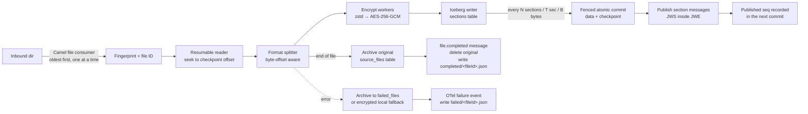

# Healthcare Source Connectors — Design

Status: **Draft for review, spike in progress** · Date: 2026-10-28 · Scope: parent project, `connector-contract`, `connector-core`, `connector-queue-reader`, `file-connector`

Revision 2026-10-28 (b): added the `connector-queue-reader` consumer library and `connector-contract` (§3, §10.2). Replaced the Iceberg-property lease with a Postgres lease plus fencing tokens (§9.3). Folded publish marks into batch commits (§9.2). Made host disk capacity an operator responsibility (§17). Recorded the §16 spike results.

Revision 2026-10-28 (c): built the splitters (§6). Resume uses a `ResumePoint` (offset plus PHI-free context offsets) instead of a bare offset, saved in the checkpoint as `resumeAt` (§6.1, §9.1). Sections are lists of literal parts and source ranges. The FHIR splitter uses a byte-level structural scanner instead of Jackson. Added X12 `GS`/`ISA` boundaries and TA1 handling.

Revision 2026-10-28 (d): built the split phase of the pipeline (§9.4). Multi-chunk sections are read twice (hash, then encrypt) so memory stays at one chunk (§7.2). Commit retries check the checkpoint first so a batch is never appended twice (§9.2). The checkpoint gained `format`, `fileSize` and the `ABANDONED` state (§9.1). Fingerprints and checkpoint MACs use labelled HMACs (§5.1, §9.1). Archiving, failure handling and broker adapters are not built yet.

Revision 2026-10-28 (e): built archiving and failure handling (§4.1, §11). Added the `FAILING` state, so the decision to fail a file is durable before anything else happens. Archive tables keep file-level values on a summary row (§8.2). The digest chain, the local fallback format and the completion order are now specified (§5.1, §11.1, §11.2). Broker adapters and the Camel wiring are not built yet.

---

## 1. Purpose

Ingest health information files (C-CDA, X12, FHIR, CSV, and proprietary formats) dropped into a directory, split each file into self-contained sections at a run-time-defined boundary, store every section encrypted in Apache Iceberg tables (Parquet data files), and announce each stored section on a run-time-selected message queue with an encrypted, signed message.

The service must:

- Resume after any crash or restart from the exact section where it stopped, including part-way through a file of up to ~1 TB.
- Process every file already in the directory, then keep picking up new ones.
- Never expose PHI in file paths, object names, IDs, queue metadata, logs or telemetry.
- Run as exactly one instance.

`file-connector` is the first of several connectors. Everything that isn't specific to files lives in `connector-core` so later connectors reuse it.

## 2. Technology baseline

All versions were checked against Maven Central on 2026-10-28.

| Component | Version | Notes |
|---|---|---|
| Java | 25 (LTS) | Virtual threads for I/O-bound publishing and KMS calls. HKDF uses the Java 25 `javax.crypto.KDF` API |
| Spring Boot | 4.1.2 | Spring Framework 7.0.x. 4.1 OSS support runs to mid-2027. Only `file-connector` imports the Boot BOM |
| Apache Camel | 4.22.2 (LTS) | Camel pins Spring Boot 4.1.1; the spike confirmed 4.1.2 works (§16) |
| Apache Iceberg | 1.12.0 | No LTS concept; latest stable |
| Apache Parquet | 1.17.1 | The version Iceberg 1.12.0 is built against; pinned to match, not upgraded separately |
| Hadoop (classes only) | 3.4.3 | Six jars, transitive dependencies excluded: `hadoop-common`, `hadoop-mapreduce-client-core`, `hadoop-shaded-guava`, `woodstox-core`, `stax2-api`, `commons-collections4` (§16) |
| Jackson 2 | 2.22.2 | Used by Iceberg only (Spring uses Jackson 3). Pinned in `file-connector`, because Boot 4.1.2 would downgrade it to 2.21.x |
| Nimbus JOSE+JWT | 10.10 | JWS/JWE message encryption and signing |
| PostgreSQL | any supported | Lease store (§9.3). Can be the JDBC catalog's database |
| OpenTelemetry | via Spring Boot 4 OpenTelemetry starter | OTLP export of traces, metrics, logs |
| Maven | 3.9.16 via Maven Wrapper | The local install is 3.8.7 |
| Spark | **Not used** | |

Where a component has no LTS line (Iceberg, Parquet, Nimbus), we use the latest stable release, with versions managed in the parent POM.

## 3. Project layout

```
healthcare-source-connectors/            groupId com.sdh.healthcare
├── pom.xml                              parent: dependency/plugin management, Java 25, enforcer
├── .gitignore                           excludes build output, IDE files, *.pem, *.key, *.p12, .env
├── mvnw, .mvn/wrapper/                  Maven 3.9.16
├── docs/DESIGN.md                       this document
├── connector-contract/                  library jar: the wire contract shared by writers and readers
│   └── com.sdh.healthcare.connector.contract
│       ├── message/      message records, payload codec, contract version
│       ├── jose/         MessageSealer (sign + encrypt), MessageOpener (decrypt + verify)
│       ├── crypto/       KeyProvider SPI, section key derivation, chunk encryption
│       └── table/        sections table schema, partition spec, sort order
├── connector-queue-reader/              library jar for consumers (§10.2); depends on contract only
│   └── com.sdh.healthcare.connector.reader
├── connector-core/                      library jar (no main class)
│   └── com.sdh.healthcare.connector.core
│       ├── split/        SectionSplitter SPI + built-in splitters
│       ├── crypto/       KMS/local KeyProvider implementations, ID HMAC
│       ├── storage/      Iceberg catalog/FileIO setup, writers, compaction, retention
│       ├── checkpoint/   checkpoint model, lease store, lease keeper, fenced committer
│       ├── publish/      MessagePublisher SPI, OutboundMessage (broker adapters live in the connector app, §10.3)
│       ├── telemetry/    audit events, metrics, PHI-safe error codes
│       └── pipeline/     source-agnostic ingest pipeline (read → split → encrypt → write → commit → publish)
└── file-connector/                      Spring Boot application + Docker image
    └── com.sdh.healthcare.connector.file
        ├── FileConnectorApplication
        ├── route/        Camel routes (directory discovery, housekeeping)
        ├── source/       LocalSourceFile, DirectoryOutcomeRecorder (completed/ and failed/ records, local fallback)
        └── admin/        operator commands (restore, decrypt-fallback)
```

Each module has its own `.gitignore` for module-specific output.

**Why `connector-contract` exists:** the message format, chunk encryption and table layout are written by `connector-core` and read by `connector-queue-reader`. Keeping them in one small module means both sides use the same code, and the reader doesn't pull in Camel, splitters or the pipeline. Consumers depend on `connector-queue-reader` only. They treat `connector-contract` as internal, apart from the message records it defines.

## 4. End-to-end flow



### 4.1 File lifecycle (state machine)

```
DISCOVERED → SPLITTING → ARCHIVING → COMPLETED
                │            │
                └────────────┴──→ FAILING → FAILED
   (source gone while SPLITTING, or ARCHIVING with the archive unfinished) → ABANDONED
```

The state lives in the `sections` checkpoint (§9.1). `FileProcessor` (`connector-core` `pipeline/`) runs the whole lifecycle.

| State | Durable record | Restart behaviour |
|---|---|---|
| DISCOVERED | none | The file is still in the inbound directory, so it is simply picked up again |
| SPLITTING | `sections` checkpoint | Resume at `resumeAt` and continue at `nextSeq`. Republish any committed-but-unpublished sections first |
| ARCHIVING | `sections` checkpoint + archive checkpoint on `source_files` | Continue archiving from the last archived block. If the archive is already done, finish without the source (§11.1) |
| COMPLETED | `completed/<fileId>.json`; original deleted | Nothing to do |
| FAILING | `sections` checkpoint with stage, error code and offset; archive checkpoint on `failed_files` | Finish failing the file; never retry splitting it |
| FAILED | `failed/<fileId>.json` (+ `failed/<fileId>.enc` if fallback was used) | Nothing to do; operators take over |
| ABANDONED | `sections` checkpoint | Nothing to do; `file.abandoned` was logged |

**Startup (for the file connector):** if `FileProcessor.inProgress()` returns a checkpoint, fingerprint the inbound files and `process()` the match first. If there is no match, call `recoverWithoutSource()`.

Files are processed **one at a time, oldest first**. This keeps ordering predictable and resume logic simple, and the work within a single file is already parallelised (§7).

## 5. Directory handling (Camel)

- **Consumer:** `camel-file` watches `sdh.file.inbound-dir`, non-recursive, with `sortBy=file:modified` and `maxMessagesPerPoll=1`.
- **Partially written files:** a configurable read lock (`changed` by default) waits until the file size and modification time stay unchanged for `min-age`. A `.done`-marker mode and an include/exclude glob are also available.
- **Subdirectories:** `completed/` and `failed/` sit inside the inbound directory and are excluded from pickup.
- **Startup:** if a checkpoint records an in-progress file, that file is processed before anything else. It is matched by fingerprint, not name. If the file has disappeared, a `file.abandoned` audit event is raised and the checkpoint is closed.
- **Completion:** Camel's own move/delete options are switched off. The pipeline moves and deletes files itself, because a file is only finished once archiving has been committed.
- **Finished-file records:** `completed/<fileId>.json` and `failed/<fileId>.json` contain no PHI: file ID, timestamps, section count, byte count, keyed file digest, and for failures the stage, offset and error code. The original filename never appears in either directory.

### 5.1 File identity

| Identifier | Definition | Purpose |
|---|---|---|
| `fileId` | UUIDv7, assigned at pickup and saved in the checkpoint | Correlates queue messages, telemetry and tables |
| fingerprint | size + `HMAC(idKey, "sdh-fingerprint" ‖ 0 ‖ first 1 MiB ‖ last 1 MiB)` | Recognises the same file after a restart without reading all of it |
| `fileDigest` | `base32` of a chained HMAC-SHA-256 over fixed 64 MiB blocks, computed during archiving | Integrity value sent in `file.completed` |

The digest is chained, `H_i = HMAC(idKey, "sdh-file-digest" ‖ 0 ‖ H_{i-1} ‖ block_i)` with `H_{-1}` = 32 zero bytes, so a restart only needs the last `H` value and the block number, both of which are saved in the archive checkpoint. An empty file is one empty block. The digest depends only on content, not on `fileId` or how the archive was committed.

## 6. Splitting

### 6.1 SPI

Package `com.sdh.healthcare.connector.core.split`; built-ins in `split.builtin`.

```java
public interface SectionSplitter {
    String format();                                  // e.g. "ccda"
    default void validate(SplitConfig cfg) {}         // called at startup: bad config fails the service, not a file
    SplitSession open(SeekableByteSource src, ResumePoint from, SplitConfig cfg) throws IOException, SplitException;
}
public interface SplitSession extends AutoCloseable {
    Optional<Section> next() throws IOException, SplitException;
}
record Section(long sourceOffset, long sourceLength, List<Part> parts, ResumePoint resume)  // Part = Literal(bytes) | SourceRange(offset, length)
record ResumePoint(long offset, List<Long> context)
```

- **Byte ranges:** a section is a list of **parts**: source byte ranges plus small synthesised literals (a CSV header, an X12 envelope, an XML declaration or a rewritten root start tag) that make it self-contained. Splitters never hold section bytes in memory; `Section.open(src)` streams the plaintext. Sections are capped by `max-section-bytes`.
- **Resume:** every section carries the `ResumePoint` after it, and `open` must accept `ResumePoint.START` or any of these and produce exactly the sections that followed. `context` holds **source offsets only** of structures the splitter re-reads on resume: the enclosing ISA and GS segments for X12, and the open ancestor start tags for XML (for in-scope namespaces). Offsets carry no PHI, so the resume point can live in the checkpoint (§9.1). File-start context (CSV header, XML declaration, FHIR array-or-stream) is re-read from offset 0.
- **Limits:** `SplitterRegistry.open(format, src, from, nextSeq, cfg)` wraps the session and enforces §6.3, counting sections from `nextSeq` so the per-file count survives a resume. Splitters also stop scanning early once a section passes `max-section-bytes`.
- **Errors:** `SplitException` carries only an `ErrorCode` and a byte offset. Codes: `PARSE_UNTERMINATED_QUOTE`, `PARSE_UNBALANCED_ELEMENT`, `PARSE_XML_MALFORMED`, `PARSE_XML_UNSUPPORTED_ENCODING`, `PARSE_X12_INVALID_ENVELOPE`, `PARSE_X12_UNBALANCED`, `PARSE_X12_CONTROL_MISMATCH`, `PARSE_X12_UNEXPECTED_SEGMENT`, `PARSE_JSON_MALFORMED`, `PARSE_FHIR_UNEXPECTED_RESOURCE`, `RESUME_INVALID`, `LIMIT_*`.
- **Plug-ins:** new formats are discovered via `ServiceLoader` (proprietary formats can be dropped in as a jar).

### 6.2 Built-in splitters

The format and boundary are both set at run time.

| `format` | Default boundary | Behaviour |
|---|---|---|
| `ccda` / `xml` | `ccda`: element `ClinicalDocument`, ns `urn:hl7-org:v3`. `xml`: boundary required, `namespace` defaults to `*` (any) | Byte-level streaming XML tokenizer that ignores comments, CDATA, processing instructions and DOCTYPE. A section runs from the boundary start tag to its matching end tag; a nested boundary element stays inside the outer section. Namespace declarations in scope from ancestor elements are copied onto the section's root element, and the file's XML declaration is prepended, so every section is a valid standalone document. End tags are checked against start tags. Input must be ASCII-compatible (UTF-8, ISO-8859-x); UTF-16 fails with `PARSE_XML_UNSUPPORTED_ENCODING`. Entities from a DOCTYPE internal subset are not carried into sections. |
| `x12` | segment `ST` (also `GS` or `ISA`) | Delimiters are read from each ISA segment. `ST`: each section is `ISA + GS + ST…SE + GE + IEA`, with GE01 and IEA01 rewritten to 1. `GS`: `ISA + GS…GE + IEA`, IEA01 = 1. `ISA`: the interchange unchanged. A TA1 between ISA and GS becomes `ISA + TA1 + IEA` (IEA01 = 0), so nothing is dropped. Control numbers ST02/SE02, GS06/GE02 and ISA13/IEA02 are checked. BIN segments are not supported. |
| `fhir` | `Bundle` (`*` = any `resourceType`) | Byte-level structural JSON scanner (strings, escapes, bracket nesting) that checks each top-level object's `resourceType`. Jackson was dropped because it can't restart mid-array at a byte offset; full JSON validation is left downstream. Accepts a single resource, a JSON array, or NDJSON / whitespace-separated objects. Optional `fhir.ndjson-group-size` = N groups N resources per section (boundary then defaults to `*`); grouped array sections are wrapped in `[ ]`. |
| `csv` | record | RFC 4180 record boundary (newlines inside quotes are respected). `csv.header=true` prepends the first record to every section; `csv.delimiter` (default `,`). Empty lines are skipped. Content is otherwise not interpreted. |
| `delimited` | regex (`delimited.pattern`, or `delimited.literal=true`) | Generic fallback for proprietary formats. `mode = START \| END \| SEPARATOR` controls whether a matching line begins a section, ends one, or is dropped. Each line is decoded (`delimited.charset`, default UTF-8) and tested with `find()` on its first `delimited.match-window` bytes (default 4096). Blank lines never start a section. In START mode, lines before the first match form their own section. |

### 6.3 Limits

These are configurable per format. A violation fails the file with error code `LIMIT_*`.

| Limit | Default |
|---|---|
| `max-file-bytes` | csv 10 GiB; others 1 TiB |
| `max-section-bytes` | 512 MiB (well under Parquet's 2 GiB value limit) |
| `max-sections-per-file` | unlimited |

A file over `max-file-bytes` is rejected **before ingestion**. It is moved to the encrypted local `failed/` fallback and is not stored in Iceberg.

## 7. Encryption and identifiers

### 7.1 Keys

| Key | Type | Held by | Used for |
|---|---|---|---|
| Sections KEK | AES-256 or RSA/EC wrap key | KMS or local keystore | wrapping batch data keys for `sections` |
| Source-files KEK | separate key | KMS or local keystore | `source_files` table |
| Failed-files KEK | separate key | KMS or local keystore | `failed_files` table |
| ID key | 256-bit HMAC secret | generated at first start, stored **wrapped** in a table property, unwrapped into memory at startup | section IDs, fingerprints, digests |
| Signing key | EC P-256 | KMS (sign API) or passphrase-protected PEM | signing queue messages (ES256) |
| Recipient public key(s) | EC P-256 / RSA | PEM files, SHA-256 fingerprint pinned in config | encrypting queue messages |
| Recovery public key | EC P-256 | PEM file | encrypting the local `failed/` fallback when storage or KMS is unreachable |

Using a separate KEK per table lets the retrieving system be given decrypt rights on `sections` only.

### 7.2 Section encryption (envelope)

1. One random 256-bit **batch data key (BDK)** per commit batch, wrapped once by the KEK. This means one KMS call per batch, not per section, which matters for millions of CSV rows.
2. A per-section key is derived as `HKDF-SHA256(BDK, info = "sdh-section" ‖ fileId ‖ seq)`. Exposing one section's key exposes nothing else.
3. The section plaintext is cut into **8 MiB chunks**. The chunk count is known up front, because the splitter reports the section's byte length.
4. Each chunk is **zstd-compressed, then encrypted** with AES-256-GCM, using a random 96-bit nonce and AAD = `fileId ‖ seq ‖ chunkIndex ‖ chunkCount`. The AAD prevents chunks being reordered, swapped between sections, or truncated.
   - The section ID is not part of the AAD, because it isn't known until the whole section has been hashed, yet every chunk row carries it. A single-chunk section (the common case) is read once into memory, hashed and encrypted. A larger section is read **twice**: one pass computes the ID, the second encrypts and writes each chunk, and re-checks the hash so a source that changed in between fails the batch. Memory stays at one 8 MiB chunk per section in flight, whatever `max-section-bytes` is.
   - Compressing before encrypting is required, because ciphertext doesn't compress. It is safe here because no attacker-controlled input is mixed into the plaintext.

### 7.3 Section ID

`sectionId = base32(HMAC-SHA-256(idKey, sectionPlaintextBytes))` (including prefix/suffix bytes).

- The ID is deterministic from content, so a repaired file resubmitted later produces the same IDs for unchanged sections. This is what downstream dedup relies on.
- It is keyed, so it cannot be used to guess low-entropy PHI such as a CSV row.
- Identical content in different files gets the same ID and is treated by downstream as a duplicate. This is accepted, and documented for CSV providers.
- The `idKey` is never rotated: rotating it would break dedup. Losing it breaks dedup only, not decryption.

### 7.4 KeyProvider SPI

```java
public interface KeyProvider {
    WrappedKey wrap(String keyRef, byte[] dataKey);
    byte[] unwrap(WrappedKey wrapped);
    byte[] sign(String keyRef, byte[] digest);        // ES256
    PublicKey publicKey(String keyRef);
}
```

Implementations: `aws-kms`, `gcp-kms`, `azure-keyvault`, `vault-transit`, and `local`.

- **`local`:** a PKCS#12 keystore for KEKs plus PEM files for signing and recipient keys.
- **Mixing providers:** wrapping and signing providers are configured independently, so a KMS can be used for one and PEM for the other.
- **Protections in `local` mode:**
  - The service refuses to start if a key file is group- or world-readable.
  - Private PEMs must be encrypted PKCS#8, with the passphrase supplied from an environment variable or mounted secret.
  - Recipient PEM fingerprints must match the pinned values.

### 7.5 PHI hygiene

- **Logging:** no PHI, filenames or exception messages from parsers are ever logged. Exceptions are mapped to stable error codes (`PARSE_UNBALANCED_ELEMENT`, `LIMIT_SECTION_SIZE`, …), and only the code, exception class, offset and seq are emitted.
- **Camel:** body logging, tracing, message history and dead-letter body dumps are disabled.
- **Temp files:** no plaintext is ever written to temporary files.
- **Container:** runs as non-root with a read-only root filesystem, heap dumps disabled, and TLS everywhere (object store, catalog, KMS, brokers).

## 8. Storage

### 8.1 Catalog and object storage

These are selected at run time.

| Setting | Options |
|---|---|
| `sdh.storage.catalog.type` | `rest` (Apache Polaris, Nessie, Unity, AWS S3 Tables, …), `jdbc` (Postgres; simplest for self-hosting) |
| `sdh.storage.io` | `s3` (AWS S3, **SeaweedFS**, MinIO via endpoint override + path-style access), `gcs`, `adls` |

**Storage-side encryption:** server-side encryption (SSE-KMS / CMEK) is enabled where the store supports it, as a second layer beneath application encryption. For SeaweedFS, application encryption is the primary protection.

### 8.2 Tables

The namespace is `sdh_ingest` (configurable). There are three tables, each with its own KEK and access policy.

**`sections`** has one row per chunk. A single table keeps commits atomic: Iceberg does not offer multi-table transactions on every catalog, so data and checkpoint must live in one table.

| Column | Type | Notes |
|---|---|---|
| section_id | string | keyed content hash |
| file_id | uuid | |
| seq | long | 0-based section sequence within file |
| chunk_index | int | |
| chunk_count | int | |
| source_offset | long | byte offset of section in source file |
| source_length | long | |
| format | string | |
| plaintext_length | long | before compression |
| ciphertext | binary | nonce ‖ AES-GCM ciphertext ‖ tag |
| bdk_wrapped | binary | wrapped batch data key (repeated per row; ~200 B per row, negligible) |
| kek_ref | string | key ID/version used to wrap |
| batch_id | uuid | |
| ingested_at | timestamptz | |

- **Partitioning:** `day(ingested_at)`. Sort order `file_id, seq, chunk_index`, so readers prune files using min/max statistics.
- **Parquet settings:** zstd level 1 for the whole table. Row group 128 MiB, target file size 512 MiB. The earlier plan to leave `ciphertext` uncompressed isn't possible: Iceberg sets the Parquet codec per table, not per column (spike finding). zstd passes incompressible ciphertext through at a small CPU cost and almost no size overhead.
- **`source_files`** holds the raw original in 8 MiB chunks, one row per chunk: `file_id`, `chunk_index`, `chunk_count`, `chunk_size`, `file_size`, `ciphertext`, `bdk_wrapped`, `kek_ref`, `batch_id`, `archived_at` (partition `day(archived_at)`, sort `file_id, chunk_index`). Chunk key = HKDF(BDK, fileId, seq 0); AAD = fileId ‖ 0 ‖ chunkIndex ‖ chunkCount.
- **Summary row:** values known only at the end go on one row with `chunk_index = -1`, written in the final archive commit: `original_name_enc` (the filename, encrypted with seq −1), `file_digest`, `digest_block_size`, `section_count`, `started_at` and `completed_at`. A file with a summary row is fully archived.
- **`failed_files`** has the same layout. Its summary row adds `failure_stage`, `failure_offset`, `failure_seq`, `error_code`, `failed_at` and `replaces_file_id`. `replaces_file_id` is not filled in yet; it waits for the admin resubmit flow.
- **Archive progress:** commits happen every `archive.commit-bytes` (default 512 MiB, whole blocks). Each one carries the archive checkpoint `sdh.archive.<connectorId>` = {fileId, nextBlock, chainHash, done, digest, finishedAt}, MAC'd like the main checkpoint. `ArchiveReader` restores a file (or its tail from an offset) a few chunks at a time and re-checks the digest.

### 8.3 Commit batching

A commit happens when the first of these thresholds is reached (all configurable):

- `commit.max-sections` (default 10,000)
- `commit.max-bytes` (default 512 MiB)
- `commit.max-interval` (default 30 s)
- end of file

Committing per section would create a snapshot per section and does not scale.

Each commit is **one fenced Iceberg commit** (§9.3) containing:
1. an `append` of the batch's data files;
2. an `updateProperties` that writes the checkpoint (§9), including the `publishedSeq` reached by the previous batch.

The fenced committer checks the lease epoch and commits with a strict compare-and-swap.

### 8.4 Maintenance

Spark is not used, so maintenance runs inside the service on the single writer and is scheduled during idle time. Every maintenance commit goes through the fenced committer, except snapshot expiry (below).

- **Snapshot expiry:** Iceberg core `expireSnapshots()`, keeping 7 days by default.
  - It runs **standalone**, straight after a successful fenced commit and lease check, not inside the fenced compare-and-swap.
  - Reason: Iceberg only deletes expired files from its own commit path. Run inside our compare-and-swap, it updates metadata but leaves the files on storage (spike finding).
  - Expiry can't write data or checkpoints. The worst a stale instance could do is expire snapshots that are already past retention.
- **Compaction:** custom bin-pack using core `RewriteFiles` with `validateFromSnapshot`, committed through the fenced committer (prototype passes in the spike). Iceberg's ready-made `RewriteDataFiles` action requires Spark or Flink.
- **Orphan-file cleanup:** custom listing, comparing the object store to the files referenced by tables, with a safety age of 3 days.
- **Retention:** `deleteFromRowFilter(ingested_at < cutoff)`, which drops whole day partitions, followed by snapshot expiry so the PHI is physically removed. Retention is configured per table and is off by default.

## 9. Checkpointing, resume and single instance

### 9.1 Where progress lives

Progress is stored in **Iceberg table properties**, written in the same atomic commit as the data. Data and progress therefore cannot disagree, and they are protected by the same catalog access controls as the PHI. No local database is used. Only the lease's liveness lives outside Iceberg, in Postgres (§9.3).

```json
sdh.checkpoint.file-connector = {
  "fileId": "...", "fingerprint": "...", "state": "SPLITTING",
  "resumeAt": "123456789:1024,5120", "nextSeq": 40211,
  "committedSeq": 40210, "publishedSeq": 39000,
  "format": "ccda", "fileSize": 987654321,
  "startedAt": "...", "mac": "HMAC(idKey, \"sdh-checkpoint\" ‖ 0 ‖ canonical JSON without mac)"
}
```

- **`resumeAt`:** the encoded `ResumePoint` of the last committed section (§6.1): the next offset, then any context offsets. Offsets only, no content.
- **States:** see §4.1. A `FAILING` or `FAILED` checkpoint also carries `failureStage`, `errorCode`, `failureOffset` and `failedAt`. The pipeline refuses a new file while another is `SPLITTING`, `ARCHIVING` or `FAILING`.
- **Labelled MACs:** checkpoint MACs and fingerprints prefix a label, so neither can ever equal a section ID made with the same key.
- **Tamper detection:** the checkpoint is MAC'd with the ID key. If it fails verification, the service stops with `CHECKPOINT_TAMPERED` rather than guessing.
- **Archive phase:** uses an equivalent property on `source_files`, recording `nextBlock`, `chainHash` and `bytesArchived`.

### 9.2 Resume and publish protocol

```
loop per batch N:
  fencedCommit(data_N + checkpoint{resumeAt, nextSeq, committedSeq = last seq of N,
                                   publishedSeq = last seq of N-1 acknowledged by the broker})
  publish messages for seq (publishedSeq, committedSeq], waiting for broker ack
end of file:
  fencedCommit(checkpoint{state = ARCHIVING, publishedSeq = committedSeq})   # no data
```

Publish progress is recorded in the **next** batch commit, not in a separate commit, which halves the number of commits. The end-of-file commit carries no data, so the fenced committer adds an empty marker snapshot to it (§9.3).

On restart:
1. Read the checkpoint.
2. Rebuild messages for any committed-but-unpublished seq range from table metadata columns. Decryption isn't needed for this.
3. Republish those messages, then resume splitting at `resumeAt`.

**Duplicates:** at most one batch can be republished after a crash. That is the same worst case as before, since a crash part-way through publishing a batch already meant republishing it. Broker dedup (§10.3) removes the duplicates where the broker supports it, and downstream dedup handles the rest.

**Unknown commit outcome:** if a commit ends with Iceberg's `CommitStateUnknownException`, the process stops and restarts from the checkpoint. The checkpoint shows whether that commit happened.

**Retrying a commit:** other transient storage errors (I/O, `CommitFailedException`, 5xx, JDBC errors; an allow-list) are retried with backoff. Before each retry the pipeline re-reads the checkpoint, and if it already shows the batch the earlier attempt landed after all, so the batch is never appended twice.

### 9.4 Pipeline (`connector-core` `pipeline/`, built)

`IngestPipeline.split(source)` runs the split phase for one file and returns once every section is committed and published, with the checkpoint in `ARCHIVING`. The connector app supplies the source, the sections table, the `FencedCommitter`, keys, the sealer and a `MessagePublisher`.

1. **Identify:** fingerprint the source. If it matches a `SPLITTING` checkpoint, resume; if it matches an `ARCHIVING` one, return straight away; otherwise assign a UUIDv7 and commit a fresh checkpoint before anything else.
2. **Announce:** publish `file.started` (again on resume; message ID dedup handles the repeat), then republish any committed-but-unpublished range.
3. **Split and encrypt:** single-chunk sections are hashed and encrypted on the worker pool, with at most `4 × workers` in flight; larger sections are processed inline (§7.2). Rows are written in seq order.
4. **Commit:** at the first threshold (§8.3), data file + checkpoint in one fenced commit. The commit first waits for the previous batch's publishing and records its last seq as `publishedSeq`.
5. **Publish:** the batch's messages are sealed on the worker pool and sent in seq order on a background thread while the next batch is split. Failed sends are retried one by one.
6. **End of file:** wait for publishing, then a data-free commit to `ARCHIVING`.

The ID key is created or unwrapped by `IdKeys` (table property `sdh.id-key`). Each audit log line carries only IDs, seqs, offsets and counts.

### 9.3 Single-instance lease and fencing

The design follows the standard pattern for single-writer leases:
- a lease with a TTL in a store that supports compare-and-set and judges expiry by its own clock;
- renewal well before expiry;
- self-fencing on the holder's monotonic clock;
- a **fencing token** that the storage layer checks on every write.

Self-fencing alone isn't enough. A process can pause (GC, VM suspend, container freeze) between checking its lease and committing, so the storage commit must also reject a stale holder.

The earlier draft kept the lease in `sections` table properties, renewed every 30 s. That meant a metadata commit (a new `metadata.json`) every 30 s, around the clock, mixed in with the PHI data. It was replaced as follows.

**Two parts:**

| Part | Where | Job |
|---|---|---|
| Liveness | Postgres row in `sdh_lease` (`JdbcLeaseStore`) | Who holds the lease and until when. Renewals touch only this row and write nothing to Iceberg |
| Fencing token | `sdh.lease.epoch` property on each ingest table (`FencedCommitter`) | Lets a commit from a stale holder be rejected by the catalog itself |

**Lease store (`JdbcLeaseStore`):**
- One row per lease name: `owner`, `epoch`, `expires_at`.
- All expiry checks use the database clock (`clock_timestamp()`), so client clock skew can't create two holders.
- **Acquire** is one atomic upsert. It inserts a new row with epoch 1, or takes over an *expired* row with `epoch + 1`. A live row is left alone, and the caller gets `LEASE_HELD` and exits non-zero. Concurrent acquirers are serialised by the row lock, and the spike test confirms exactly one of 16 wins.
- **Renew** succeeds only while `owner` and `epoch` still match. **Release**, on clean shutdown, sets `expires_at` to now so a restart doesn't wait for the TTL. The row is never deleted, so the epoch only ever increases.
- **Placement:** a JDBC-catalog deployment can use the catalog's own Postgres. A REST-catalog deployment needs a small Postgres for this. The `LeaseStore` SPI leaves room for other stores with the same guarantees (for example a Kubernetes `Lease`); none is planned yet.

**Holder (`LeaseKeeper`):**
- **Timing:** TTL 60 s, renewal every 15 s, safety margin 10 s. These defaults are configurable; the code requires `2 × renew + margin < TTL`, so two renewals can fail in a row before anything happens.
- **Local validity:** `(time the last successful renewal request was sent) + TTL − margin`, measured on the monotonic clock. Counting from when the request was sent, not when the reply arrived, means a slow reply can only shorten the window.
- **Self-fencing:** before every commit, the pipeline calls `checkHeld()`. If the window has passed, or the store reports a new owner, the lease is lost (`lease.lost` audit event, `LEASE_LOST`). The pipeline stops, the process exits non-zero, and the orchestrator restarts it.
- **After a crash:** a successor waits at most the TTL (60 s) before it can take over.

**Fencing (`FencedCommitter`):**
1. **Establish:** after acquiring the lease, the instance commits its epoch to each ingest table. This commit fails if the table already shows a higher epoch. From that point, every older holder is fenced out.
2. **Every commit** (data batches, checkpoint updates, archive progress, compaction):
   - refresh the table and require `sdh.lease.epoch` = our epoch;
   - build the change as a transaction on that exact metadata;
   - commit it with `TableOperations.commit(start, new)`, a strict compare-and-swap;
   - if the commit fails, refresh and check the epoch again, which identifies a stale holder.
3. **Why not `Transaction.commitTransaction()`:** Iceberg's normal commit refreshes the table and quietly re-applies our changes on top of whatever metadata is newest. A stale instance's checkpoint would then land on top of its successor's. The spike includes a control test that shows this happening on both catalog types.
4. **Every commit adds a snapshot:** if a change doesn't add one, for example a properties-only update, the committer adds an empty marker append.
   - A REST catalog only checks a commit against concurrent changes through requirements such as `assert-ref-snapshot-id`, which is only sent when `main` moves. A properties-only commit carries no such requirement, so the server would accept it from a stale instance.
   - JDBC and Hive catalogs compare the whole metadata location, so they are safe either way. The marker keeps behaviour identical across catalogs.
5. **Tested:** a stale holder is rejected when it commits after its successor established, and in the race where the successor establishes between the stale holder's check and its commit. Both are tested on JDBC (embedded Postgres) and on REST (Iceberg's reference REST request handling, run in-process).
6. **Internals:** this relies on Iceberg's public `BaseTransaction.startMetadata()`, `currentMetadata()` and `underlyingOps()`. They are not formally part of the API, so the fencing tests run on every Iceberg upgrade.

## 10. Messaging

### 10.1 Message types

Every message is **JWS (ES256, signed by this service, `typ: sdh-msg+jws`) nested inside JWE (`ECDH-ES+A256KW` for EC recipients or `RSA-OAEP-256` for RSA, always `A256GCM`)** addressed to the recipient's public key. Both headers carry a `kid`, so keys can be rotated. Every payload carries `"v": "<major>.<minor>"`, the contract version (§10.2).

| Type | When | Payload (inside encryption) |
|---|---|---|
| `file.started` | file picked up (or resumed with a new run) | fileId, format, fileSize, startedAt, connectorId |
| `section.stored` | after batch commit | messageId, fileId, sectionId, seq, sourceOffset, sourceLength, format, plaintextLength, chunkCount, storage ref (catalog, namespace, table, ingested date, snapshotId, kekRef) |
| `file.completed` | after archive commit | fileId, sectionCount, fileSize, fileDigest, startedAt, completedAt |

- **No `file.failed` message:** failure is reported through OpenTelemetry only, as agreed. Downstream can detect an unfinished file as a `file.started` with no matching `file.completed`.
- **Change from earlier discussion:** the "duplicates skipped" count is **not** included in `file.completed`. Counting it would require checking every section against all previously stored IDs, which is too expensive at this scale. Duplicate handling stays downstream.
- **Unencrypted broker metadata** is limited to: `messageId`, `type`, `fileId` (used for ordering), and the content type `application/jose`.
- **Message IDs:**
  - `section.stored`: `messageId = sectionId`.
  - `file.started`: `fs-<fileId>`.
  - `file.completed`: `fc-<fileId>`.

### 10.2 Consuming messages: `connector-queue-reader`

Consumers never implement the envelope, encryption or table layout themselves. They use the `connector-queue-reader` library, so those details can change inside the connector without breaking any consumer.

```java
QueueReader reader = QueueReader.builder()
    .recipientKey("downstream-2026", recipientPrivateKey)      // several allowed during rotation
    .trustedSigner("connector-2026", connectorSigningPublicKey)
    .catalog(icebergCatalog)                                     // consumer supplies catalog + FileIO
    .expectedCatalogName("prod")                                 // optional
    .keyProvider(kmsKeyProvider)                                 // unwrap rights on the sections KEK only
    .build();

ConnectorMessage m = reader.decode(brokerMessageBody);           // FileStarted | SectionStored | FileCompleted
if (m instanceof SectionStored s) {
    try (InputStream in = reader.openSection(s)) { ... }         // or reader.readSection(s, maxBytes)
}
```

**What the library does:**
- **Decoding:** decrypts and verifies messages. Only the algorithms listed in §10.1 are accepted, and keys are chosen by `kid` from fixed lists, so a message header can't pick a weaker algorithm or key. Rejections give a `MessageRejectedException.Reason`, never payload content.
- **Section lookup:** queries `sections` for the section's `file_id`, `seq` and `ingested_at` day, which allows partition pruning. It refreshes its cached table if the message names a snapshot it hasn't seen yet.
- **Keys:** unwraps each batch data key once and caches it by `batch_id`, then derives the section key.
- **Streaming:** decrypts chunk by chunk, holding one 8 MiB chunk in memory plus any chunks the scan returns early. Each row is checked against the message (section ID, chunk count, length). The stream fails if a chunk is missing, duplicated, out of range, from another batch, or the wrong length.
- **Broker-neutral:** the consumer passes in the message body from whatever broker client it uses.

**Versioning:** a reader accepts any message with the same contract major version and ignores unknown fields, so minor versions only add optional fields. A new major version is rejected with `UNSUPPORTED_VERSION`. Before the connector starts writing a new major version, consumers must upgrade to a reader that supports it.

**Dependencies:** `connector-contract`, Iceberg core/data/parquet and the six-jar Hadoop set. There is no Camel, no Spring and no pipeline code. Consumers add their catalog and FileIO modules, for example `iceberg-aws`.

### 10.3 Brokers

`sdh.queue.type` selects the adapter, and `sdh.queue.uri` is a full Camel endpoint URI, so any component option can be set at run time. All client libraries are included in the single build.

| `type` | Camel component | Ordering key | Broker-side dedup |
|---|---|---|---|
| `kafka` | camel-kafka | record key = fileId | idempotent + transactional producer |
| `sqs` | camel-aws2-sqs | MessageGroupId = fileId (FIFO) | MessageDeduplicationId (FIFO queues, 5 min) |
| `pubsub` | camel-google-pubsub | orderingKey = fileId | none; `messageId` attribute |
| `servicebus` | camel-azure-servicebus | SessionId = fileId | duplicate detection on MessageId |
| `eventhubs` | camel-azure-eventhubs | partitionKey = fileId | none; `messageId` property |
| `artemis` | camel-jms + Artemis JMS client | JMSXGroupID = fileId | `_AMQ_DUPL_ID` |
| `rabbitmq` | camel-spring-rabbitmq | single queue / consistent-hash exchange | `message_id`; optional `x-deduplication-header` for the dedup plugin |

- **Acknowledgement:** publishing is synchronous until the broker acknowledges (Kafka acks=all, RabbitMQ publisher confirms, etc.).
- **Message size:** messages are small, around 2–4 KB after JOSE encoding, well under the smallest limit (SQS 256 KB).

## 11. Failure handling

| Situation | Action |
|---|---|
| Transient errors (KMS, object store, catalog, broker) | Retry with exponential backoff and jitter (`retry.max-attempts`, `retry.max-backoff`). The pipeline pauses; the file stays in its current state |
| Retries exhausted, or a non-retryable error (parse error, limit exceeded) | Fail the file (below) |
| Crash or kill at any point | Resume from the checkpoint (§9) |

**Classifying a failure:**

| Cause | Stage | Error code |
|---|---|---|
| File over `max-file-bytes` (checked before any checkpoint or `file.started`) | `intake` | `LIMIT_FILE_SIZE` |
| Splitter error | `split` | the splitter's `PARSE_*` / `LIMIT_*` code and offset |
| Broker didn't acknowledge after retries | `publish` | `PUBLISH_FAILED` |
| Reading the source failed | `split` or `archive` | `SOURCE_READ_FAILED` |
| Storage, catalog or KMS still failing after retries | `split` or `archive` | `STORAGE_FAILED` |

These never fail a file. They stop the process, which then restarts from the checkpoint: lease loss, `CommitStateUnknownException`, a tampered checkpoint, or a broken invariant (`IllegalStateException`).

### 11.1 Completing a file

After the split phase: archive the original to `source_files`, publish `file.completed`, write `completed/<fileId>.json`, delete the original, then commit `COMPLETED`. The original is deleted only after its archive is committed, and every step can be repeated (message ID dedup, records overwritten, deleting a missing file is fine). So a crash anywhere just repeats the remaining steps, and once the archive is done the source is no longer needed. A failure while archiving fails the file through §11.2, which archives it to `failed_files` instead.

### 11.2 Failing a file
1. Commit the decision: checkpoint `FAILING` with stage, code and offset. If storage is down this can't be recorded; the file still goes to the local fallback.
2. Already-committed and published sections stay where they are, each tied to its `file_id`.
3. The whole original is archived into `failed_files`. It goes to the local fallback `failed/<fileId>.enc` instead (§11.3) when the file is over `max-file-bytes`, when `FAILING` couldn't be recorded, or when the archive fails (storage or KMS unreachable). If even the fallback can't be written, the original is kept and the error propagates.
4. Write `failed/<fileId>.json`, delete the original, log `file.failed` (fileId, stage, offset, last committed seq, error code, where it was archived), and commit `FAILED`. No `file.failed` message is published (§10.1); the OpenTelemetry event comes with §12. Attempt count isn't recorded yet.

### 11.3 Local fallback format

`RecoveryEnvelope` (`connector-core` `crypto/`), streaming and any size:
- **Header:** `"SDHFB1"` ‖ fileId ‖ SHA-256(recovery public key) ‖ an ephemeral EC public key.
- **Key:** HKDF-SHA256 over the ECDH of the ephemeral and recovery keys, salted with the header hash.
- **Records:** each is `u32 length ‖ nonce ‖ AES-256-GCM(zstd(plaintext)) ‖ tag`, with AAD = header hash ‖ record index ‖ last-record flag.
- **Contents:** record 0 is JSON metadata (original name, size). The data follows in 8 MiB records.
- **Integrity:** truncation, reordering, splicing and the wrong key are all detected.

`DirectoryOutcomeRecorder` writes it to a hidden temp file and renames it into place only after a successful write and sync. Records are written the same way, with owner-only permissions.

### 11.4 Operator tools

`java -jar file-connector.jar admin …` (not built yet; `ArchiveReader` and `RecoveryEnvelope` do the decrypting). Every command emits an audit event naming the operator identity from the environment.
- `restore --file-id X --to <dir> [--from-offset N]` decrypts an archived failed file, or only its unprocessed tail, into a directory for repair or resubmission. A resubmitted file gets a new fileId, and `replaces_file_id` is recorded.
- `decrypt-fallback --file failed/<id>.enc --key recovery.pem` handles a file that was encrypted locally.
- `status` shows the checkpoint, lease and in-progress file.

## 12. Observability and audit (OpenTelemetry)

**Traces:** `ingest.file` (root, one per file) contains:
- `split.batch`
- `storage.commit`
- `publish.batch`
- `archive`

**Audit log events** (OTel logs, `event.name = sdh.audit.*`):
- **File events:** `file.discovered`, `file.started`, `file.resumed`, `batch.committed` (running seq and offset), `file.archived`, `file.completed` (final tally), `file.failed` (stage, offset, seq, error code), `file.abandoned`.
- **Operator and lease events:** `admin.restore`, `admin.decrypt_fallback`, `lease.acquired`, `lease.fenced_table` (epoch established on a table), `lease.lost` (with reason `EXPIRED`, `TAKEN_OVER` or `FENCED`), `lease.released`.

**Metrics:**

| Metric | Type |
|---|---|
| `sdh.files.in_progress` | gauge |
| `sdh.bytes.read` | counter |
| `sdh.sections.stored` | counter |
| `sdh.sections.published` | counter |
| `sdh.files.completed` | counter |
| `sdh.files.failed{error_code}` | counter |
| `sdh.commit.duration` | histogram |
| `sdh.publish.duration` | histogram |
| `sdh.inbound.oldest_file_age` | gauge |
| `sdh.file.progress_ratio` | gauge |

Attributes are restricted to an allow-list (fileId, format, error code, stage, counts, offsets). A telemetry processor drops any other attribute, so PHI cannot leak in through a careless log call.

## 13. Performance

| Pipeline stage | Concurrency |
|---|---|
| Reader | 1 thread, sequential; `FileChannel` with 4 MiB direct buffers |
| Splitter | 1 thread |
| Hash, compress, encrypt | worker pool sized to CPU cores, at most 4 × workers sections in flight; sections over one chunk run inline on the writer thread |
| Iceberg writer | 1 thread, writes in seq order |
| Publishing | one background thread per pipeline sends in seq order; sealing runs on the worker pool; the adapter's futures carry concurrency |

- **Reads per file:** each file is read **twice**, once to split and once to archive. This trade keeps both phases simply resumable, and the second read is sequential I/O.
- **Throughput:** expected to be bound by disk read speed or object-store upload speed for large C-CDA and X12 files, and by HMAC/encryption for very many small CSV records.

## 14. Configuration (illustrative)

```yaml
sdh:
  connector-id: file-connector
  file:
    inbound-dir: /data/inbound
    read-lock: changed            # changed | marker
    min-age: 30s
    include: "*"
  split:
    format: ccda                  # ccda | x12 | fhir | csv | delimited | <plugin>
    boundary: ClinicalDocument
    namespace: urn:hl7-org:v3
    csv: { header: true }
    fhir: { ndjson-group-size: 0 }
    delimited: { pattern: "^MSH\\|", mode: START }
    limits: { max-file-bytes: 1TiB, max-section-bytes: 512MiB }
  storage:
    catalog: { type: rest, uri: https://polaris:8181/api/catalog, warehouse: sdh }
    io: { type: s3, endpoint: https://seaweedfs:8333, path-style: true, region: us-east-1 }
    namespace: sdh_ingest
    commit: { max-sections: 10000, max-bytes: 512MiB, max-interval: 30s }
    retention: { sections: off, source-files: off, failed-files: off }
  lease:
    store: jdbc
    jdbc: { url: "jdbc:postgresql://postgres:5432/sdh?sslmode=verify-full", table: sdh_lease }
    ttl: 60s
    renew-interval: 15s
    safety-margin: 10s
  crypto:
    wrap-provider: aws-kms        # aws-kms | gcp-kms | azure-keyvault | vault-transit | local
    sign-provider: local
    keys:
      sections-kek: arn:aws:kms:...:key/...
      source-files-kek: ...
      failed-files-kek: ...
      signing: file:/run/secrets/signing.pem
      recipients:
        - { kid: downstream-2026, pem: /run/secrets/recipient.pem, sha256: "ab12..." }
      recovery-public: /run/secrets/recovery-public.pem
  queue:
    type: kafka
    uri: "kafka:sdh.sections?brokers=kafka:9093&securityProtocol=SSL"
```

Every value can be overridden through environment variables or Spring config sources.

## 15. Testing

| Level | Coverage |
|---|---|
| Unit | Each splitter, including boundaries spanning buffer edges, resume from every reported offset, malformed input and limits; crypto round-trips and AAD tamper detection; checkpoint MAC; message JOSE round-trip; lease keeper timing with a fake clock |
| Integration without Docker (default build) | Embedded PostgreSQL binaries (`io.zonky.test:embedded-postgres`) for the lease store and JDBC catalog. Iceberg's `RESTCatalogAdapter` for REST catalog commit rules, in-process. `InMemoryFileIO`. Fencing tests run against both catalog types. End-to-end write → message → `connector-queue-reader` |
| Integration (Testcontainers) | SeaweedFS and MinIO, Postgres JDBC catalog, Iceberg REST catalog fixture, Kafka, RabbitMQ, Artemis, LocalStack (SQS + KMS), Pub/Sub emulator, Azure Service Bus and Event Hubs emulators, Vault |
| Crash and resume | Fault-injection points at every stage (after write, after commit, after publish, mid-archive). The process is killed and restarted, then the test checks that there are no gaps, no lost sections, and duplicates only within the documented window |
| Throughput | Synthetic multi-GB C-CDA, X12 and CSV files, with records of MB/s and sections/s |

Integration tests run in a separate Maven profile (`-Pit`) because they need Docker.

## 16. Risks and verification items

These are checked first, in a build spike before the full implementation. Spike status as of 2026-10-28. All results come from `./mvnw install` on Java 25.0.4 (32 tests, all passing).

| # | Item | Status | Result |
|---|---|---|---|
| 1 | Java 25 with Iceberg/Parquet and Hadoop classes | **Passed** | Parquet write and read through Iceberg work on Java 25. A fully trimmed `hadoop-common` is not enough: `Configuration` needs Woodstox/StAX2, hadoop-shaded-guava and commons-collections4, and Parquet's read path needs `hadoop-mapreduce-client-core`. That is six jars in total, all with transitive dependencies excluded (§2). We don't use `HadoopFileIO`, so Hadoop's security code (`UserGroupInformation`/`Subject`, a known Java 23+ problem area) is never reached. Not yet tested: `S3FileIO` against a real object store (needs Docker, item 6) |
| 2 | Camel 4.22 with Spring Boot 4.1.x | **Passed** | Spring Boot 4.1.2 with Camel 4.22.2: the context starts with all 7 broker components resolved, the file consumer picks up files oldest first, skips `completed/`/`failed/` and never moves or deletes files, and the Iceberg stack works on the same classpath. One fix needed: pin Jackson 2 to 2.22.2 (§2). Fat jar is about 184 MB with every broker client |
| 3 | Azure emulators | **Not run** | Needs Docker, which isn't available on the spike machine. Run under `-Pit` on a machine with Docker. The plan for gaps (real namespace) is unchanged |
| 4 | Custom compaction | **Prototype passed** | Bin-pack via `RewriteFiles` + `validateFromSnapshot` through the fenced committer works. Finding: snapshot expiry must run standalone to delete files physically (§8.4) |
| 5 | Metadata growth | **Resolved** | Lease renewals no longer touch Iceberg (§9.3), and publish marks ride along with batch commits (§9.2). Commits are now roughly one per batch. Test: after 130 commits, at most 100 previous metadata files are kept, and the oldest is deleted (JDBC catalog; a REST server applies its own policy) |
| 6 | New: fencing on REST and JDBC catalogs | **Passed** | Plain Iceberg transactions are not fenced, which the control test demonstrates. The compare-and-swap committer with snapshot markers is (§9.3) |
| 7 | New: Testcontainers suite (SeaweedFS/MinIO + `S3FileIO`, brokers, LocalStack KMS, Vault) | **Not run** | Needs Docker; `-Pit` profile |

**Spike follow-ups:** run items 3 and 7 on a machine with Docker. Check the Iceberg internals used by the fenced committer (§9.3) on every Iceberg upgrade.

## 17. Out of scope (for now)

- Multi-instance or high-availability operation. The lease enforces a single writer.
- **Host disk capacity:** space for the inbound directory, `completed/` and `failed/` records, and the encrypted local `failed/<fileId>.enc` fallback is the operators' responsibility, through normal system monitoring. The service doesn't reserve, measure or predict disk space.
- Re-keying existing data after a KEK compromise. KEK rotation for new data is supported through `kek_ref`.
